# IBM数据工程专业证书课程8：《使用Shell、Airflow和Kafka的ETL和数据管道课程（IBM）》｜etl-and-data-pipelines - P4：3_比较 etl 到 elt.zh_en - GPT中英字幕课程资源 - BV1Q94y1r7YG

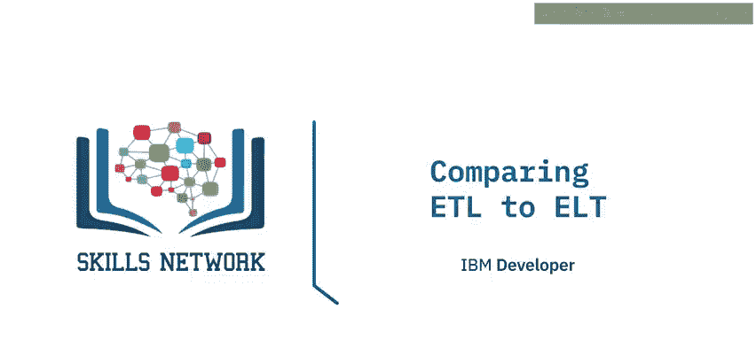

Welcome to comparing ETL and ELT After watching this video。

 you will be able to list key differences between ETL and ELT describe ELT as an evolution of ETL and describe the trending shift from ETL to ELT differences between ETL and ELT For one thing。

 the transformations happen in a different order， Transs for ETL pipelines take place within the data pipeline before the data reaches its destination whereas transformations for ELT are decoupled from the data pipeline and happen in the destination environment at will they also differ in flexibility in how they can be used ETL is normally a fixed process meant to serve a very specific function whereas ELT is flexible making data readily available for self-serve analytics they also differ in their ability to handle。

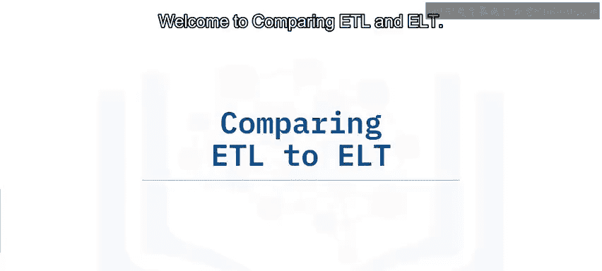

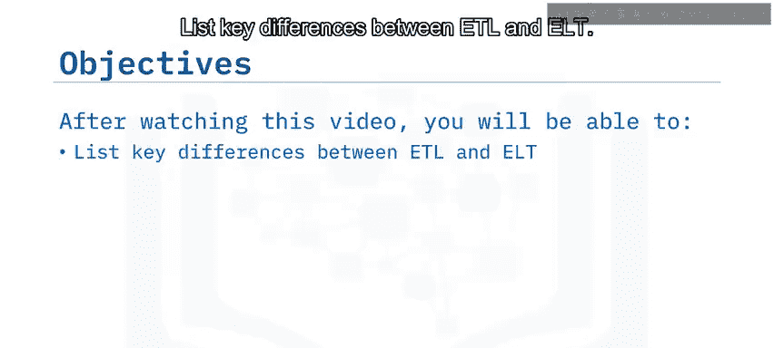

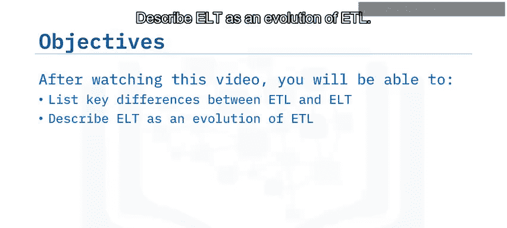

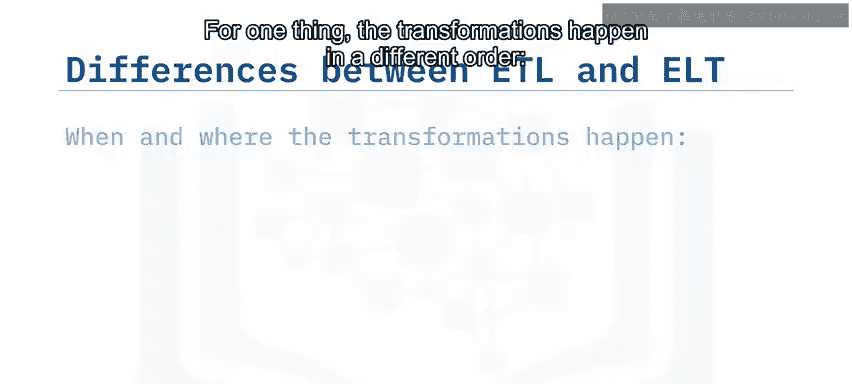

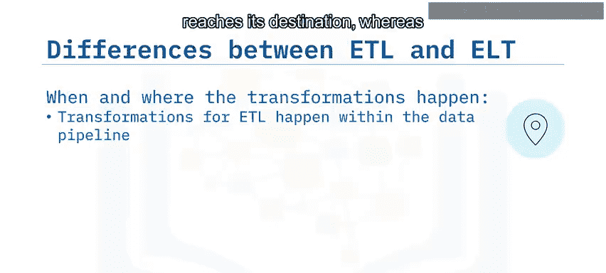

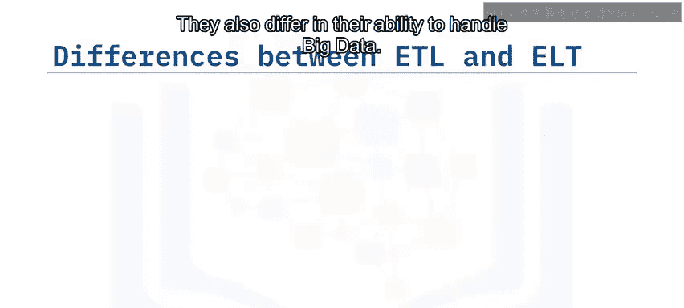

Big data ETL processes traditionally handle structured relational data and on premise computing resources handle the workflow。

 thus scalability can be a problem。 ELT， on the other hand。

 handles any kind of data structured and unstructured and to handle scalability problems posed by big dataT leverages the on demandmand scalability offered by cloud computing services With regard to data discovery and time to insight ETL pipelines take time and effort to modify。

 which means users must wait for the development team to implement the requested changes。

 ELT provides more agility with some training in modern analytics applications and users can easily connect to and experiment with the raw data create their own dashboards and run predictive models themselvesLT is a natural evolution of ET。

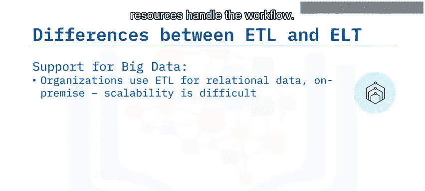

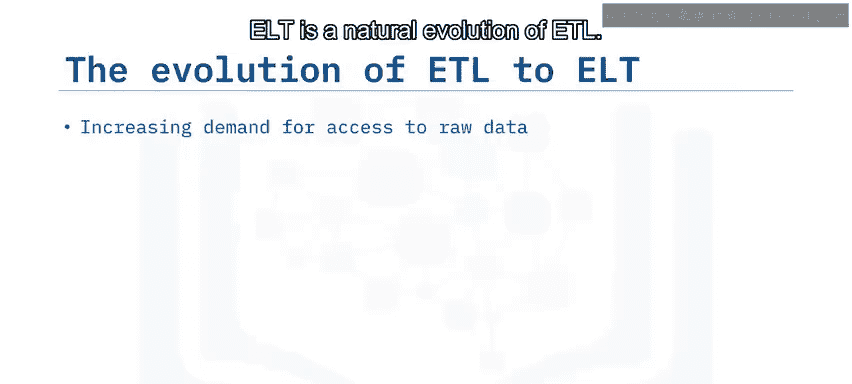

orsD that evolution is the demand to release raw data to a wider user base for the enterprise。

 Traditionally， ETL processes include an intermediate storage facility called a staging area。

 This is a holding area for raw extracted data where you can run processes prior to loading the resulting transform data into a data warehouse or a data Mart。

 This sounds a lot like an ELT process and the staging area fits the description of a data lake。

 which is a modern self-s repository for storing and manipulating raw data a traditional staging area。

 however， is not something that is usually shared across the company。

 It's a private siloed area set aside for developing。

 monitoring and performance tuning the data pipeline and it's built in transformations。

long with the ever increasing ease of use and connection capabilities of analytics tools raw data sources have become much more accessible。

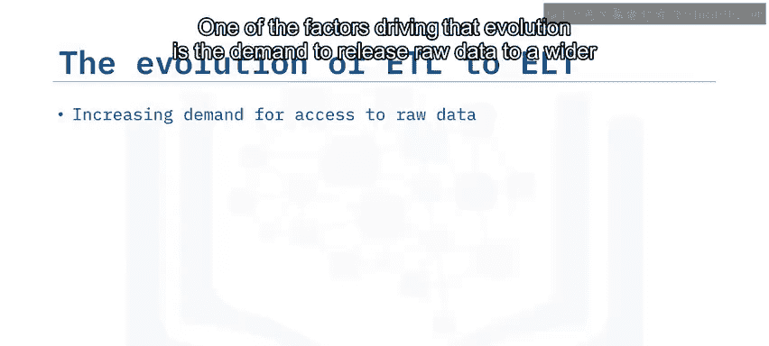

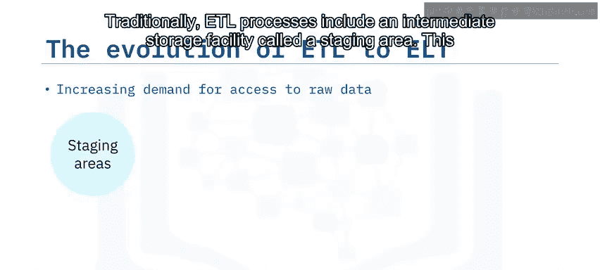

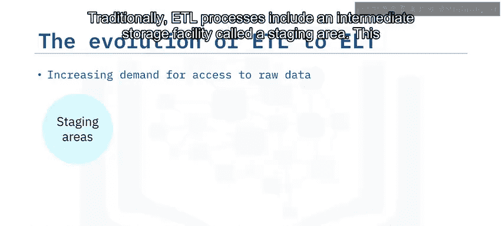

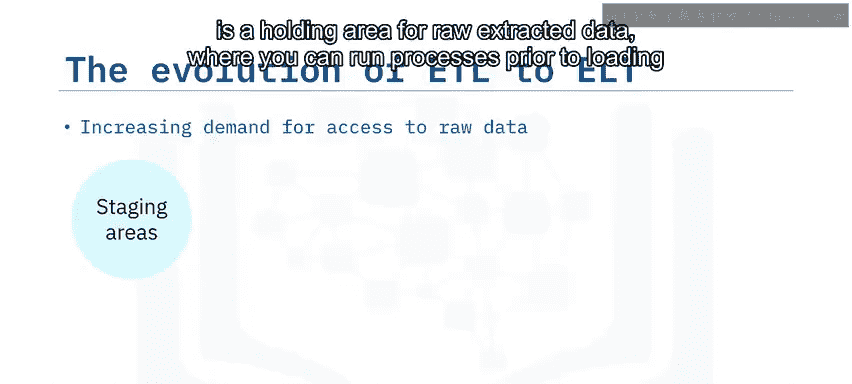

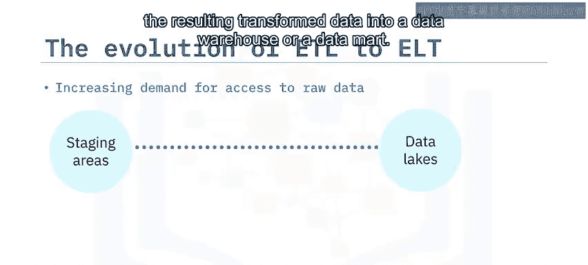

ableTo less technical end users According， the paradigm is shifting to self-service data platforms There is still a place for conventional ETL in developing data pipelines。

 so ETL is not disappearing any time soon。 however， there is a trend taking place。

 a trend which is favoring modern ELT over conventional ETL the trend is being driven by the pain points that ELT solves namely。

 the lengthy time to insight the challenges， for example， scalability imposed by big data。

 and the conventional siloed nature of data。

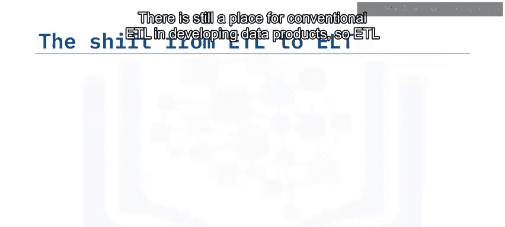

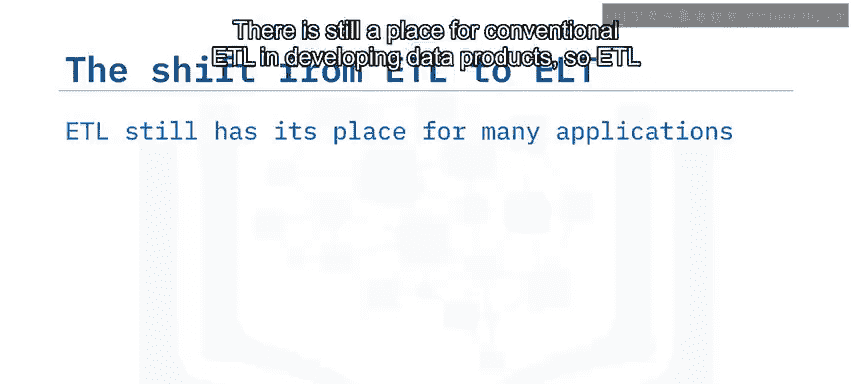

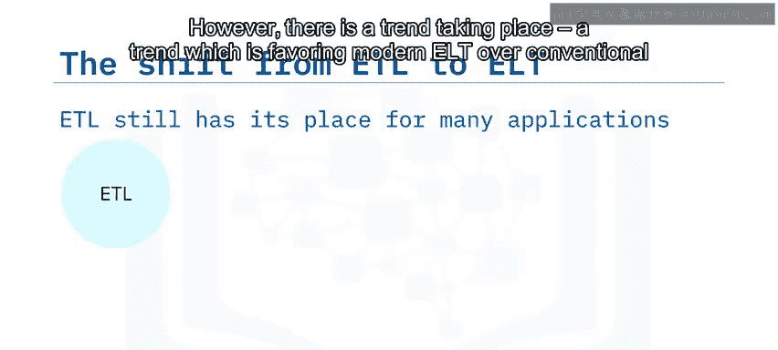

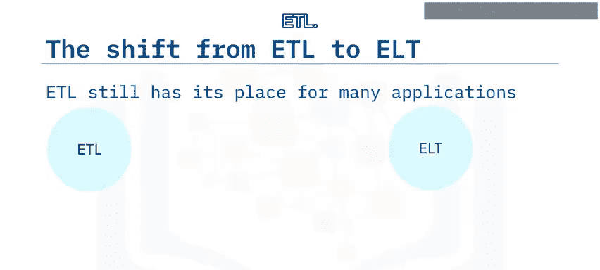

In this video， you learned that key differences between ETL and ELT are the location where the transformation takes place。

 flexibility， big data support and time to insight。

 one of the factors driving the evolution from ETL to ELT is the demand to release raw data to a wider user base for the enterprise conventionalional ETL has many applications and still has its place。

 and ELT is more flexible than ETL enabling end users to perform ad hoc self-service data analytics in real time。

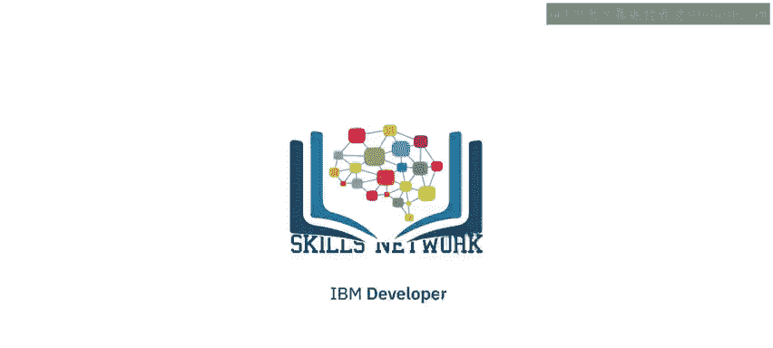