# IBM数据工程专业证书课程8：《使用Shell、Airflow和Kafka的ETL和数据管道课程（IBM）》｜etl-and-data-pipelines - P6：5_介绍数据转换技术.zh_en - GPT中英字幕课程资源 - BV1Q94y1r7YG

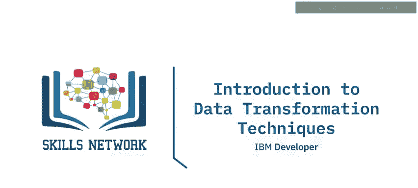

Welcome to Introduction to Data transformationform Techns。

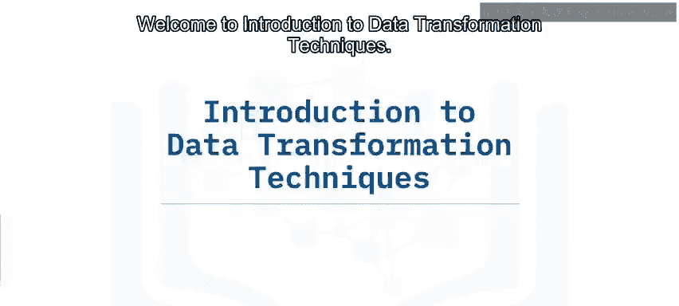

After watching this video， you will be able to name data transformation techniques。

 compare schema on right versus schema on Read， and list ways information can be lost in transformation。

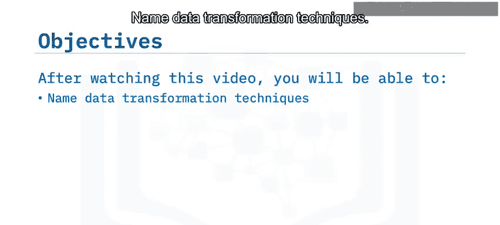

Data transformation is mainly about formatting the data to suit the application This can involve many kinds of operations such as data typing。

 which involves casting data to appropriate types such as integer， float， string。

 object and category， data structuring， which includes converting one data format to another。

 such as JSON， XML or CSV to database tables， as well as anonymizing and encrypting transformations to help ensure privacy and security。

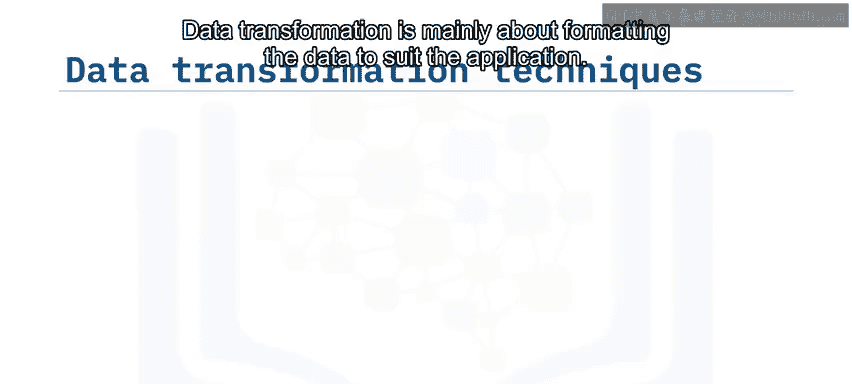

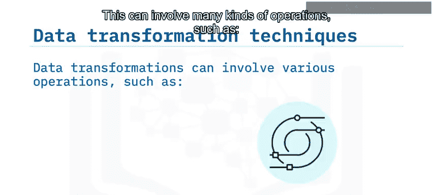

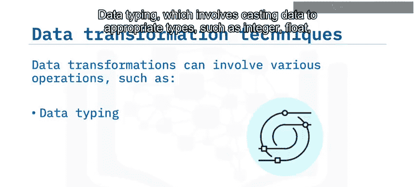

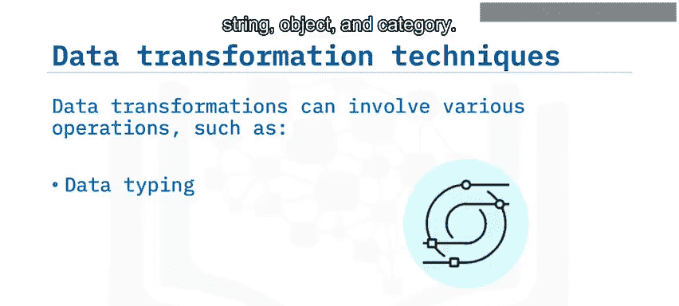

Other types of transformations include cleaning operations for removing duplicate records and filling missing values。

 normalizing data to ensure units are comparable， for example， using a common currency， filtering。

 sorting， aggregating and binning operations for accessing the right data at a suitable level of detail and in a sensible order。

 and joining or merging disparate data sources。

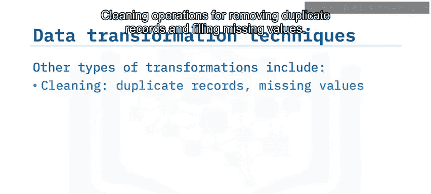

Schema on right is the conventional approach used in ETL pipelines where the data must be conform to a defined schema prior to loading to a destination such as a relational database。

 The idea is to have the data consistently structured for stability and for making subsequent queries much faster。

 but this comes at the cost of limiting the versatility of the data。

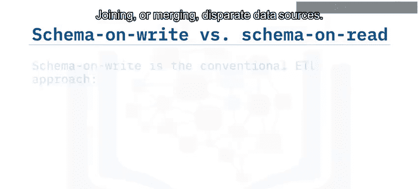

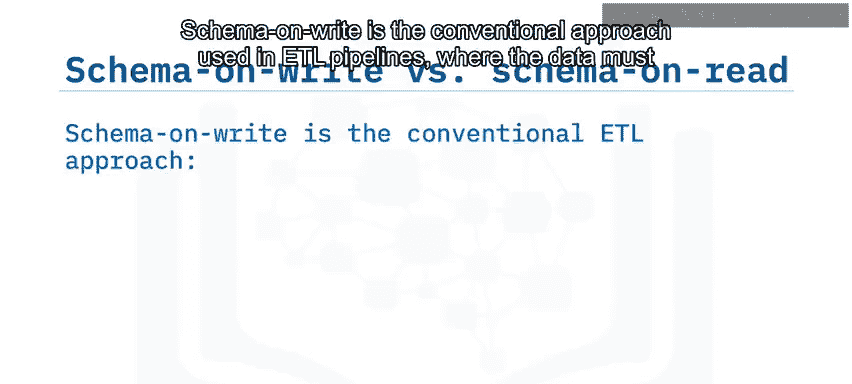

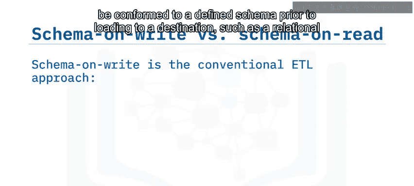

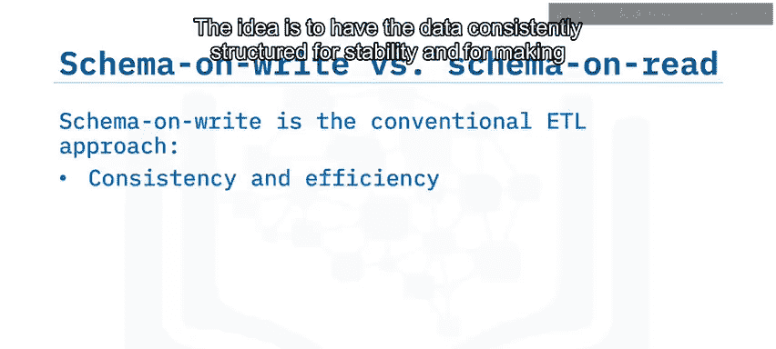

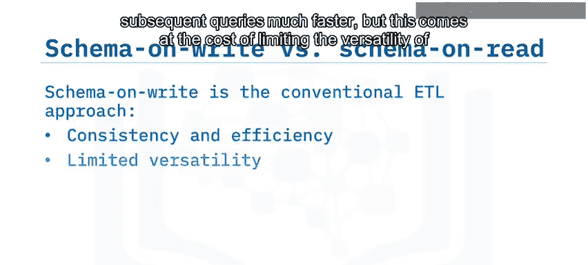

Schema on read relates to the modern ELT approach where the schema is applied to the raw data after reading it from the raw data storage。

 This approach is versatile since it can obtain multiple views of the same source data using ad hoc schemas Use potentially have access to more data since it does not need to go through a rigorous preprocessing step。

Whether intentional or accidental， there are many ways in which information can be lost in transformation we can visualize this loss as follows raw data is normally much bigger than transform data since data usually contains noise and redundancy。

 we can illustrate the information content of data as a proper subset of the data correspondingly we can see that shrinking the data volume can also mean shrinking the information content。

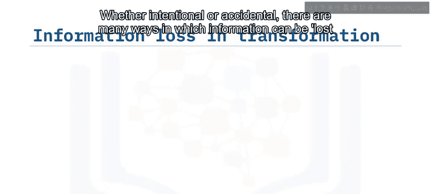

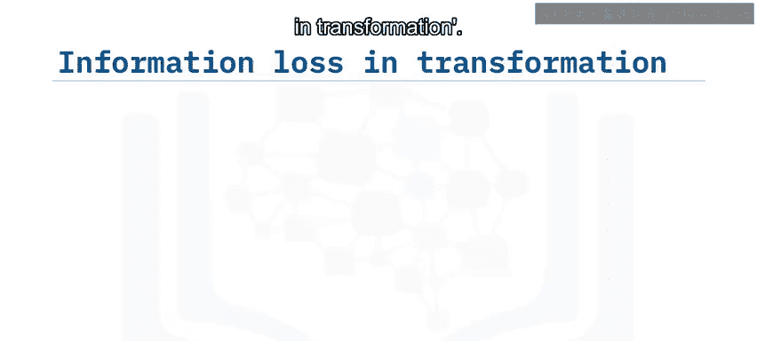

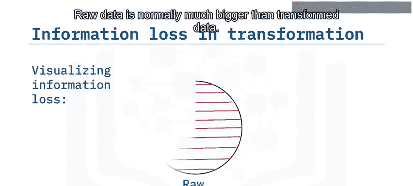

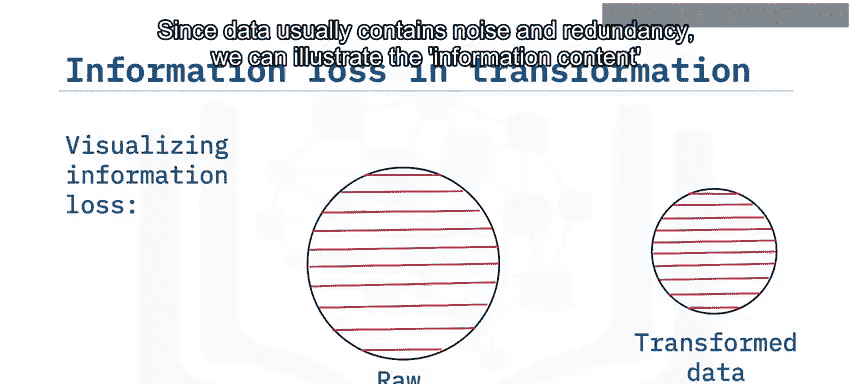

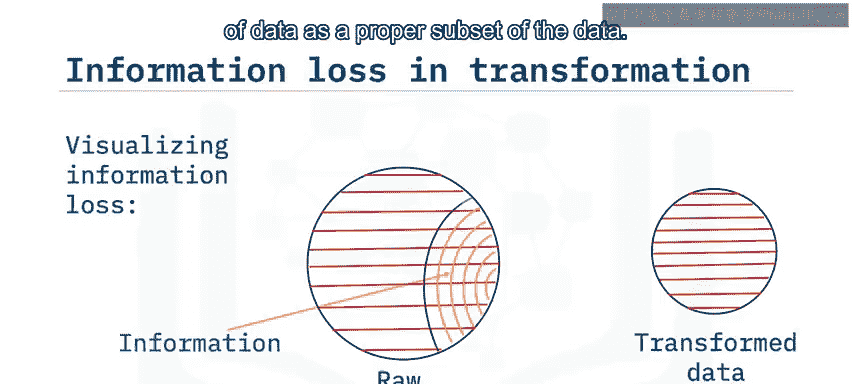

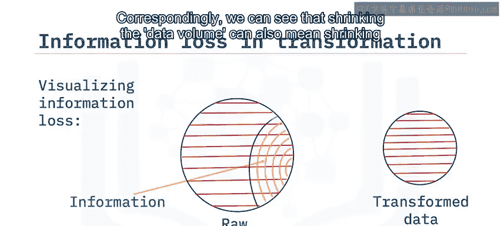

Either way， for ETL processes， any lost information may or may not be recoverable， whereas with ELT。

 all the original information content is left intact because the data is simply copied over as is。

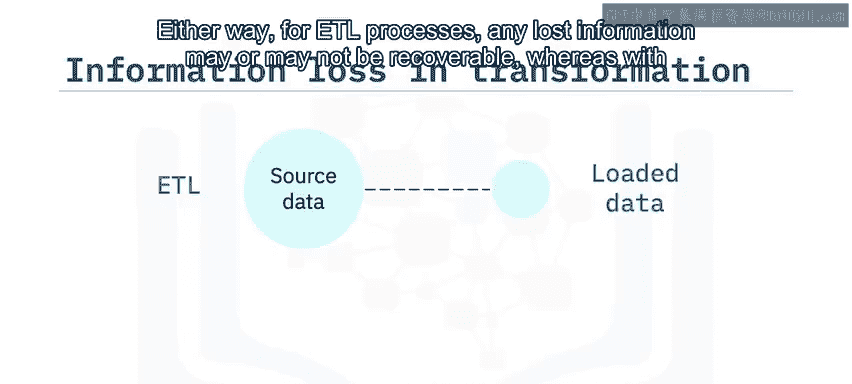

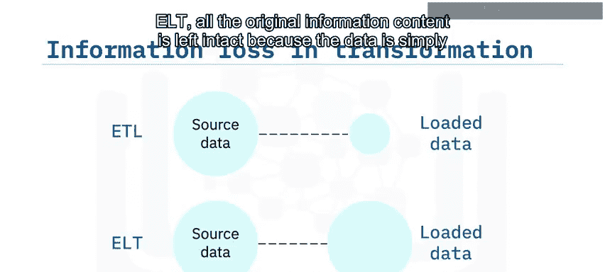

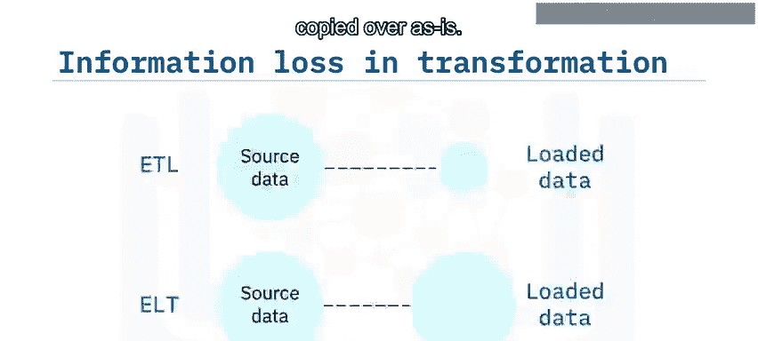

Examples of ways information can be lost in transformation processes include lossy data compression。

 for example， converting floating point values to integers， reducing bit rates on audio or video。

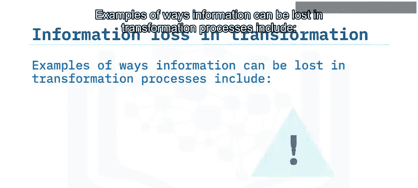

Filtering for example， filtering is usually a temporary selection of a subset of data。

 but when it is permanent， information can easily be discarded。Aggregation for example。

 average yearly sales versus daily or monthly average sales and edge computing devices， for example。

 false negatives in surveillance devices designed to only stream alarm signals， not the raw data。

In this video， you learned that data transformation is generally about formatting data to suit the needs of the intended application Common transformation techniques include typing。

 structuring， normalizing， aggregating and cleaning。

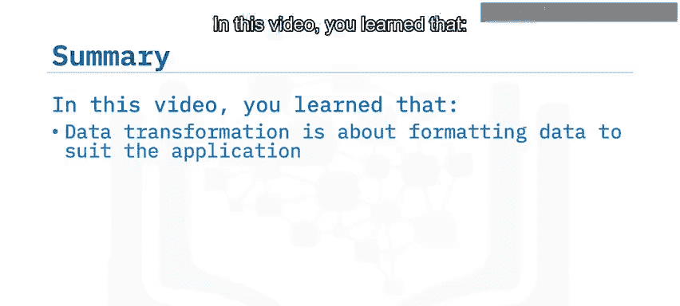

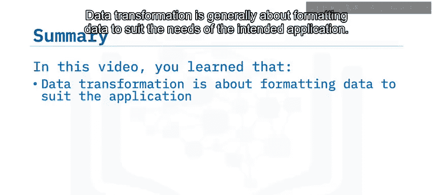

Schema on right is the conventional approach used in ETL pipelines。

 and schema on Read relates to the modern ELT approach and finally ways of losing information in transformation processes include filtering。

 aggregation， using edge computing devices and lossy data compression。

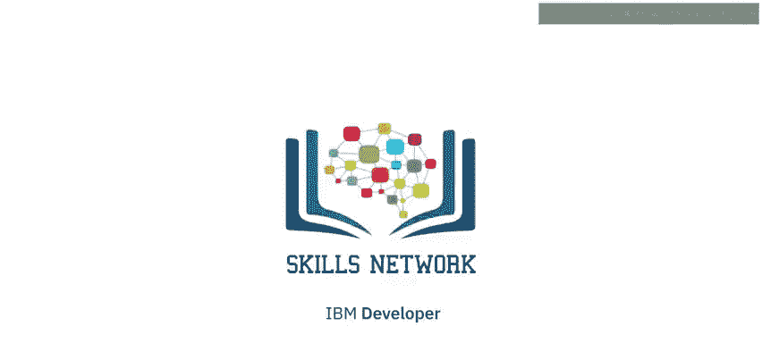