# IBM数据工程专业证书课程8：《使用Shell、Airflow和Kafka的ETL和数据管道课程（IBM）》｜etl-and-data-pipelines - P7：6_数据加载技术.zh_en - GPT中英字幕课程资源 - BV1Q94y1r7YG

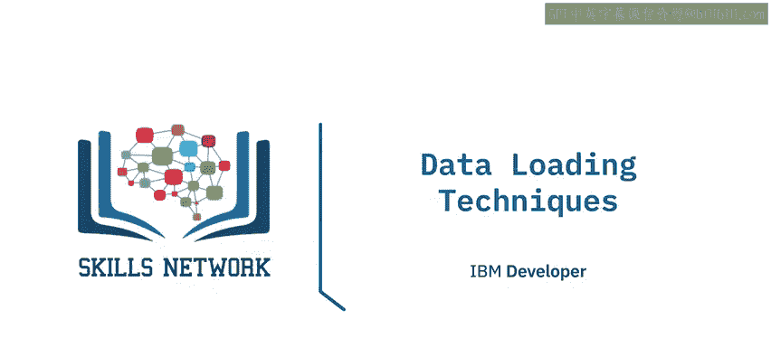

Welcome to data loading techniquess After watching this video。

 you will be able to list data loading techniques， differentiate batch loading from stream loading。

 explain push versus poll and describe parallel loading。

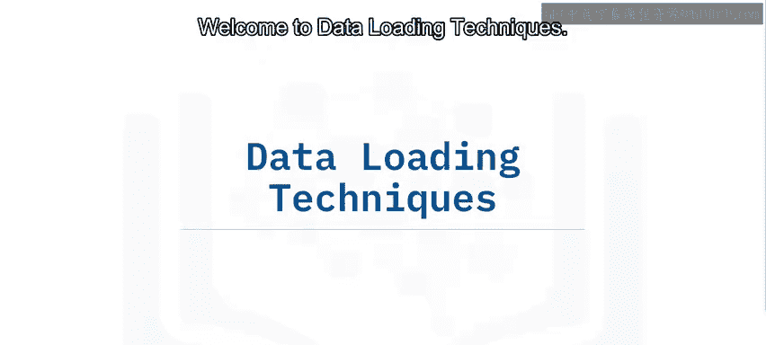

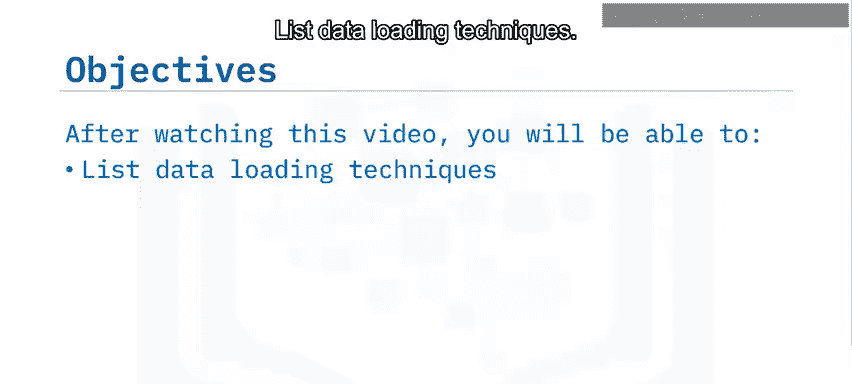

There are many techniques for loading data， some of which are full loading。

 you can load an initial history into a database， after which incremental loading is applied to insert new data or to update already loaded data you can schedule data loading to occur on a periodic basis or you can loaded as required on demand Data can also be loaded in batches or it can be streaming continuously to its destination。

 the data can be either pushed to a server or pushed to clients by a server and data is usually loaded serially。

 but it can also be loaded in parallel。

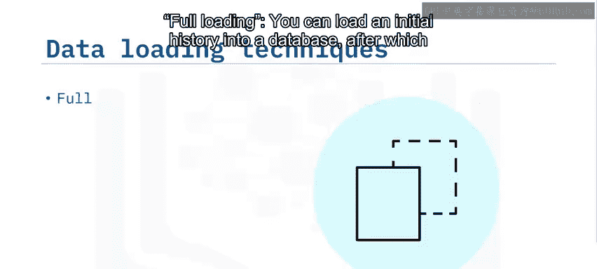

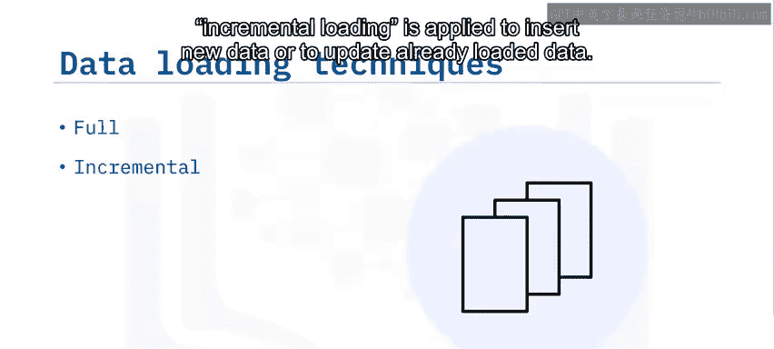

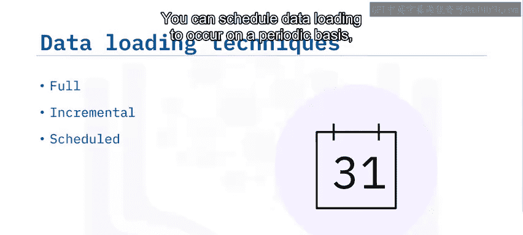

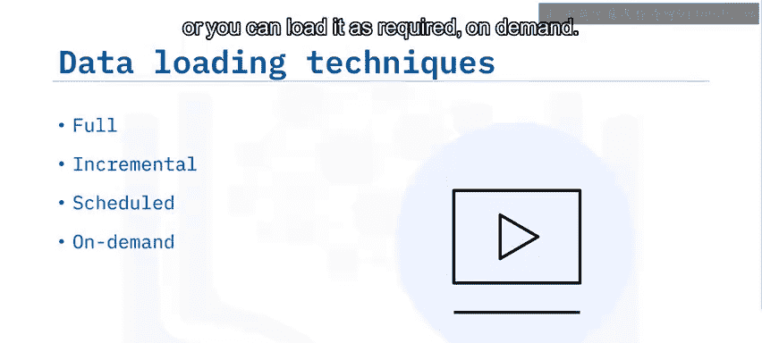

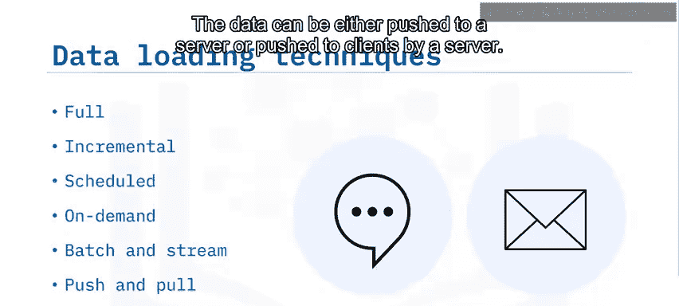

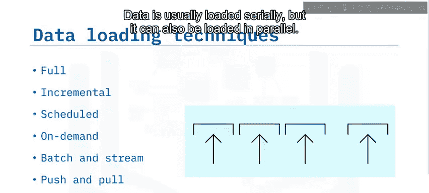

Full loading refers to loading data in one large batch This is used， for example。

 when organizations want to start tracking transactions in a new data warehouse and they copy the existing transaction history from the old to the new system then it's a matter of incrementally loading transactions as they arise thus ensuring the transaction history is tracked with incremental loading。

 the target data store is appended to， such that only the changes are loaded。

 this is useful for accumulating historical data such as transactions。

 whether and browsing history the volume， velocity and demand for the data determine whether the data is loaded in batches or streamed live。

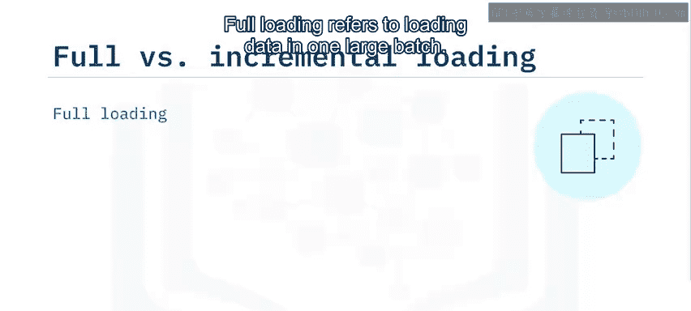

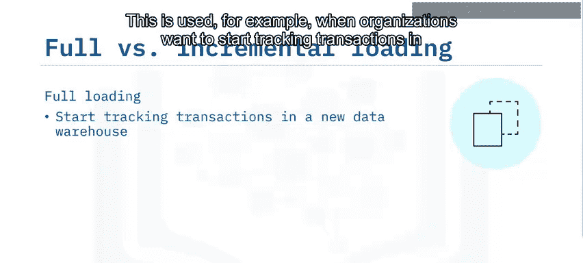

Data loading processes can be scheduled or initiated on demand data is often loaded on a schedule for example。

 daily point of sale transactions can be loaded into a database at the end of each day during off peakak hours。

 loading tasks can be scheduled with tools such as Windows task scheduler or with Chroron on UniX like systems onded loading is also very common and relies on triggering mechanisms such as when the source data reaches a specified size。

 when an event is detected by the source system such as motion。

 sounds or temperature changes or when a user requests data such as online videos。

 music or web pages。

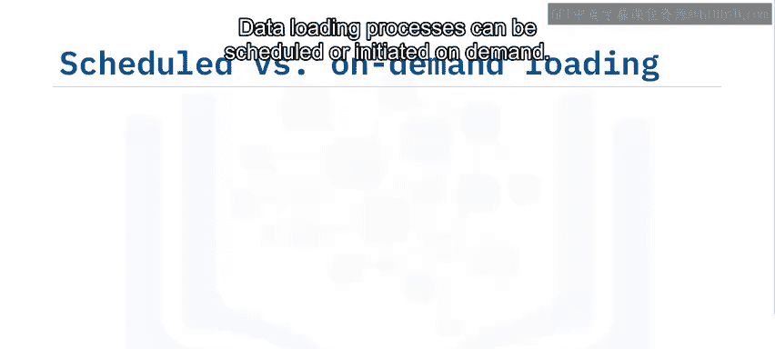

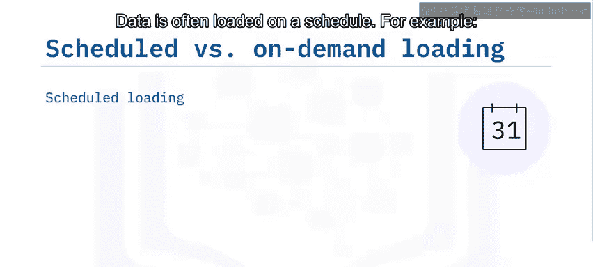

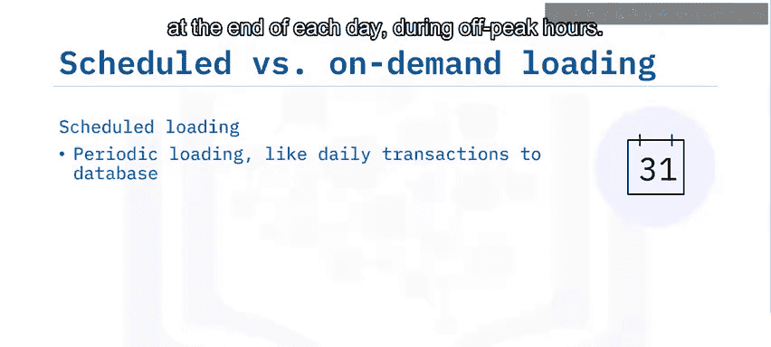

Batch and stream data loading are two ends of a spectrum of loading methods batchch loading refers to loading data in chunks defined by some time windows of data accumulated by the data source usually on the order of hours to days at the other end of the spectrum。

 we have stream loading， which loads data in real time as it becomes available。

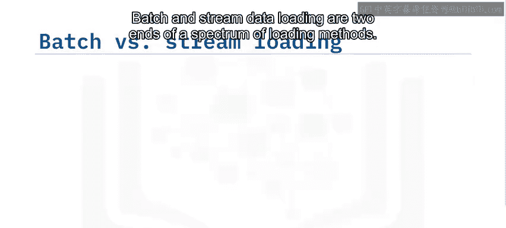

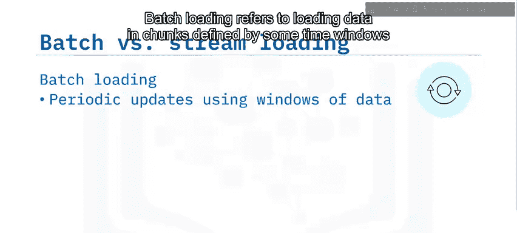

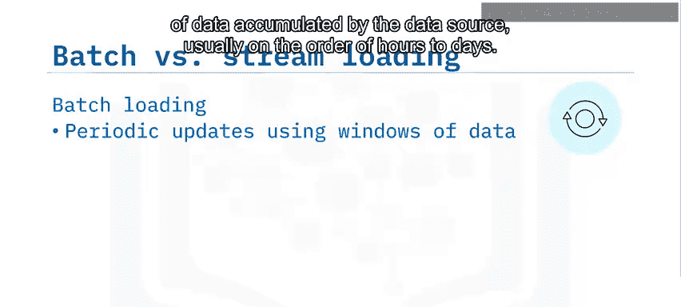

In between batch and stream loading， we have microcro batchch loading this is used when eminent processes need access to a small window of recent data。

Push and pull data loading methods are based on a client's server model A poll refers to a client initiating a request for data from a server The server then responds to the client's request and delivers the data Exles of pull technologies include RSS feeds and email with push technologies the client subscribes to a service provided by a server so that the server can then push the data to the client as it becomes available Exles include push notifications and instant messaging services。

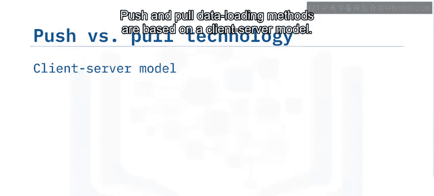

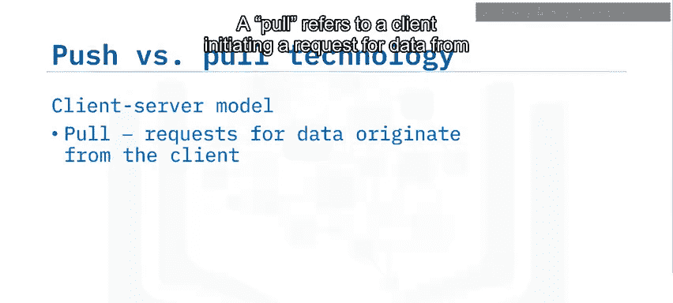

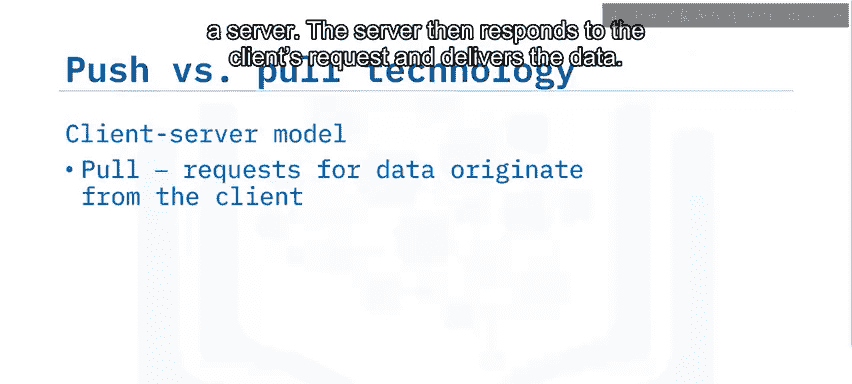

Paraallel loading can be employed on multiple data streams to boost loading efficiency。

 particularly when the data is big or has to travel long distances。

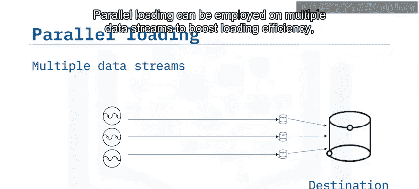

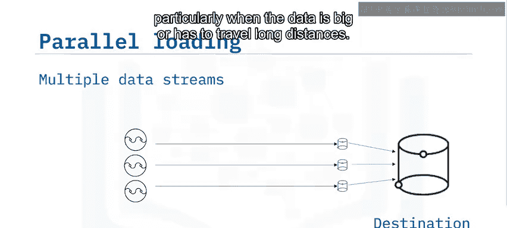

Similarly， by splitting a single file into smaller chunks。

 the chunks can then be loaded simultaneously。

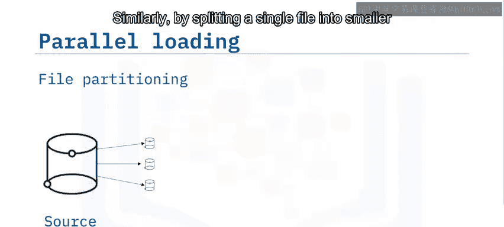

In this video， you learned that some data loading techniques are scheduled on demand and incremental data can be loaded in batches or it can be streamed continuously into its destination Servers can push data to subscribers as it becomes available Cl can initiate pull requests for data from servers。

 and you can employ parallel loading to boost loading efficiency of large volumes of data。

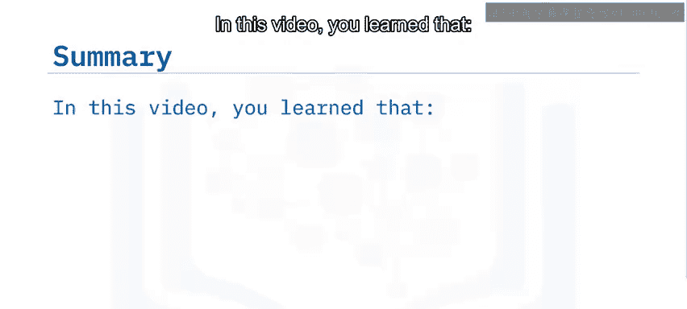

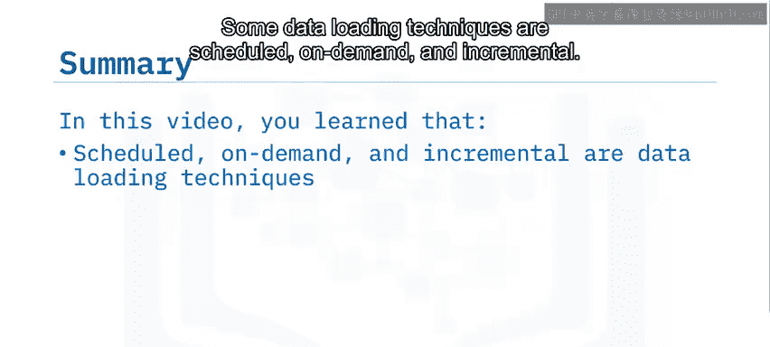

