# IBM数据工程专业证书课程8：《使用Shell、Airflow和Kafka的ETL和数据管道课程（IBM）》｜etl-and-data-pipelines - P8：7_使用 shell 脚本进行 etl.zh_en - GPT中英字幕课程资源 - BV1Q94y1r7YG

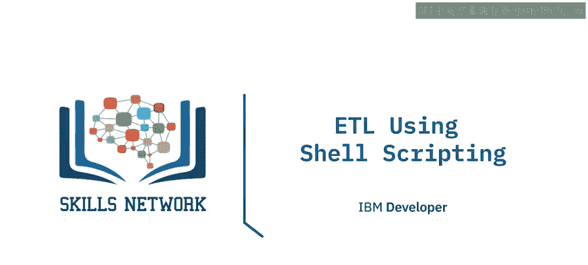

Welcome to ETL U Shell scripting。

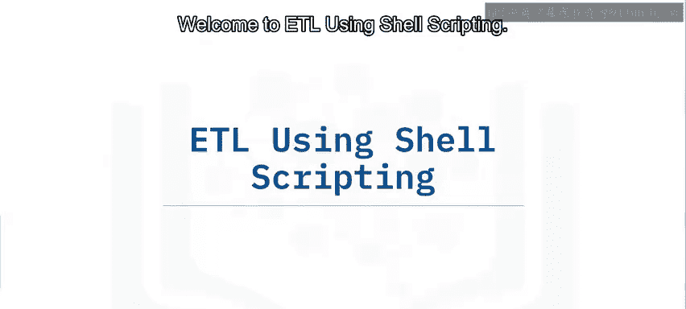

After watching this video， you will be able to describe how Shell scripting can be used to implement an ETL pipeline and explain how ETL scripts or tasks can be scheduled。

Imagine a scenario that you have been tasked with， reporting the hourly average minimum and maximum temperatures from a remote sensor that supplies the temperature on demand and feeding the results to a dashboard every minute you are given APIs that read the temperature and print it to standard output and load the stats to a repository which is available to a reporting tool such as a dashboard here is an outline of how this can be achieved using bash scripting。

Let's sketch the workflow for your ETL pipeline starting with the weather station and its data interface The extraction step involves obtaining a current temperature reading from the sensor using the supplied GetTemp API you can append the reading to a log file。

 say temperature。 log， Since you will only need to keep the most recent hour of readings。

 buffer the last 60 readings and then just overwrite the log file with the buffered readings。Next。

 call a program， for example， a Python script called get stats。pi。

 which calculates the temperature stats from the 60 minute log and loads the resulting stats into the reporting system using the load stats API The stats can then be used to display a live chart showing the hourly min。

 max and average temperatures you will also want to schedule your workflow to run every minute。

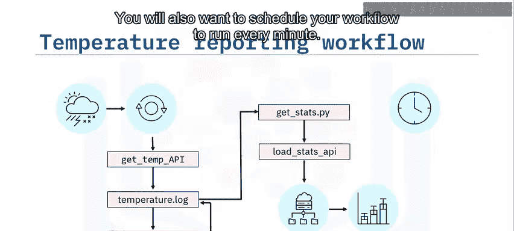

Start by creating a shell script called temperatureature_ El。shH。

 you can create the file by using the touch command。

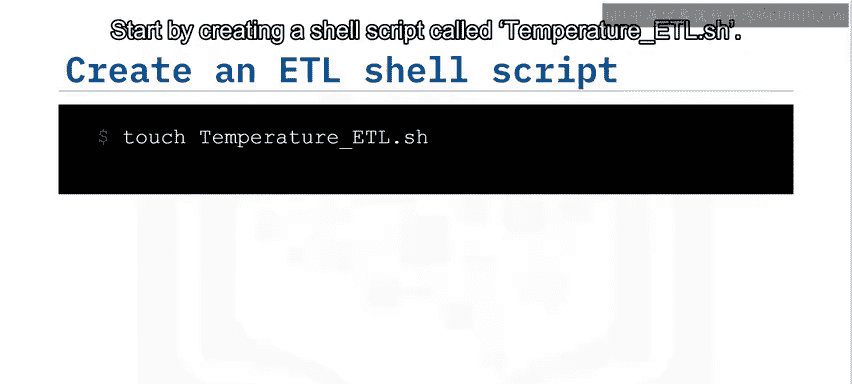

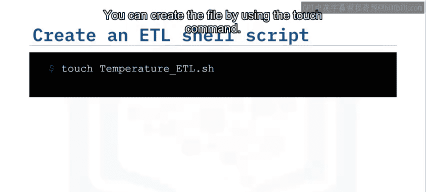

Next， open the file with any text editor such as G Ed in the editor。

 type in the ba Shaang to turn your file into a bash shellll script Now you can add the following comments to help outline your tasks。

 extract a temperature reading from the sensor using the supplied get tempemp API。

 append the reading to a log file， say temperature log。

 you only need to keep the most recent hour of readings， so buffer the last 60 readings。

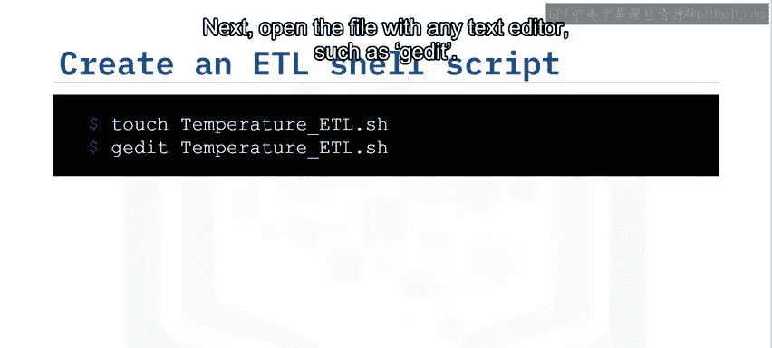

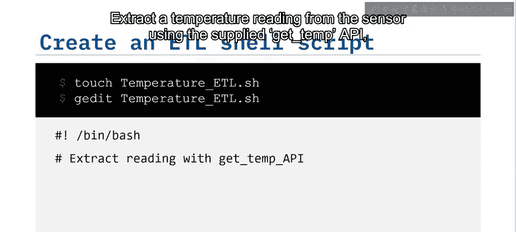

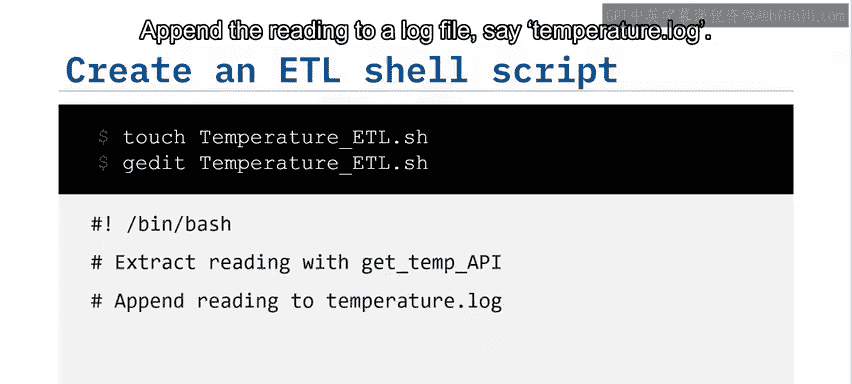

Call a program， say a Python script called get stats。pi。

 which calculates the temperature stats from the 60 minute log and load the resulting stats into the reporting system using the supplied API。

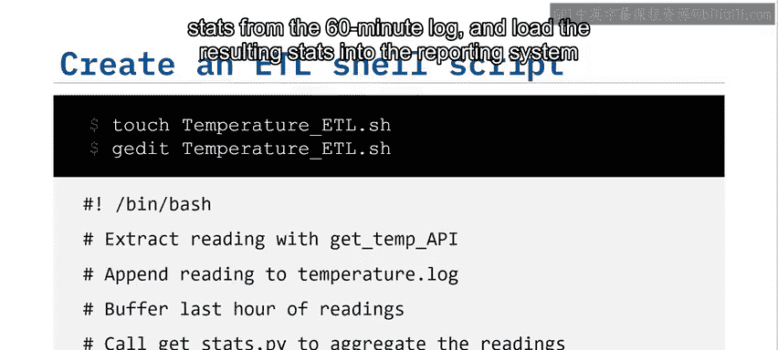

After you finish writing the ETL Bsh script， you will need to schedule it to run every minute。

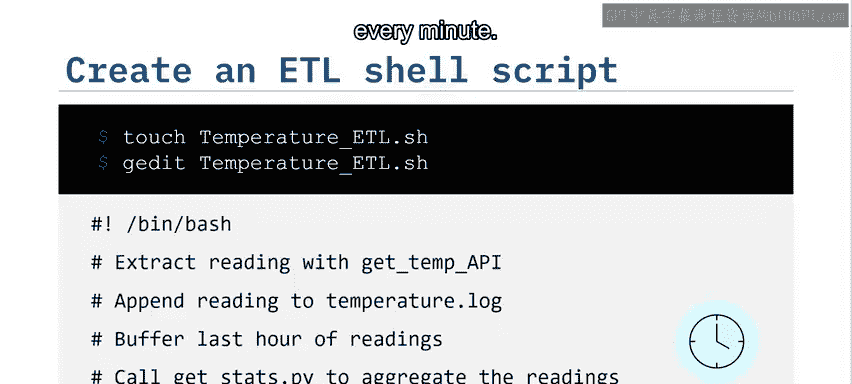

Now you can fill in some details for your task comments。

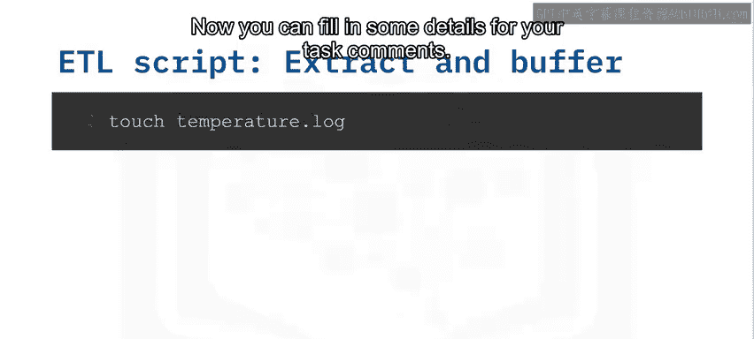

Start by initializing your temperature log file on the command line with the To command。

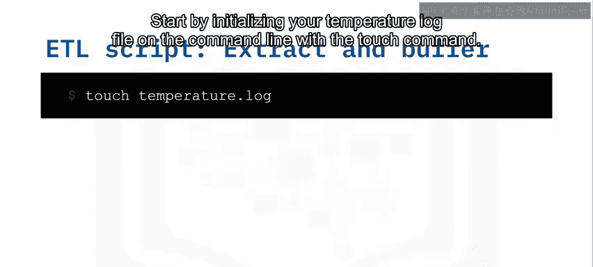

In the text editor， enter a command to call the API to read a temperature and append the reading to the temperature log Now。

 just keep the last hour or 60 lines of your log file by overriding the temperature log with its last 60 lines。

 This completes the data extraction step。

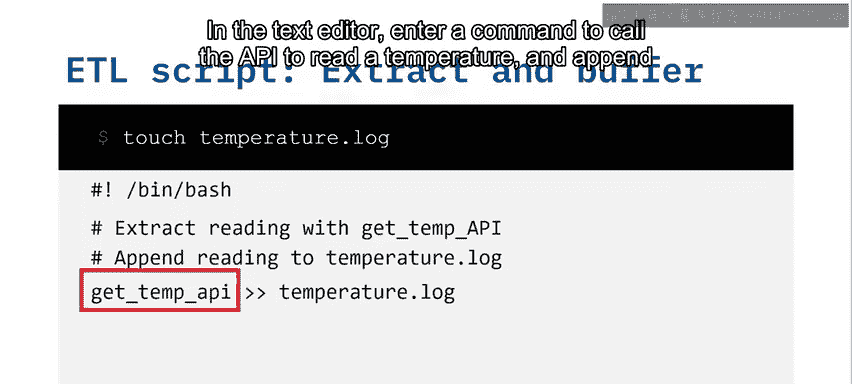

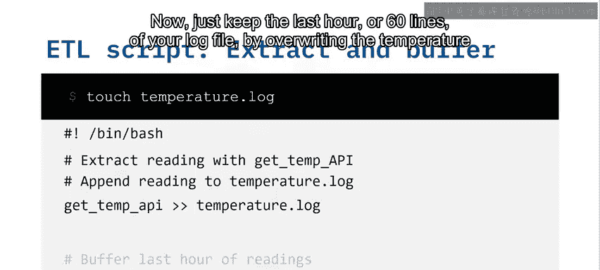

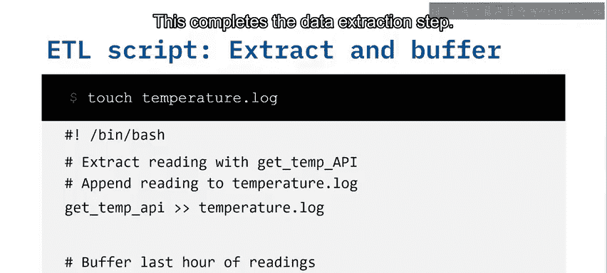

Suppose you have written a Python script called gettts。pi， which reads temperatures from a log file。

 calculates the temperature stats， and writes the results to an output file so that the input and output file names are specified as command line arguments。

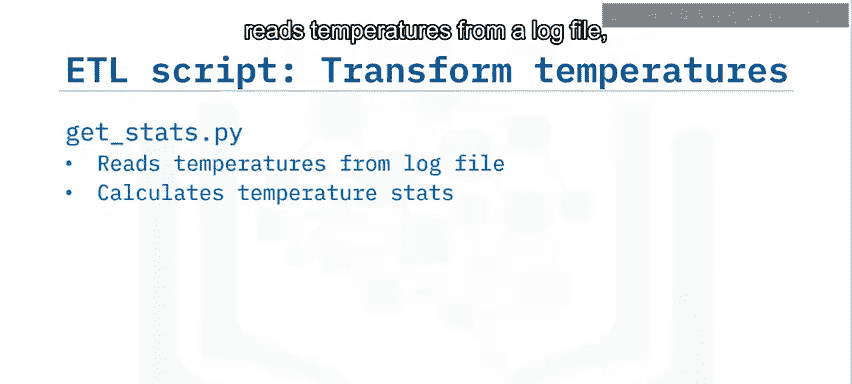

You can add the following line to your ETL script， which calls Python 3 and invokes your Python script gettts。

pi， using the readings in temperature。logg and writes the temperature stats to a CSv file called temperaturetatts。

csv。This completes the transformation component of your ETL script。Finally。

 you can load the resulting stats into the reporting system using the supplied API by calling the API and specifying the temperature stats CSV as a command line argument。

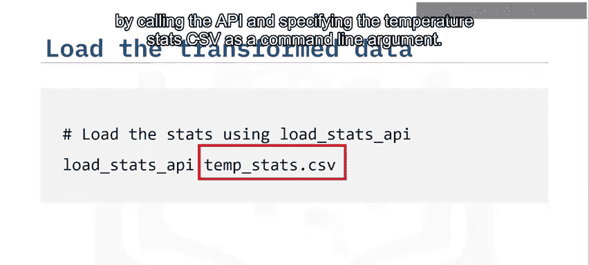

Next， don't forget to set permissions to make your She script executable。

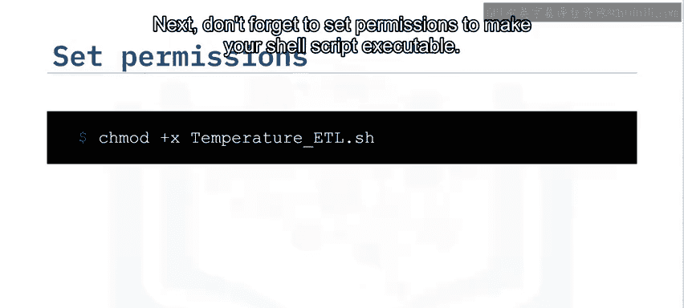

Now it's time to schedule your ETL job， open the Crron tab editor。

 schedule your job to run every minute of every day， close the editor and save your edits。

 Your new ETL job is now scheduled in running in production。

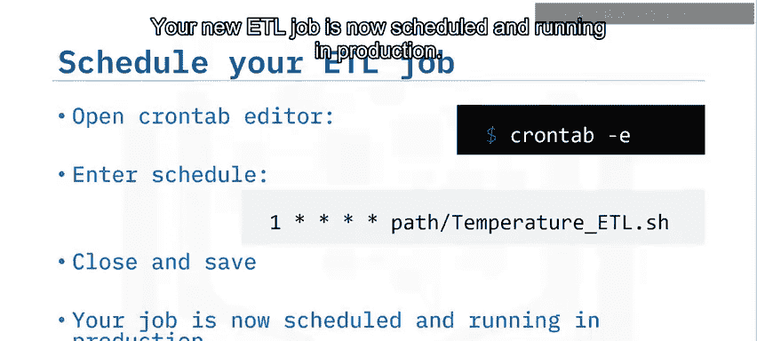

In this video， you learned that ETL pipelines can be built from basic Bsh scripts and an ETL job can be scheduled to run by creating a Crme job for your Bsh script。

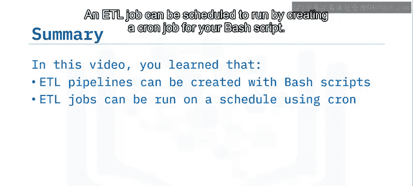

