# IBM数据工程专业证书课程8：《使用Shell、Airflow和Kafka的ETL和数据管道课程（IBM）》｜etl-and-data-pipelines - P9：8_数据流水线简介.zh_en - GPT中英字幕课程资源 - BV1Q94y1r7YG

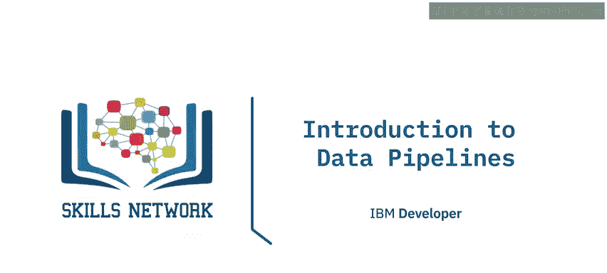

Welcome to Introuction to Data Pipelines。

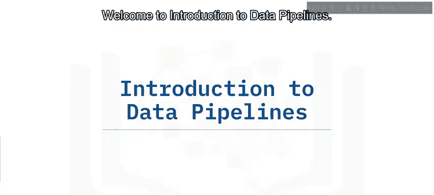

After watching this video， you will be able to define what a pipeline is。

 describe data pipeline performance in terms of latency and throughput。

 and give examples of data pipeline use cases。

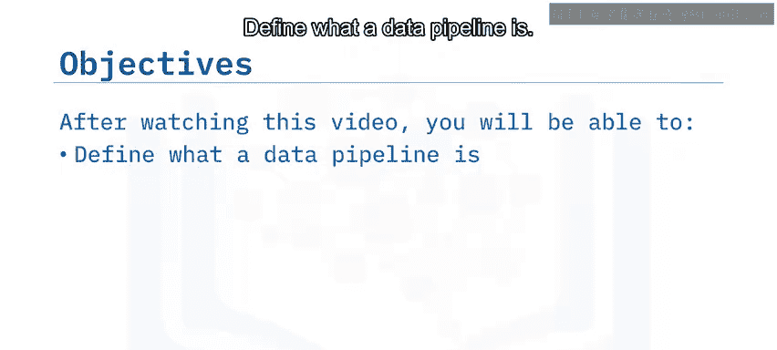

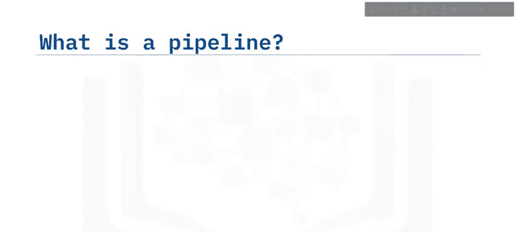

The concept of a pipeline applies broadly to any set of processes that are connected to each other sequentially。

 This means that the output of one process is passed along as input to the next process in a chain。

 For example， one way to move boxes from one place to another is to have a chain of friends each passing the boxes one by one up the line to the nearest friend。

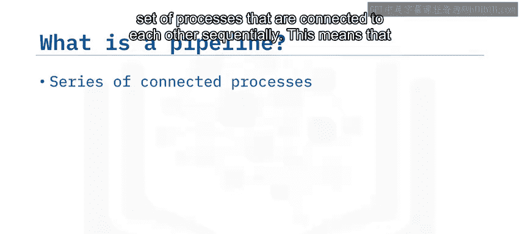

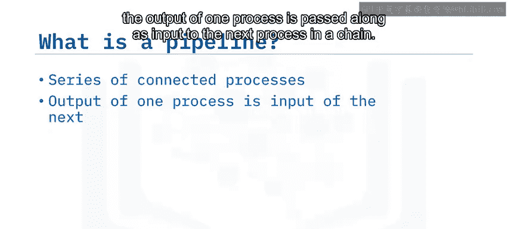

Each friend is a processor whose function is identical。 get a box。

 pass a box mass production is similar， but transformations may differ from stage to stage。

Data pipelines are pipelines that specifically move or modify data the purpose of a data pipeline is to move data from one place or form to another a data pipeline is a system which extracts data and passes it along to optional transformation stages for final loading。

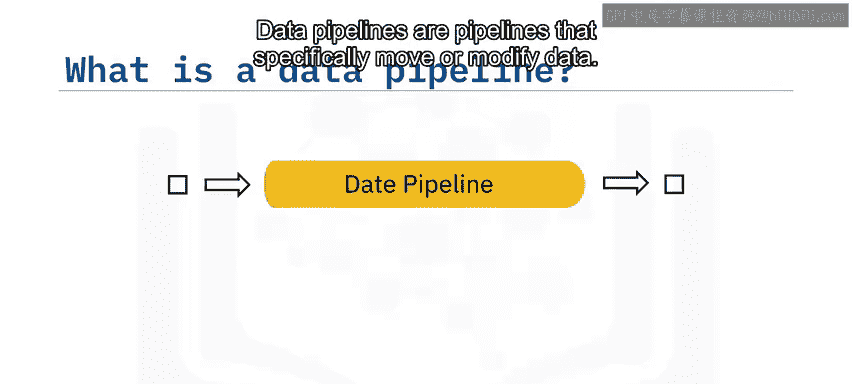

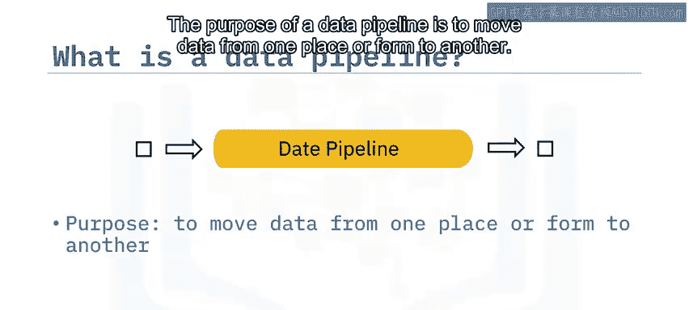

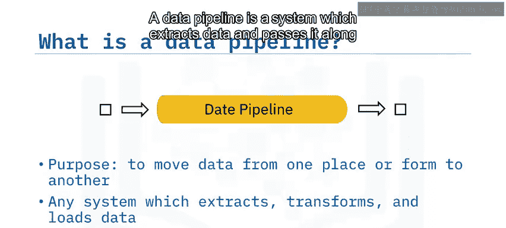

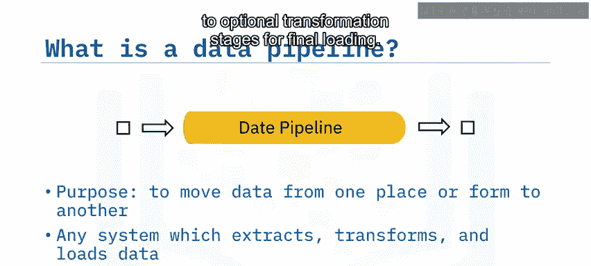

This includes lowlevel hardware architectures， but our focus here is on data pipelines as architectures driven by software processes。

 such as commands， programs and processing threads the simple bash pipe command in Linux can be used as the glue that connects such processes together。

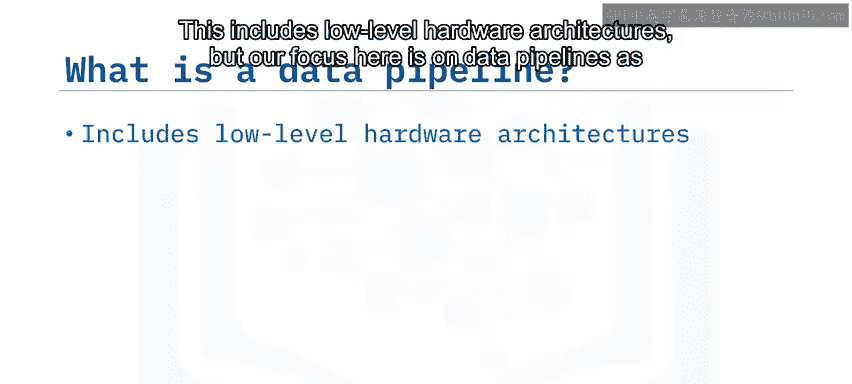

We can think of data flowing through a pipeline in the form of data packets。

 a term which we will use to broadly refer to units of data packets can range in size from a single record or event to large collections of data here we have data packets queued for ingestion to the pipeline。

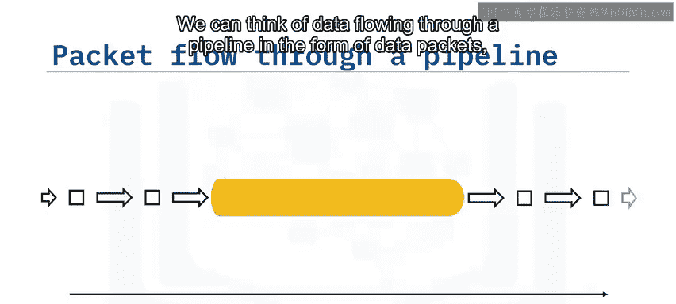

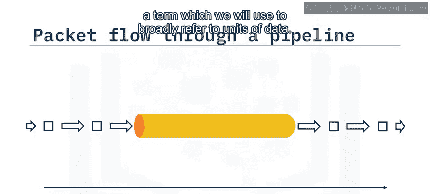

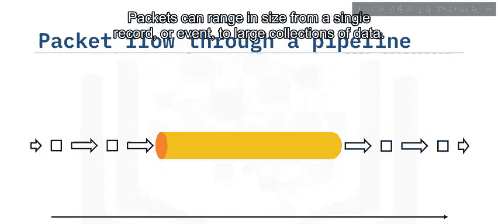

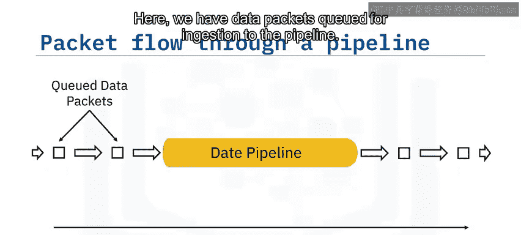

The length of the data pipeline represents the time it takes for a single packet to traverse the pipeline。

 the arrows between packets represent the throughput delays or the times between successive packet arrivals。

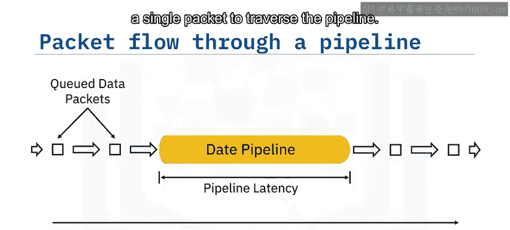

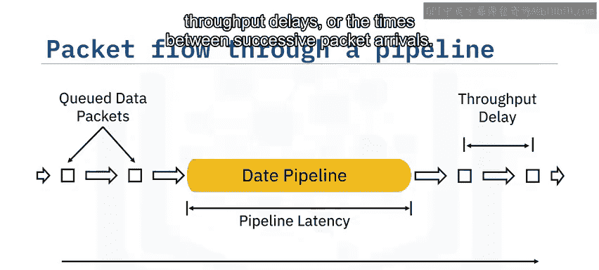

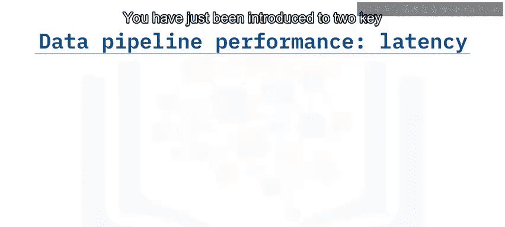

You have just been introduced to two key performance considerations regarding data pipelines。

 the first is latency， which is the total time it takes for a single packet of data to pass through the pipeline。

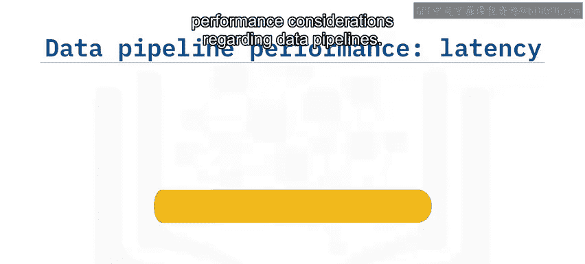

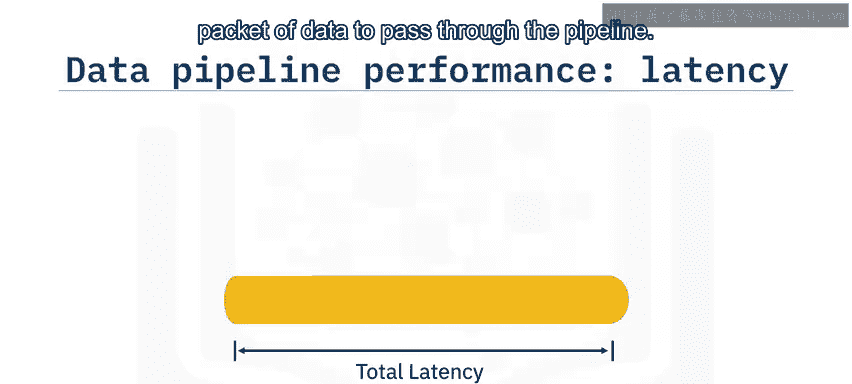

Equivalently， latency is the sum of the individual time spent during each processing stage within the pipeline。

 thus， overall latency is limited by the slowest process in the pipeline。

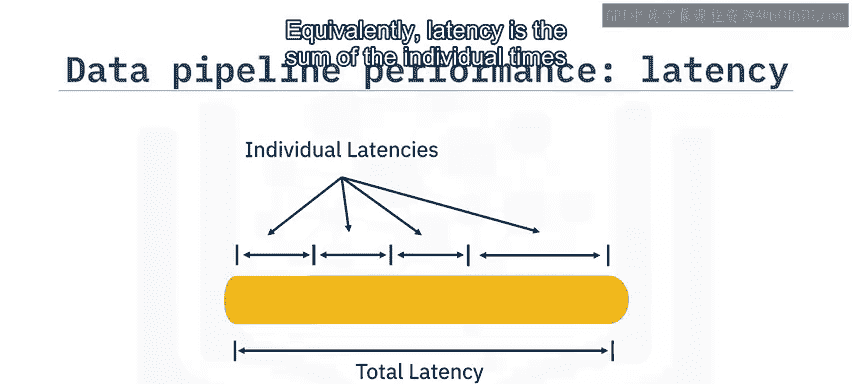

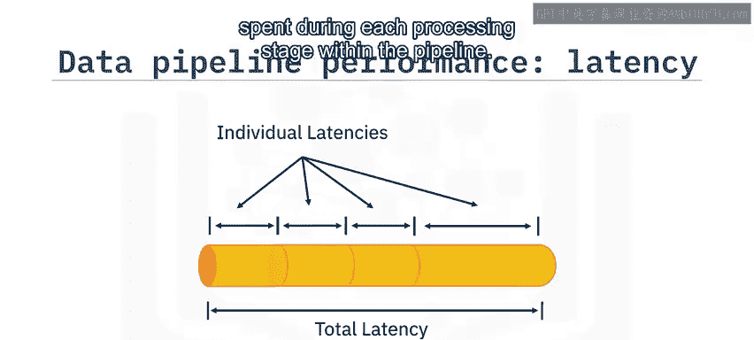

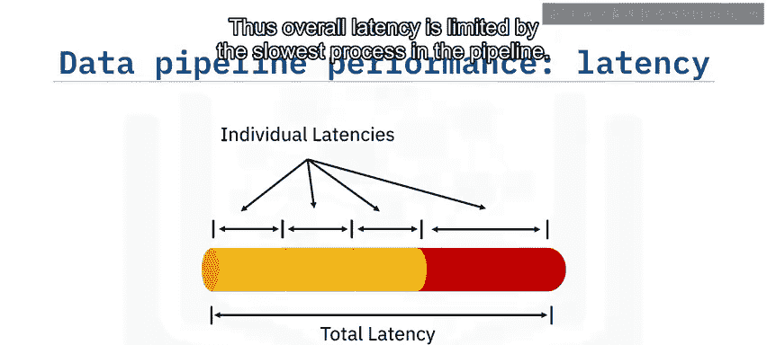

For example， no matter how fast your internet service is。

 the time it takes to load a webage will be decided by the server speed。

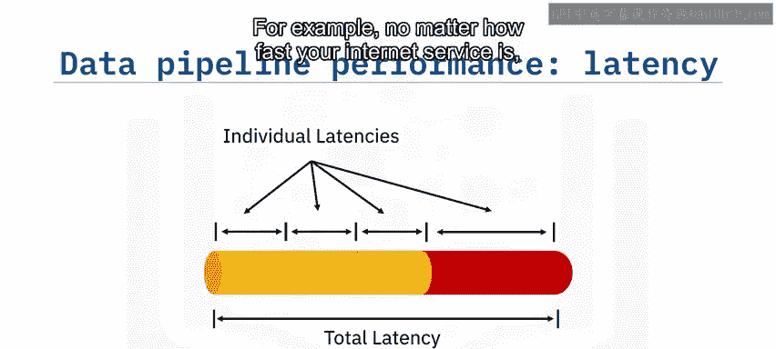

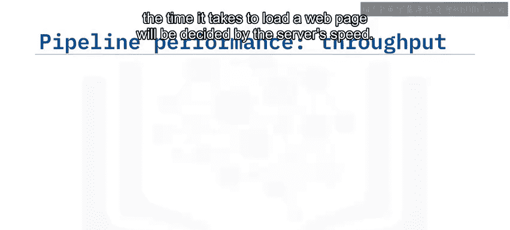

The second performance consideration is called throughput。

 it refers to how much data can be fed through the pipeline per unit of time。

 processing larger packets per unit of time increases throughput。

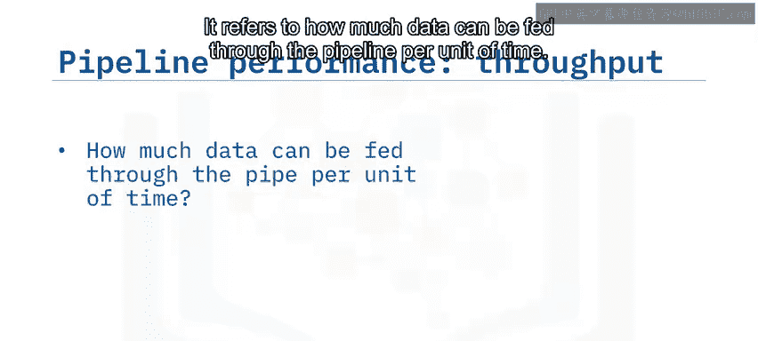

Coming back to our example of having a chain of friends passing boxes from one to another。

 we can see in the right image within limits that passing bigger boxes can increase productivity。

Let's list a few of the applications of data pipelines from the multitude of use cases。

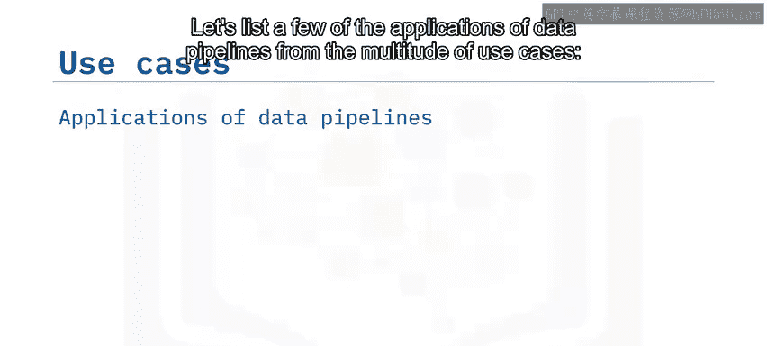

The simplest pipeline is one which has no transformations and is used to copy data from one location to another as in file backups。

 integrating disparate raw data sources into a data lake。

 moving transactional records to a data warehouse， streaming data from IoT devices to make information available in the form of dashboards or alerting systems。

 preparing raw data for machine learning development or production。

 and message sending and receiving such as with email， SMS or online video meetings。

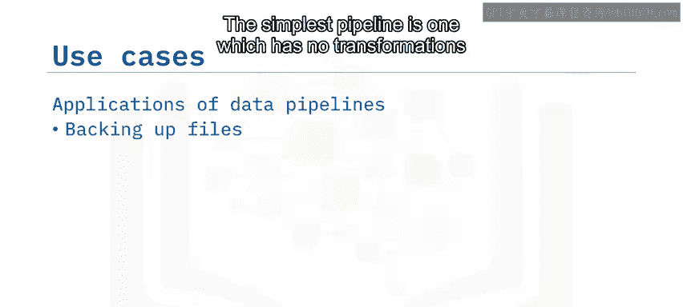

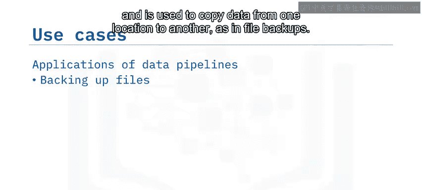

In this video， you learned that the purpose of a data pipeline is to move data from one place or form to another we can visualize data flowing through a pipeline as a series of data packets flowing in and out one by one。

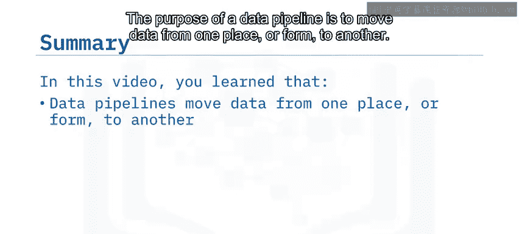

Latency and throughput are key design considerations for data pipelines。

 and use cases for data pipelines are many and range from simple copy and paste like data backups to online video meetings。

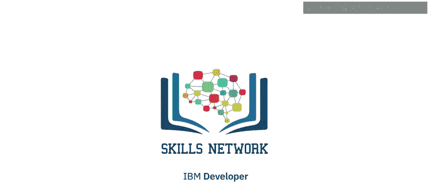