# IBM数据工程专业证书课程9：《数据仓库和BI分析入门》｜getting-started-with-data-warehousing-and-bi - P11：10_使用星型和雪花模式的数据建模.zh_en - GPT中英字幕课程资源 - BV1bN41187mr

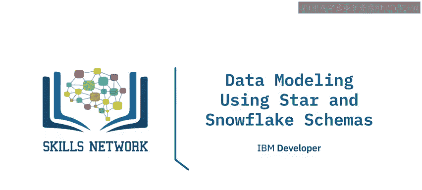

Welcome to data modeling using Star and Snowflake schemas After watching this video you will be able to describe star schema modeling in terms of facts and dimensions。

 describe snowflake schema as an extension of star schema and distinguished star from Snowflake schema in terms of normalization。

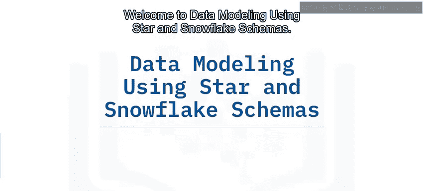

Recall that a fact table contains foreign keys that refer to the primary keys of dimension tables The idea of a star schema is based on the way a set of dimension tables can be visualized or modeled as radiating from a central fact table linked by these keys a star schema is thus a graph whose nodes are facts and dimension tables and whose edges are the relations between those tables Star schemas are commonly used to develop specialized data warehouses called data Mars。

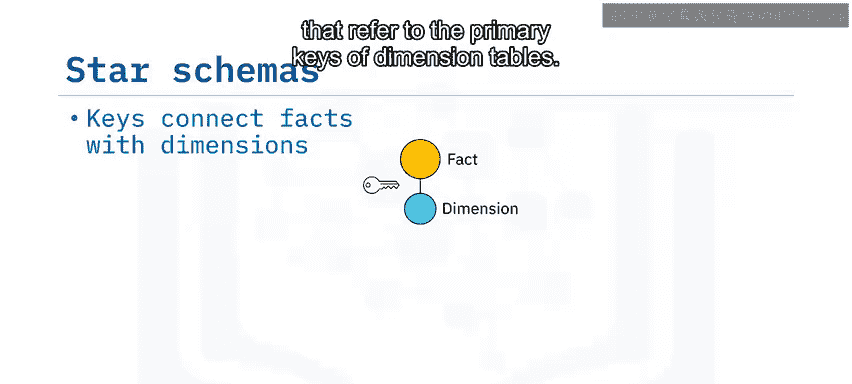

Snowflake schemas are a generalization of star schemas and can be seen as normalized star schemas。

 normalmalization means separating the levels or hierarchies of a dimension table into separate child tables。

 A schema need not be fully normalized to be considered a snowflake so long as at least one of its dimensions has its levels separated。

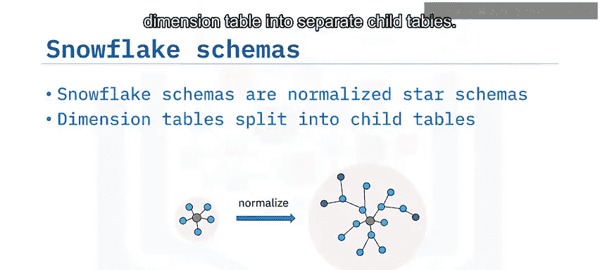

Let's look at some general principles you need to consider when designing a data model for a star schema The first step involves selecting a business process as the basis for what you want to model you might be interested in processes such as sales manufacturing or supply chain logistics in step 2。

 you need to choose a granularity which is the level of detail that you need to capture are you interested in coursegraed information such as annual regional sales numbers。

 or maybe you want to drill down into monthly sales performance by salesperson Next in the process you need to identify the dimensions these may include attributes such as the date and time and names of people。

 places and things。

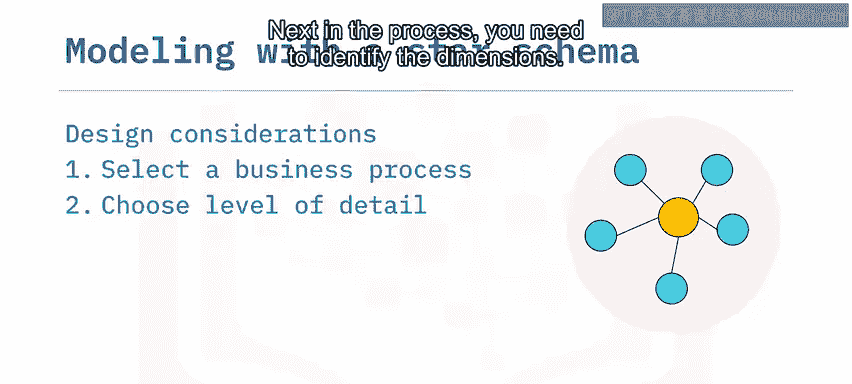

The final consideration in designing star schemas is to identify the facts。

 These are the things being measured in the business process。

 Let's apply these considerations to a scenario。 Imagine， for example。

 that you are a data engineer helping to lay out a data ops for a new store called a to Z discount warehouse。

 They would like you to develop a data plan to capture everyday P or point of sales transactions that happen at the till where customers have their items scanned and pay for them。

 Thus， point of sales transactions is the business process that you want to model。

 The finest granularity you can expect to capture from P transactions comes from the individual line items。

 which is included in the detailed information you can see on a typical store receipt。

 This is precisely what a to Z is interested in capturing The next step in the process is to identify the dimensions。

 This include attributes such as the date。

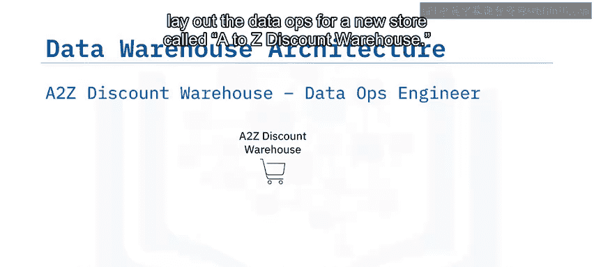

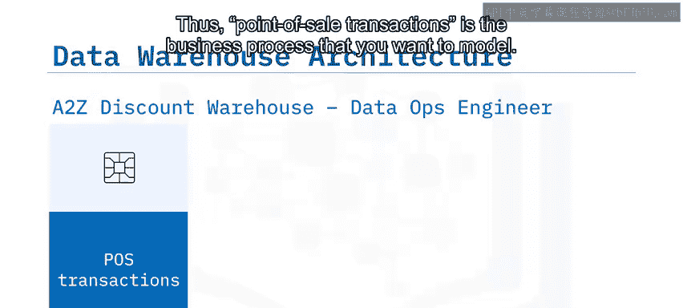

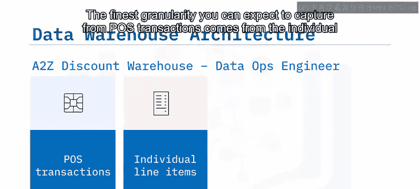

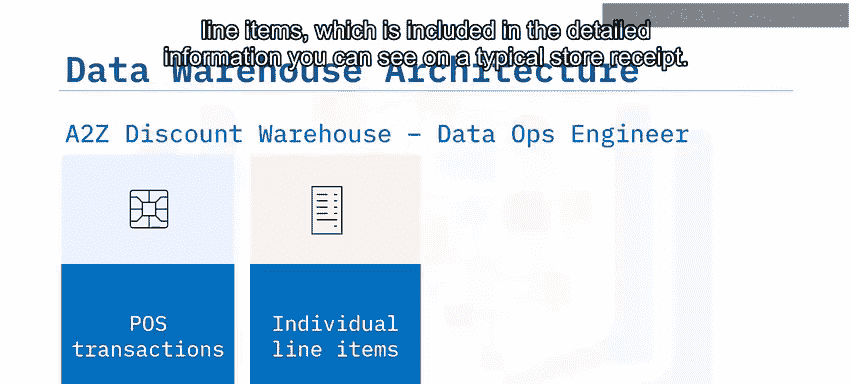

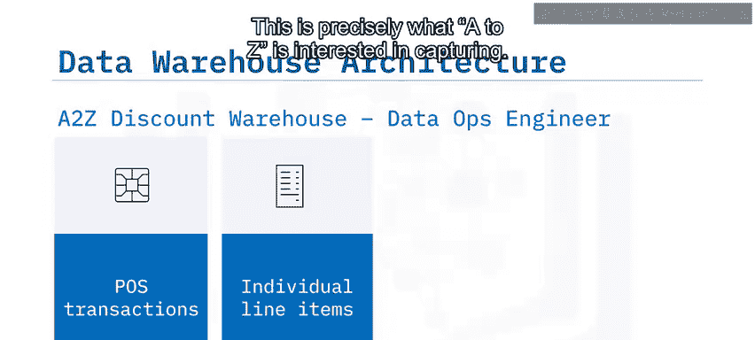

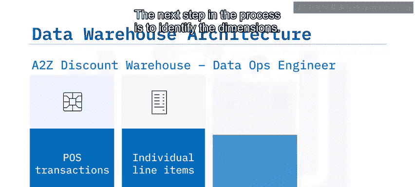

And time of purchase， the store name， the products purchased and the cashier who processed the items you might add other dimensions like payment method。

 whether the line item is a return or a purchase and perhaps a customer membership number。

Now it's time to consider the facts， thus you identify facts such as the amount of each item's price。

 the quantity of each product sold， any discounts applied to the sale， and the sales tax applied。

 other facts to consider include environmental fees or deposit fees for returnable containers。

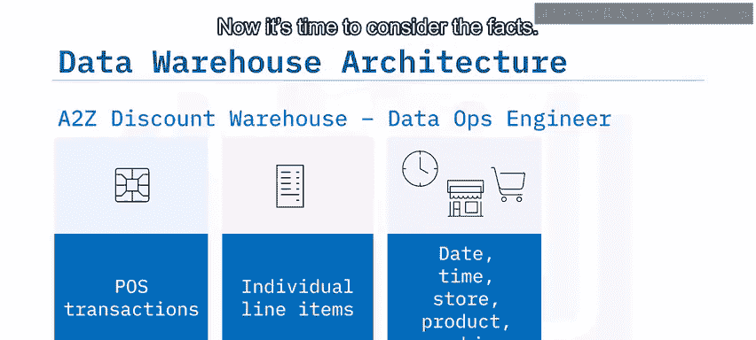

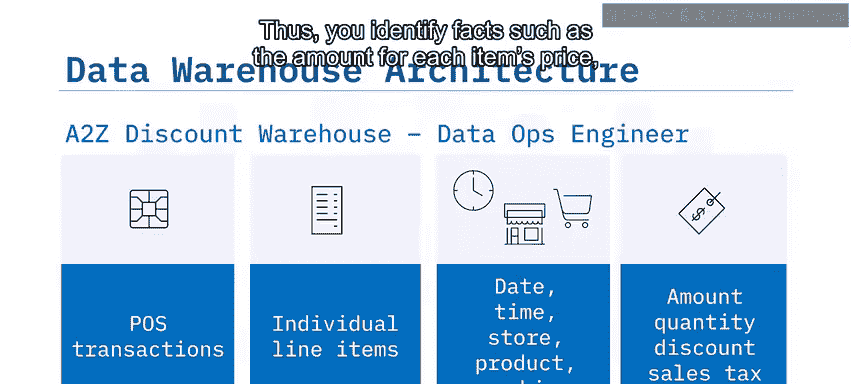

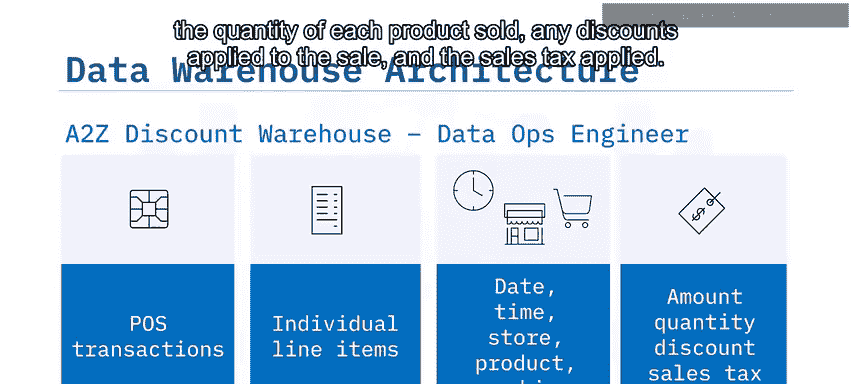

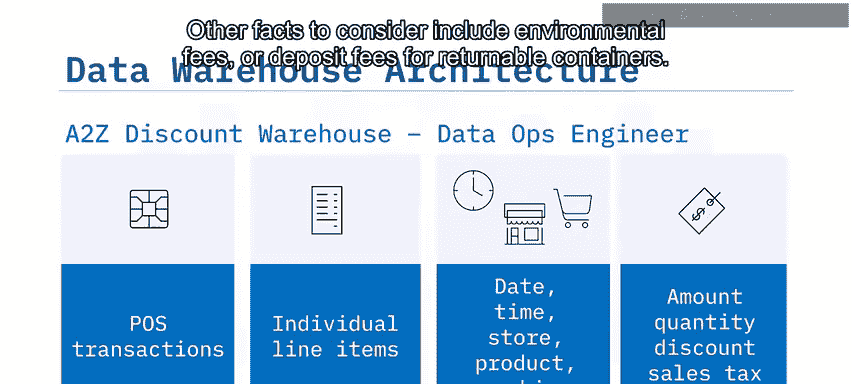

Now， you are ready to start building your star schema for a to Z discount warehouse at the center of your star schema sits a point of sales fact table。

 which contains a unique ID called Po ID for each line item in the transaction plus the following f or measures the amount of the transaction in dollars。

 the quantity or number of items involved sales tax and any discount applied there may be other facts to include。

 but these can be added later as you discover them。

 Each line item from a sales transaction has many dimensions associated with it you include them as foreign keys in your fact table or as links to the primary keys of your dimension tables For example。

 the name of the store at which the item was sold is kept in a dimension table called store which is identified in the fact table by the value of the foreign store ID key which is the primary key for the store table。

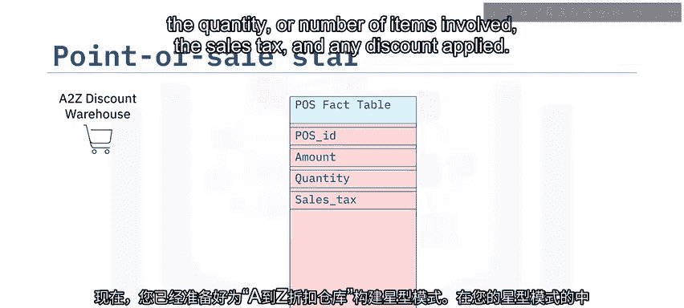

Product information is stored in the product table。

 which is uniquely identified by the product ID key， Similarlyly。

 the date of the transaction is keyed by the date ID。

 which cashier entered the transaction is keyed by the cashier ID and which member was involved is indicated by the member ID This illustrates what a star schema might look like。

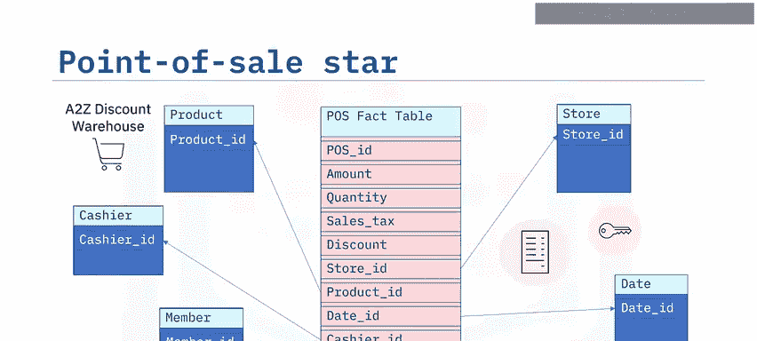

Let's see how you can use normalization to extend your star schema to a snowflake schema Starting with your star schema。

 you can extract some of the details of the dimension tables into their own separate dimension tables creating a hierarchy of tables a separate city table can be used to record which city the store is in while a foreign city ID key would be included in the store table to maintain the link you might also have tables and keys for the city state or province and a predefined sales region for the store as well as which country the store resides in We've left out the associated keys for simplicity。

 We can continue to normalize other dimensions like the product' brand and a product category that it belongs to the day of week and the month corresponding to the date plus the quarter and so on This normalized version of the star schema is called a snowflake schema due to its multiple layers of branching which resembles a snowflake。

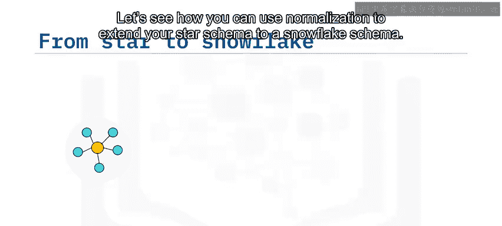

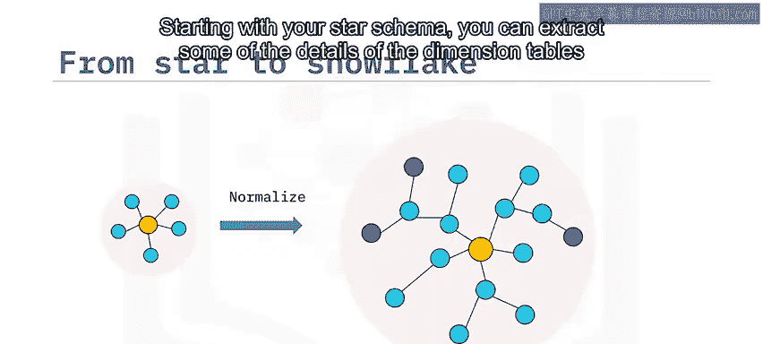

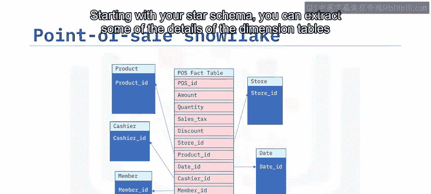

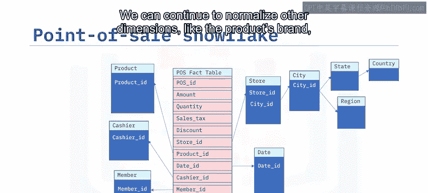

Much like pointers are used to point to memory locations in computing。

 normalization reduces the memory footprint of the data。In this video。

 you learned that the facts and dimensions tables together with foreign and primary keys are used to form star and snowflake modeling schemas。

 design considerations for data modeling with star schema include identifying a business process。

 its granularity and its facts and dimensions， Snowflake schemas can be described as normalized star schemas。

 where normalization involves separating dimension tables into individual tables defined by levels or hierarchies of the parent dimension and reduces storage footprint。

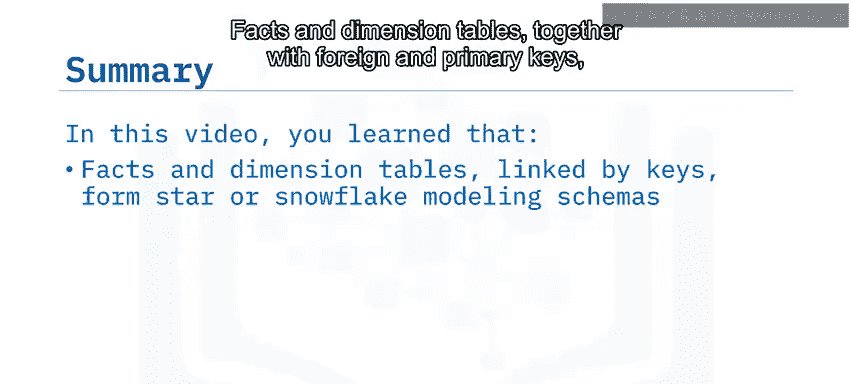

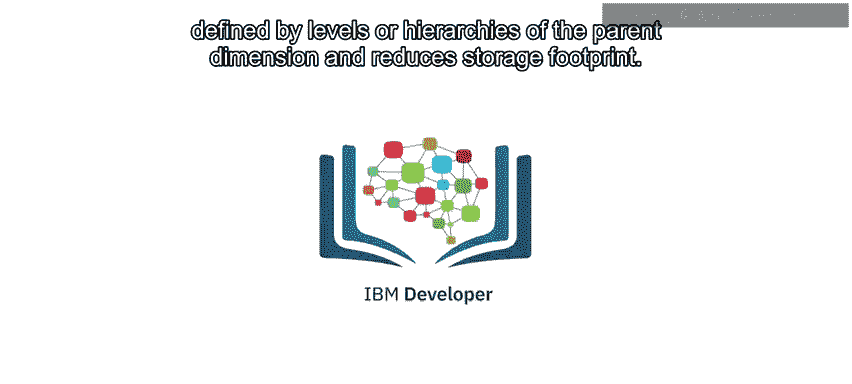