# IBM数据工程专业证书课程9：《数据仓库和BI分析入门》｜getting-started-with-data-warehousing-and-bi - P12：11_数据仓库的暂存区.zh_en - GPT中英字幕课程资源 - BV1bN41187mr

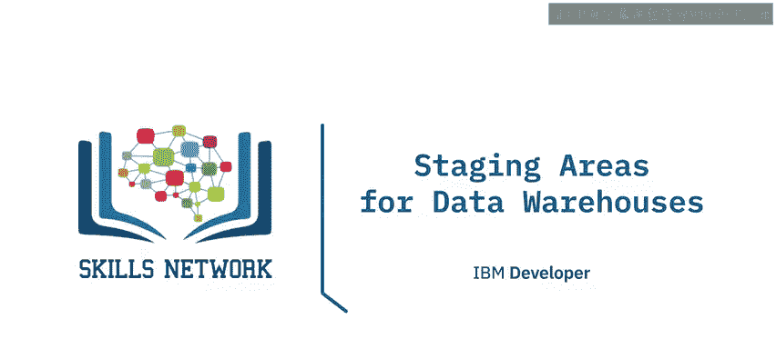

Welcome to Stging Area for data warehouses After watching this video。

 you will be able to describe what a data warehouse staging area is。

 describe why a staging area may be used and relate how a staging area is used as a first step for integrating data sources。

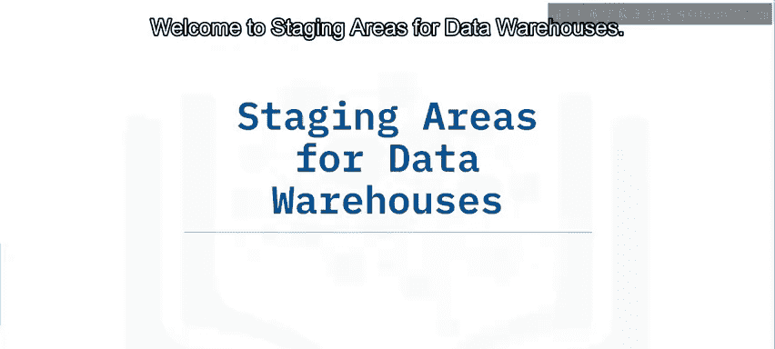

What is a data warehouse staging area you can think of a staging area as an intermediate storage area that is used for ETL processing thus staging areas act as a bridge between data sources and the target data warehouses。

 data mars or other data repos they are often transient。

 meaning that they are erased after successfully running ETL workflows， however。

 many architectures hold data for archival or troubleshooting purposes they are also useful for monitoring and optimizing your ETL workflows。

Staging areas can be implemented in many ways， including simple flat files such as CSV files stored in a directory and managed using tools such as Bash or Python。

 or a set of SQL tables in a relational database such as DB2 or a self-contained database instance within a data warehousing or business intelligence platform such as Cgnos Ana。

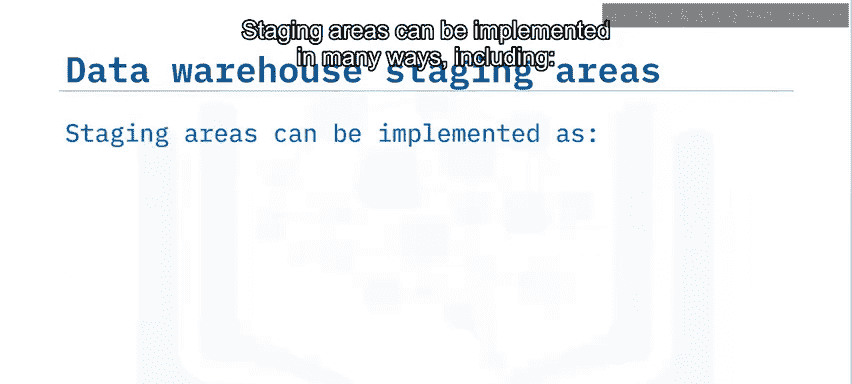

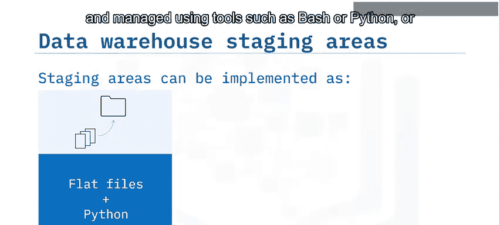

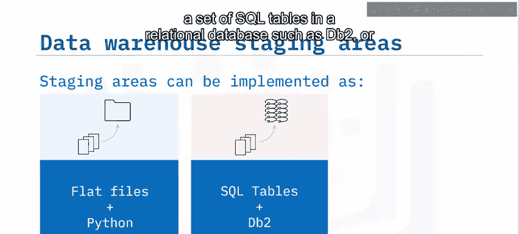

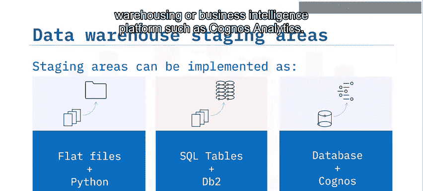

Let us explore an example use case to illustrate a possible architecture for a data warehouse containing a staging area。

 which in turn includes an associated staging database。

Imagine the enterprise would like to create a dedicated cost accounting online analytical processing system the required data is managed in separate online transaction processing systems within the enterprise from the payroll。

 sales and purchasing departments。From these siloed systems。

 the data is extracted to individual staging tables。

 which are created in the staging database Data from these tables is then transformed into the staging area using SQL to conform it to the requirements of the cost accounting system。

 the conformed tables can now be integrated or joined into a single table。

 and the final phase is the loading phase where the data is loaded into the target cost accounting system。

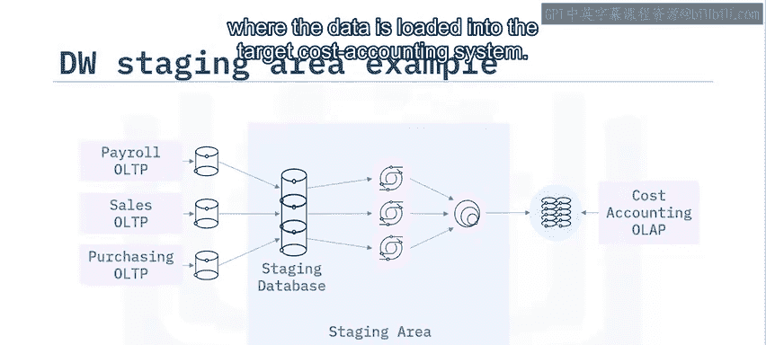

A staging area can have many functions， some typical ones include integration。 Indeed。

 one of the primary functions performed by a staging area is consolidation of data from multiple source systems。

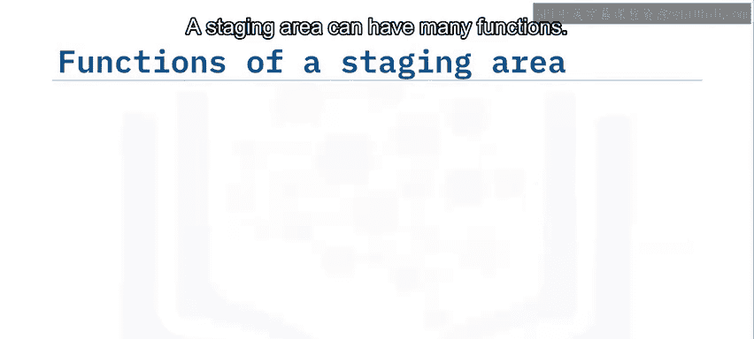

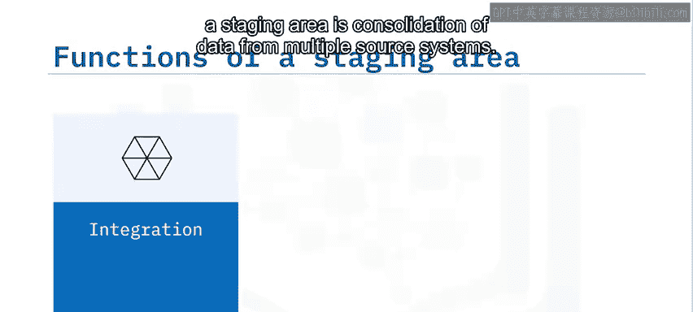

Change detection Stging areas can be set up to manage extraction of new and modified data is needed。

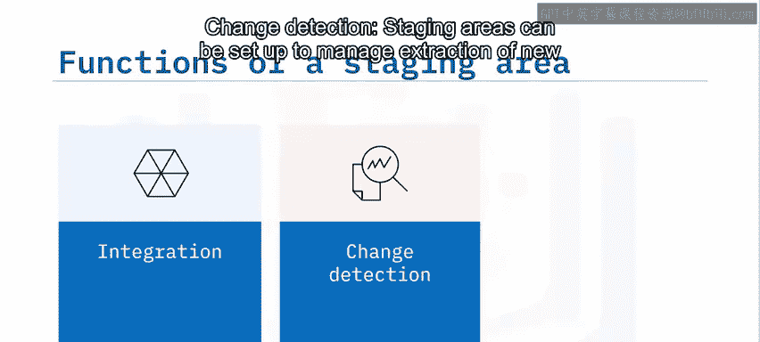

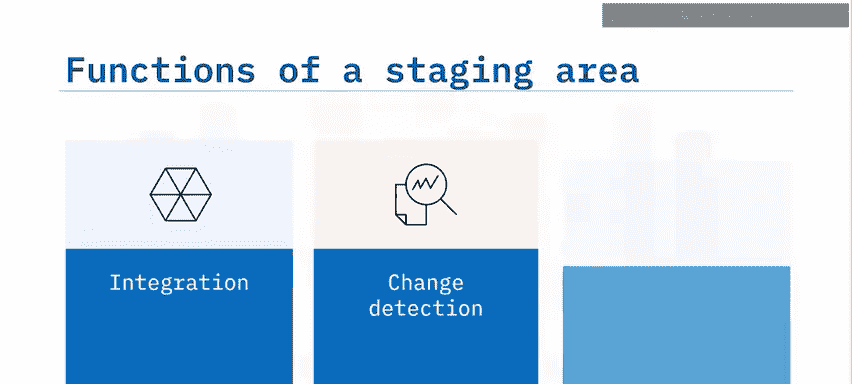

Scheduling individual tasks within an ETL workflow can be scheduled to run in a specific sequence concurrently and at certain times。

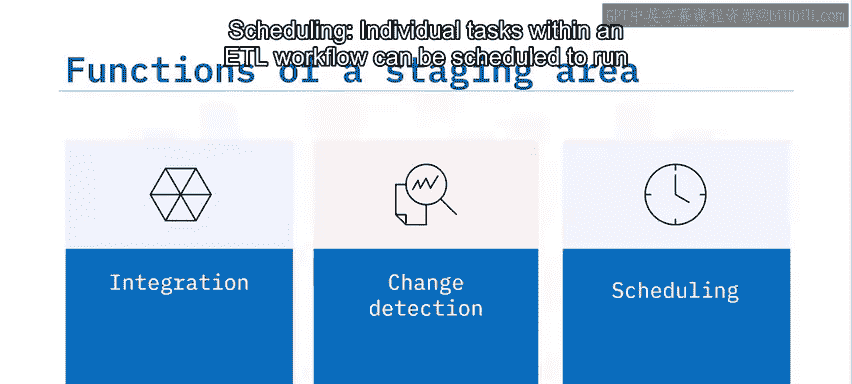

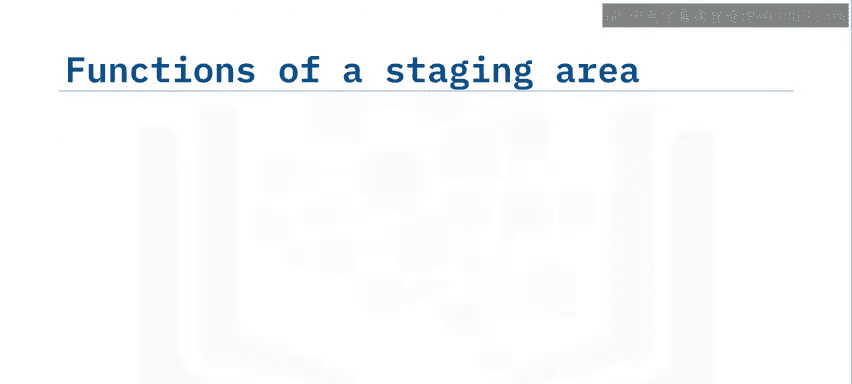

There's also data cleansing and validation， for example。

 you can handle missing values and duplicated records。

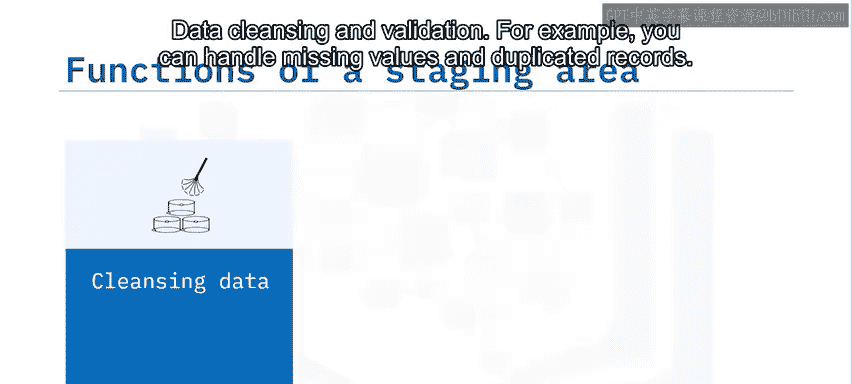

Aggregating data you can use the staging area to summarize data for example。

 daily sales data can be aggregated into weekly， monthly or annual averages prior to loading into a reporting system。

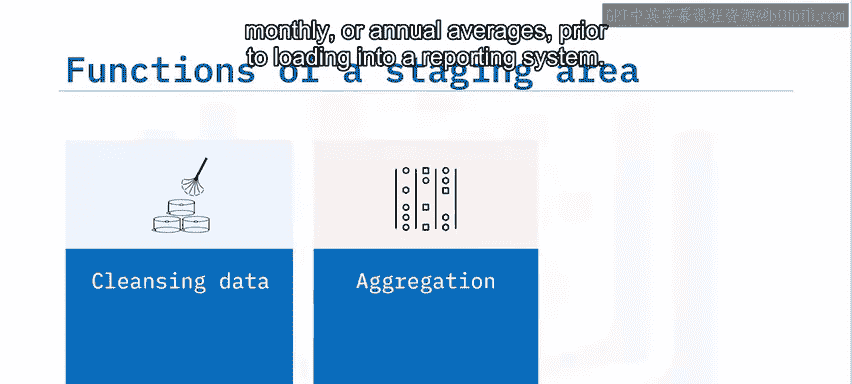

And normalizing data to enforce consistency of data types or names of categories such as country and state codes in place of mixed naming conventions。

 such as Mont， MA， or Montana。

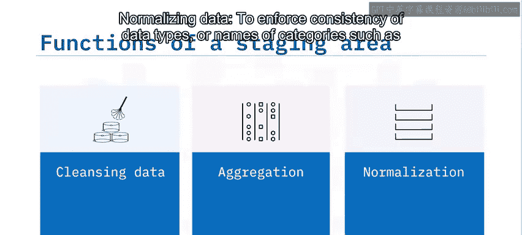

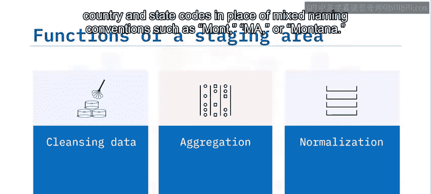

A staging area is a separate location where data from source systems is extracted to the extraction step therefore decouples operations such as validation。

 cleansing and other processes from the source environment this helps to minimize any risk of corrupting source data systems and simplifies ETO workflow construction。

 operation and maintenance， and if any of the extracted data becomes corrupted somehow。

 you can easily recover。

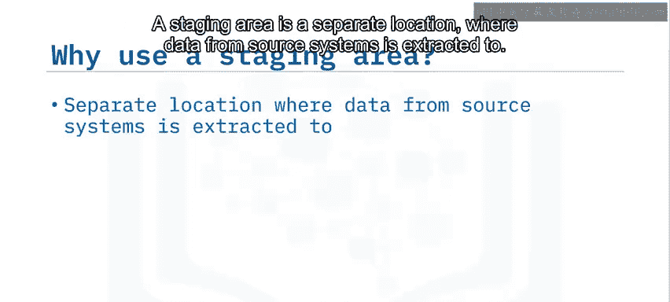

In this video， you learned that a staging area acts as a bridge between data sources and the target system and are mainly used to integrate disparate data sources in data warehouses。

 staging areas can be implemented quite simply as a set of flat files in a directory and managed with scripts or as tables in a database。

 staging areas decoupled data processing from the source systems and thus help minimize risk of data corruption。

 and although they are often transient staging areas can be held for archiving or troubleshooting purposes。

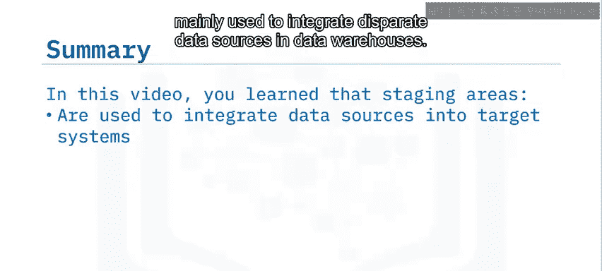

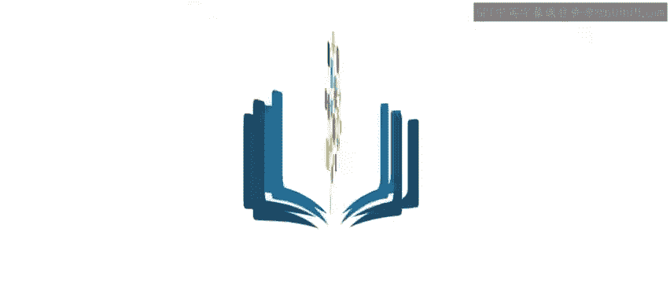