# IBM数据工程专业证书课程9：《数据仓库和BI分析入门》｜getting-started-with-data-warehousing-and-bi - P13：12_验证数据质量.zh_en - GPT中英字幕课程资源 - BV1bN41187mr

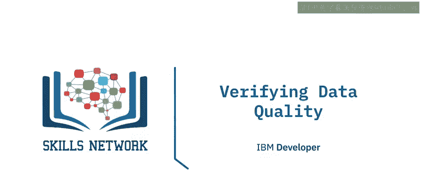

Welcome to verifying data quality After watching this video。

 you will be able to describe data quality verification， identify why organizations verify data。

 list examples of data quality concerns， and outline a process for handling bad data。

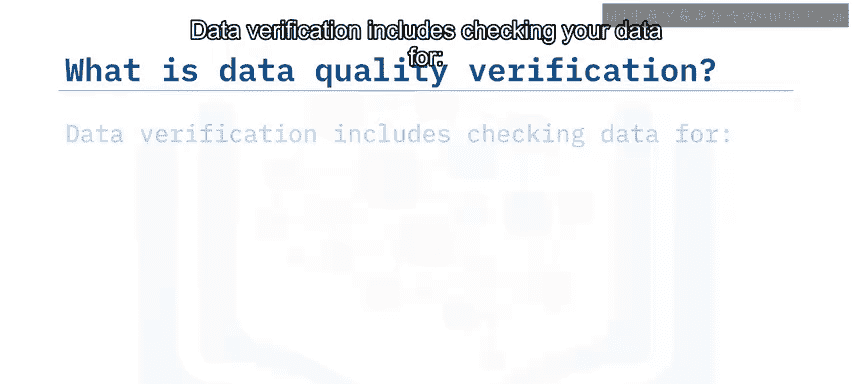

Data verification includes checking your data for accuracy， is your data correct。

 Compness is there missing data， consistency are fields consistently entered。

 and currency is your data up to date。

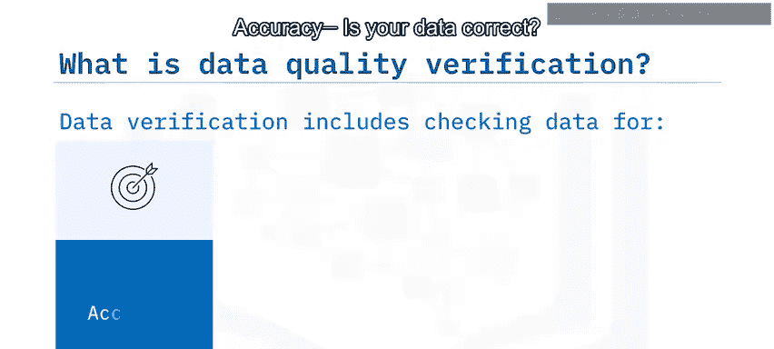

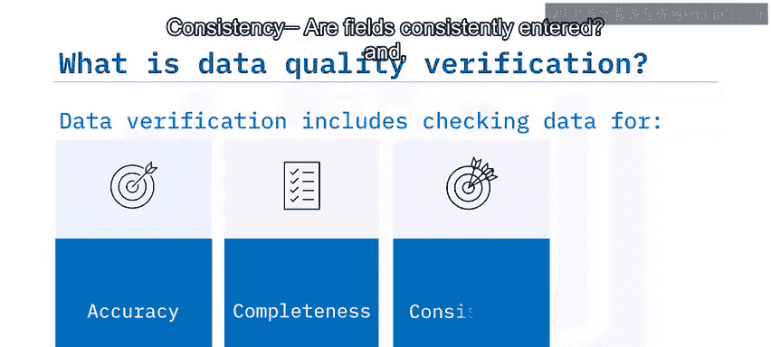

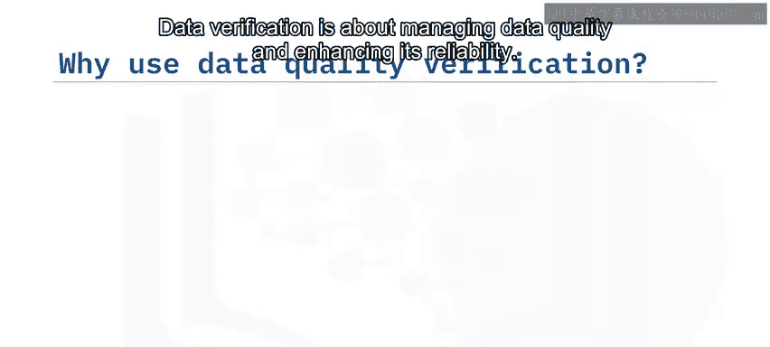

Data verification is about managing data quality and enhancing its reliability high quality data enables successful integration of related data and its complex relationships。

 data verification also provides you with the complete and connected view of your organization data that is ready for advanced analysis statistical modeling and machine learning and ultimately more confidence in your insights and decision making。

Unfortunately， data quality is not a top concern among the daily chaos of running a company According to Harvard Business Review。

 IBM's 2016 estimate of the yearly cost of poor data quality in the USS alone was over $3 trillion。

Let's identify data quality concerns that organizations contend with The first is accuracy Ac includes ensuring a match between source data and destination data。

 How can accuracy become an issue， data migrating from source systems often contains duplicated records when users enter data manually typos can find their way into the data records yielding out of range values。

 outliers and spelling mistakes。Sometimes large chunks of data become misaligned。

 causing data corruption for example， a CSV file might contain a legitimate comma。

 which the new system can misinterpret as a column separator。

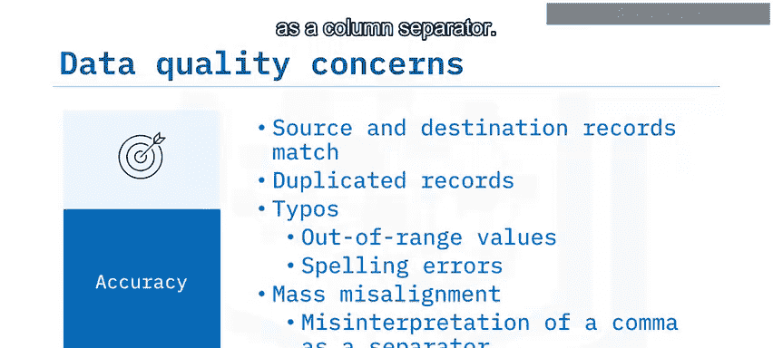

Another data quality concern is completeness Data is incomplete when the business finds missing values such as voids or nulls and fields that should be populated or haphazard use of placeholders such as 999 or minus-1 to indicate a missing value En records can also be missing due to upstream system failures。

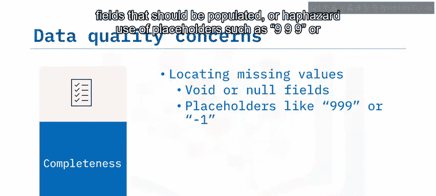

Consistency is another important data quality concern。

 Are there deviations from standard terminology。 Are dates entered consistently， For example。

 year month， day and month， day year formats are incompatible。 Is data entered consistently。

 For example， Mr。 John Doe and John Doe might refer to the same person in the real world。

 but the system will see them as distinct。 and are the units consistent。 For example。

 you are expecting kilograms， but you might have entries based on pounds。

 or you are expecting dollar amounts， but you might have entries based on thousands of dollars。

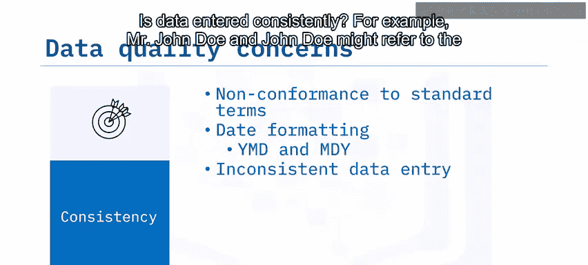

Lastly， currency is an ongoing data quality concern for most businesses。

 Curency is about ensuring your data remains up to date。 for example。

 you might have dimension tables that contain customer addresses。

 some of which might be outdated in the US。 you could check these against a change of address database and update your table as required。

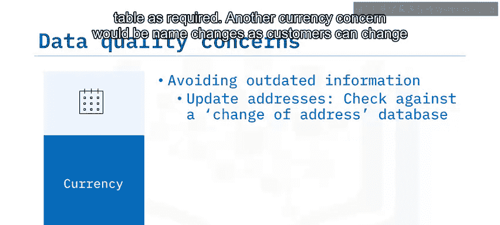

Another currency concern would be name changes， as customers can change their names for various reasons。

Determining how to resolve and prevent bad data can be a complex and iterative process。 First。

 you'll implement rules to detect bad data。 then you'll apply those rules to capture and quarantine any bad data。

 you might need to report any bad data and share the findings with the appropriate domain experts。

 you and your team can investigate the root cause of each problem searching for clues upstream in the data lineage Once you diagnose each problem。

 you can begin correcting the issues。Ultimately， you want to automate the entire data cleaning workflow as much as possible。

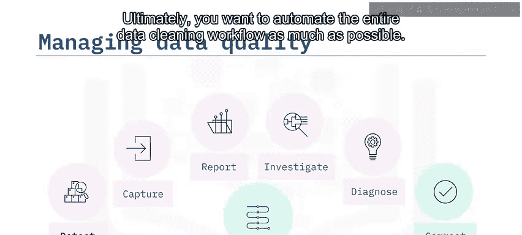

For example， you need to validate the quality of data in the staging area before loading the data into a data warehouse for analytics you determine the data from certain data sources consistently has data quality issues。

 including missing data duplicate values out of range values and invalid values。

Here's how an organization might manage and resolve these issues First。

 write SQL queries to detect these issues and test for them Next。

 address some of the quality issues that you've repeatedly identified by creating rules for treating them。

 such as removing rows that have out of range values。

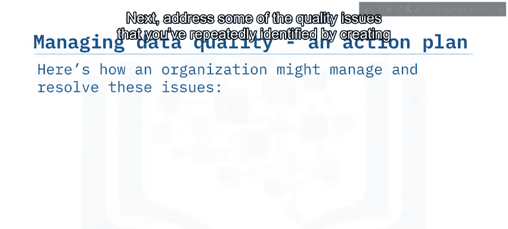

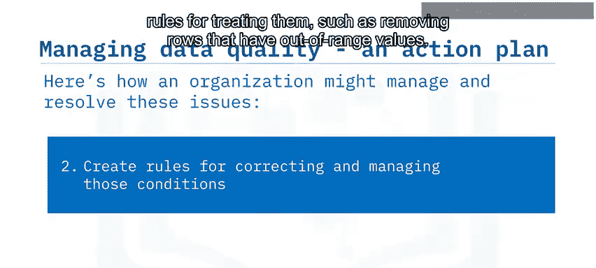

Create a script that runs queries to detect data quality issues that happen during the nightly loads to the data warehouse。

 This script applies corrective measures and transformations for some of these known issues。Next。

 create a second script that automates the script you created in step3 after the data is extracted from the various data sources。

 this script automatically runs the prior scripts SQL data validation queries every night in the staging area the script you created in step3 generates a report of any remaining issues that could not be automatically resolved the administrator can review this report and address the unresolved issues。

Some of the leading vendors and their tools for data quality solutions include IBM Insphere Server for data quality and IBM data Refry。

 Informatica data quality SAP data quality management。

 SaS data quality T opent for data quality precisely spectrum quality。

 Microsoft data quality services， Oracle Enter data quality and an open source tool called openRefin Each of these solutions has its own strengths。

 Let's look at one of these solutions the IBM Insphere information server for data quality is an example of a product that can help you perform data verification in a unified environment Insphere information server for data quality enables you to continuously monitor the quality of your data。

 and keep your data clean on an ongoing basis， helping you turn your data into trust and information。

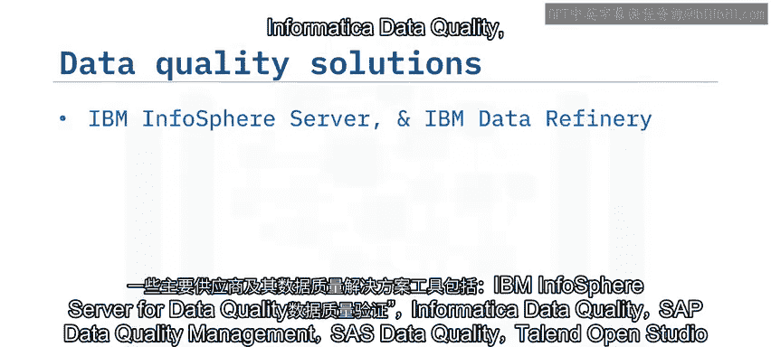

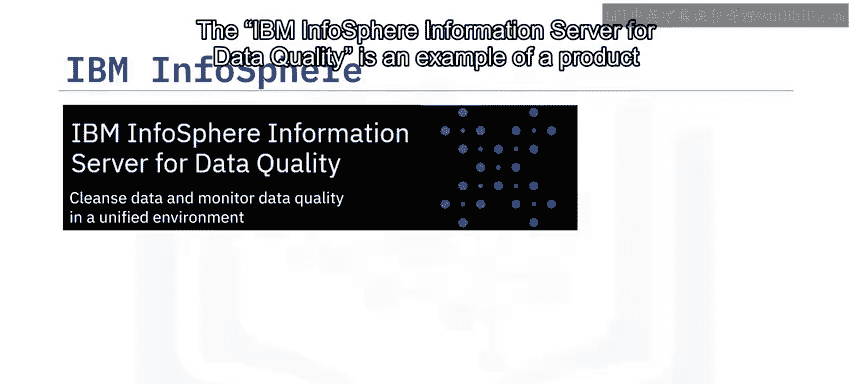

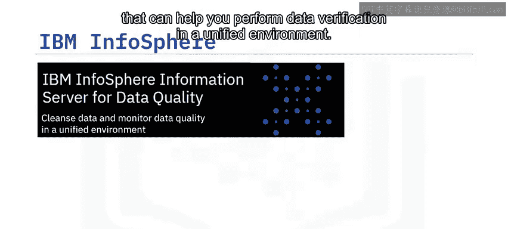

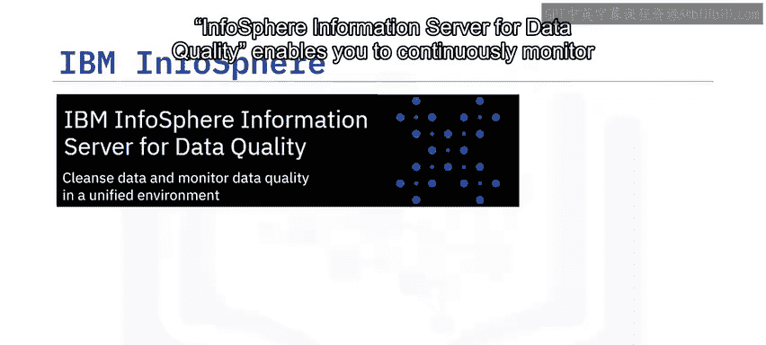

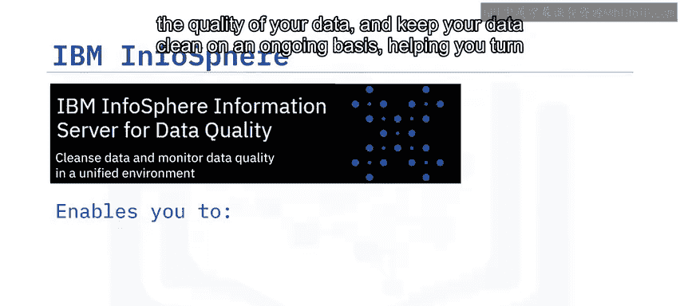

In addition， the IBM Insphere Information server for data Q comes with built in and to end data quality tools to help you understand your data and its relationships。

 monitor and analyze data quality continuously， clean， standardize and match data。

 and maintain data lineage， which is the history of the data's origin。

 and what happened to the data along the way。

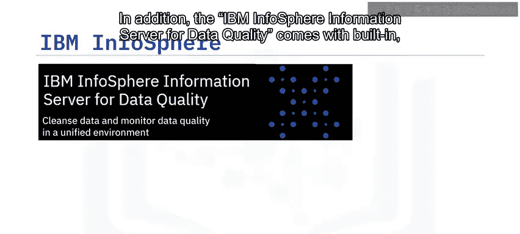

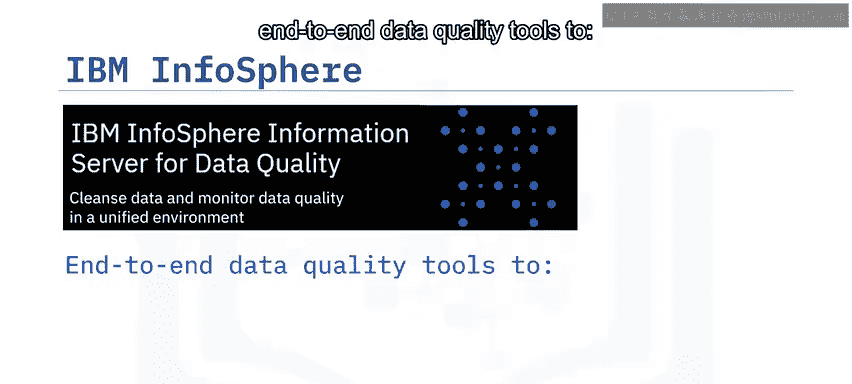

In this video you learned that data verification includes checking your data for accuracy。

 completeness， consistency and currency Data verification is about managing data quality。

 enhancing data reliability and maximizing data value。

 determining how to resolve and prevent bad data can be a complex and iterative process。

 and enterprise grade tools such as IBM Insphere information server for data quality can help you perform data verification in a unified environment。

