# IBM数据工程专业证书课程9：《数据仓库和BI分析入门》｜getting-started-with-data-warehousing-and-bi - P14：13_填充数据仓库.zh_en - GPT中英字幕课程资源 - BV1bN41187mr

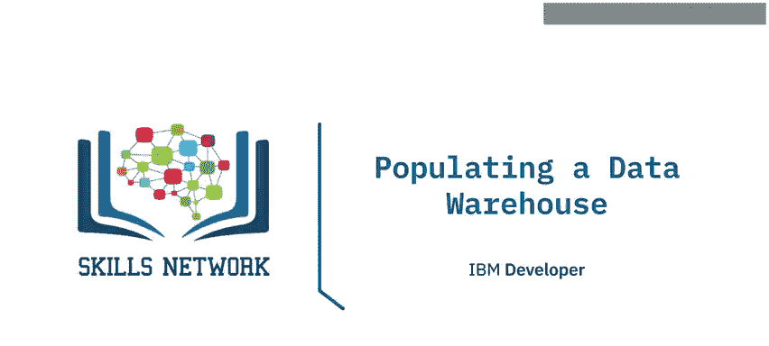

Welcome to populating a data warehouse。After watching this video。

 you'll be able to describe populating a data warehouse as an ongoing process。

 list the main steps for populating a data warehouse。

 list methods for change detection and incremental loading。

 manually create and populate tables for a sales star schema。

 recall the periodic maintenance required to keep your data warehouse running smoothly。

Populating the enterprise data warehouse is an ongoing process。

 You have an initial load followed by periodic incremental loads。 For example。

 you may load new data every day or every week。 Ra a full refresh may be required in case of major schema changes or catastrophic failures。

 General， fact tables are dynamic and require frequent updating while dimension tables don't change often。

 For example， lists of cities or stores are quite static， but sales happen every day。

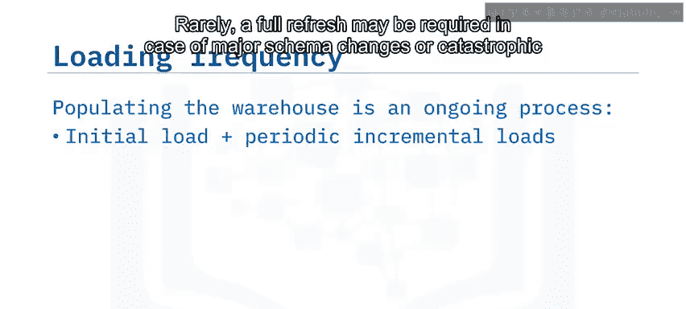

Many tools are available to automate the ongoing process of keeping your data warehouse current Datas like DB2 have a load utility that is faster than inserting a row at a time。

 and loading your warehouse can also be a part of your ETL data pipeline that is automated using tools like Apache Aflow and Apache Kafka you can also write your own scripts。

 combining lowerleve tools like Bsh， Python and SQL to build your data pipeline and schedule it with Chron and Infophere data stage allows you to compile and run jobs to load your data。

Before populating your data warehouse， ensure that your schema has already been modeled。

 your data has been staged in tables or files， and you have mechanisms for verifying the data quality。

Now you're ready to set up your data warehouse and implement the initial load。

 You first instantiate the data warehouse and its schema， then create the production tables。 Next。

 establish relationships between your fact and dimension tables and finally。

 load your transformed and clean data into them from your staging tables or files。

Now that you've gone through the initial load， it's time to set up ongoing data loads。

 you can automate subsequent incremental loads using a script as part of your ETL data pipeline。

 you can also schedule your incremental loads to occur daily or weekly depending on your needs。

 you will also need to include some logic to determine what data is new or updated in your staging area。

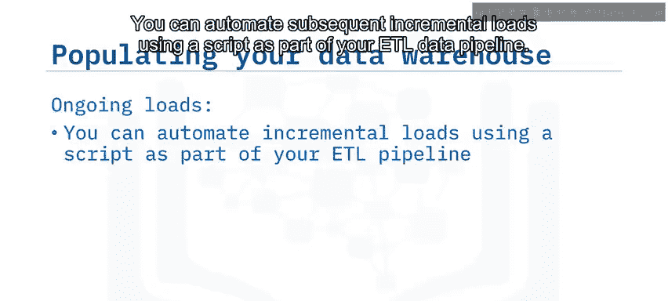

Normally， you detect changes in the source system itself。

 Many relational database management systems have mechanisms for identifying any new。

 changed or deleted records since a given date， you might also have access to timestamps that identify both when the data was first written and the data it might have been modified。

 Some systems might be less accommodating and you might need to load your entire source to your ETL pipeline for subsequent brute force comparison to the target。

 which is fine if the source data isn't too large。Data warehouses need periodic maintenance。

 usually monthly or yearly to archive data that is not likely to be used。

 You can script both the deletion of older data and its archiving to slower， less costly storage。

Let's illustrate the process with a simplified example of manually populating a data warehouse with a star schema called sales。

 We'll assume you've already instantiated the data warehouse and the sales schema。

 Here's a sample of some auto sales transaction data from a fictional company called Shi auto sales。

 You can see several foreign key columns such as sales I。

 which is a sequential key identifying the sales invoice numberno。

 which is the employee number and class ID， which encodes the type of car sold。

 such as small SV Each of these keys represents a dimension that points to a corresponding dimension table in the star schema。

 The date column is a dimension that indicates the sales date。 The amount column is the sales amount。

 which happens to be the fact of interest。 This table is already close to the form of a fact table。

 The only exception is the date column which is not yet represented by a foreign date I。

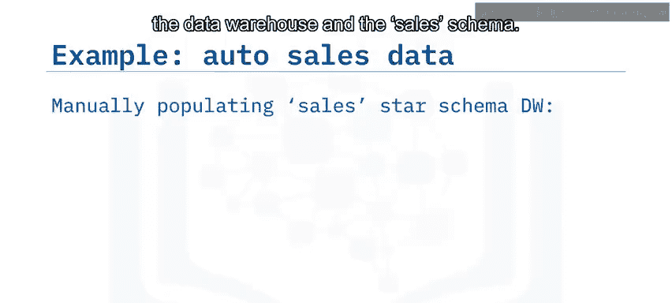

いき？Let's use PSQL， the terminal based frontend for Postgres SQL to illustrate how you can create your dimension tables using the salesperson dimension as an example。

 use the Cate table clause to create the dim salesperson table with the sales schema along with salesperson ID as a serial primary key。

 salesperson Alt ID as the salesperson's employee number。

 and finally a column for the salesperson's name。

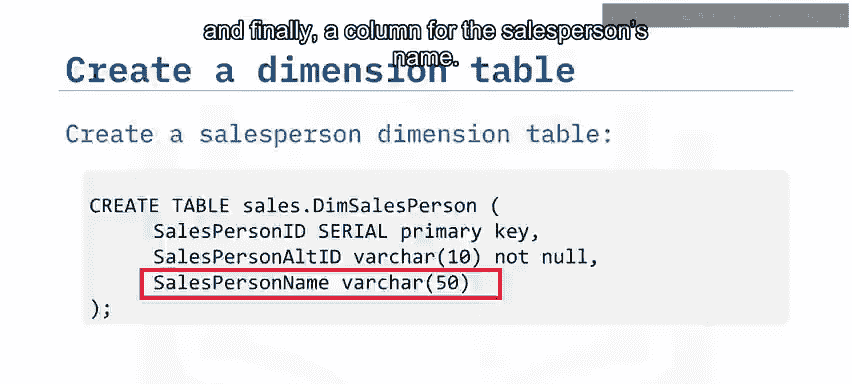

Now you can start populating the Di salesperson table row by row。

 you use an insert into clause on the Sal。DSaperson table。

 specifying the salesperson Alt ID and salesperson name columns and begin inserting values such as employee number 680 Cadillac Jack you would similarly create and populate tables for the remaining dimensions。

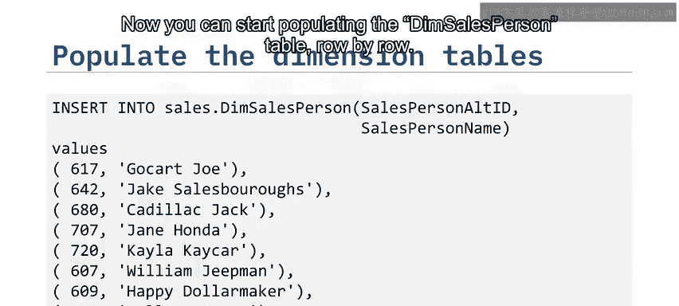

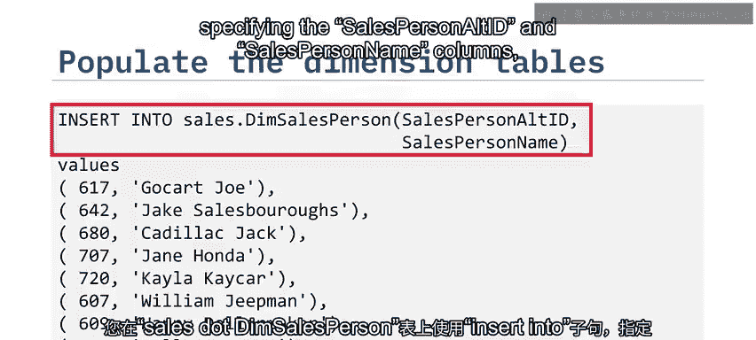

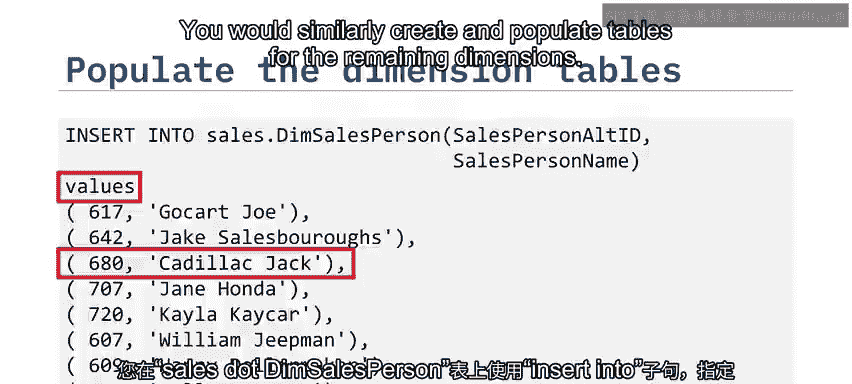

You can enter the SQL statement， select star from sales。

dm salesperson limitit 5 to view your salesperson dimension table and see that everything seems to be correctly populated。

 such as record1， employee number 617， and salesperson name， Go cart Joe。

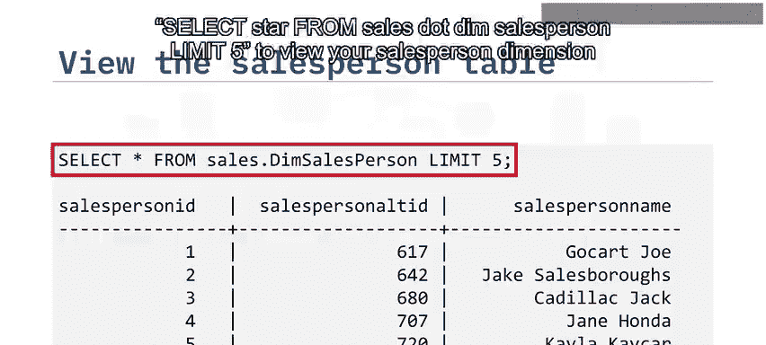

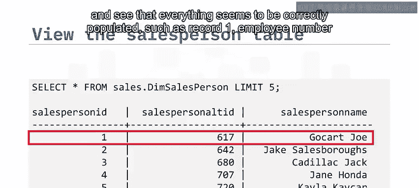

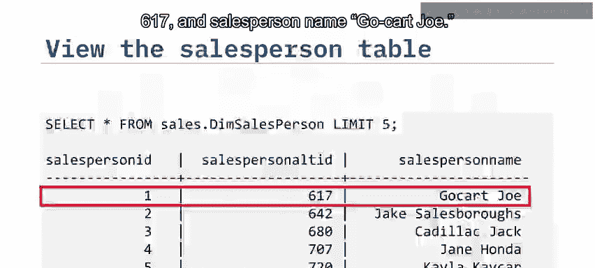

Now it's time to create your sales fact table， using createreate Table with sales。

 factactau sales as the table name， transaction ID as the primary key with big serial type。

 and the various foreign keys such as sales ID and auto class ID， and finally。

 the fact of interest amount as type money。

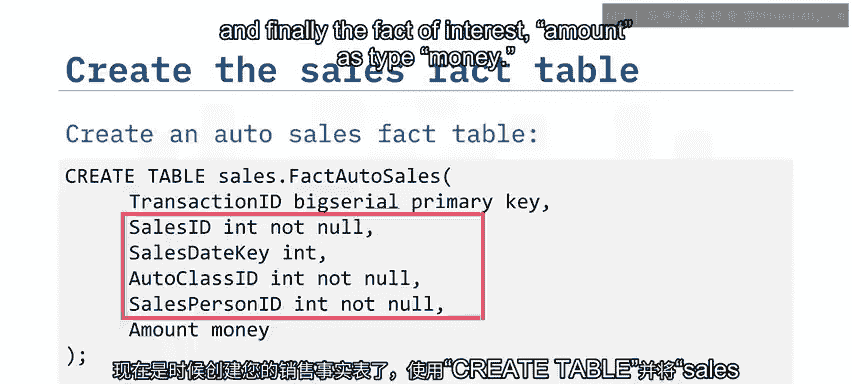

Next， you proceed with setting up the relations between the fact and dimension tables of the sales schema。

 For example， you can apply the Al table statement and the add constraint clause to the sales do factact auto sales factact table to add Kv autoclass ID as a foreign key relating autoclass ID to the same column name in the sales do dim auto category table using the references clause。

 you would then use the same method to set up the relations for the remaining dimension tables。

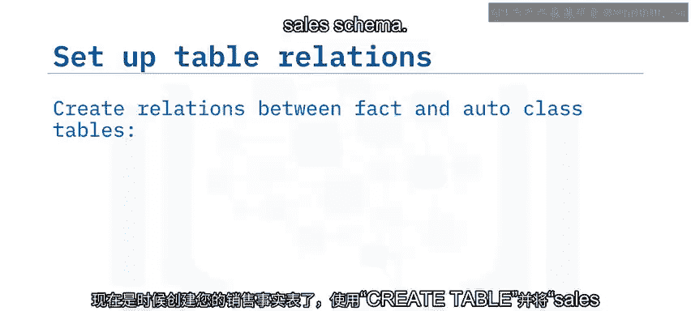

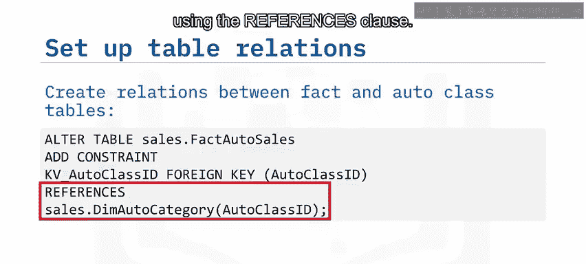

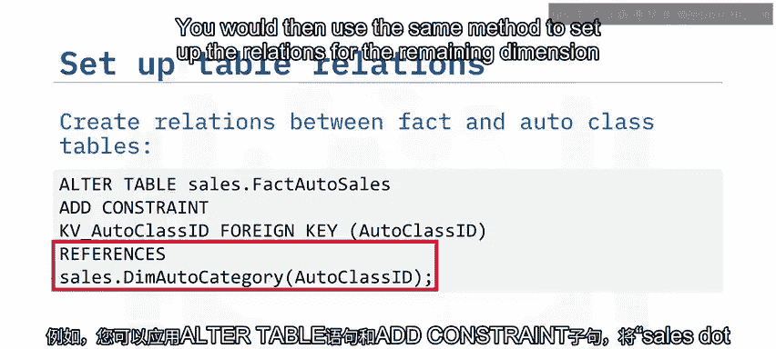

After defining all the tables and setting up the corresponding relations。

 it's finally time to start populating your fact table using the sales data that you started with。

 you can use the insertsert Into statement on sales。 factact auto sales。

 specifying the column names sales ID amount， salesperson ID Autoclass ID and sales D key。

 and entering rows such as 1629-420021 and 4， which you would obtain using the auto sales data。

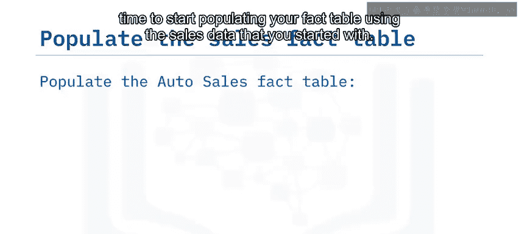

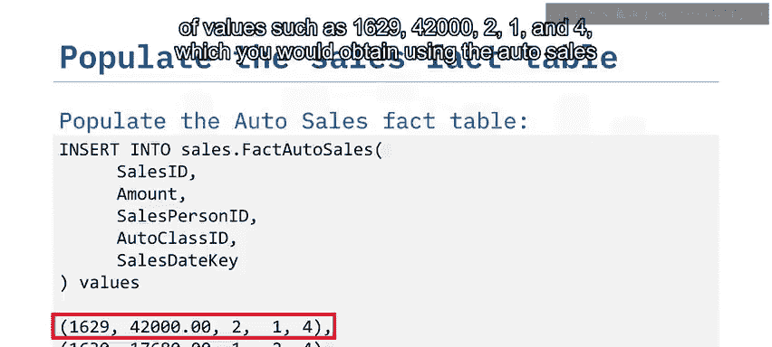

You can view the auto sales factact table by entering the SQL statement select star from sales dot factact auto sales limit 5 to display its first five rows。

 Here you see the dollar amounts for individual auto sales。

 the primary key called transaction ID and the remaining columns which are foreign keys that you set up。

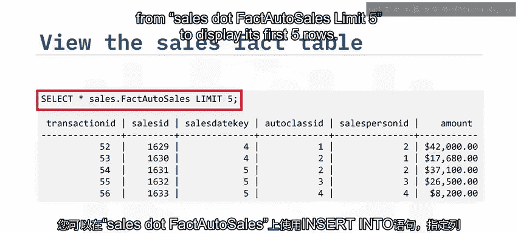

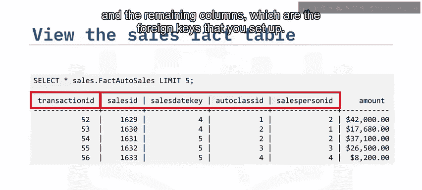

In this video， you learned that populating an enterprise data warehouse includes initial creation of fact and dimension tables and their relations and loading of clean data into tables。

 populating the enterprise data warehouse is an ongoing process that starts with an initial load followed by periodic incremental loads factact tables are dynamic and require frequent updating while dimension tables are more static and don't change often。

 and you can automate incremental loading and periodic maintenance of your data warehouse using scripting or built for purpose data pipeline tools。

😊。

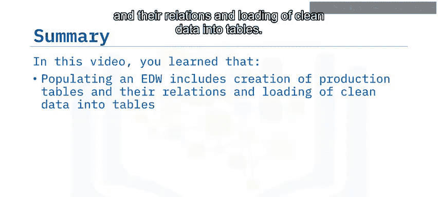

