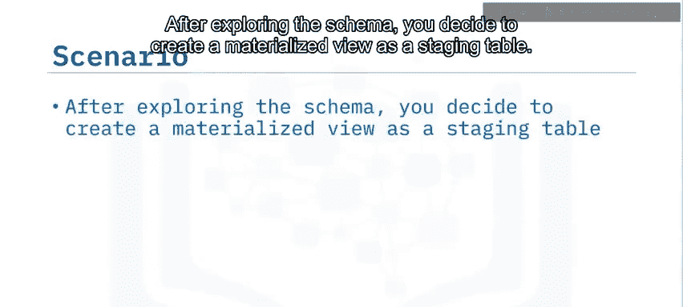
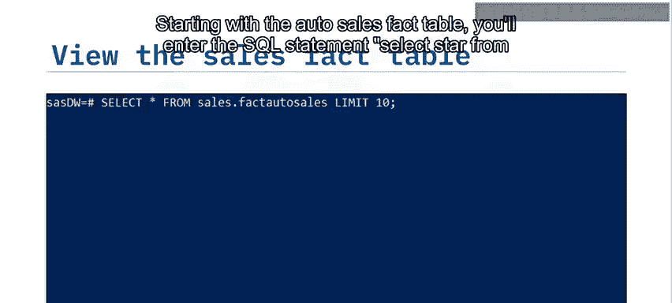
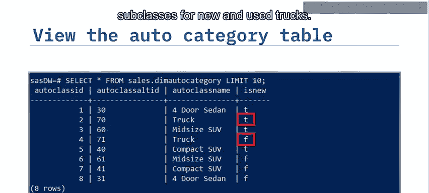
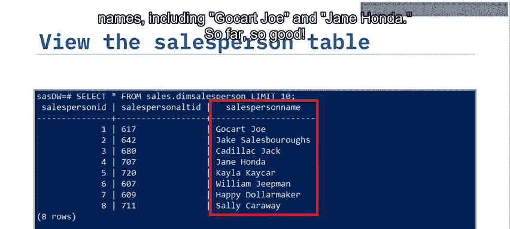
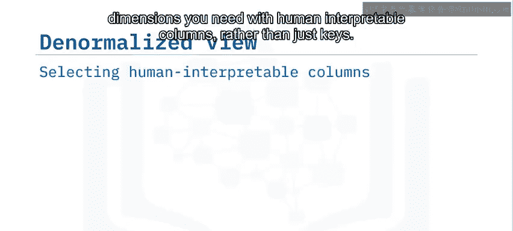
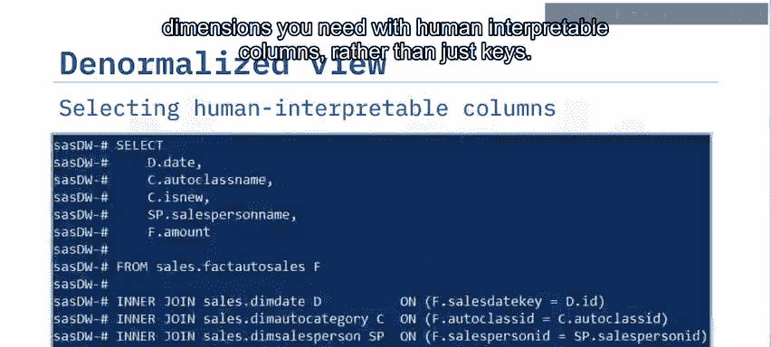
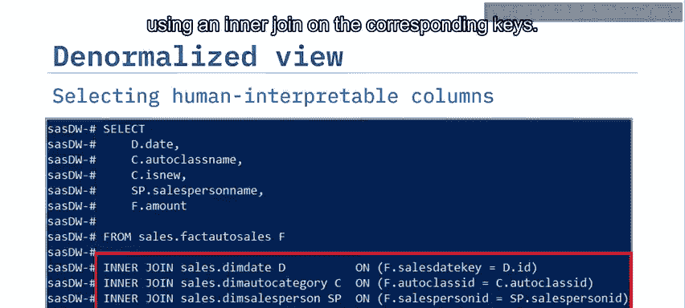
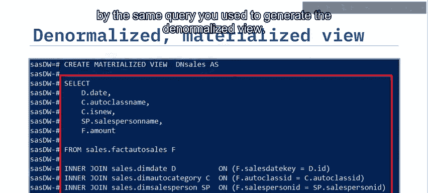
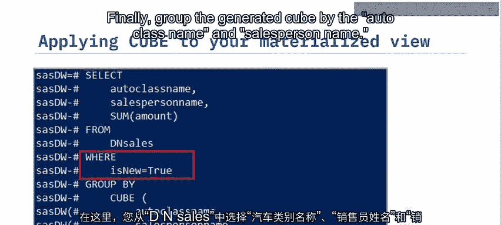
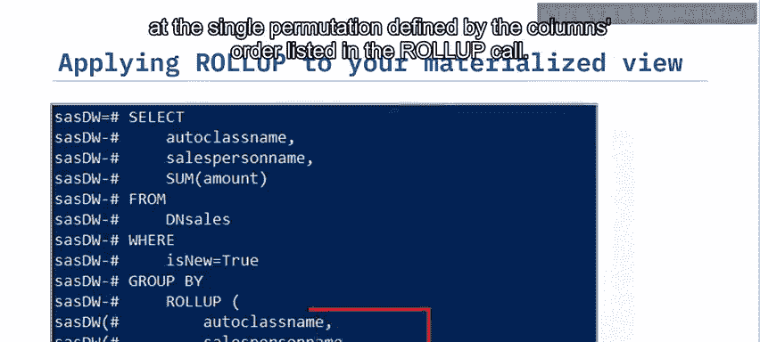

# IBM数据工程专业证书课程9：《数据仓库和BI分析入门》｜getting-started-with-data-warehousing-and-bi - P15：14_查询数据.zh_en - GPT中英字幕课程资源 - BV1bN41187mr

Welcome to querying the data After watching this video。

 you will be able to interpret an entity relationship diagram or ERD for a star schema and use the relations between tables to set up queries。

 create a materialized view by deormalizing or joining tables from a star schema。

 and apply the cubeB and rollup options in a group by clause to generate commonly requested total and subtotal summaries。

Cube and rollup operations generate the kinds of summaries that management often requests。

 These summaries are much easier to implement than the multiple SQL queries that are otherwise required。

 materialized views conveniently enable you to create a stored table so you can refresh on a schedule or on demand when the view is complex。

 Re frequently， or is run on large datas， Consider materializing the view to help reduce the load on the database because data is precomputed。

 querying materialized views can be much faster than querying the underlying tables。

 combininging cubes or rollups with materialized views can enhance performance。

 you can even follow up by materializing the cube or rollup。

Consider the following scenario you have the task of creating some live summary tables for reporting January sales by salesperson and automobile type for shiny Auto sales begin by understanding the existing star schema in their data warehouse called SASDW based on PostwetQL then explore relevant shiny Auto sales data by querying the tables from the sales star schema in the SASDW warehouse After exploring the schema。

 you decide to create a materialized view as a staging table C the view as a staging table provides you with a data you need while minimizing your impact on the database you can incrementally refresh the data at will during offpeak hours。

You start a Postgresql session and generate an entity relationship diagram or ERD。

 which represents the salesstar schema implemented within the Shi auto sales data warehouse SA DW Then you locate the central fact table named factact auto sales。

 This table contains the amount column which is the measure you need You also spot the three foreign keys in the sales fact table Sal date key Auto class I and salesperson ID These keys link respectively to the date dimension table。

 which contains dates and related values such as the day of the week month name and quarter The auto category dimension table。

 which includes the auto class name and the Boolean is new column and finally。

 the salesperson dimension table which contains the salesper's name In this example you are using PostgresQL Let's assume you already started up the terminal based front end。

To postresqL or PSQL and connected to the SASDW data warehouse notice the command prompt contains the name of the data warehouse you are connected to SASDW。

Starting with the autoSa factact table， you'll enter the SQL statement select star from sales。

 factact auto sales limit 10 to display its first 10 rows Here you see the dollar amounts for individual auto sales。

 but the remaining columns are primary and foreign keys which don't have any direct meaning for you yet however。

 you notice that the sales ID values are sequential， but the numbering starts at $1。

629 instead of one， that's because shiny auto sales has provided you with access to a windowed subset of their data。

Next， you query the autocatego dimension table。 Now you can see meaningful names for various automobile classes such as truck and compact SUVs。

 You notice duplicate entries for the truck class and wonder why they exist。

 When you look more closely， you realize the duplicate entries exist because of the distinct subclasses for new and used trucks。

 Similarlyly， you generate a view for the salesperson dimension table and find eight distinct salesperson names。

 including Gohart Joe and Jane Honda so far so good。

Finally， you view the date dimension table。 You notice the dates only go back to January 1， 2021。

 your contact at Shiny Auto sales informs you that she will provide you with more detail later。

 and that for now， you can work with a smaller data set while you develop your queries。

 The date table contains potentially useful date elements， such as the day of the week。

 month name and quarter name。At this stage， it would be more convenient to have a table of data that contains the dimensions you need with human interpretable columns rather than just keys。

Essentially， you want to create a deormalized view of the data by joining the dimensions back to the fact of interest。

 You proceed by selecting the date， auto class name is new Salesperson name and amount columns from their tables and joining each dimension onto the amount fact using an inner join on the corresponding keys。

Next， why not capture the view as a materialized view called deormalized sales or DN sales for short。

 then you can reuse the materialized view for different queries without having to recreate your work。

You accomplish this task using the clause， createate materialized view， DN。

 sales as followed by the same query you use to generate the deormalized view。

Type select star from DN sales limit 10 to display a resulting materialized view。

 Now you have a tidy human readable time series of sales data available for further analysis。

 For example， you can see the Cadillac jack sold a new midsize SV on January 5 for $260500。 Next。

 you want to apply cube and rollup operations to your deormalized materialized view。

 Let's see the cube results。 here， you select the auto class name salesperson name and the sum of the sales amounts from Dn sales where is new is set to true。

 Finally， group that generated cube by the auto class name and salesperson name。

 The output looks like this。 The first row has no entries in the dimensions columns。

 which means all Thus， the value of $36676 represents the total sales。

Of all new cars the next block of records has both dimension columns populated， so for instance。

 you can read the total sales of new midsized SUvs by Go carcho， which is $32099 Similarlyly。

 the last two blocks summarize new auto sales by class and by salesperson。Now。

 you'll apply a roll up instead of a cube operation。

 You decide to keep the query the same as the previous query。

 except that you replace cube with rollup。 Here's what the resulting view looks like。 Now。

 you have five fewer rows with the rollup result than cube resulting in 13 rows instead of 18 rows。

 The only difference in this result is that you don't have the total sales amount by salespersons summary。

 While cube generates all possible permutations of the group by columns。

 Roup only looks at the single permutation defined by the columns order listed in the rollup call。

In this video you learned thatCB and rollup summaries on materialized views provide powerful capabilities for quickly querying and analyzing data in data warehouses。

C and rollup operations generate the kinds of summaries grouped by dimensions that management often requests you can deormalize star schemas using joins to bring together human interpretable facts and dimensions in a single materialized view。

 and you can create staging tables from materialized views which you can incrementally refresh during off peakak hours。

