# IBM数据工程专业证书课程9：《数据仓库和BI分析入门》｜getting-started-with-data-warehousing-and-bi - P16：15_分析与商业智能工具简介.zh_en - GPT中英字幕课程资源 - BV1bN41187mr

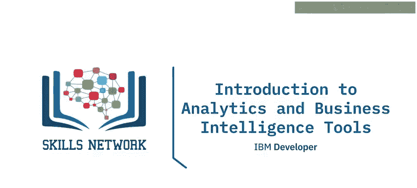

Welcome to Inuction to Anatics and Business Inlig tools After watching this video you will be able to define analytics。

 describe how business intelligence tools have changed analytics processing and results。

 outline the purpose of analytics and business intelligence tools。

 define what an analytics or business intelligence tool is。

 and identify several analytics and business intelligence tools。

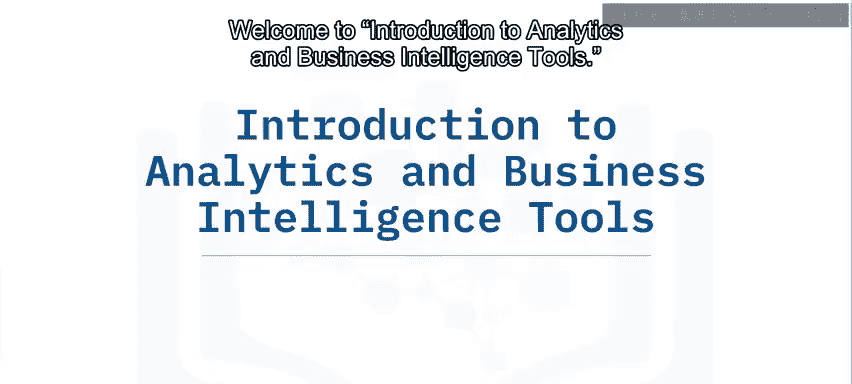

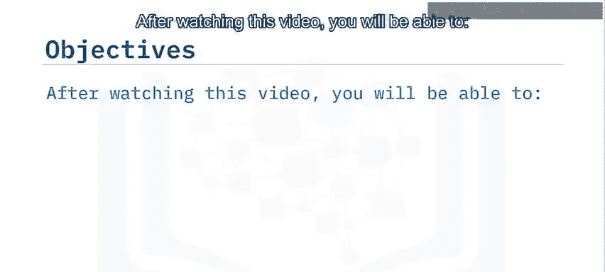

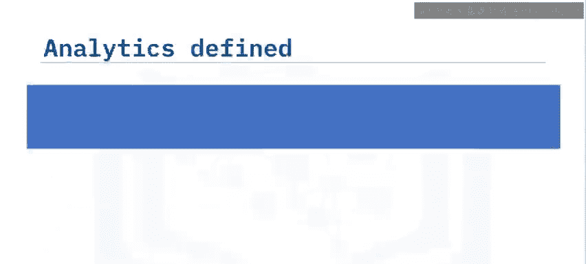

Analytics is the systematic compilation and a section of data statistics and operations research to build models to make better decisions。

 Compute storage processors and memory capabilities have significantly increased speed capacity and affordability The data warehousing solutions available now store large volumes of data with low latency these exponential increases in both capacity and speed for storage processors and memory enable organizations to now process petaflops of data with swift turnaround times。

 When more data is available， analytics are more accurate organizations can use bi tools built in expertise to analyze data and find patterns using machine learning based on statistical modeling。

 Today's analytical tools have reduced the time to churn data so much that results are now almost real time。

 These analytical outcomes can be descript。😊。

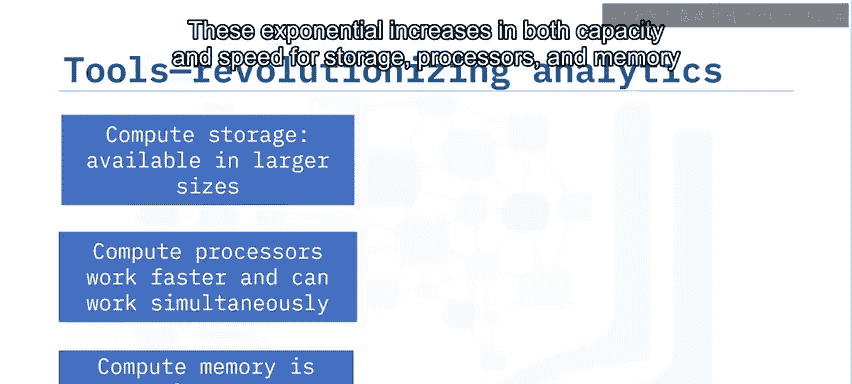

Prescriptive or predictive Descriptive analytics provide insight into the past Pre analytics provide insight into what could happen in the future In contrast。

 prescriptive analytics provide insight into what actions an organizations should take to create a specific outcome in the future。

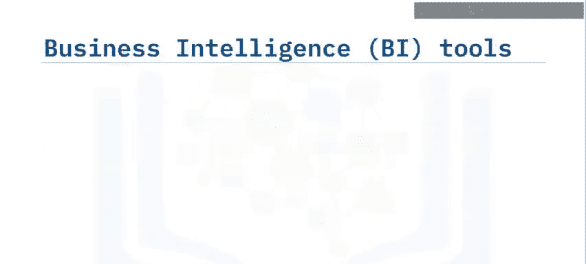

Business intelligence tools or BI tools enable data preparation， data mining。

 data management and data visualization Iment BI tools is much like solving a puzzle to gain a more comprehensive picture of your organization BI tools help organizations focus on the what and the why Business use their data to discover what is happening and determine what trigger a specific outcome BI tools as highly evolved software。

 apply statistics and operations research as part of the process of creating inherent intelligence BI tools also help organizations harness the power of descriptive。

 diagnostic， predictive and prescriptive analytics for operational and strategic decisions Use can analyze business operations through dashboarding。

 reporting and self-serve analytics based on historical current and projected data to transform data into business opportunities。

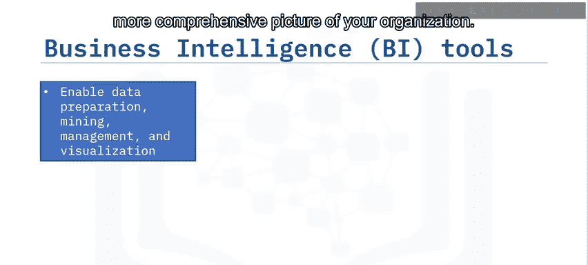

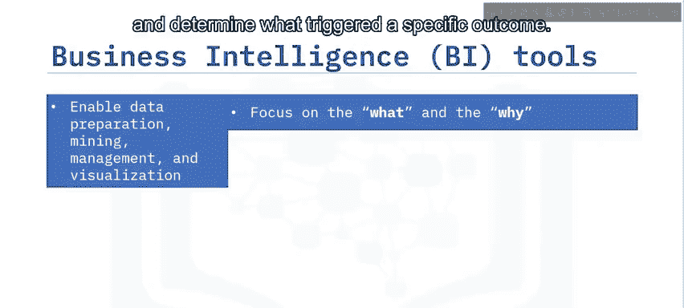

There are many solutions available in the market that empower organizations with the ability to perform advanced analytics。

 some of the wellknow players in the market are IBM Cgnos Ana。

 which integrates Watson analytics that leverages IBM's artificial intelligence and natural language processing。

 Microsoft Power BI， well known for its secure insights， Tableau is known for powerful visualization。

 Oracle Ana Cloud known for its conversational analytics。

 SAP business objects known for its intelligence analytics and Tbco Spotfire offers scalability for small and large organizations。

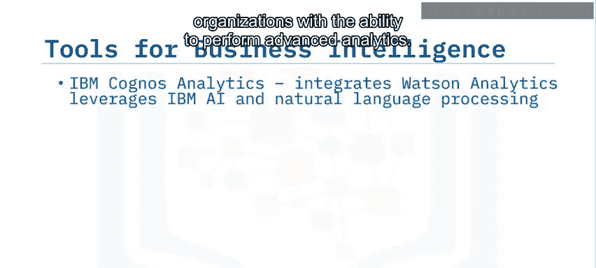

IBM has invested more than $25 billion since 2005 to grow its analytics business Cgnos Analytics is IBM's AI fuel business intelligence and analytics software that supports the entire data analytics lifecycle from discovery to operations。

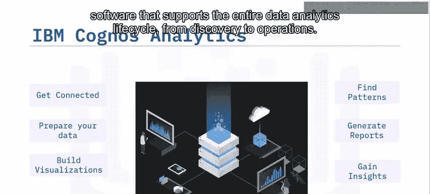

In this video you learned that analytics is building models with data to make better decisions Business intelligence is a technology that enables data preparation。

 data mining， data management and data visualization。

 the software market offers many business intelligence tools。

 and IBM Cgnos Ana is one of the top BI solutions available based on AI。

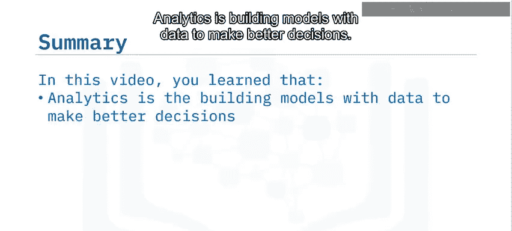