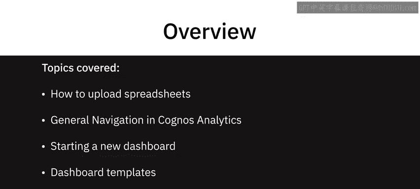
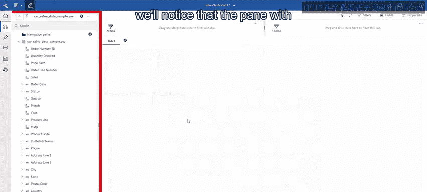
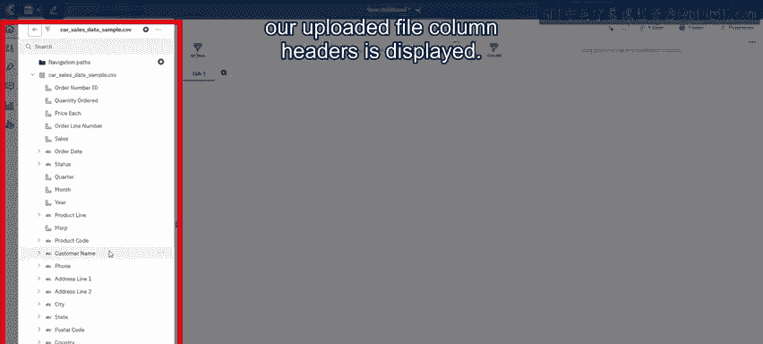
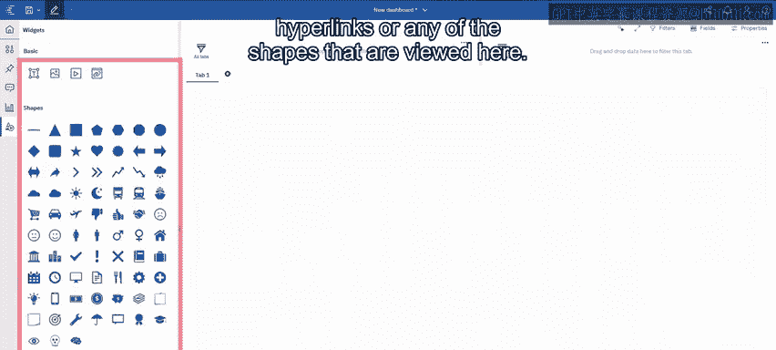
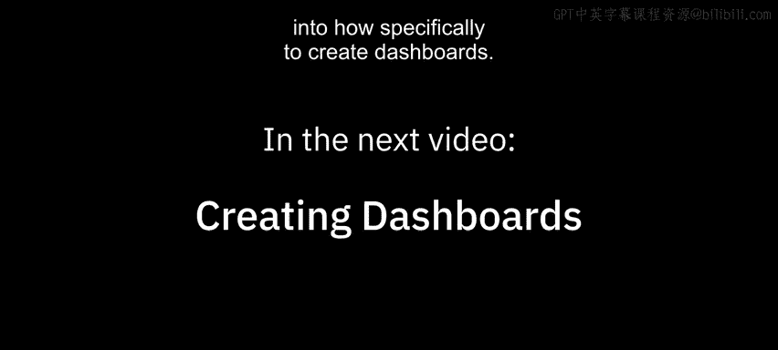

# IBM数据工程专业证书课程9：《数据仓库和BI分析入门》｜getting-started-with-data-warehousing-and-bi - P18：17_在 cognos analytics 中导航.zh_en - GPT中英字幕课程资源 - BV1bN41187mr

嗯。In this particular video， we'll cover off how we can upload spreadsheets。

 general navigation and Cgnos Analy， how to start a new dashboard。

 using dashboard templates as well as navigating within the Cgnos Ana dashboard environment。

There are two main navigation areas for C analytics along the left hand side。

 as well as along the top。These will change an update based on the area you're in the product。

Now for today， while Cgnos can connect to a number of databases。

 we're going to start with simply uploading an Excel file and we can do this in one of two ways we can come to the new。

 select upload files and navigate to find the file in question。Alternatively。

 what we can do is we can drag and drop the file onto our main landing page here and have it take us directly into the experience that we're looking to do。

 in our case here，board。Now you'll notice that this says that uploaded content will land in my content。

 which is up there on the left hand navigation， whether you do it from here or through the plus and upload。

 it'll still land in the same place once in my content it can be taken moved around into a shared area within Team content。

As the file uploads here， you'll notice that we see something that says analyzing。

 this allows us to integrate the data。Get an understanding of what's in the data in order to be able to help make some better assumptions and decisions for you as we look to build out content。

The first thing we'll do is we go to build a dashboard is to select a template。

You'll see a number here and based on what you're trying to achieve。

 how many visualizations and what types you may want to select something specific in this case I'll choose one that has four and one larger space。

Once we're in the dashboard， we'll notice that the pane with our uploaded file。

Column headers is displayed， there's a few other things that we want to highlight here in terms of navigation to help you with the experience here in Cgnos Analytics。

Our second pin down here allows you to pin different visualizations for reuse in other dashboards across the system。

We'll come back to our assistant in a future video。

 but this allows you to ask questions in natural language and have the system tell you a little bit about your data as well as provide some visualizations。

Next system here is our view of all the different visualizations we support in the dashboard。

As well as the ability to upload your own custom visualization， should we not have one that。

Meets your needs。The final。One here is our additional widgets， whether that's text， images， video。

 hyperlinks， or any of these shapes that are viewed here。

In the next video， we'll dive a little bit deeper into how specifically to create dashboards。

