# IBM数据工程专业证书课程9：《数据仓库和BI分析入门》｜getting-started-with-data-warehousing-and-bi - P1：0_数据仓库概述.zh_en - GPT中英字幕课程资源 - BV1bN41187mr

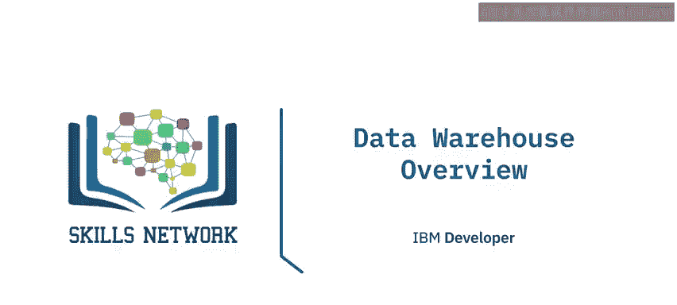

Welcome to data warehouse Over After watching this video。

 you will be able to define a data warehouse， identify data warehouse use cases。

 and list the benefits of a data warehouse a data warehouse is a system that aggregates data from one or more sources into a single central consistent data store to support various data analytics requirements。

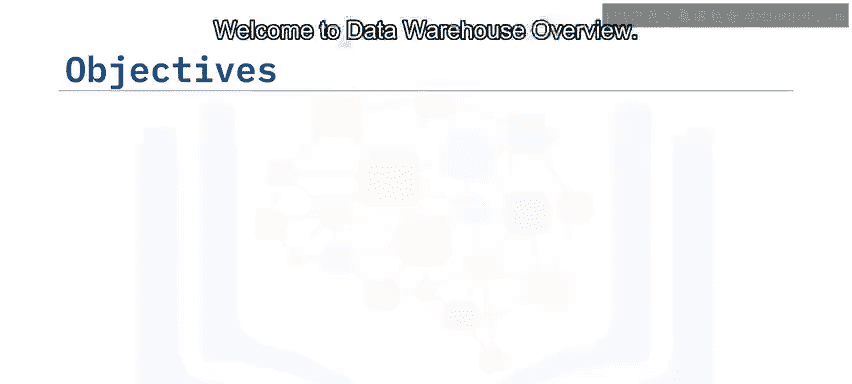

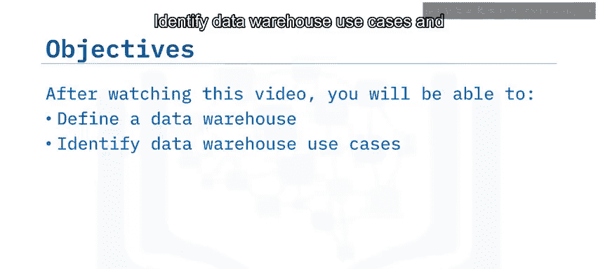

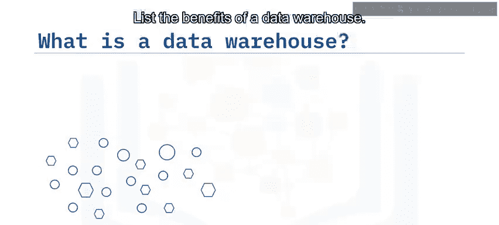

Let's take a closer look at data warehouse analytics Data warehouse systems support data mining。

 including the application of artificial intelligence and machine learning data transformation during the ETL process。

 speeds frontend reporting， delivering critical information fast data warehouses enable online analytical processing known as OLAP。

 which provides fast， flexible multidimensional data analysis for business intelligence and decision support applications。

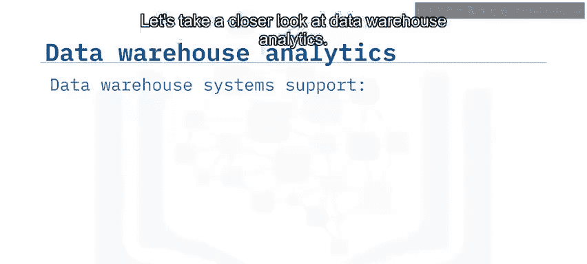

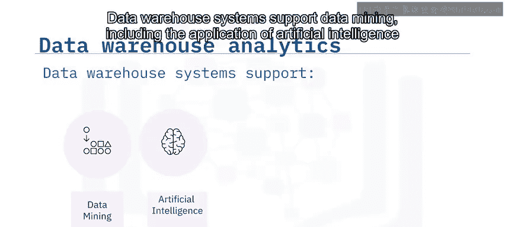

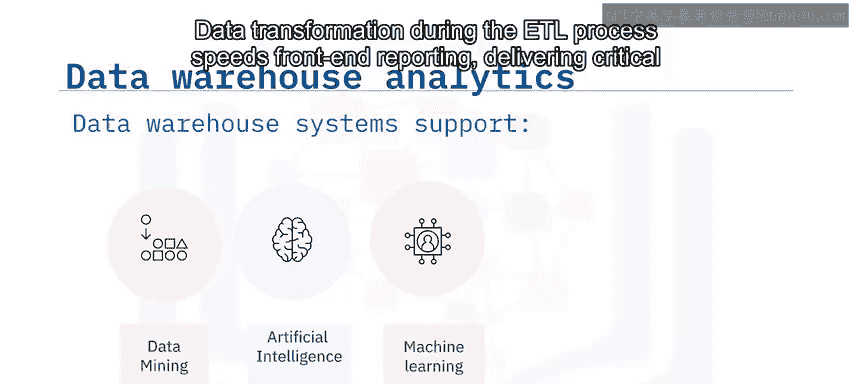

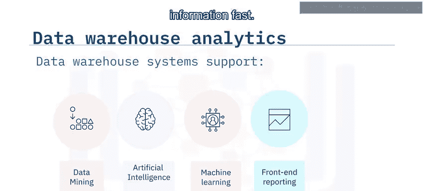

Traditionally， data warehouses have been hosted on premises within enterprise data centers。

 initially on mainframes and then on UniX Windows and Linux systems data warehouse appliances emerged with the growth of more extensive data volumes in the 200s these appliances consisted of a pre-integrated bundle of specialized hardware and optimized data warehouseehousing software that reduced large- scale data warehousing management overhead in the last decade or so with exponential amounts of data being generated and stored in the cloud。

 cloud data warehouses frequently called CDWs have gained popularity where organizations don't purchase hardware or install warehouseehousing software instead organizations access data warehouses as a scalable pay as you go service Now that you can define what a data warehouse is identify where data warehouses exist and understand their basic structure and。

Let's examine what organizations use data warehouses data warehouses are a part of almost every industry。

 including e-commerce， transportation， medical， banking and fintech social media and governments but why do these types of organizations use data warehouses Let's learn more retail and e-commerce organizations use data warehouses to analyze and report on sales performance These organizations also apply machine learning assisted shopping that provide shoppers with relevant recommendations that drive additional sales by applying artificial intelligence to patient data。

 healthcare providers can access the most recent insights and use that information to diagnose and treat their patients with greater accuracy？

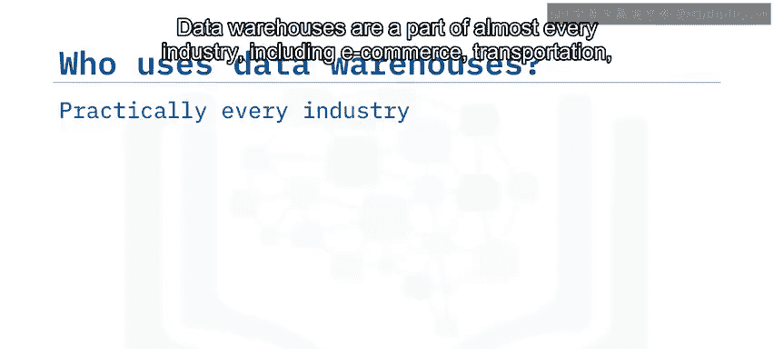

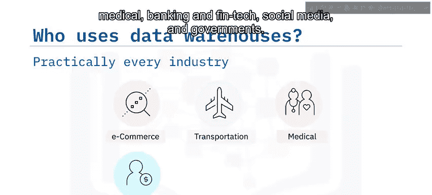

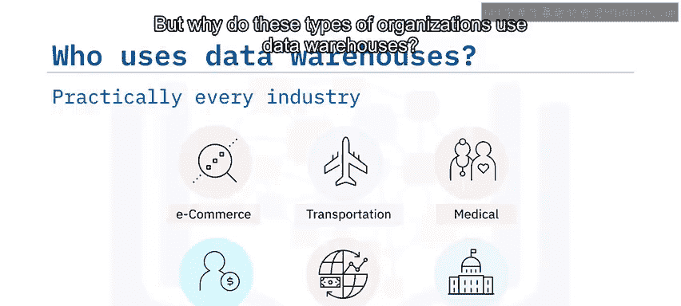

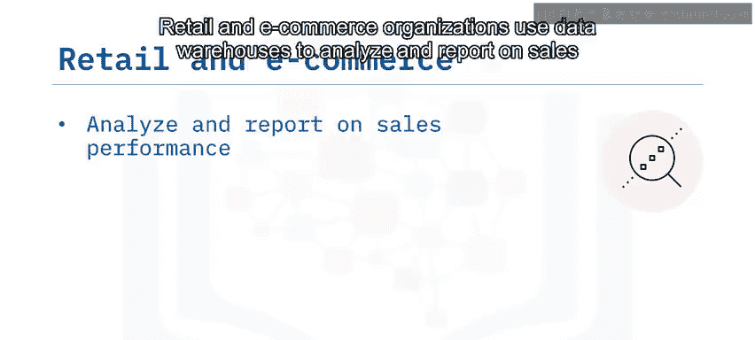

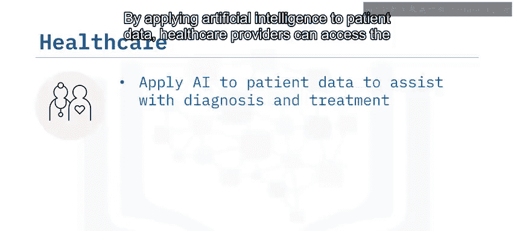

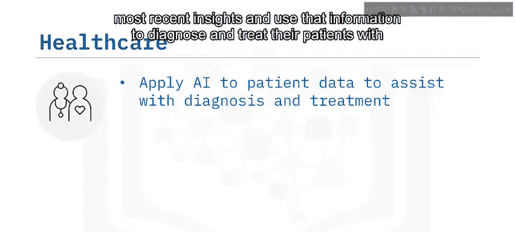

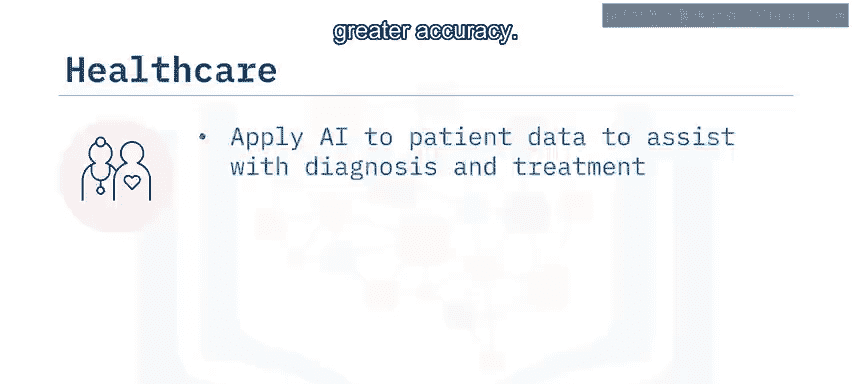

BI capabilities enable transportation providers to optimize routes， travel times。

 equipment needs and staffing requirements Financial tech organizations including banking apply data analytics to evaluate risks。

 detect fraud and cross-sell services social media organizations need analytic capabilities that can quickly measure everchan customer sentiment and project product sales Governments apply business intelligence to analyze and evaluate citizen focused programs and assist with policy change decisions so what are the benefits of a data warehouse data warehouses enable organizations to centralize data from disparate data sources such as transactional systems。

 operational databases and flat files data integration removing bad data。

 eliminating duplicates and standardizing data creates a single source of truth that results in better data quality for analysis。

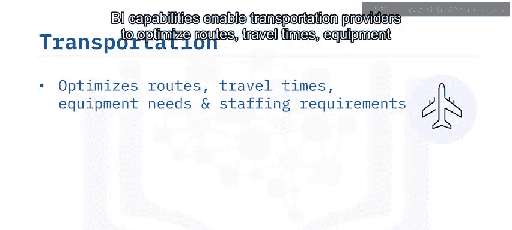

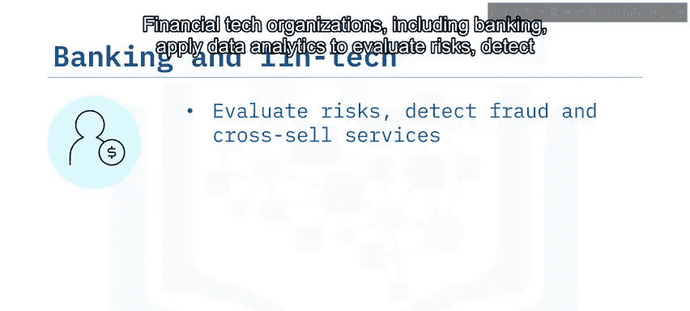

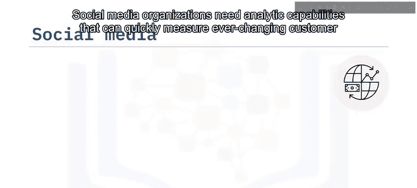

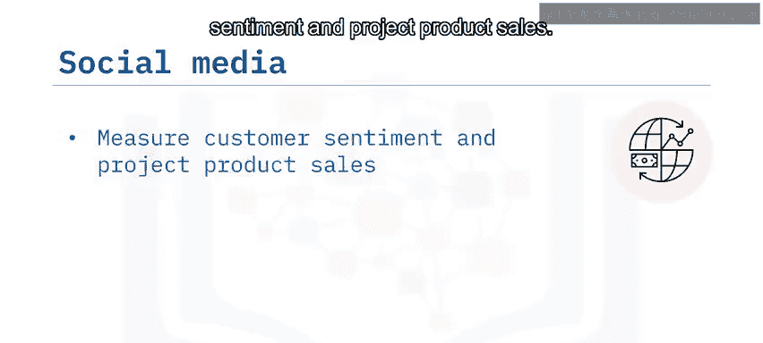

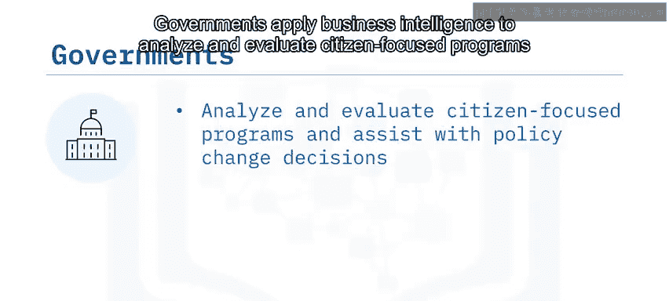

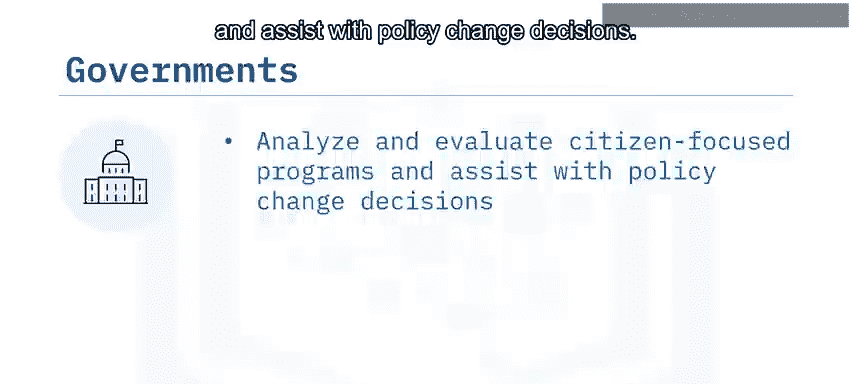

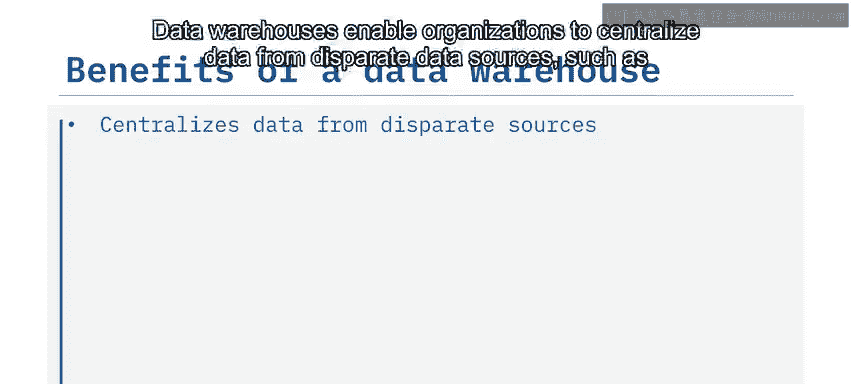

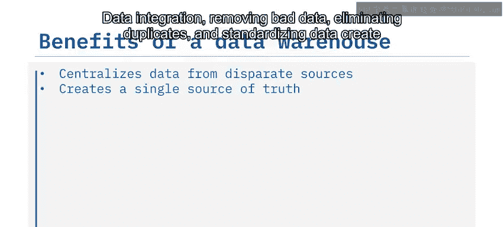

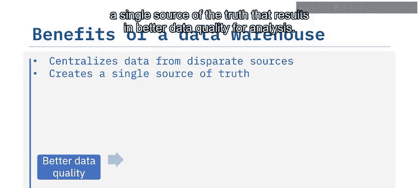

Single source of truth empowers users to leverage all the company's data and access that data more efficiently In addition。

 separating database operations from data analytics generally improves data access performance leading to faster business insights Next。

 large scale BI functions such as data mining， artificial intelligence and machine learning tools facilitate smarter decisions by data professionals and business leaders These capabilities build on each other to give organizations the means and opportunity to realize competitive advantages and gains。

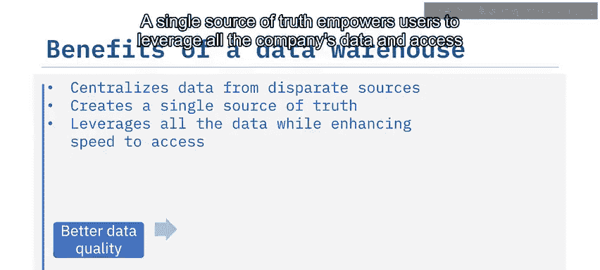

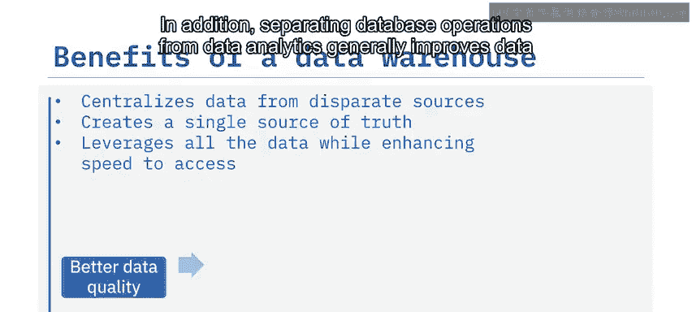

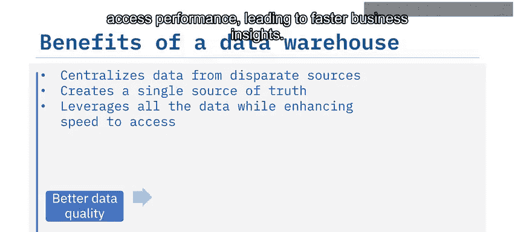

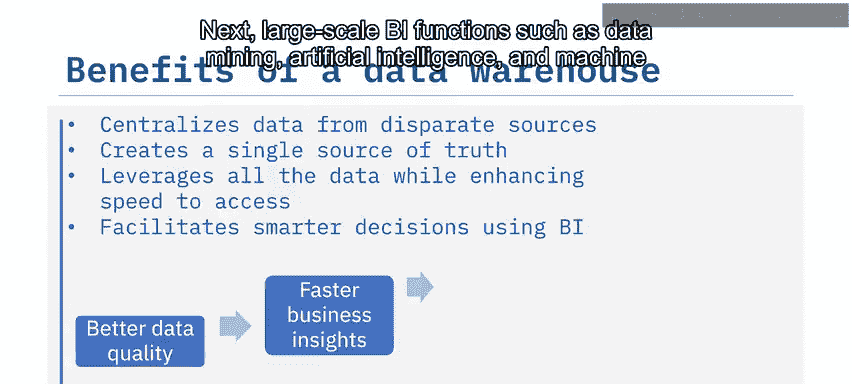

In this video you learned that a data warehouse is a system that aggregates data from one or more sources into a single consistent data store to support data analytics。

 data warehouses support data mining， AI and machine learning， OLAP， and frontend reporting。

 and finally， data warehouses and BI help organizations improve data quality。

 speed business insights and improve decision making， all of which can result in competitive gains。

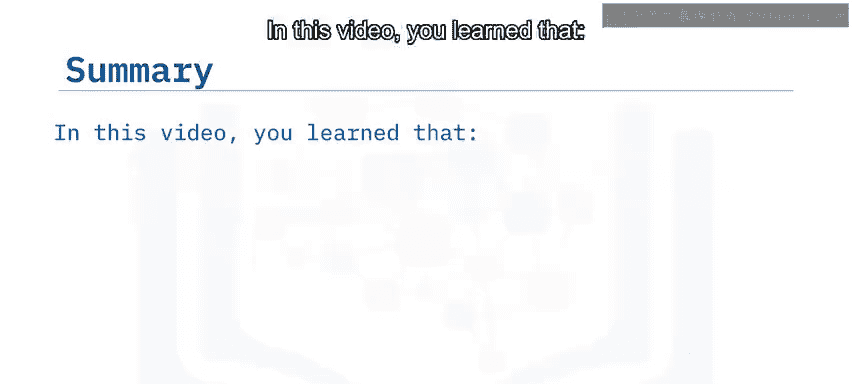

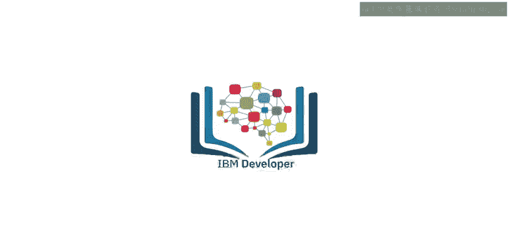