# IBM数据工程专业证书课程9：《数据仓库和BI分析入门》｜getting-started-with-data-warehousing-and-bi - P21：20_使用 cognos 访问您的仓库.zh_en - GPT中英字幕课程资源 - BV1bN41187mr

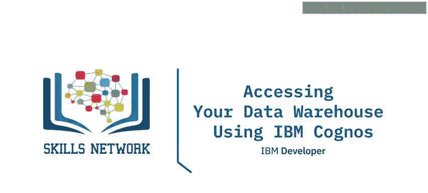

Welcome to Accessing your data warehouse using IBM CgnoOS After watching this video。

 you will be able to describe the steps involved in accessing a database or data warehouse from Cgnos Anatic。

 create an interactive dashboard using data in the data warehouse and add multiple visualizations to the dashboard。

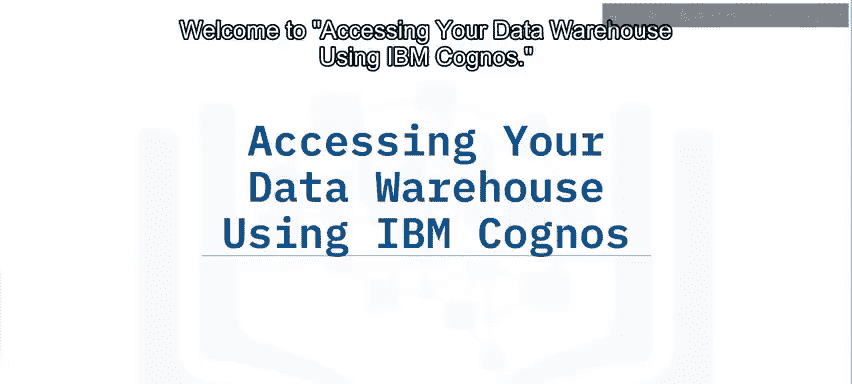

In addition to files and static datasets， you can use Cgnos Analy to access a variety of databases and data warehouses。

 both on the cloud and in your enterprise， including IBMDB2 Warhouse， Amazon RedSshift， Oracle。

 Microsoft SQL Ser， MongoDB， MySQL， PostgresQL， Snowflake and others。

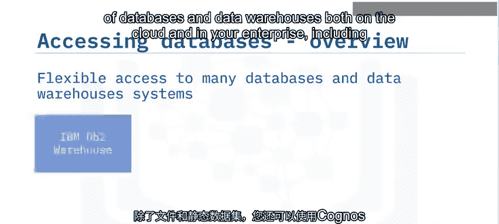

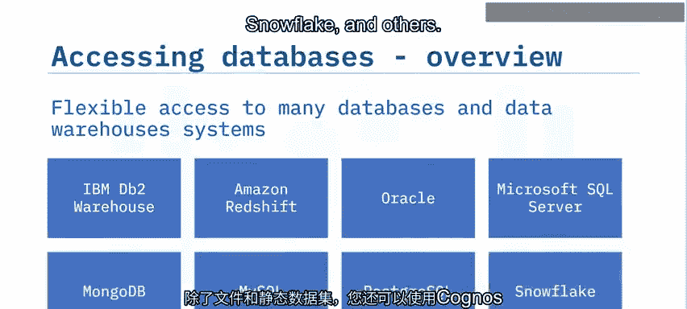

First identify the source databases， including schemas and tables and obtain their connection credentials Next。

 within Cgnose Ana， you'll create data Ser connections to the selected databases and then for each connection。

 create data modules for the selected tables。

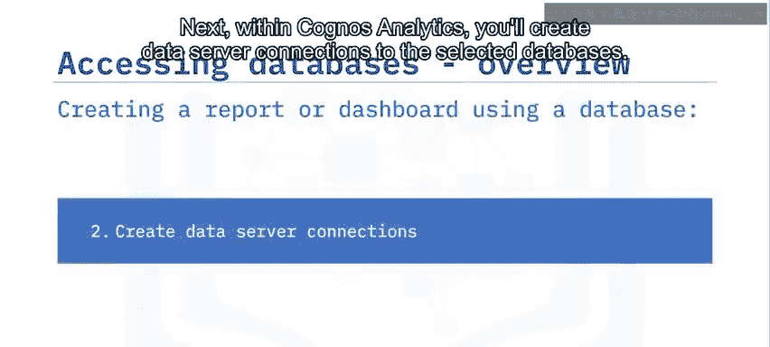

Next， create a dashboard and add the data modules as sources。

And then drag columns from the data module onto the dashboard canvas Let's see these five steps in action for this demo。

 you will use an IBM DB2 on cloud database as the source data warehouse First。

 you need to obtain the service credentials to connect to the database from the DB2 instance page by clicking new credential。

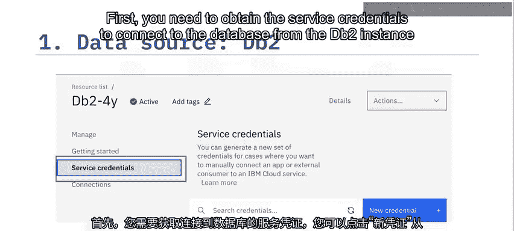

Now you need to name the service credential， set the role to Manager。

 and click add to add the service credential。

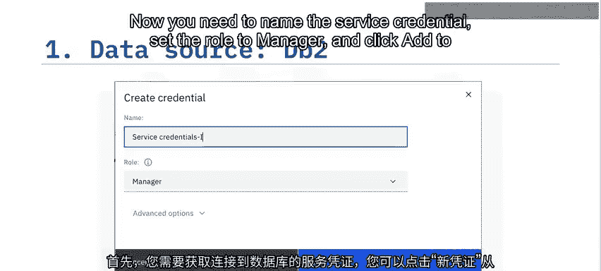

Scrolling down you can see the service credential you just created displayed within the service credentials list Click the credential drop down arrow to view the credentials details Here's a snippet of the service credential details copypy the username password and the JDBC URL you will need to replace the placeholder values for the username and password in the JDBC URL with actual values Remember to remove the angle brackets。

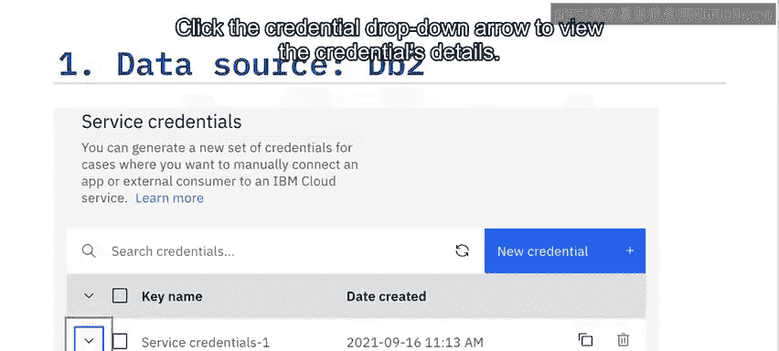

Next， let's identify and preview the data that is the schema and tables that you need for the Cgnos dashboard Under manage click go to UI This action opens the page where you can view。

 edit and administer the DB2 instance。

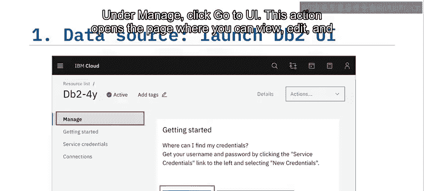

Within the DB2 UI， click the data icon， select the schema and select the table you want to use for your dashboard in Cgnos Analytics。

 select the customer loyalty table。

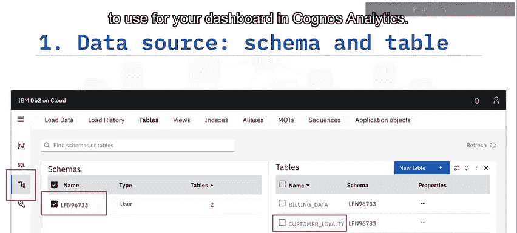

Here you are previewing the customer loyalty table in the LFN 96733 schema viewing your table provides ideas about the data attributes you can visualize。

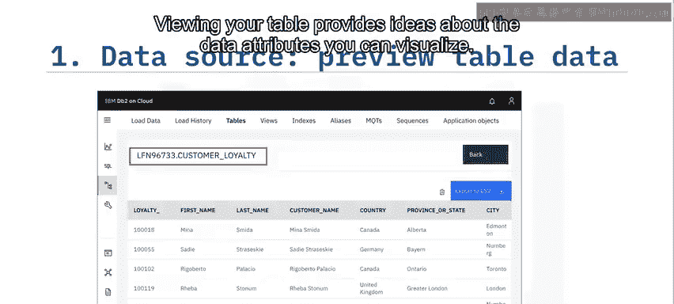

Now that you have the database credentials and identify the data you want to visualize。

 go to the Cgnos Analytics webpage， click the hamburger menu and then manage。

 you'll see several management options， but your task is to click Data Server Connect to connect with a data Ser click the plus icon to view the data warehouse options that you can connect to using Cgnos。

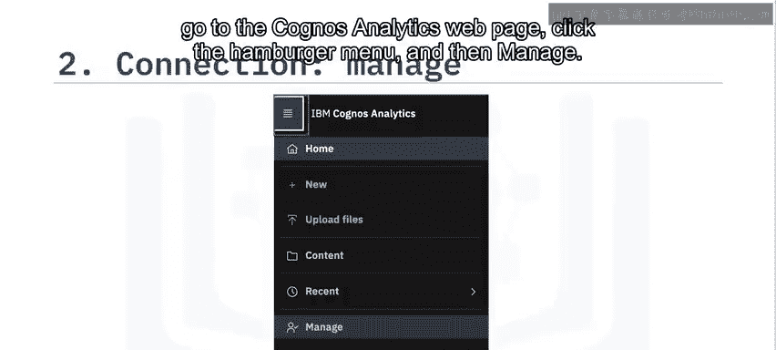

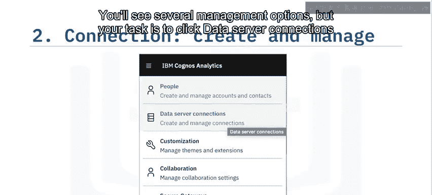

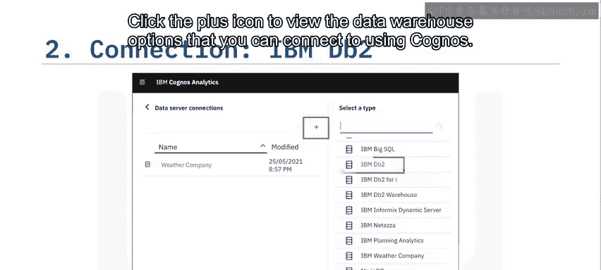

Next， click IBM DB2。Now click the option to connect anonymously and paste the JDBC connection string you copied from the DB2 Instance Administration page。

 replace the username and password with your DB2 service credentials。

 and click test to ensure you have a successful data connection。

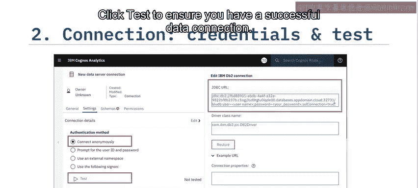

If the test was successful， you'll see success with a green checkmark icon you can then name the connection here the connection is named my DB2。

 click Save。

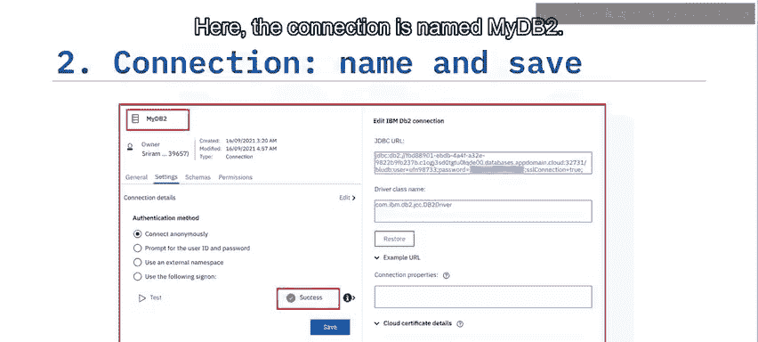

Next， you'll load the schema， go to the schema tab and click the three dots next to the schema you want to load。

 then click load metadata This action takes a few seconds while cgnos fetches and loads the metadata from the DB2 instance。

Once the metadata is loaded， you'll see a green check mark next to the schemeche and name。

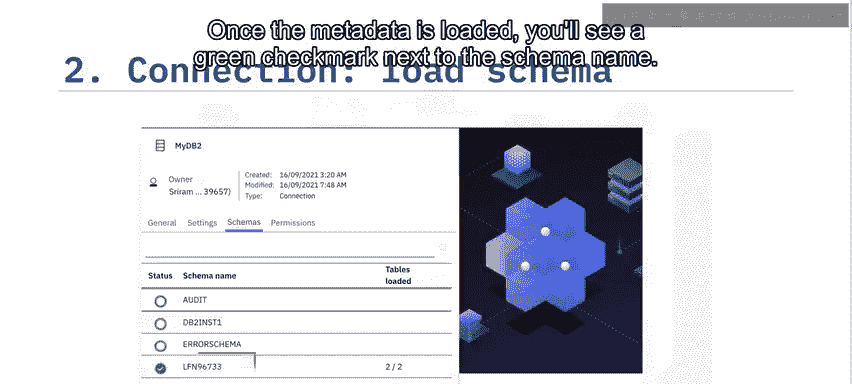

Now that you have connected to the DB2 instance， you create a new data module that will link to the source data this action opens a page where you can select the data source。

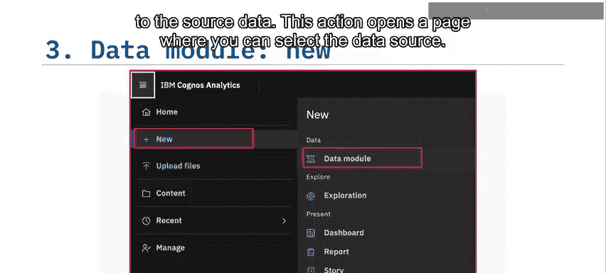

Click the Data Sers icon in the left pane， then click myDB2。

 which is the connection you previously created。Here。

 click the schema you want to use and click OK When the new module opens， click the table name。

 Cgnos will open the table and you can view the data， click the file icon to save the table。

Give the data module an applicable name here the data module is named My customer Lo module and is saved within the My contenttent folder。

 click Save。

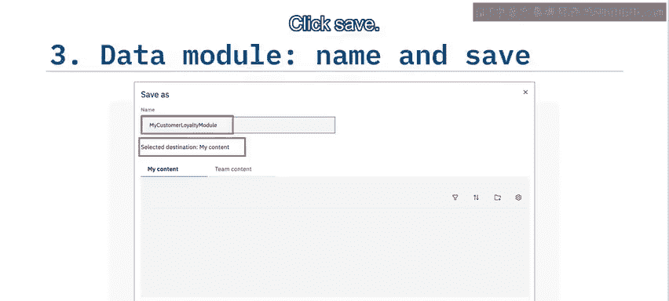

Now that the data module is created， you will use it to create your dashboard on the IBM Cgnos Analytics menu。

 click New and then click Dashboard， you can select the tabbed or infographic layout with multiple template options in each for this demo session。

 you click this template and then click Create。

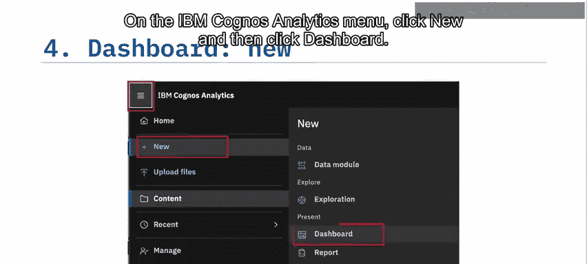

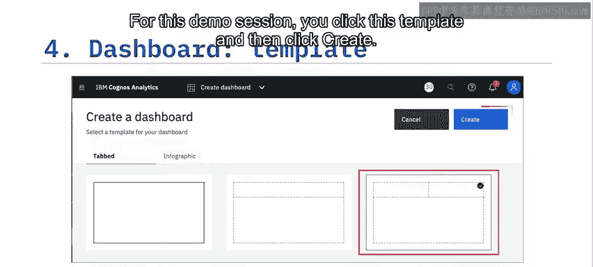

ClickSe a source to choose the data module to use for the dashboard。

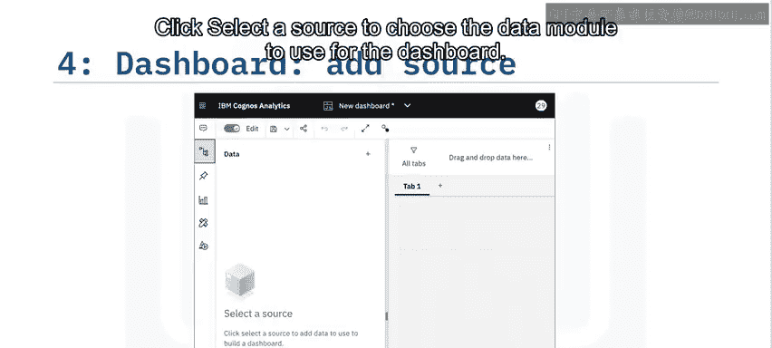

In the dashboard window， click the MyCustom loyalty data module in the name column Azure source and then click add。

In the left pane of the My customer loyalty data module。

 drag the attributes that you want to see onto the dashboard in this example the quantity sold is selected。

You can see the total quantity sold along with the title。

 which is the field label by default you can double click the label to change or format the text you can also adjust the attribute's length width and position based on your design requirements。

Next， drag the attributes into the tabbed area and render them as a barpl The attributes are rendered as a bar plot showing the sale for each product line over the years。

 you can adjust the size and position of the tab and you can add a title and format it like the quality sold attribute for the third tab。

 let's drag country below quantity sold to visualize regional sales。

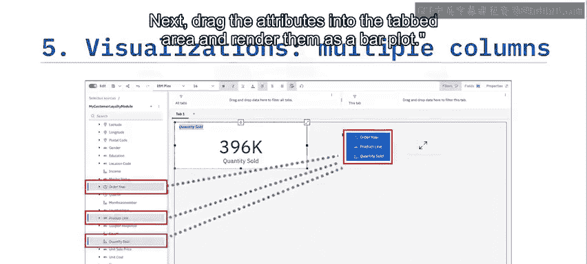

The world map appears。 you can adjust the size of the region based on your needs。

 Let's add some attributes to the map。

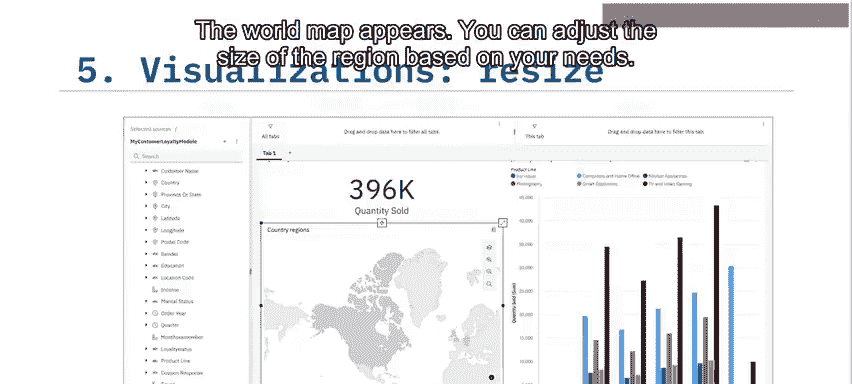

You want to add quantity sold so that you can visualize regional sales。

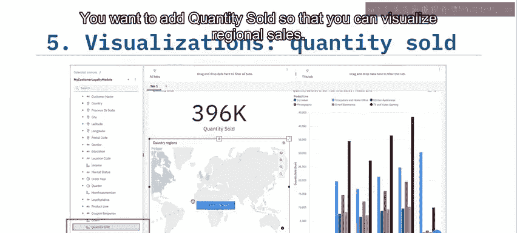

Now， when you click a particular region， you can see the bar graph and the quantity sold is updated as per the selected region Here is a glimpse of the finished dashboard remember to save your completed dashboard with an appropriate link Cgnos makes it easy for you to share the finished dashboard as a viewable link。

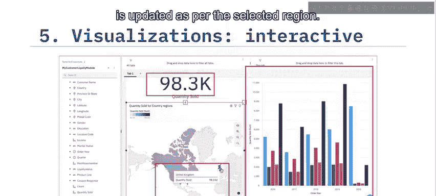

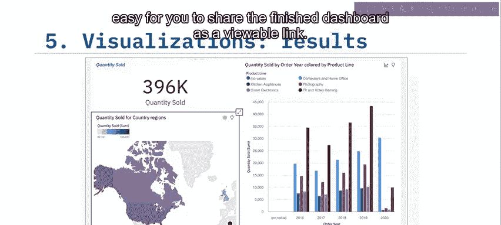

In this video you learned that you can create dashboards and reports in Cgnosse analytics using various data sources。

 including flat files， databases and data warehouses。

 accessing a database in Cgnos requires a data server connection and a data module。

 a data server connection establishes a connection to the database and a data module is a container or link to specific tables and database objects you can add a data module to a dashboard just like any other source and use its fields and columns to create visualizations。

And Cgnos Analytics offers a variety of templates and visualization options to create interactive dashboards using data from data warehouses。

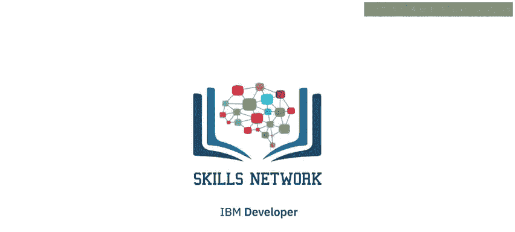