# IBM数据工程专业证书课程9：《数据仓库和BI分析入门》｜getting-started-with-data-warehousing-and-bi - P3：2_选择数据仓库系统.zh_en - GPT中英字幕课程资源 - BV1bN41187mr

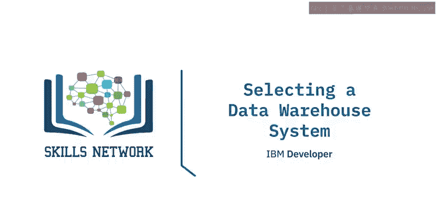

Welcome to selecting a Data warehousee System。

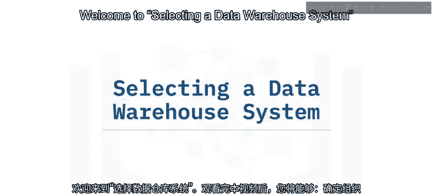

After watching this video， you'll be able to identify criteria that organizations can use to evaluate data warehouse systems。

 Describe key considerations for each data warehouse selection crion summarize how organizations decide between on premises or public cloud data warehouse system and list the various types of warehouse costs。

😊，Let's look at the criteria businesses use to evaluate data warehouse systems。

 including features and capabilities， compatibility and implementation considerations。

 ease of use and skills， support considerations and various costs。

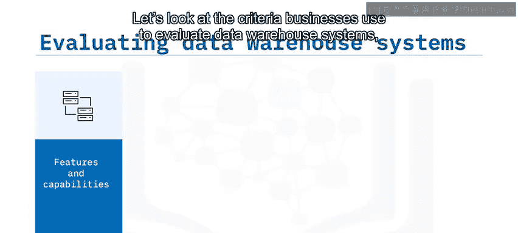

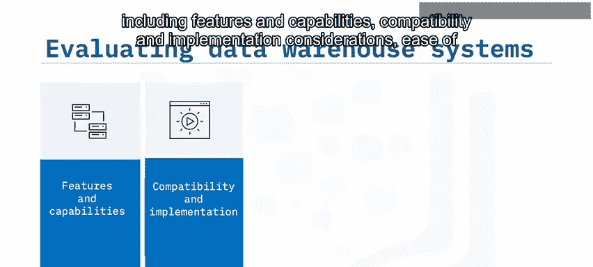

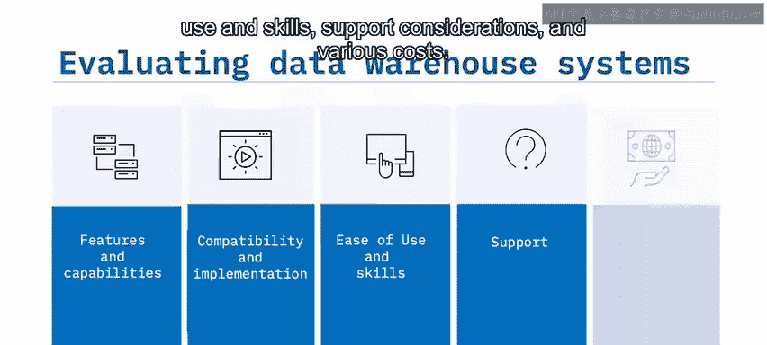

One of the primary data warehouse features or considerations for an organization is location data warehouses can exist on premises。

 on appliances， or on one or more cloud locations。

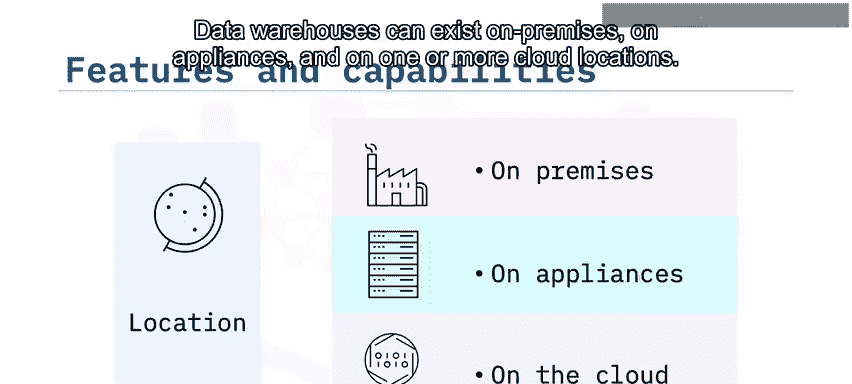

To select a location， organizations must balance multiple demands related to data ingestion。

 storage and access for some organizations， securing their data is their highest priority。

 requiring a mandatory on- premises solution， multilocation businesses that grapple with data privacy requirements such as CCPA or GDPR need on- premises or geospecific data warehouse locations。

 Each organization balances security and data privacy requirements with the need for speed that delivers critical profit producing business insights。

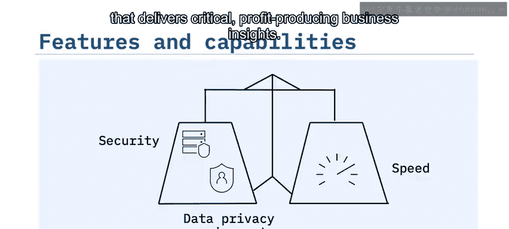

Organizations will also want to consider features and capabilities related to architecture and structure is the organization ready to commit to a vendorspec architecture does the organization need multi-cloud installation such as multiple data warehouses in multiple locations does the solution scale to meet anticipated future needs What data types are supported and what types of data does the organization ingest if your organization currently analyzes dark data or is planning for the implementation of using semistructured or unstructured data you'll want a data warehouse system that supports these data types and an organization that processes big data needs a system that supports both batch and streaming data capabilities that affect the ease of implementation include data governance data migration and data transformation capabilities with the data warehouse system in place how easily。

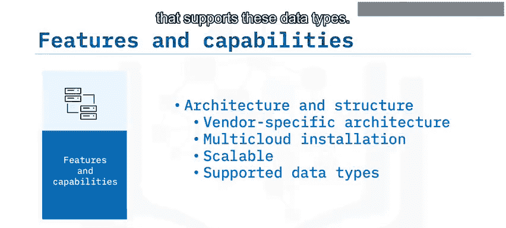

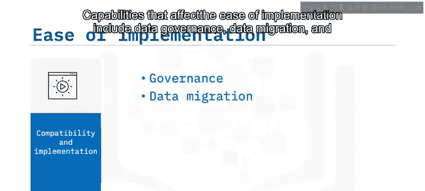

and the organization optimize and reoptimize system performance as needs change Another consideration is user management with more organizations implementing a zerot security policy because of expensive data breaches。

 implementing programs that manage and validate system users is mandatory and notifications and reports are essential for organizations to correct errors and mitigate risks before minor issues become larger problems。

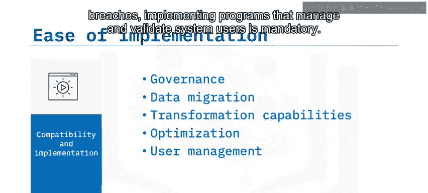

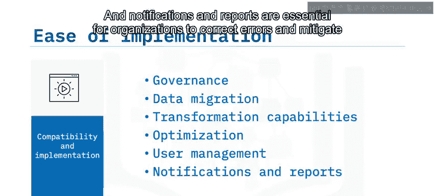

Let's explore ease of use and skills。 Does your organization's staff have the skills needed to implement a specific data warehousing vendor's technology and if not。

 how quickly and easily can they gain those skills Complex large data warehouse deployments can require additional work from your implementation partner so their expertise also greatly matters Finally。

 do the technology and engineering staff who architect， deploy and administer front end querying。

 reporting and visualization tools have the skills needed to configure your new system quickly Next。

 let's review some support considerations。😊。

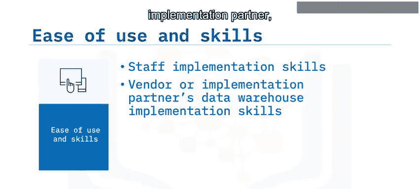

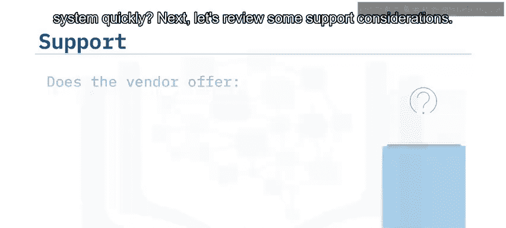

Support is essential and can become frustrating and expensive if not well planned for you might find that by using a single vendor。

 you can leverage one highly accountable responsible source， potentially saving you time。

 money and frustration you'll also want to verify the availability of service level agreements for uptime security。

 scalability and other data warehouse system issues validateate the vendor support hours and channels such as by phone。

 email， chat or text Finally， does the vendor offer self-service solutions and an active rich user community after all this analysis it's time to evaluate and compare costs When calculating costs for a data warehouse system consider more than the initial costs Consider the total cost of ownership or TCO for running systems for several years TCO includes infrastructure such as compute and storage costs。

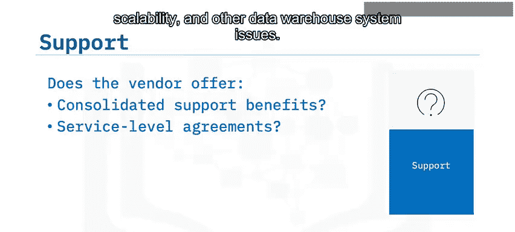

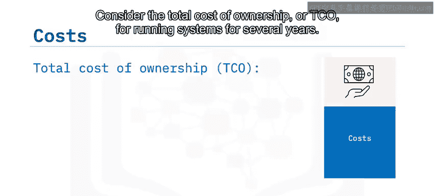

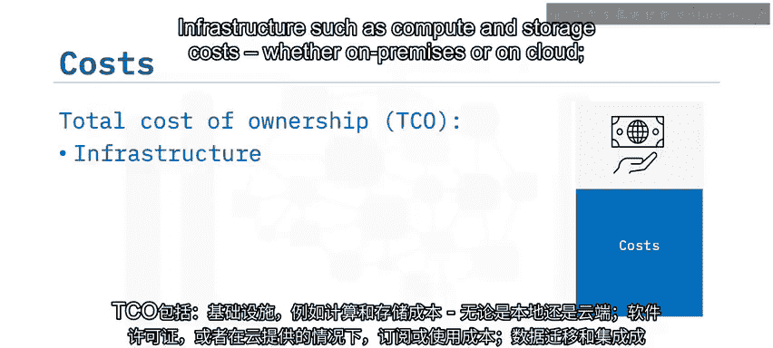

Whether on premises or on cloud， software licensing or in case of cloud offerings。

 their subscription or usage costs， data migration and integration costs for moving data into the warehouse and pruning and purging as required。

 administration costs related to system management and personal training and recurring support and maintenance costs paid to the warehousing vendor or implementation partner。

In this video， you learned that businesses evaluate data warehouse systems based on features and capabilities。

 compatibility and implementation， ease of use and required skills。

 support quality and availability and multiple cost considerations。

 an organization might need a traditional on- premises installation to adhere to data security and privacy requirements。

 public cloud sites offer organizations the benefits of economies of scale。

 including powerful compute power and scalable storage。

 resulting in flexible price for performance options， and when selecting a data warehouse system。

 Consider the total cost of ownership， including infrastructure， compute and storage， data migration。

 administration and data maintenance costs in your calculations。

