# IBM数据工程专业证书课程9：《数据仓库和BI分析入门》｜getting-started-with-data-warehousing-and-bi - P4：3_可选 ibm db2 warehouse.zh_en - GPT中英字幕课程资源 - BV1bN41187mr

Welcome to IBM DB2 Warhouse。After watching this video。

 you'll be able to describe key features of the IBM DB2 War， list IBM DB2 War use cases。

 and list key pipeline tool capabilities and integrations with DB2 War。

IBMDB2 warehouse is a complete data warehouse solution that offers a high level of control over your data and applications DB2 warehouse is easy to deploy within containerized environments such as Docker。

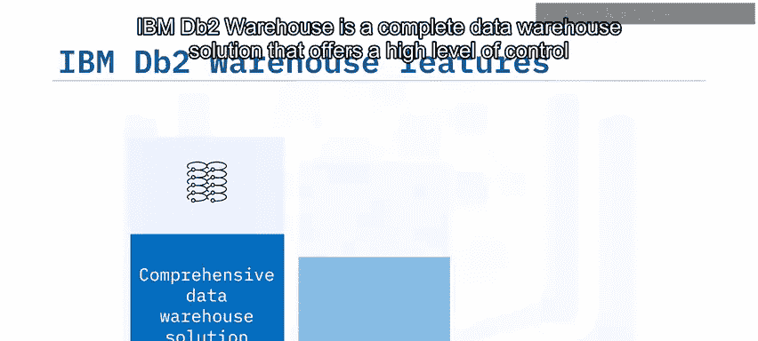

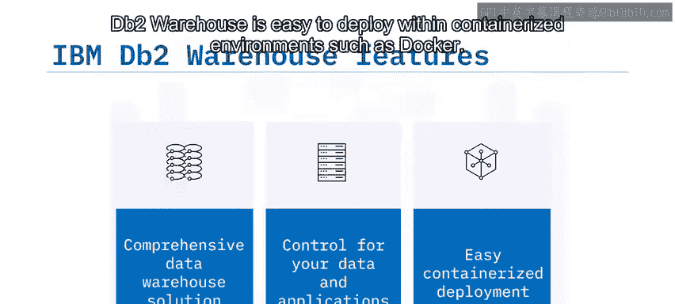

DB2 warehouse is a highly flexible data warehouse for client managed on premises。

 cloud and hybrid environments that scales automatically with massively parallel processing known as MPP to support containerized deployments DB2 warehouse comes prepackaged with access to machine learning algorithms and utilizes in database business analytics for speed。

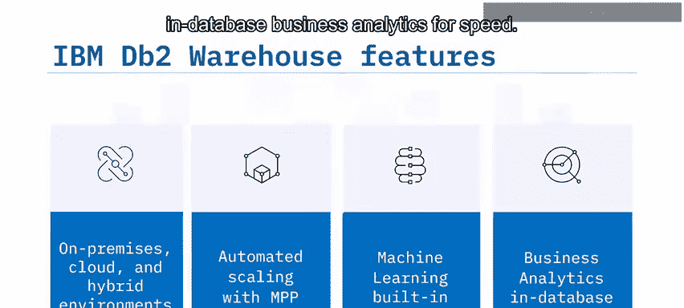

DB2 warehouse enables you to automatically generate data schemas and seamlessly transform and load unstructured data sources into a structured format for analysis DB2 warehouse speeds queries using blue acceleration。

 which includes inmemorySQL columnar processing data skipping and as mentioned before。

 a massively parallel processor cluster architecture that speeds complex queries。

 DB2 warehouse supports your AI analytics needs。

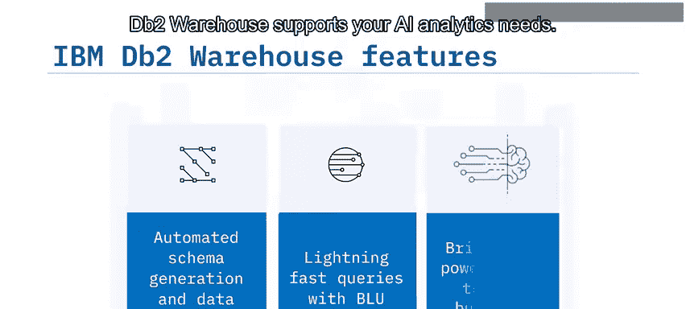

DB2 warehouse comes with dashboards for monitoring performance and reporting issues。

 Some examples of included widgets are hardware and software issue counts， database alerts。

 and the amount of allotted storage used。 You can also view a breakdown of how much time is spent in different states。

 such as waiting for locks and time to execute SQL queries and a table of details regarding any database alert events。

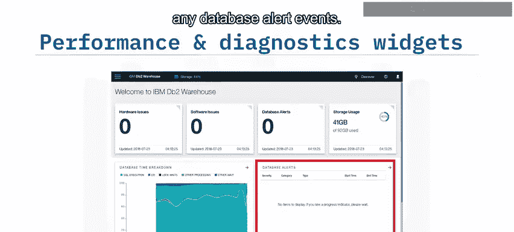

There are many other widgets available， such as system and data Ser， CPUU U， history， and others。

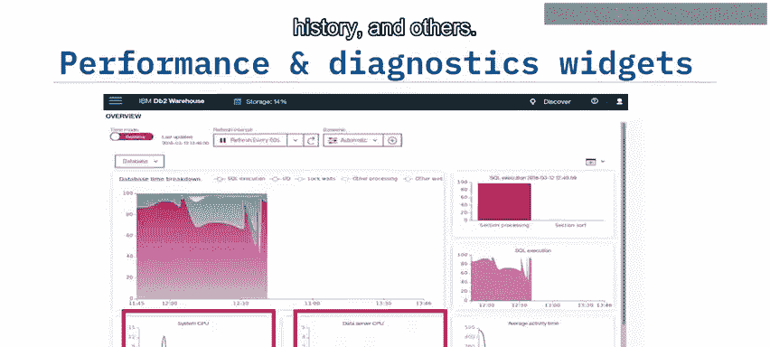

Some of the use cases that DB2 warehouse is well suited for include elasticity or high scalability requirements。

 cloud on premises or hybrid hosting， consolidation and integration of disparate data sources。

 rapid development of line of business analytics products such as data mars。

 management of sensitive or regulated data and storage of older， colder structured SQL data。

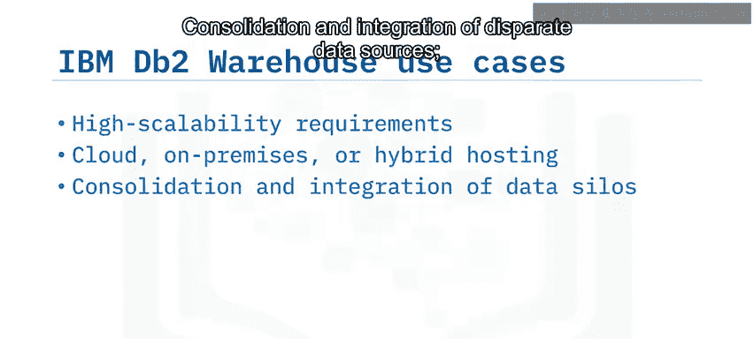

DP2 Warhouse supports a range of clients and plugins， including Java Data connectivity or JDBC。

 nodede JS， Spring， Python， R， go， Spark， and Microsoft Visual Studio。

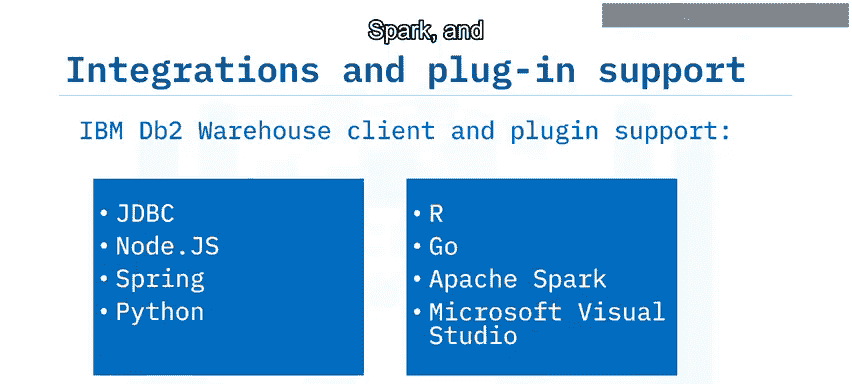

IBM DB2 warehouse， with its integrated Apache Spark cluster can be partitioned and deployed across a cluster of machines。

 you can submit Apache Spk jobs through stored procedures to run against DB2 warehouse extending your analytical reach。

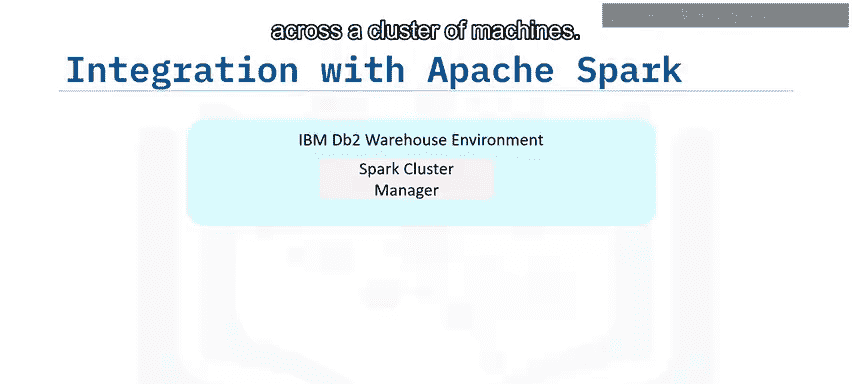

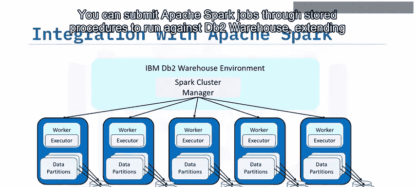

You can use RSt to analyze Wrangle， model and visualize your data with DB2 warehouse For example。

 you can create your own Docker image that contains RSt and all the packages and drivers you need to connect to DB2 warehouse。

 you can even develop applications that run R code， integrate it with DB2 through a RE API。

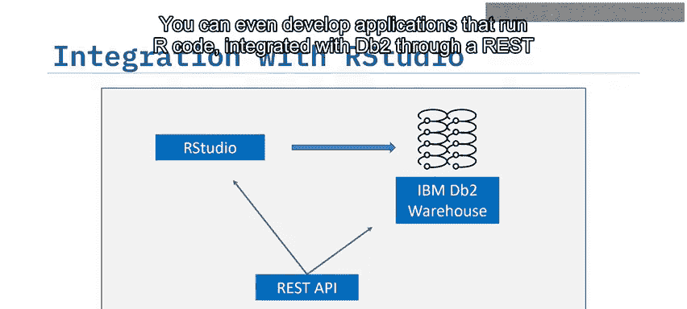

DB2 Warhouse also has a range of commonly used open source drivers available on GitHub in the IBMDB repository。

 for example， under popular repositories， you can find the Python IBMDB package。

 which provides a Python interface for connecting to IBMDB2。

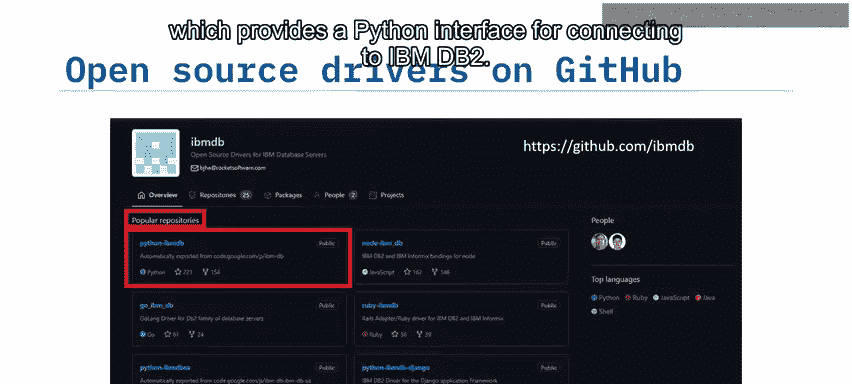

In this video， you learned that IBM DB2 warehouse is a cloud ready。

 highly flexible data warehouse platform， key features of IBM DB2 warehouse include speed。

 Scalability， automated schema generation and built in machine learning。

 Use cases include data integration and rapid development of data Mars。

 and DB2 warehouse integrates with JDBC， Apache Spark， Python and RSt。

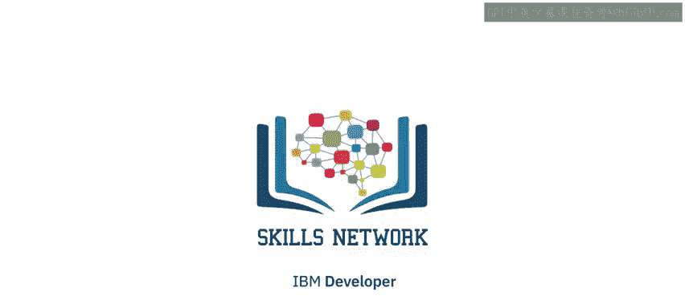