# IBM数据工程专业证书课程9：《数据仓库和BI分析入门》｜getting-started-with-data-warehousing-and-bi - P8：7_数据仓库体系结构概述.zh_en - GPT中英字幕课程资源 - BV1bN41187mr

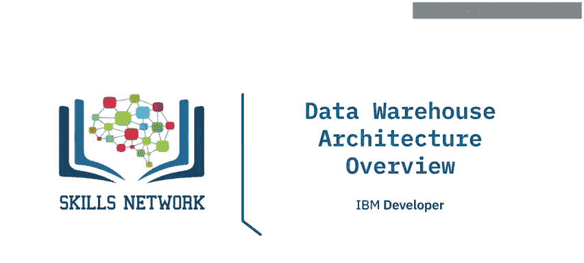

Welcome to Data warehousehouse Architecture Overview After watching this video you will be able to list use cases that drive data warehouse design considerations。

 describe a general data warehousing architecture and list its component layers。

 distinguish between general and reference enterprise data warehouse architecture。

 and describe reference architecture for an enterprise data warehouse platform。

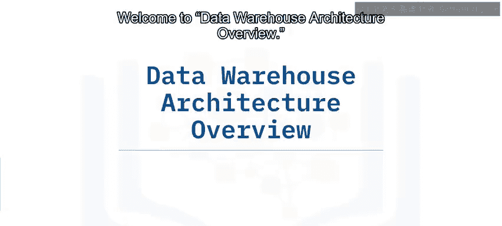

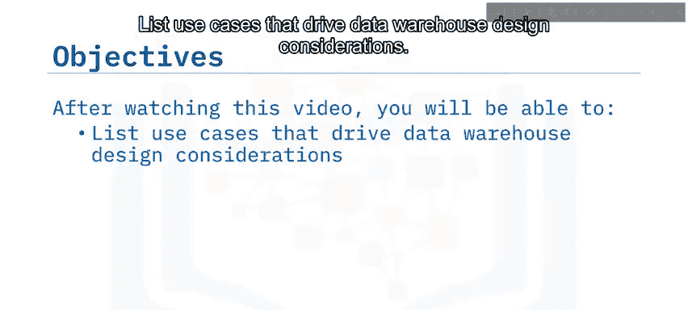

The details of the architecture of a data warehouse depend on the intended usage of the platform。

 requirements can include report generation and dashboarding， exploratory data analysis。

 automation and machine learning， and self serveve analytics。

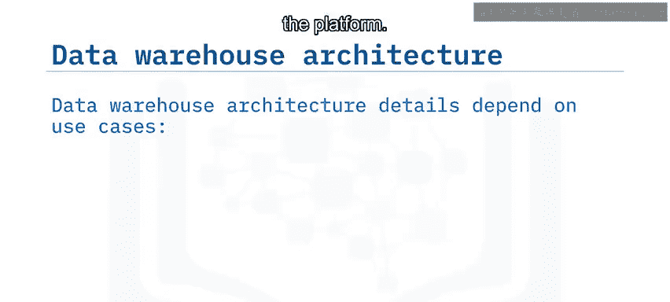

Let's start by considering a general architecture model for an enterprise data warehouse or EDW platform which companies can adapt for their analytics requirements In this architecture。

 you can have various layers or components including data sources such as flat files。

 databases and existing operational systems， an ETL layer for extracting。

 transforming and loading data， optional staging and sandbox areas for holding data and developing workflows。

 an enterprise data warehouse repository， sometimes data mars which are known as a hub and spoke architecture when multiple data mars are involved。

 and an analytics layer and business intelligence tools。

 data warehouses also enforce security for incoming data and data passing through to further stages and users throughout the network。

Enterprise data warehouse vendors often create proprietary reference architecture and implement template data warehousing solutions that are variations on this general architectural model a data warehousing platform is a complex environment with lots of moving parts thus Interoperability among components is vital vendor specific reference architecture typically incorporates tools and products from the vendor's ecosystem that work well together Next。

 let's check out IBM specific reference data warehouse architecture。

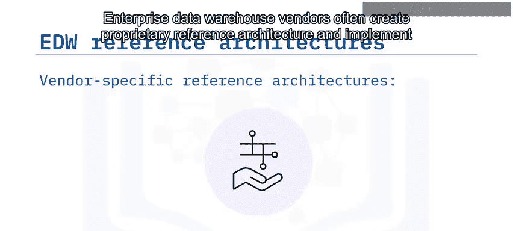

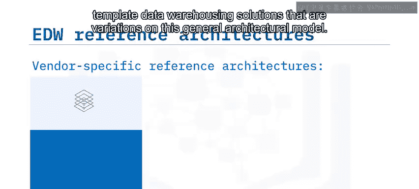

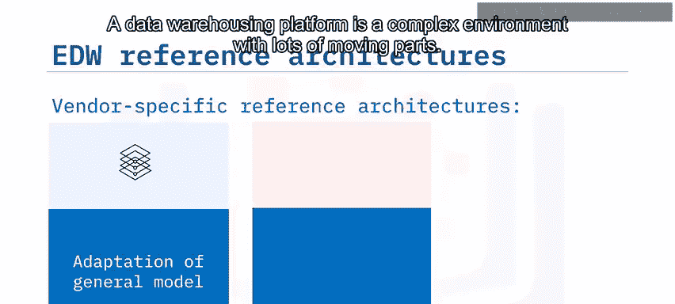

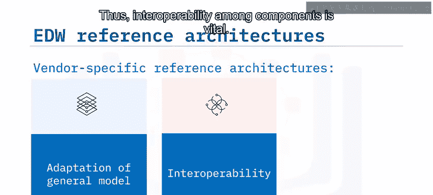

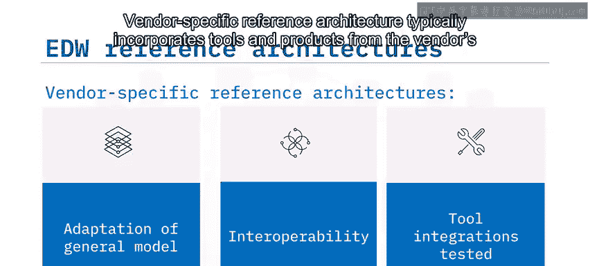

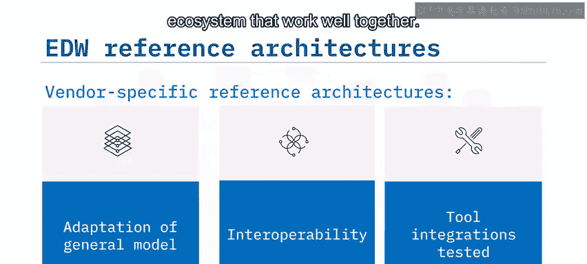

Each layer of the architecture performs a specific function The data acquisition layer consists of components to acquire raw data from source systems such as human resources。

 finance and billing departments the data integration layer essentially a staging area has components for extracting the data transforming it and loading it into the data repository layer it also houses administration tools and central metadata The data repository layer stores the integrated data typically employing a relational model。

 The analytics layer often stores data in a cube format to make it easier for users to analyze it。

 and the final presentation layer incorporates applications that provide access for different sets of users such as marketing analysts。

 users and agents applications consume the data through web pages and portals defined find in the reporting tool or through web services。

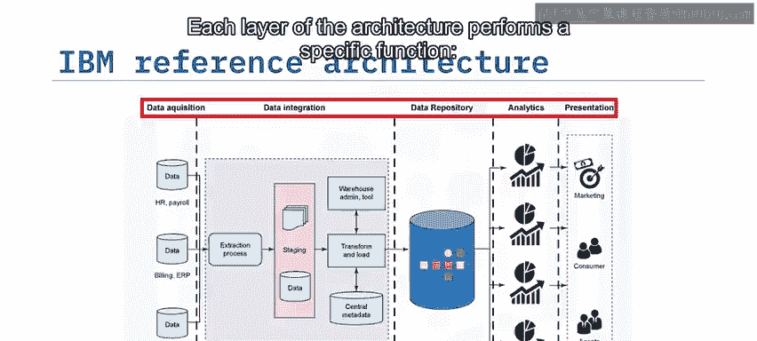

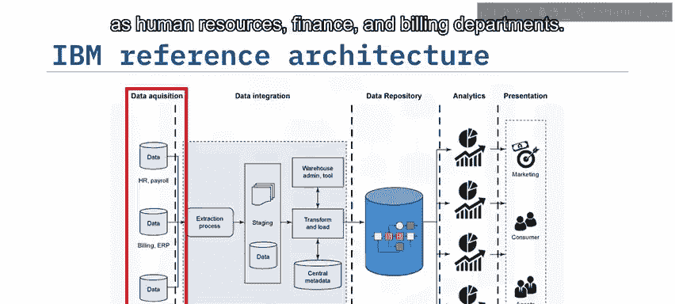

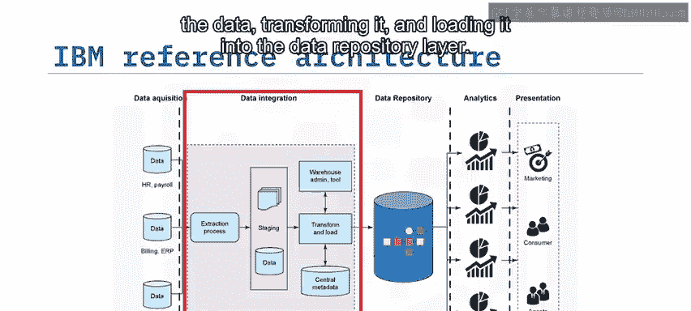

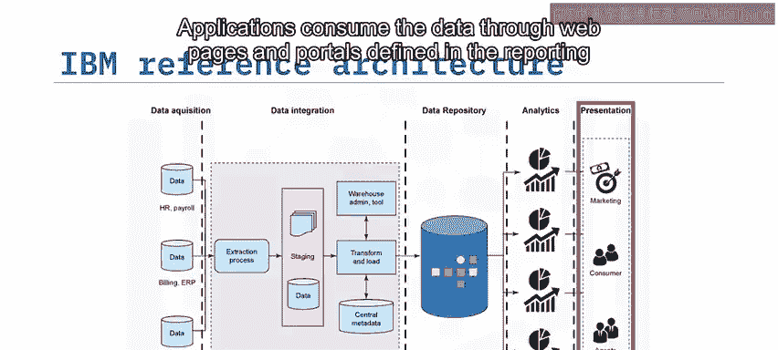

IBM reference architecture is supported and extended using several products from the IBM Inphere suiteite IBM Insphere data stage is a scalable ETL platform that delivers near real-time integration of all data types on premises and in cloud environments IBM Inphere metadata workbench provides end-to- end dataflow reporting and impacts analysis and information assets in an environment that allows organizations to share easily locate and retrieve information from these systems use the builtin dataflow reporting capabilities to monitor how IBM Inphere data stage moves and transforms your data IBM Inphere quality stage designed to support your data quality and information governance initiatives。

 enables you to investigate cleanse and manage your data This solution helps you create and maintain consistent views of key entities。

 including customers vendors locate。

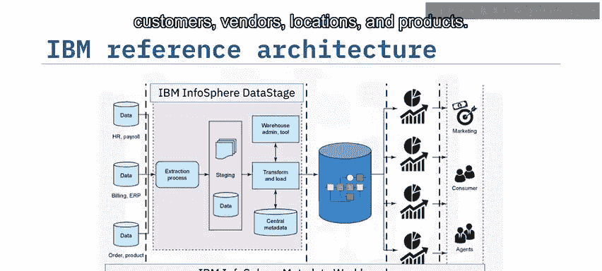

IBMDB2 Warhouse is a family of highly performant， scalable and reliable data management products that manage both structured and unstructured data across on premises and cloud environments and finally。

 IBM Cgnos Ana is an advanced business intelligence platform that generates reports。

 scoreboards and dashboards， performs exploratory data analysis。

 and even curates and joins your data using multiple sources。

In this video you learned that an architectural model for a general data warehousing platform includes data sources。

 ETL pipelines， optional staging and sandbox areas， and enterprise data warehouse repository。

 optional data Mars and analytics and business intelligence tools。

 Comp can modify general enterprise data warehouse architecture to suit their analytics requirements。

 vendors offer proprietary reference architecture based on the general model which they test for interoperability among components。

 and an IBM enterprise data warehouse solution combines Infophere with DB2 warehouse and cgnos analytics。

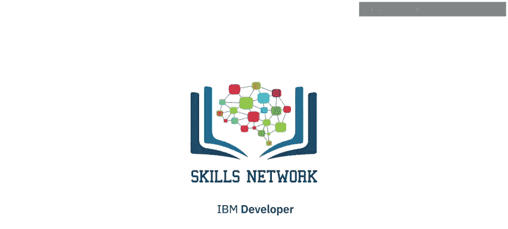