# IBM数据工程专业证书课程9：《数据仓库和BI分析入门》｜getting-started-with-data-warehousing-and-bi - P9：8_立方 聚合和物化视图和表.zh_en - GPT中英字幕课程资源 - BV1bN41187mr

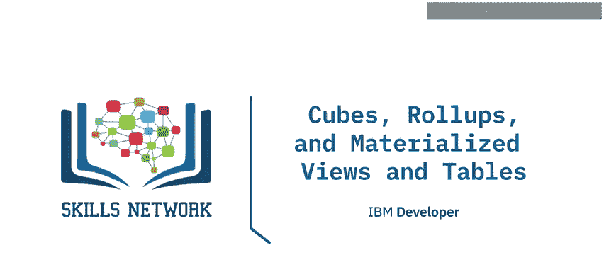

Welcome to Cus， rollups and materialized views and tables After watching this video you will be able to relate what a data cube is in terms of star schema。

 discuss the terms slice， dice， drill up or down， roll up and pivot in terms of data cubes。

 describe what a materialized view is， and recall two use cases for materialized views。

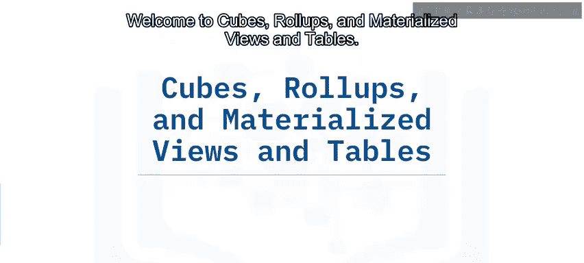

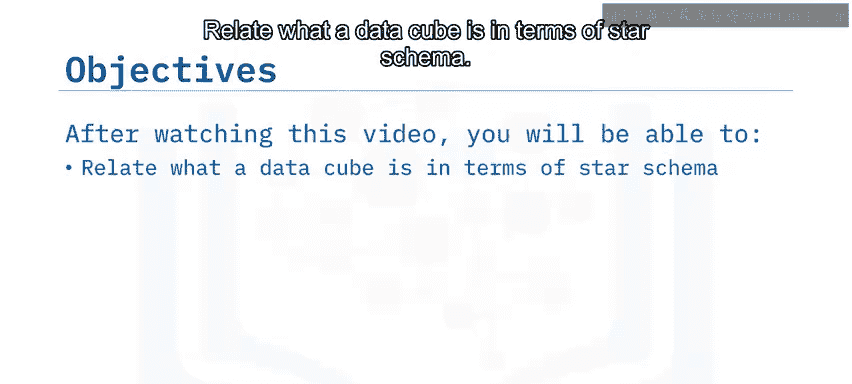

Let's use an example to illustrate the concept of a data cube Here is a cube generated from an imaginary star schema for a sales OLAP or online analytical processing system。

 the coordinates of the cube are defined by a set of dimensions which are selected from the star schema In this illustration we are only showing three dimensions but data cubes can have many dimensions we have the product categories corresponding to the items sold the state or province the items were sold from and the year these products were sold in Now the cells of the cube are defined by a fact interest from the schema。

 which could be something like total sales in thousands of dollars here the 243 indicates $243。

000 for some given product state and year combination There are many operations you can perform on data cubes such。

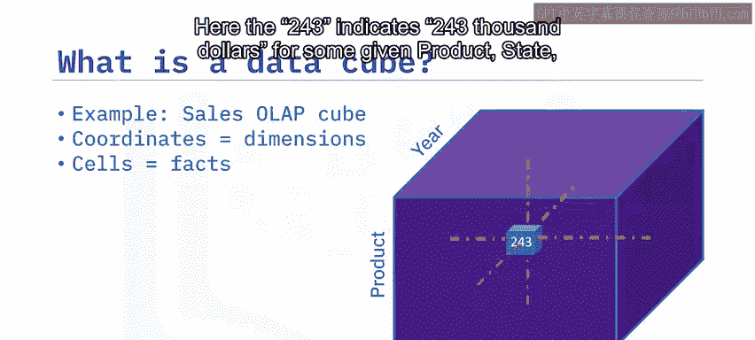

AsSlicing， dicing， drilling up and down， pivoting and rolling up let's go over some examples of these operations。

 starting with slicing Slicing a data cube involves selecting a single member from a dimension which yields a data cube that has one dimension less than the original For example。

 you can slice this sales cube by selecting only the year 2018 from the year dimension。

 allowing you to analyze sales totals for all sales states and all products for the year 2018。

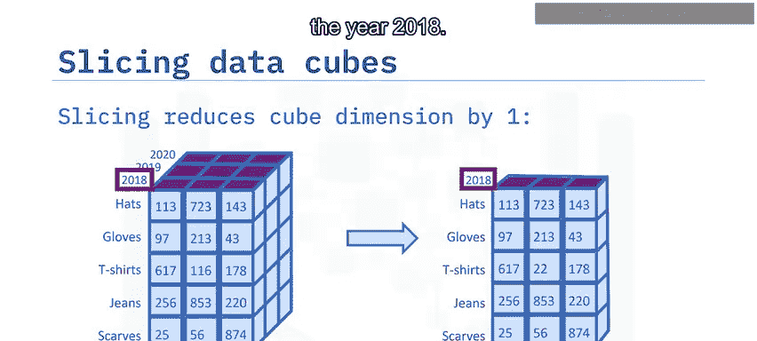

Similarly， dicing a cube involves selecting a subset of values from a dimension effectively shrinking it for example。

 you can dice this sales cube by selecting only gloves。

 tshirts and jeans from the product type dimension。

 allowing you to restrict your view to just those product types。In snowflake schema。

 you will find hierarchies or subcategories within some of your dimensions that you can drill into thus。

 for example， you can drill down into a particular member of the product category dimension such as t-shirts resulting in this view which may include more specific product groups such as classic slim fit and regular fit Dring up is just the reverse process which would take you back to the original data cube。

Pivoting data cubes is straightforward。 it involves a rotation of the data cube In this case。

 the year and product dimensions have been interchanged while the state dimension has been fixed as is Piting doesn't change its information content it just changes the point of view you may choose to analyze it from。

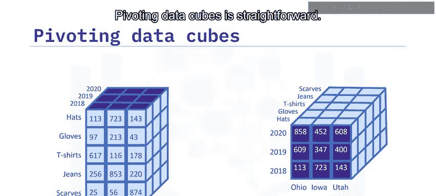

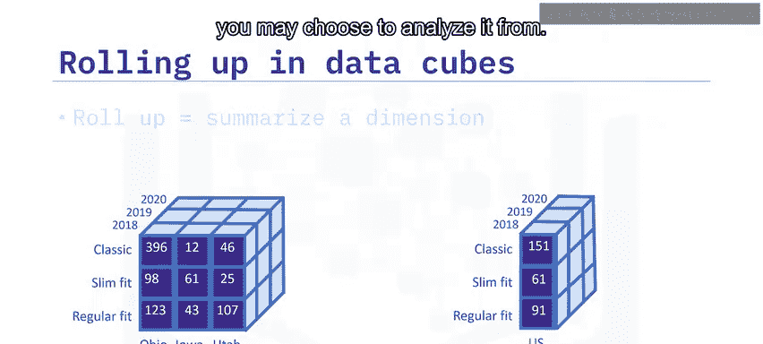

Rolling up means summarizing along a dimension you can roll up a dimension by applying aggregations such as count。

 min， Max， sum and average for example， you could calculate the average selling price of classic slim fit and regular fit Tshirts by summing horizontally over the three US states and dividing by three。

A materialized view is essentially a local read only copy or snapshot of the results of a query。

 they can be used to replicate data， for example， to be used in a staging database as part of an ETL process or to precompute and cash expensive queries such as joins or aggregations for use in data analytics environments。

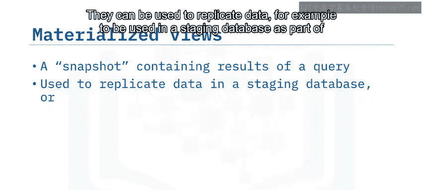

Materialized views also have options for automatically refreshing the data。

 thus keeping your query up to date， because materialized views can be queried。

 you can safely work with them without worrying about affecting the source database。

Materialized views can also be set up to have different refresh options， such asN。

 they are only populated when created， which is useful if the data seldom changes upon request。

 manually refresh for example， after changes to the data have been made or scheduled refresh。

 for example， after daily data loads， and immediately， automatically refresh after every statement。

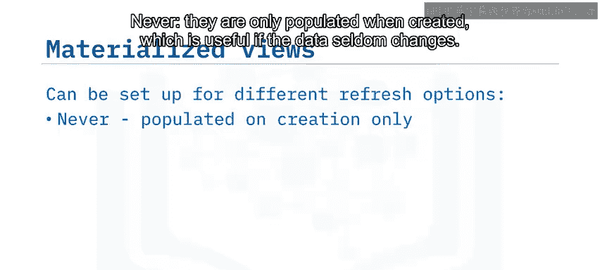

Let's look at an example here is how you might create a materialized view in Oracle using SQL statements Start by creating and naming a materialized view object called My underscore mat underscore view。

 specify the refresh type as fast， which means incrementally refresh the data specify today as the start date and refresh the view every day。

 The final statement selects all data from My underscore table underscore name。

And here is how you might create a materialized view in PostresQL to replicate a table。

 Start by creating a materialized view object called My underscore mat underscore view specify some parameters and then specify the source tablespace。

 say tablespace_ name， select all rows and columns from table underscore name Note in PostresqL。

 you can only refresh materialized views manually using the refresh material view command。

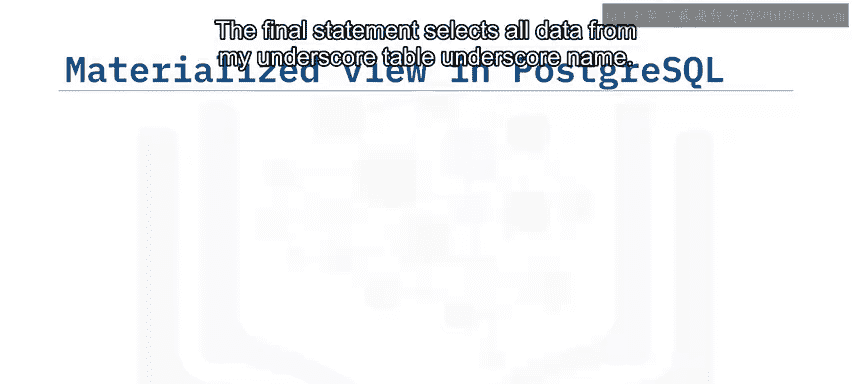

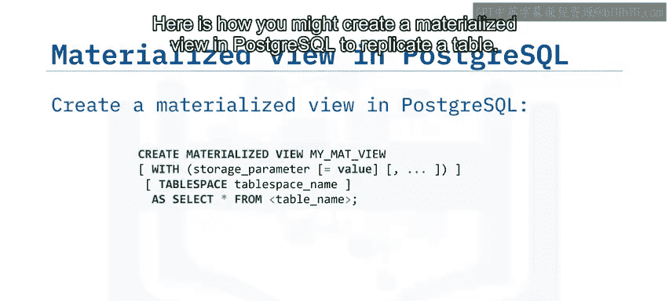

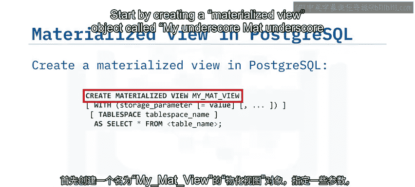

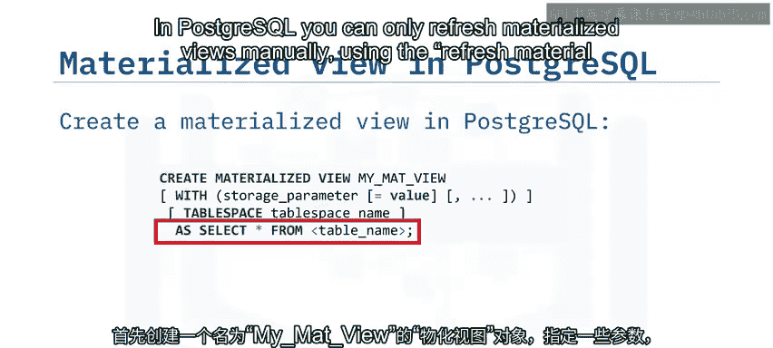

In DB2， materialized views are called MQTs which stand for materialized query tables。

 Here's an example from IBM's online documentation of creating a system maintained immediate refresh MQT The table which is named Imp is based on the underlying tables employee and department from the sample database The table will be created according to the query formed by these SQL statements。

 which selects columns from both tables。 The data initially deferred clause means that data will not be inserted into the table as part of the C table statement while the refresh immediate clause specifies that the query should refresh automatically The immediate checked clause specifies that the data is to be checked against the MQT's defining query and refreshed and lastly。

 the notin clause specifies that In checking is to be done on the whole。table？

A query executed against the EP materialized query table shows that it is fully populated with data。

In this video， you learned that a data cube represents a star or snowflake schema's dimensions as coordinates。

 plus a from the schema to populate its cells with values。

 many operations can be applied to data cubes， such as drilling down into hierarchical dimensions。

 slicing， dicing and rolling up。

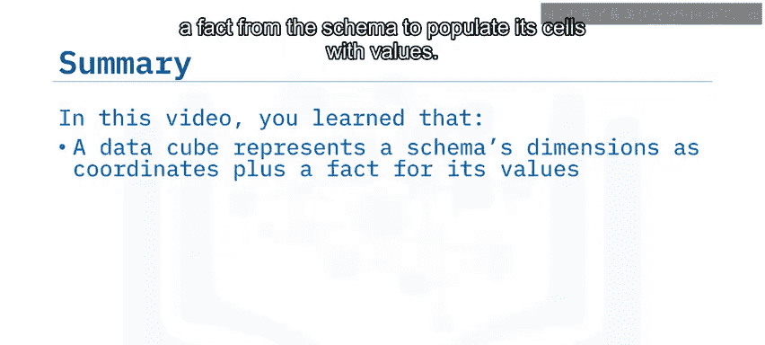

Materialized views can be used to replicate data or to precompute expensive queries， and finally。

 modern enterprise data warehouse tools such as Oracle and DB2 allow you to automatically keep your material views up to date。

