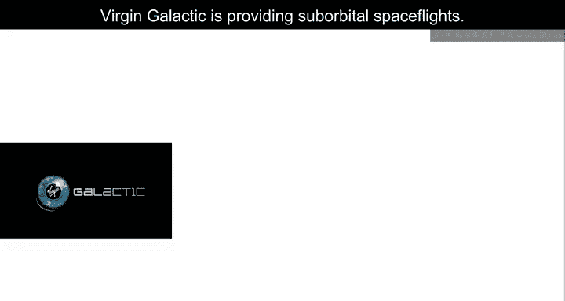
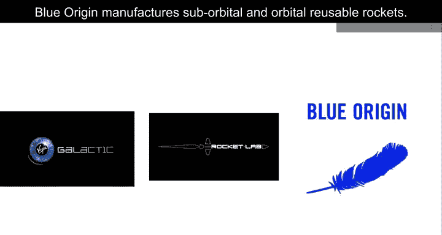
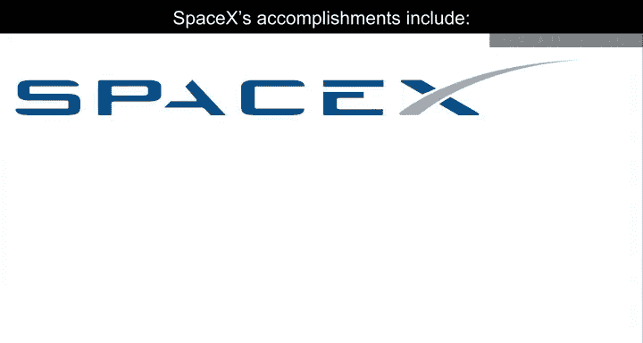
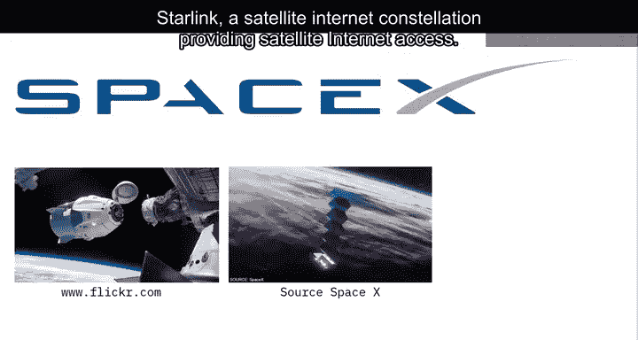
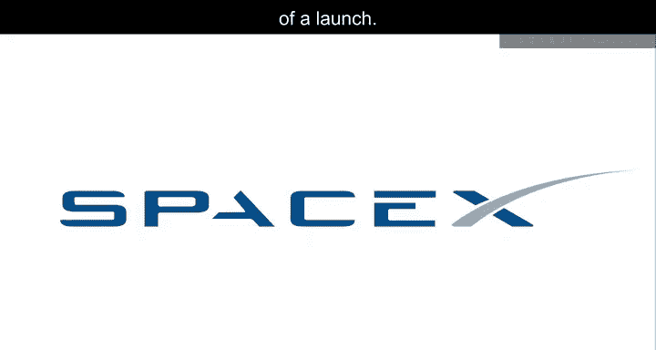
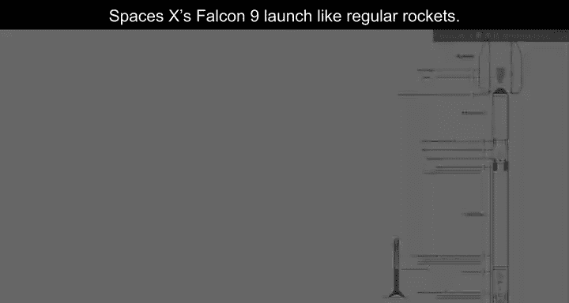
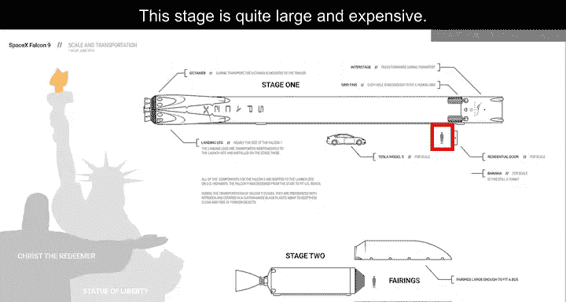
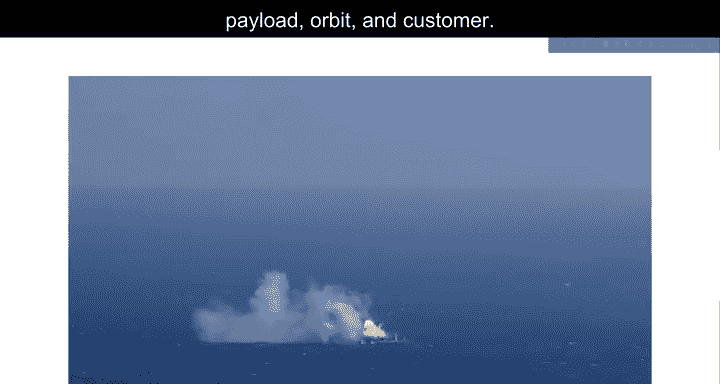
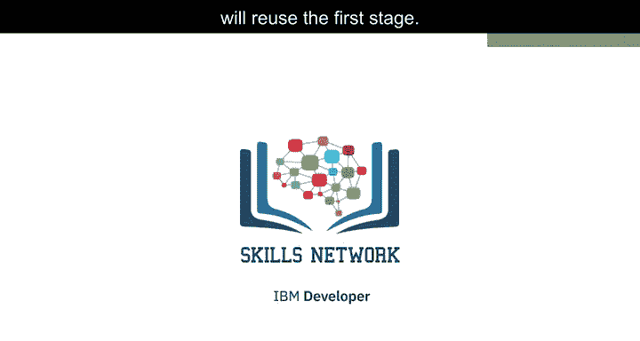

# IBM数据科学专业证书课程10：《应用数据科学毕业项目》applied-data-science-capstone（中英字幕） - P1：0_项目场景与概述.zh_en - GPT中英字幕课程资源 - BV17V4y1B7MF

In this video， we will provide the project scenario and overview。

The commercial space age is here companiesies are making space travel affordable for everyone Virgin Galactic is providing suborbital space flights。

 Rocket Lab is a small satellite provider and blue Or manufacture suborbital and orbital reusable rockets。

Perhaps the most successful is SpaceX SpaceX accomplishments include sending spacecraft to the International Space Station。

 Starlink， a satellite Internet constellation， providing satellite internet access and sending manned missions to space。

 One reason SpaceX can do this is the rocket launches are relatively inexpensive。😊。

SpaceX advertises Falcon9 rocket launches on its website with a cost of $62 million Other providers cost upwards of $165 million each much of the savings is because SpaceX can reuse the first stage。

 therefore if we can determine if the first stage will land， we can determine the cost of a launch。

SpaceX's Falcon 9 launch like regular rockets。To help us understand the scale of the Falcon 9。

 we are going to use these diagrams from Forest Cattch。

 a 3D artist and software engineer at ZLsadesign。com he makes infographics on space flightlight and spacecraft art and he also makes software The payload isn' enclosed in the fairing。

Stage2 or the second stage helps bring the payload to orbit。

 but most of the work is done by the first stage。 The first stage is shown here。

 This stage does most of the work and is much larger than the second stage。

 Here we see the first stage next to a person and several other landmarks。

 This stage is quite large and expensive。

Unlike other rocket providers， SpaceX' Falcon 9 can recover the first stage。

Sometimes the first stage does not land， sometimes it will crash as shown in this clip。Other times。

 SpaceX will sacrifice the first stage due to the mission parameters like payload， orbit。

 and customer。

In this capstone， you will take the role of a data scientist working for a new rocket company。

 Space Y that would like to compete with SpaceX。 Space Y is founded by billionaire industrialist Alon Mask。

Your job is to determine the price of each launch you will do this by gathering information about SpaceX and creating dashboards for your team you will also determine if SpaceX will reuse the first stage。

Instead of using rocket science to determine if the first stage will land successfully。

 you will train a machine learning model and use public information to predict if SpaceX will reuse the first stage。

