# IBM数据科学专业证书课程10：《应用数据科学毕业项目》applied-data-science-capstone（中英字幕） - P2：1_数据收集概述.zh_en - GPT中英字幕课程资源 - BV17V4y1B7MF

In this video， we will review collecting the data with an API。

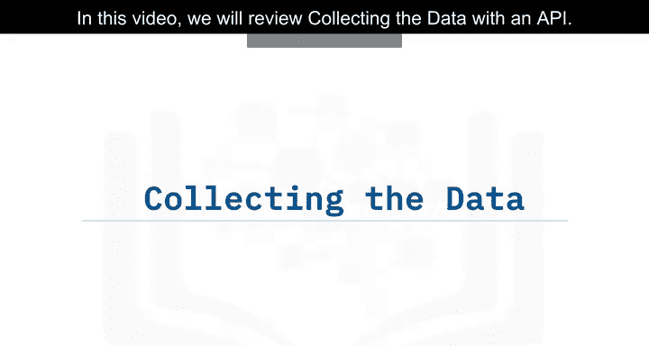

In this capstone assignment we will be working with SpaceX launch data that is gathered from an API。

 specifically the SpaceXRt API This API will give us data about launches including information about the rocket used payload delivered launch specifications。

 landing specifications and landing outcome Our goal is to use this data to predict whether SpaceX will attempt to land a rocket or not。

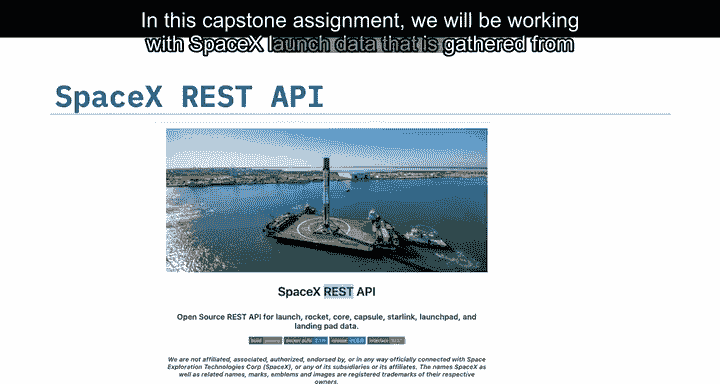

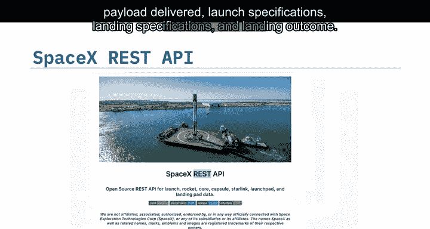

The SpaceX RE API endpoints or URL starts with API。spaceXdata。

com forward/v4 forward/lash We have the different endpoints， for example。

 forward/capsules and forward/lash course We will be working with the endpoint API。spaceXdata。

com forward/ v4 forwardlashlaunes forward/pat Let's see how the API works。

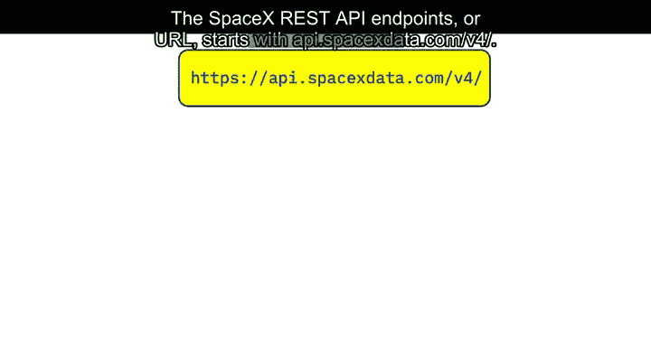

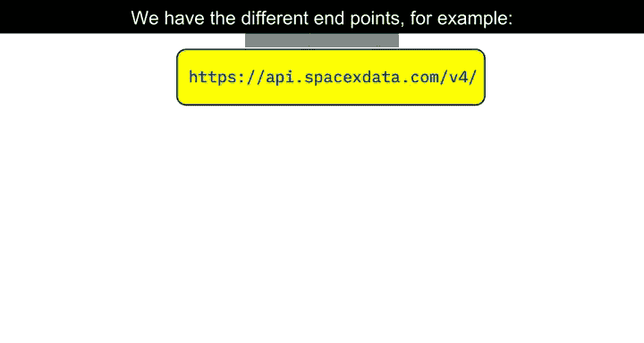

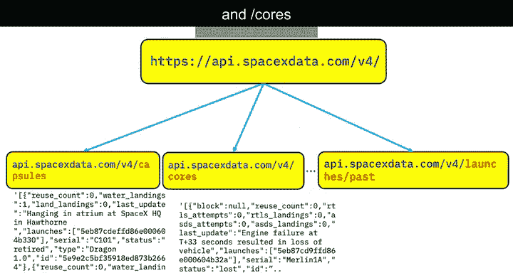

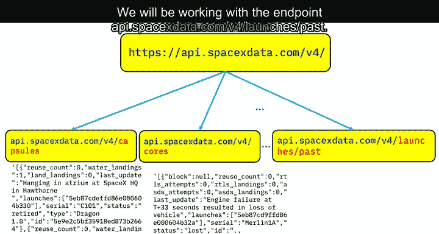

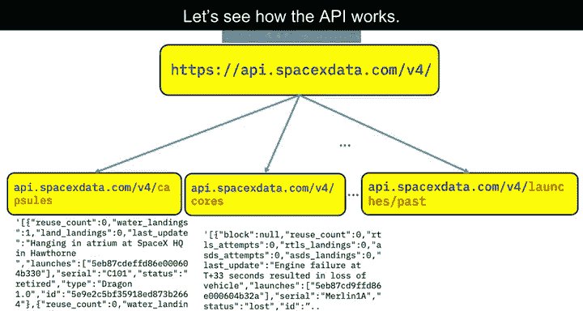

We will use this URL to target a specific endpoint of the API to get past launch data we will perform a get request using the requests library to obtain the launch data。

 which we will use to get the data from the API This result can be viewed by calling the dot J Open parentheses closed parentheses method our response will be in the form of a JO specifically a list of J objects。

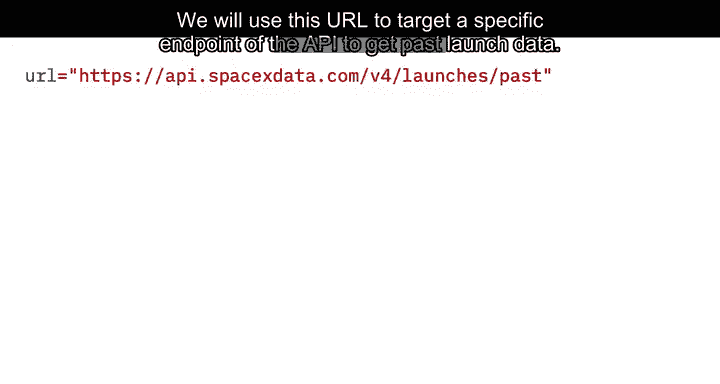

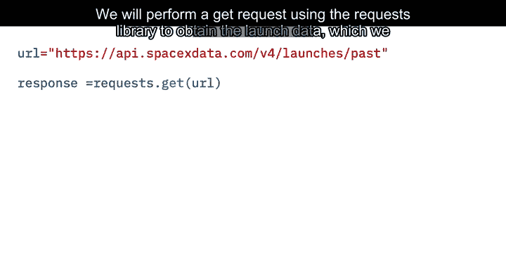

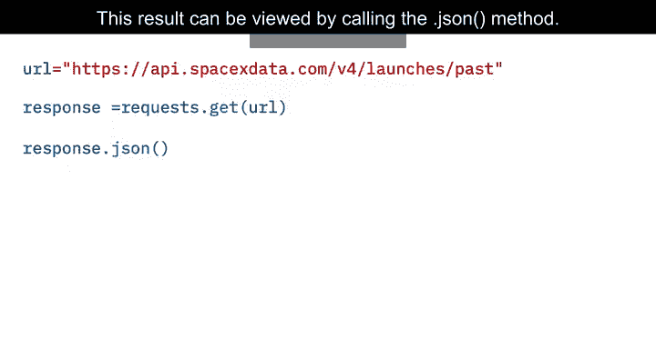

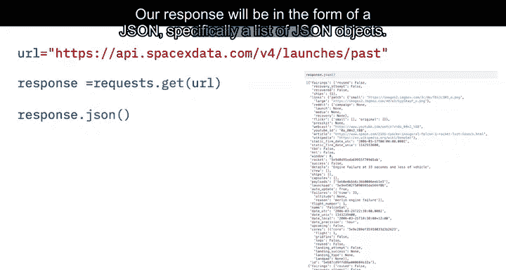

Since we are using an API， you will notice in the lab that when we get a response。

 it is in the form of a JON， specifically we have a list of JO objects which each represent a launch to convert this JO to a data frame we can use the JO_ normalized function This function will allow us to normalize the structured JO data into a flat table。

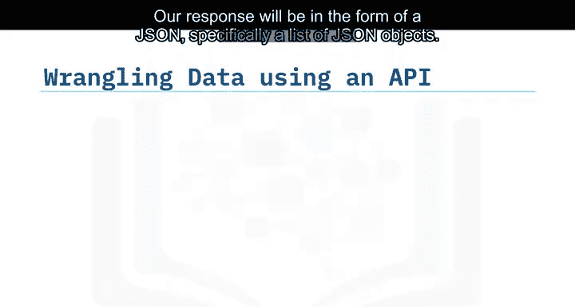

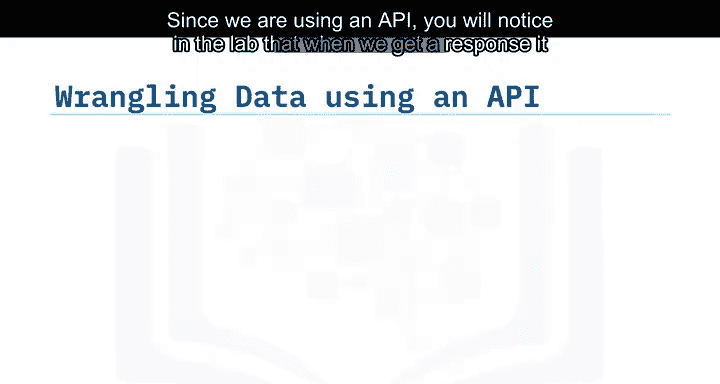

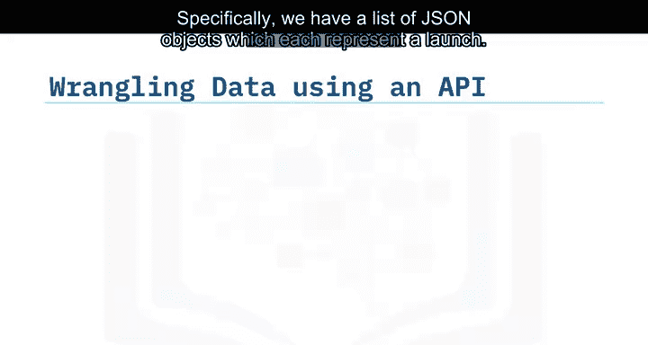

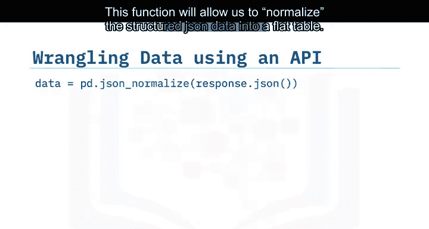

This is what your J will look like in a table form。

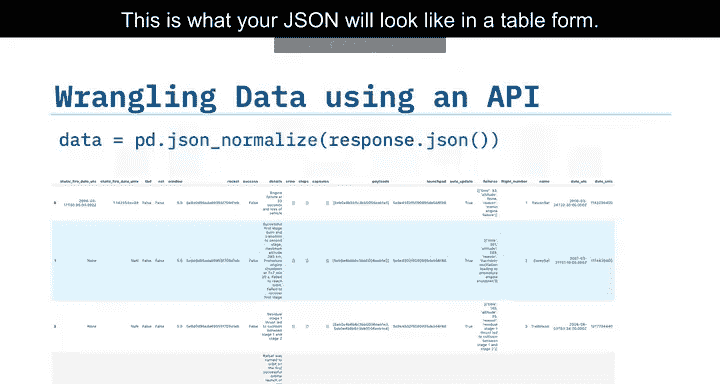

Another popular data source for obtaining Falcon 9 launch data is webs scraping related Wiki pages In this lesson you will be using the Python Beaut suit package to webs scrappe some HTML tables that contain valuable Falcon9 launch records then you need to parse the data from those tables and convert them into A pannda's data frame for further visualization and analysis。

We want to transform this raw data into a clean data set。

 which provides meaningful data on the situation we are trying to address。

 wrangling data using an API， sampling data， and dealing with nulls。

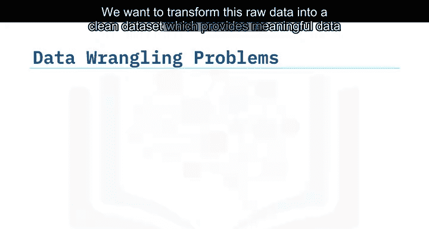

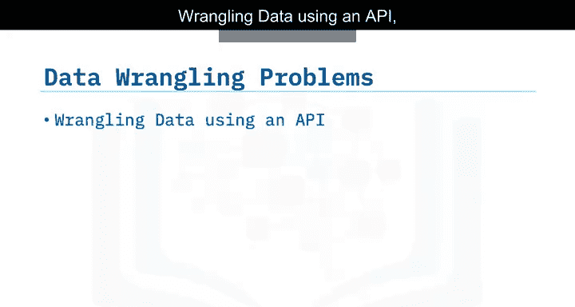

You will notice in some of the columns like Rock， we have an identification number。

 not actual data This means we will need to use the API again。

 targeting another endpoint to gather specific data for each ID number these functions are already created for you and will use the following booster。

 launchpad， payload and core the data will be stored in lists and will be used to create our data set。

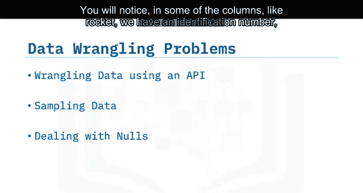

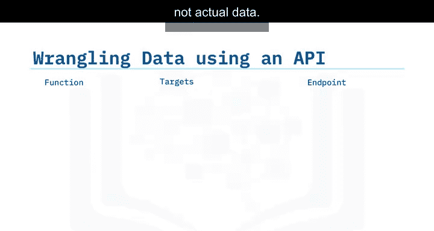

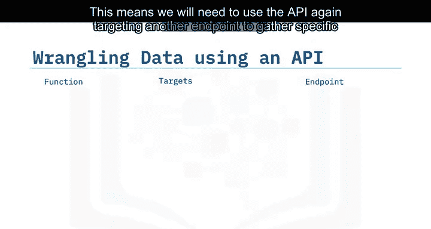

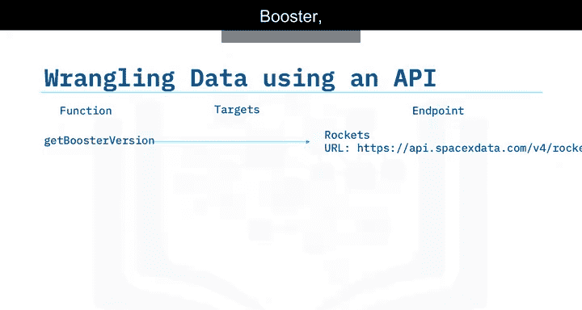

Another issue we have is that the launch data we have includes data for the Falcon 1 booster。

 whereas we only want Falcon 9 in this lab you will need to figure out how to filter。

 sample the data to remove Falcon1 launches。

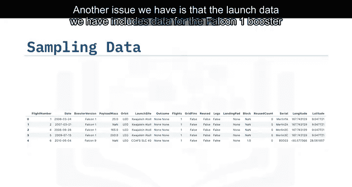

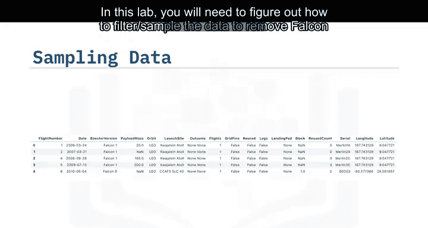

Finally， not all gathered data is perfect。 We may end up with data that contains null values。

 We must sometimes deal with these null values in order to make the dataset set viable for analysis In this case。

 we will deal with the null values inside the payload mass in this lab。

 you will figure out a way to calculate the mean of the payload mass data and then replace the null values in payload mass with the mean we will leave the column landing pad with null values as it is represented when a landing pad is not used This will be dealt with when using one hot encoding later on。

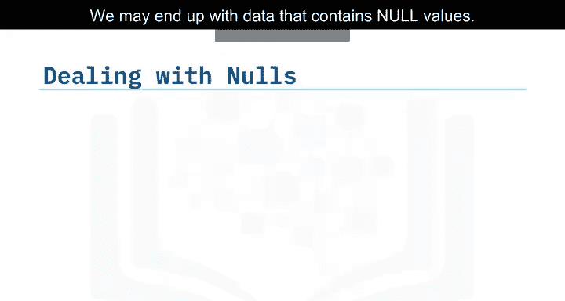

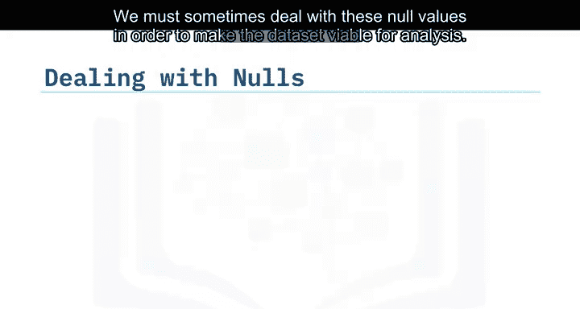

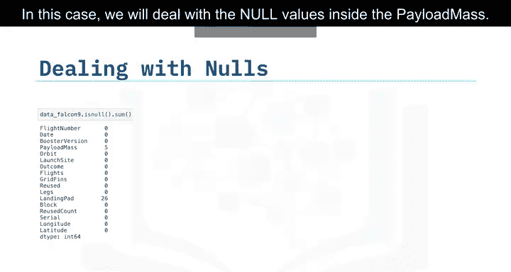

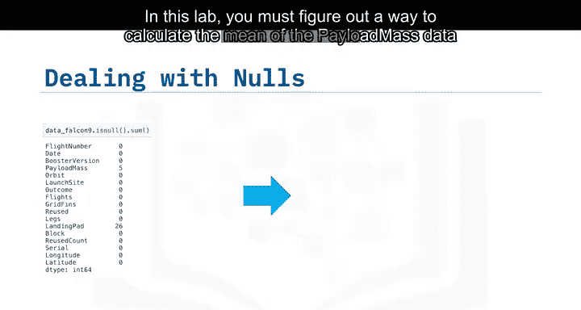

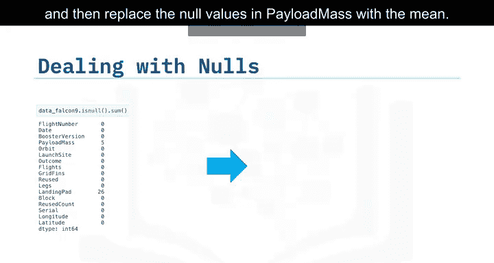

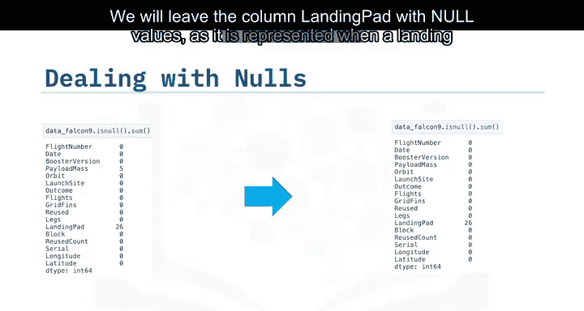

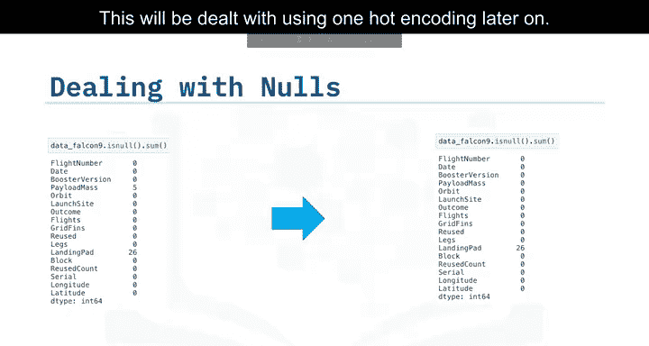

