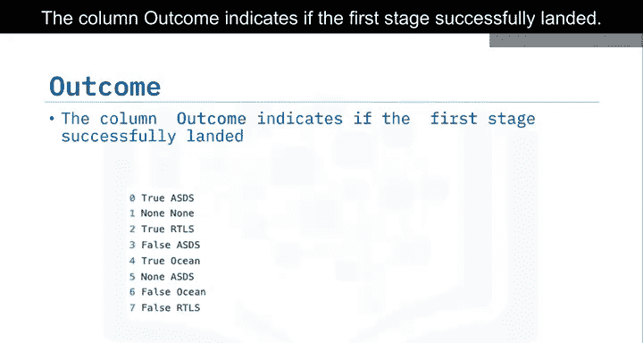

# IBM数据科学专业证书课程10：《应用数据科学毕业项目》applied-data-science-capstone（中英字幕） - P3：2_数据整理概述.zh_en - GPT中英字幕课程资源 - BV17V4y1B7MF

In this video we will review data wrangling。Let's review some of the attributes， flight number， date。

 booster version， payload mass， orbit， launch site， outcome。

 this is the status of the first stage flights， gridfinins， these help with landing。

 reused legs used in landing， landing pad block， reused count。

 serial and longitude and latitude of launch Let's take a look at some of these attributes。

The column launch site contains the different launch sites， including Vandenberg， AFB Space launchch。

 Kennedy Space Center， and CCAFS SLC 40。The column orbits are the different orbits of the payload。

 for example， Low Earth orbit or LEO is an Earth centered orbit with an altitude of 2000 kilometers。

 and GTO， a geosynchronous orbit is a high Earth orbit that allows satellites to match Earth's rotation it is located at 22。

236 miles or 35，786 kilometersm above Earth's equator。

The column outcome indicates if the first stage successfully landed， there are eight of them。

 for example。

True ASDS means the booster successfully landed to a drone ship as shown in the following looped video。

False ASDS means the mission outcome was unsuccessfully landed to a drone ship as shown in this looped video。

Outcome， we would like landing outcomes to be converted to classes Y。

 either 0 or 10 is a bad outcome。 That is， the booster did not land。 One is a good outcome。

 That is the booster did land。 The variable Y will represent the classification variable that represents the outcome of each launch。

