# IBM数据科学专业证书课程10：《应用数据科学毕业项目》applied-data-science-capstone（中英字幕） - P4：3_探索性数据分析概述.zh_en - GPT中英字幕课程资源 - BV17V4y1B7MF

In this video， we will review exploratory data analysis。

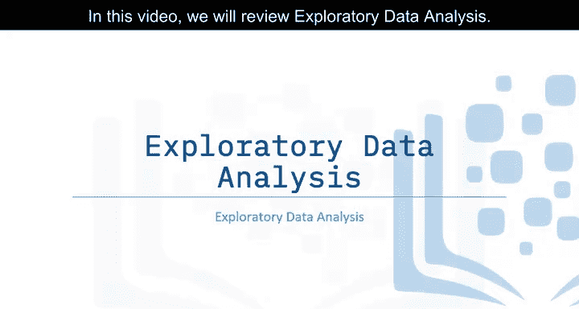

Expllororatory data analysis is the first step of any data science project in the first lab you will perform some exploratory data analysis using a database in the second lab you will see if the data can be used to automatically determine if the Falcon 9 second stage will land。

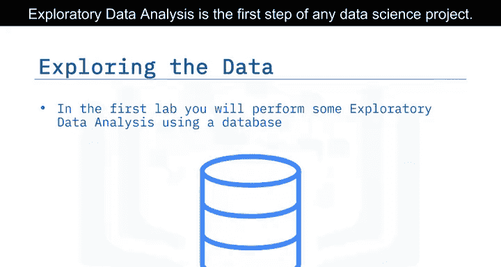

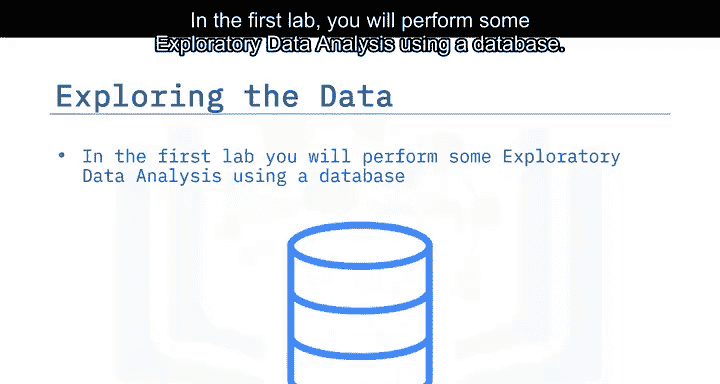

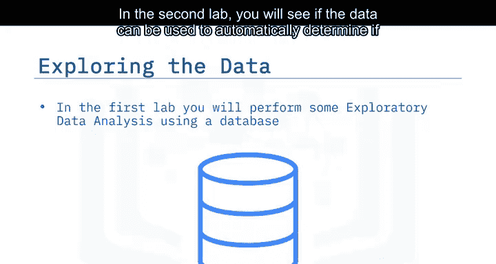

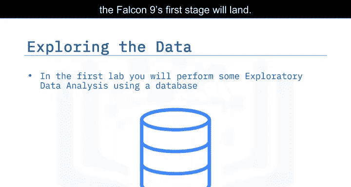

Some attributes can be used to determine if the first stage can be reused。

 we can then use these features with machine learning to automatically predict if the first stage can land successfully。

 for example。

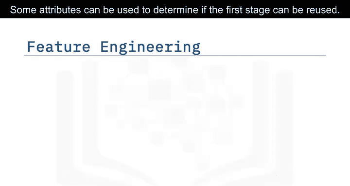

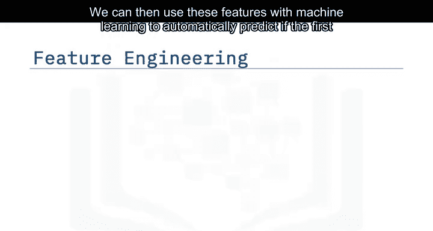

You can observe that the success rate since 2013 has improved。

 we can incorporate this as a feature via launch number。

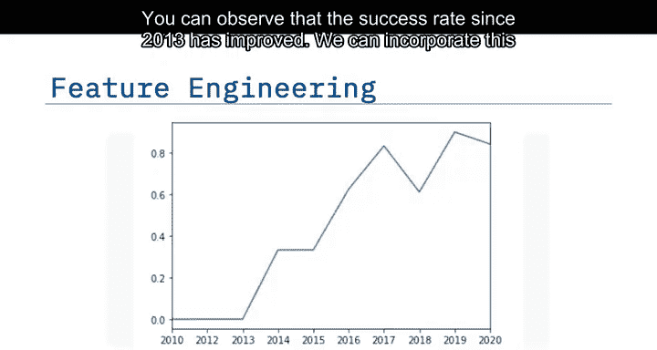

We see that different launch sites have different success rates as a result。

 they can be used to help determine if the first stage will land successfully CCAFSLC40 has a success rate of 60%。

 while KSCLC 39A and VAFB SLC4E have a success rate around 77%。

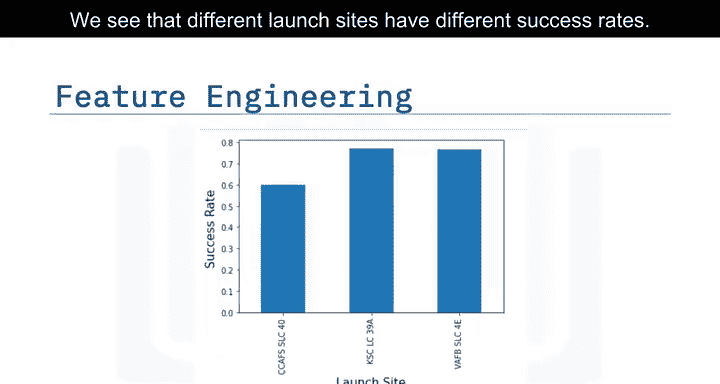

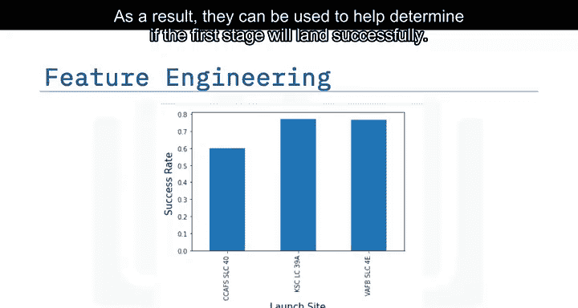

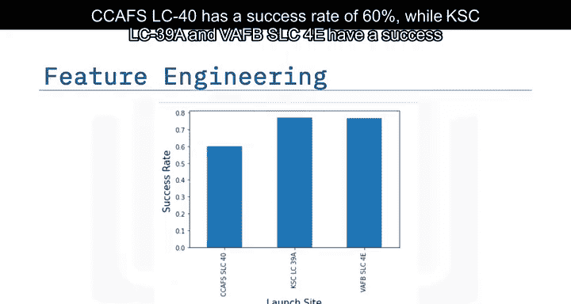

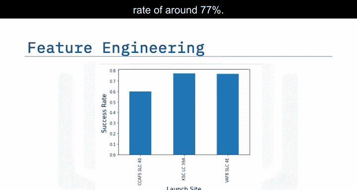

Combining attributes also gives us more information If we overlay the result of the landing outcomes as a color。

 we see that CCAFSLC40 has a success rate of 60%， but if the mass is above 10，000 kilograms。

 the success rate is 100% therefore we will combine multiple features。

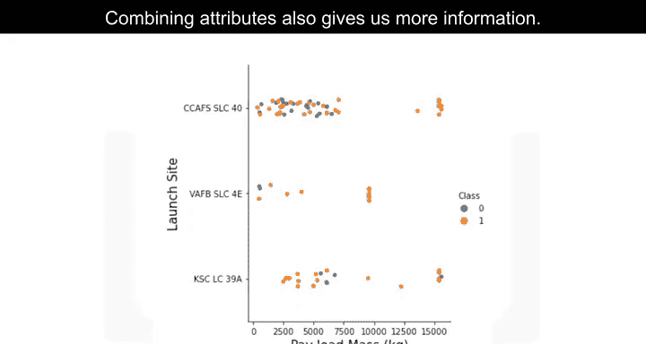

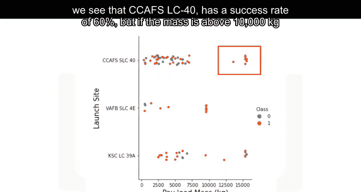

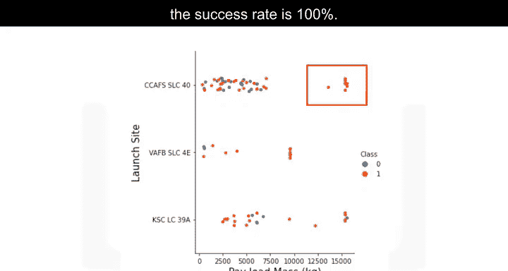

In the lab， you will determine what attributes are correlated with successful landings The categorical variables will be converted using one hot encoding。

 preparing the data for a machine learning model that will predict if the first stage will successfully land。

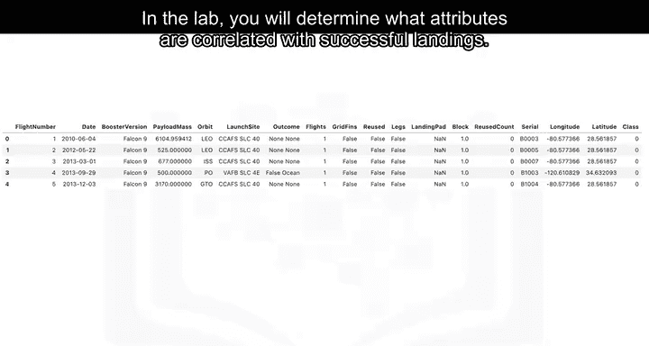

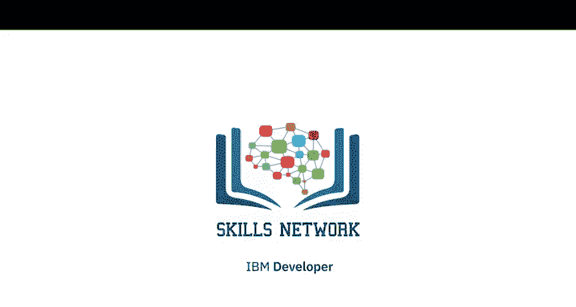