# IBM数据科学专业证书课程10：《应用数据科学毕业项目》applied-data-science-capstone（中英字幕） - P5：4_交互式可视化分析与仪表盘.zh_en - GPT中英字幕课程资源 - BV17V4y1B7MF

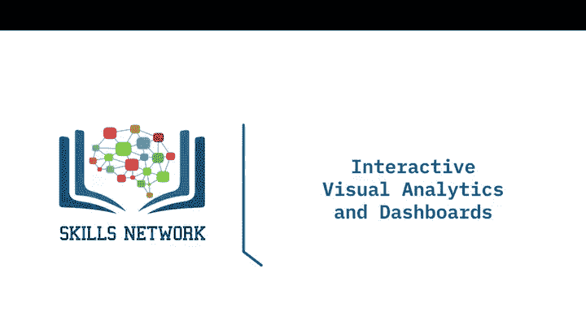

Welcome to the Interactive Visual Analytics and Dboard module。

 you will use this to build a dashboard for stakeholders。

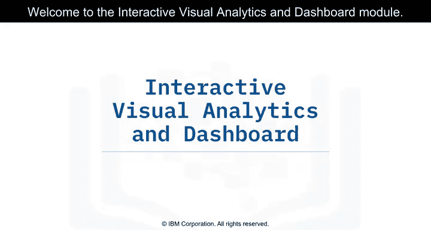

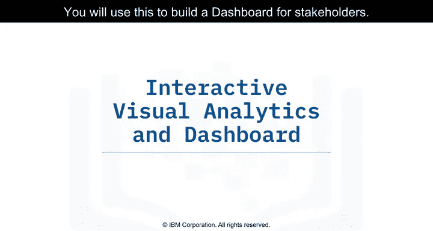

Interactive visual analytics enables users to explore and manipulate data in an interactive and realtime way。

 Commonmon interactions include zoom in and zoom out pan filter。

 search and link with interactive visual analytics users could find visual patterns faster and more effectively Instead of presenting your findings in static graphs。

 interactive data visualization or dashboarding can always tell a more appealing story。

 In this module， you will be using foliium and plotly dash to build an interactive map and dashboard to perform interactive visual analytics。

 The first part of this module will be focused on analyzing launch site geo and promities with foliium。

 We will first mark the launch site locations and their close promities on an interactive map。

 Then we will explore the map with those markers and try to discover any patterns from them。 Finally。

 we should be able to explore。

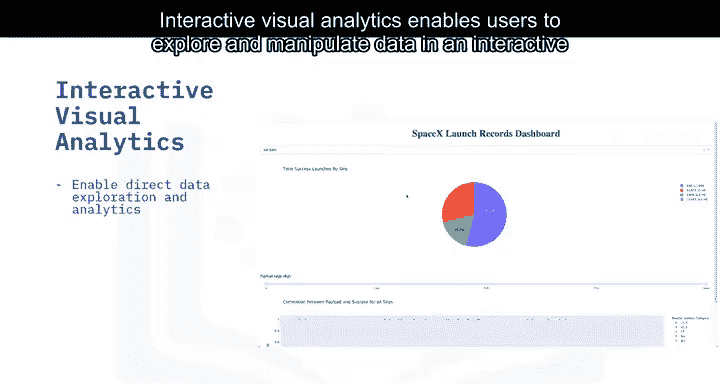

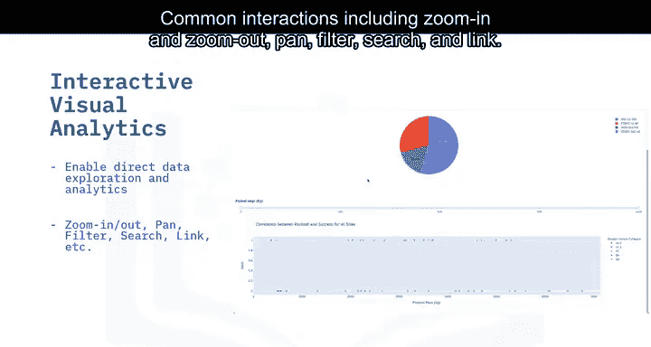

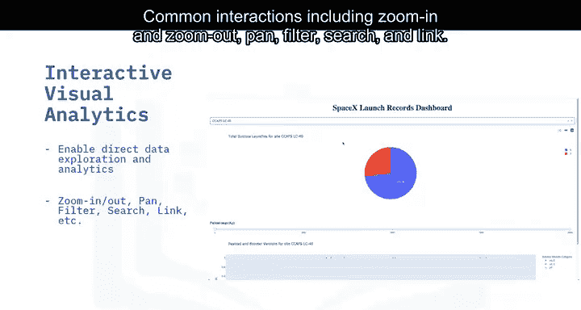

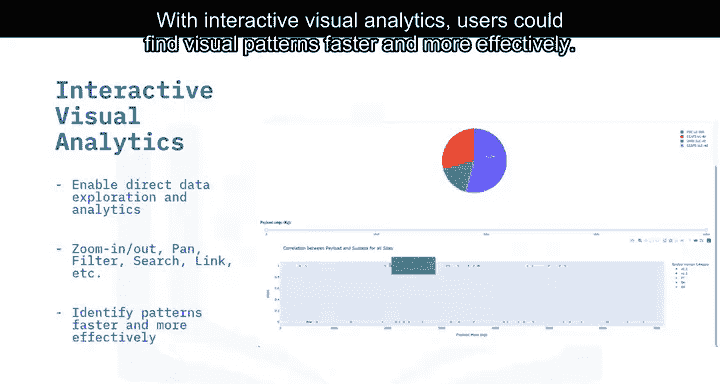

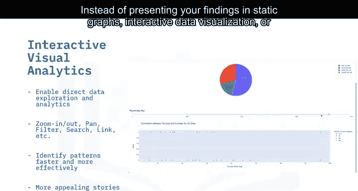

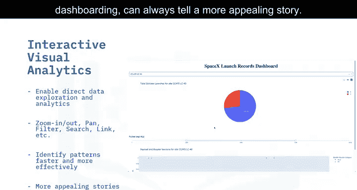

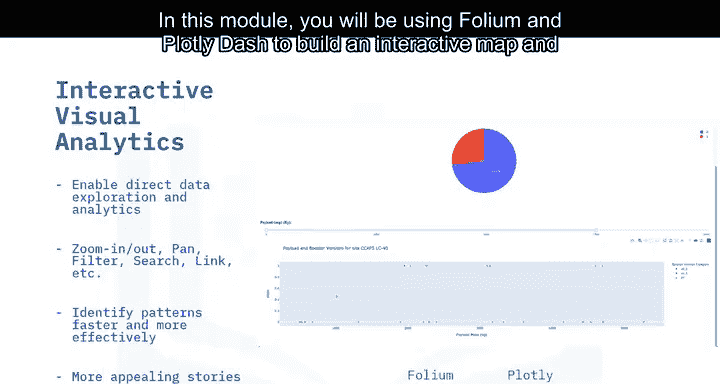

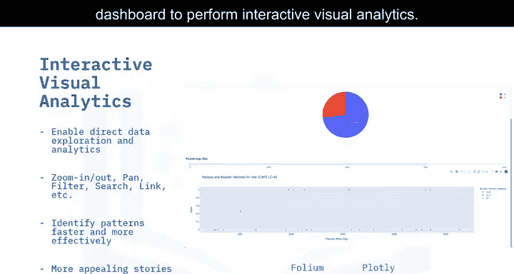

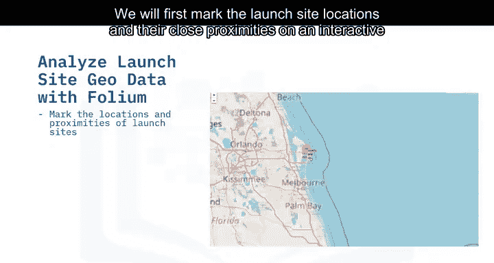

How to choose an optimal launch siteNext， you will be building a dashboard application with the Python plotly dash package This dashboard application contains input components such as a dropdown list and arrange slider to interact with a pie chart and a scatter point chart you will be guided to build this dashboard application in an instructional lab After the dashboard is built。

 you can use it to find more insights from the SpaceX data more easily than with static graphs。

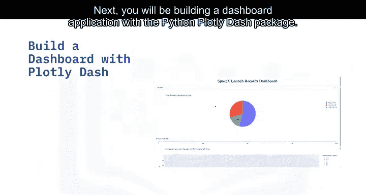

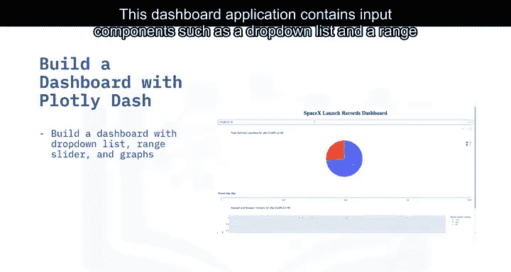

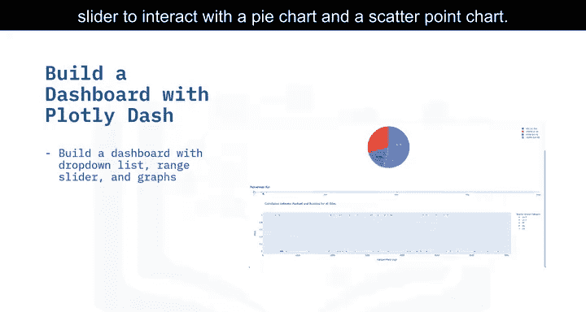

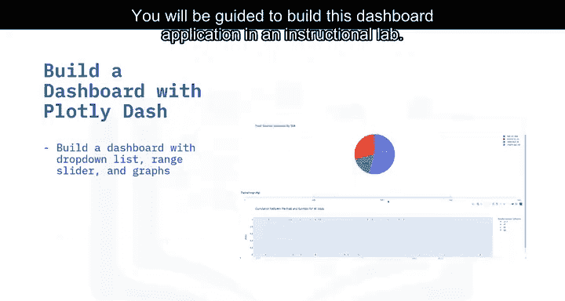

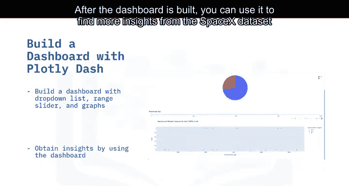

