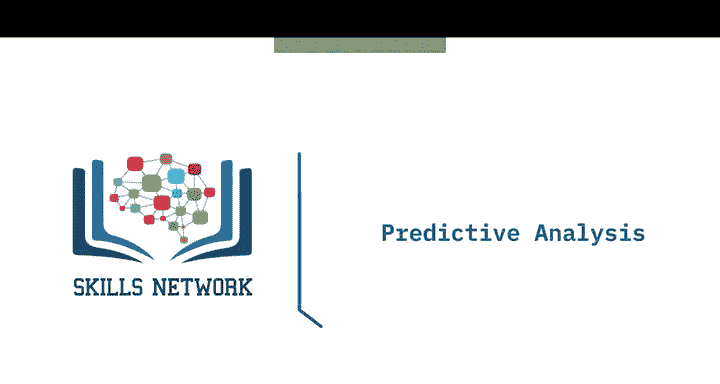
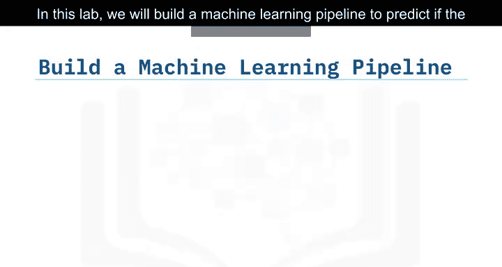
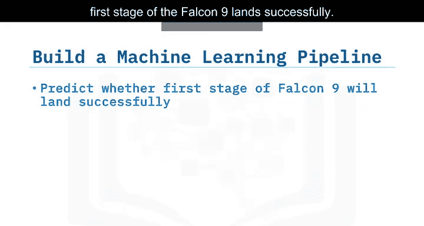
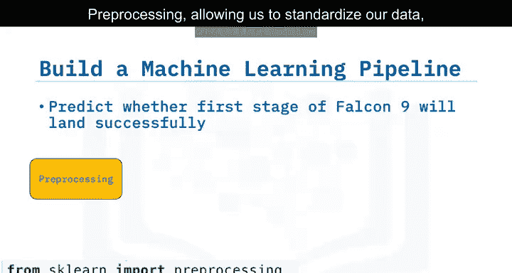
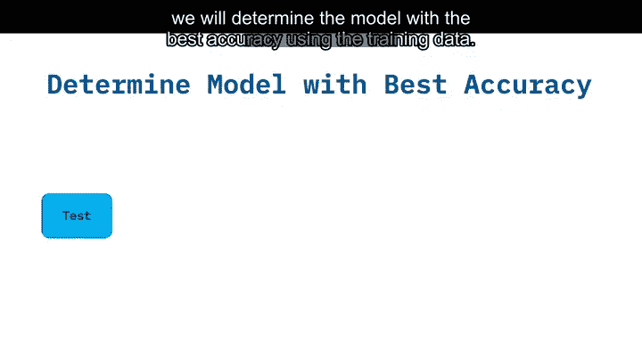
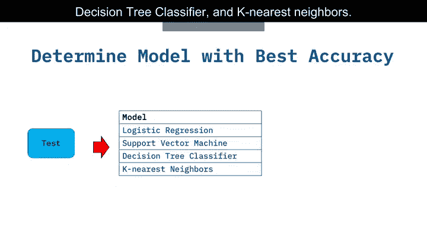
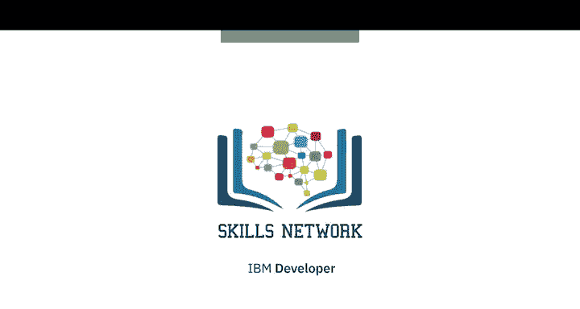

# IBM数据科学专业证书课程10：《应用数据科学毕业项目》applied-data-science-capstone（中英字幕） - P6：5_预测性分析概述.zh_en - GPT中英字幕课程资源 - BV17V4y1B7MF

In this video we will review predictive analysis In this lab。

 we will build a machine learning pipeline to predict if the first stage of the Falcon 9 lands successfully。

 this will include pre-processing， allowing us to standardize our data and train test split。

 allowing us to split our data into training and testing data。

 we will train the model and perform grid search， allowing us to find the hyperparameters that allow a given algorithm to perform best。

 and using the best hyperparameter values， we will determine the model with the best accuracy using the test data。

 you will test logistic regression， support vector machines。

 decisionte classifier and k nearest neighbors， and finally we will output the confusion matrix。

