# IBM数据科学专业证书课程1：《数据科学是什么？》what-is-datascience（中英字幕） - P11：10_大数据驱动数字化转型.zh_en - GPT中英字幕课程资源 - BV1wp4y1V7UT

Digital transformation affects business operations， updating existing processes and operations。

 and creating new ones to harness the benefits of new technologies。

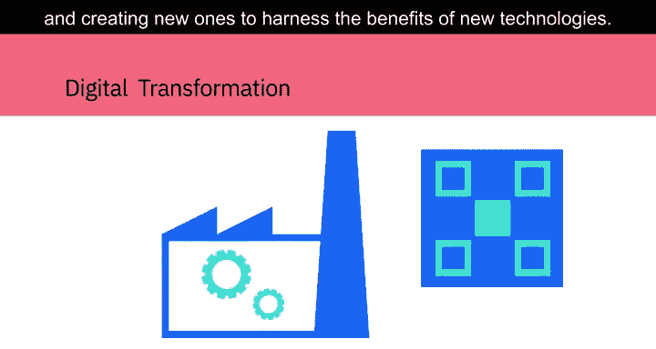

This digital change integrates digital technology into all areas of an organization。

 resulting in fundamental changes to how it operates and delivers value to customers。

 It is an organizational and cultural change driven by data science and especially big data。

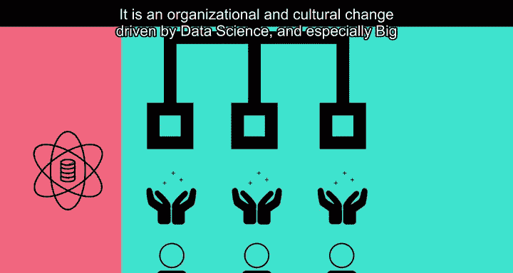

The availability of vast amounts of data and the competitive advantage that analyzing it brings has triggered digital transformations throughout many industries。

 Netflix moved from being a postal DVD lending system to one of the world's foremost video streaming providers。

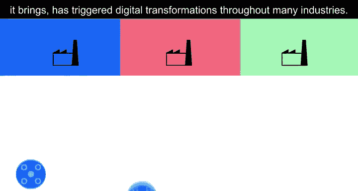

The Houston Rockets MBA team used data gathered by overhead cameras to analyze the most productive plays and Lathanza analyzed customer data to improve its service organizations all around us are changing to their very core。

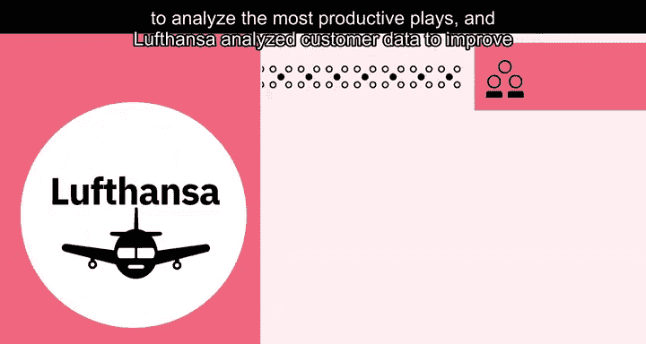

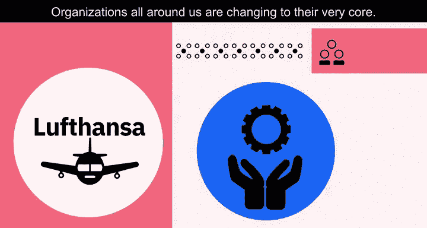

Let's take a look at an example to see how big data can trigger a digital transformation。

 not just in one organization， but in an entire industry。

In 2018， the Houston Rockets， a National Basketball Association or MBA team。

 raised their game using big data， The rockets were one of four NBAA teams to install a video tracking system which mindd raw data from games they analyzed video tracking data to investigate which plays provided the best opportunities for high scores and discovered something surprising。

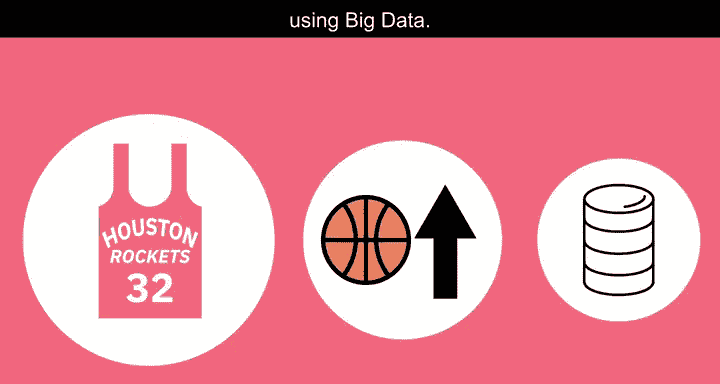

Data analysis revealed that the shots that provide the best opportunities for high scores are two point dunks from inside the two point zone and three point shots from outside the three point line。

 not long range two point shots from inside it。 This discovery entirely changed the way the team approached each game。

 increasing the number of three point shots attempted。In the 2017-18 season。

 the rockets made more three point shots than any other team in NBA history。

 and this was a major reason they won more games than any of their rivals。

In basketball， big data changed the way teams try to win， transforming the approach to the game。

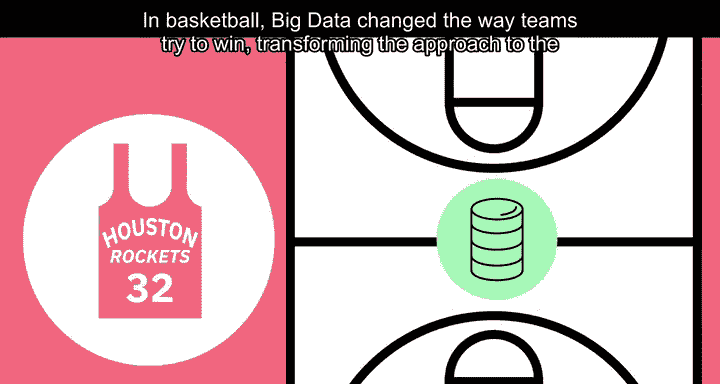

Digital transformation is not simply duplicating existing processes in digital form。

The in depthep analysis of how the business operates helps organizations discover how to improve their processes and operations。

 and harness the benefits of integrating data science into their workflows。

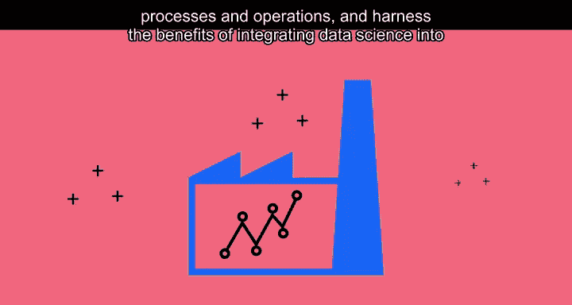

Most organizations realize that digital transformation will require fundamental changes to their approach towards data。

 employees， and customers， and it will affect the organizational culture。

Digital transformation impacts every aspect of the organization。

 so it is handled by decision makers at the very top levels to ensure success。

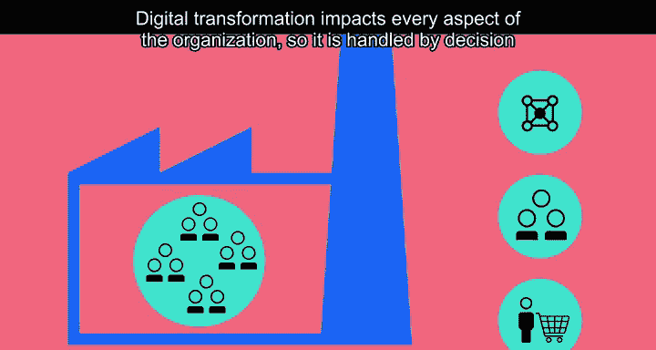

The support of the chief executive officer is crucial to the digital transformation process。

 as is the support of the chief Information officer and the emerging role of chief data officer。

 but they also require support from the executives who control budgets， personnel decisions。

 and day to day priorities。

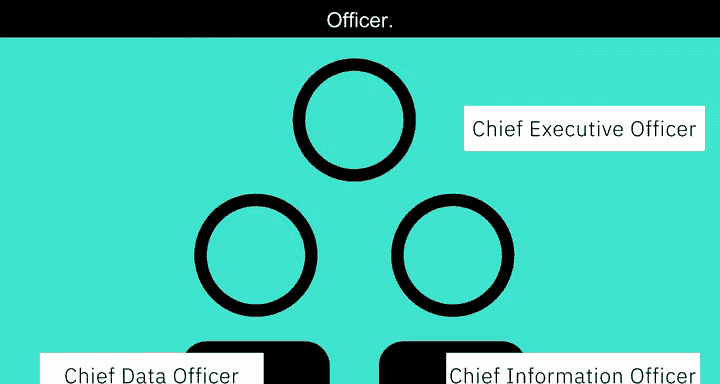

This is a whole organization process， everyone must support it for it to succeed。

There is no doubt dealing with all the issues that arise in this effort requires a new mindset。

 but digital transformation is the way to succeed now and in the future。

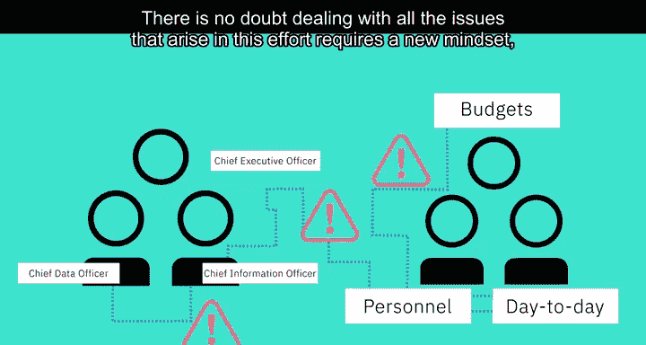

