# IBM数据科学专业证书课程1：《数据科学是什么？》what-is-datascience（中英字幕） - P17：16_数据科学拯救生命案例.zh_en - GPT中英字幕课程资源 - BV1wp4y1V7UT

Using data science techniques to understand and analyze the large data sets available today has a huge impact on human lives。

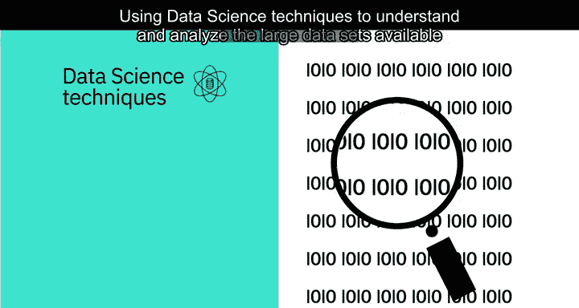

It can provide targeted information to help healthcare professionals give the best treatment to patients or help predict natural disasters so that people can prepare early and much more besides。

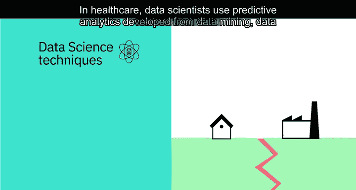

In healthcare data scientists use predictive analytics developed from data mining， data modeling。

 statistics， and machine learning to find the best options for patients this type of predictive analytics examines all known factors for a disease。

 including gene markers， associated conditions and environmental factors。

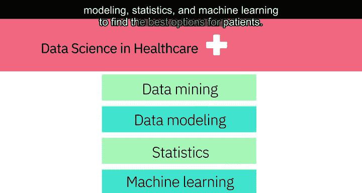

It then recommends appropriate tests， suitable trials， and any suggested treatments。

Every individual physician has their own store of knowledge gained from their studies。

 interests and experiences。

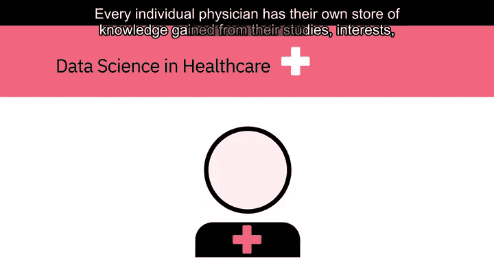

Data science systems that use predictive analytics ensure that all physicians can also access the latest information about the disease tests and treatment plans tailored to their specific patient with this type of system every physician has access to the same knowledge and the best options can be consistently offered。

 improving patient outcomes。

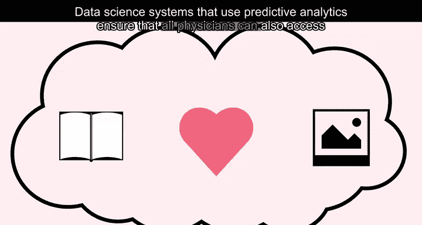

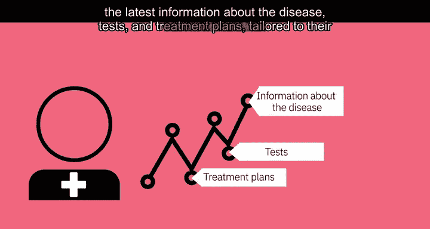

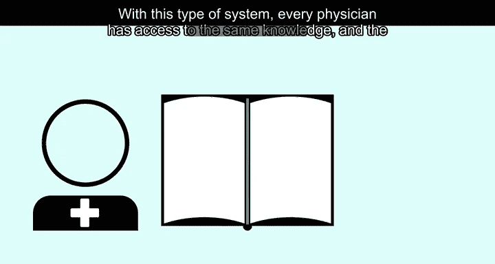

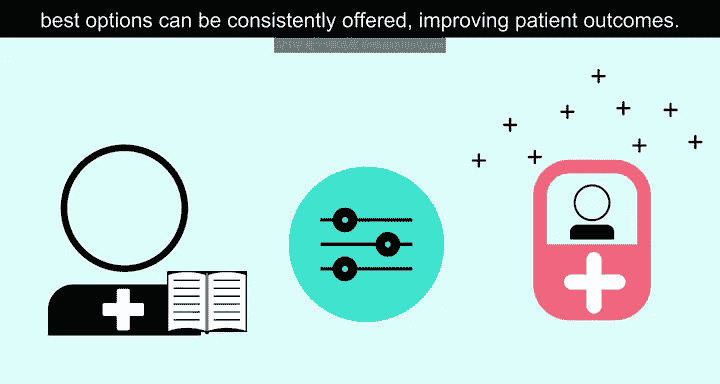

For example， a study by the Boston Consulting Group， an AVM DX。

 an industrydutry Association of Medical diagnosticiagnos companiesies。

 examined the barriers to the adoption of potentially life-saving diagnostic tests for patients with a specific cancer and a particular gene marker。

 the study discovered that the biggest factor in the patient being offered a specific test was the patient's oncologist who may or may not have known about the test and its relationship to the gene marker。

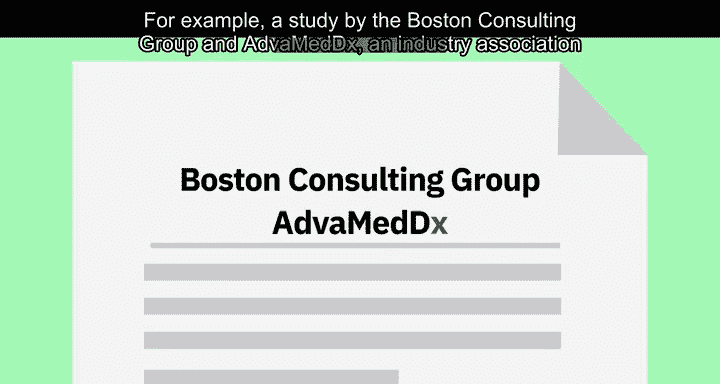

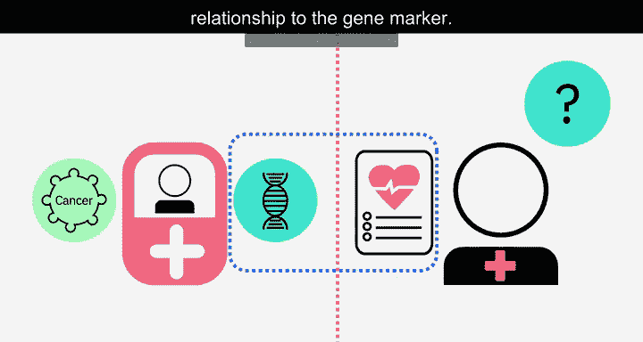

By providing extra information through data science tools。

 physicians can be made aware of the most helpful tests and treatments for a specific patient。

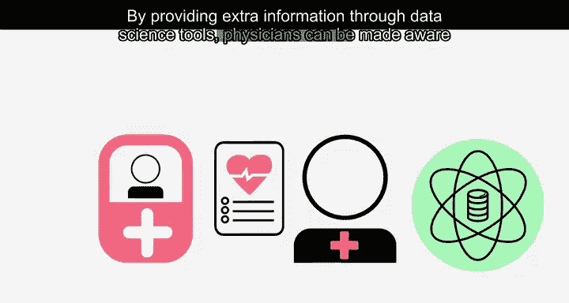

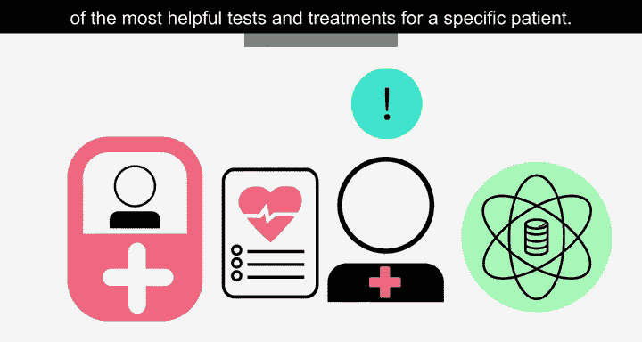

There are many opportunities to explore other ways to mine data。

 such as from electronic medical records for different types of medical research。

 schools such as the North Shore University Health System in suburban Chicago。

 a leader in the implementation of electronic medical records。

 EMR systems now offer guidance on data mining。

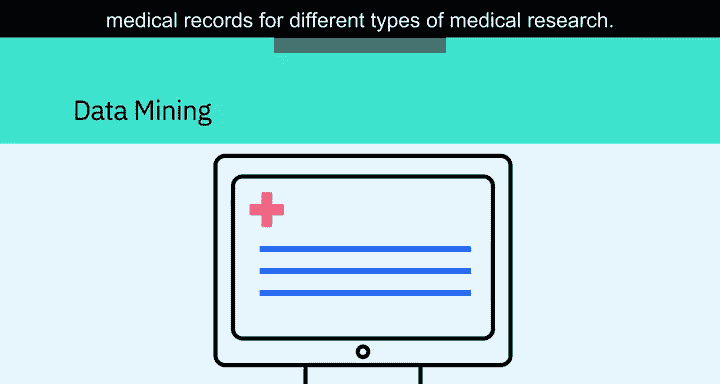

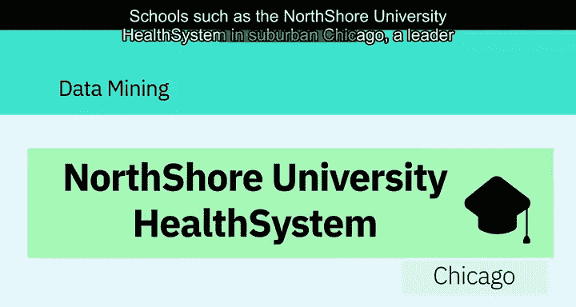

It is the first healthcare provider in America to be awarded the highest level of EMR deployment for both inpatient and outpatient care this remarkable effort has generated much anonymized data available for innovative analytics research。

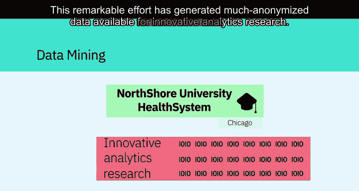

Developing more sophisticated big data analytics capabilities helps healthcare organizations move from basic descriptive analytics towards predictive insights thanks to data science。

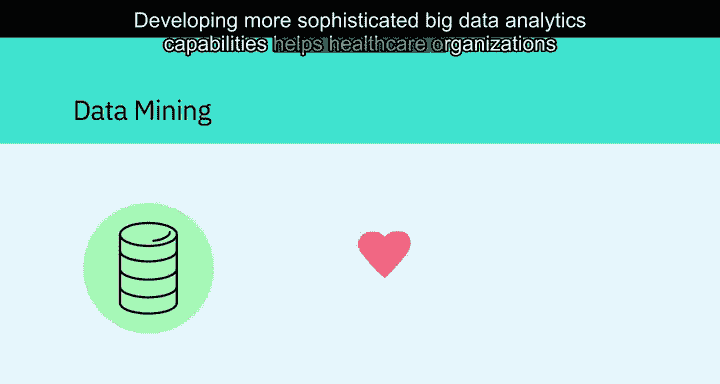

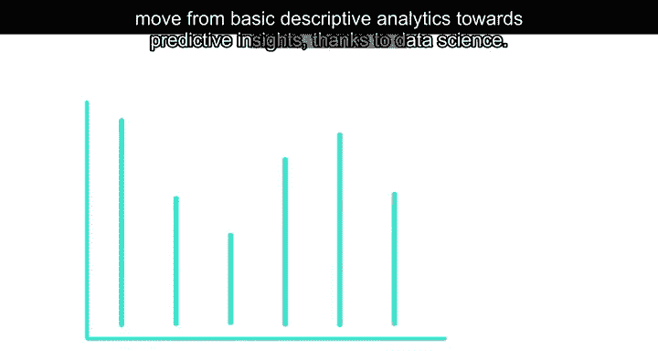

In the field of disaster preparedness， the ability to save lives using data science tools has been under development for many years。

 The use of predictive analytics tools is improving and providing new data analysis in a multitude of ways。

 alerting populations to danger faster than ever before。

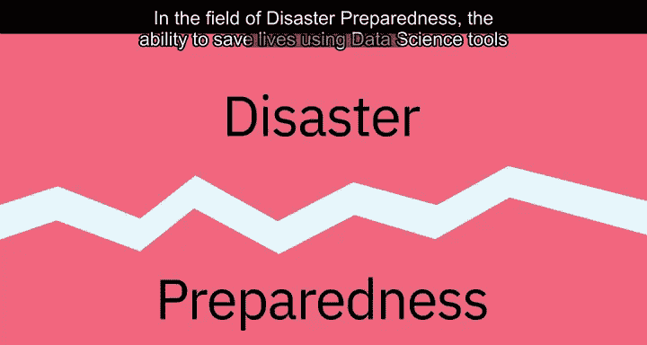

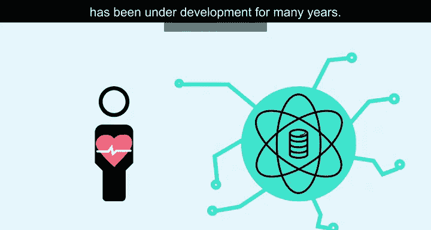

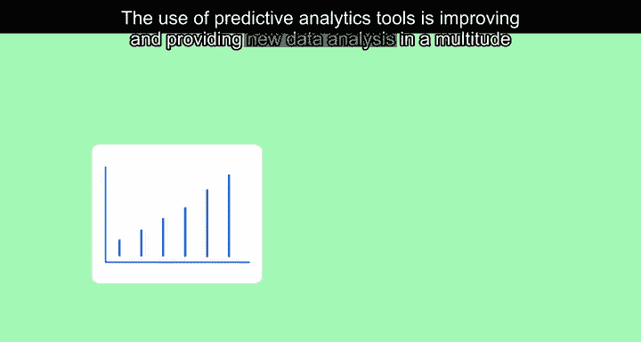

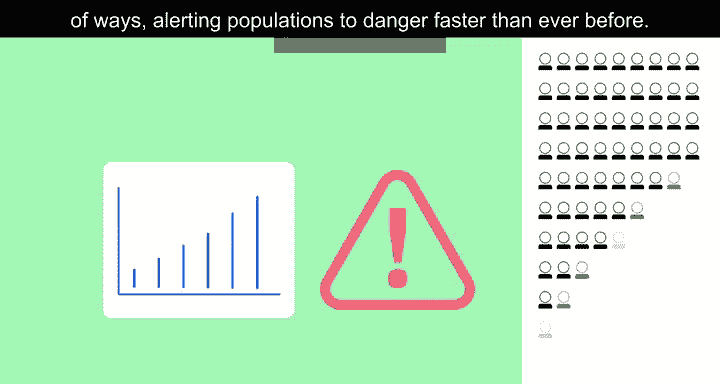

Large， high quality data sets can be used to predict the occurrence of numerous types of natural disasters。

 which can be the difference between life and death for thousands of people。Earthquakes。

 hurricanes and tornadoes， floods， and volcanic eruptions can be predicted with the help of data science。

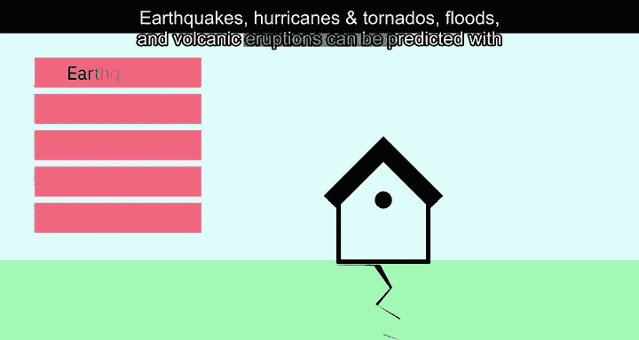

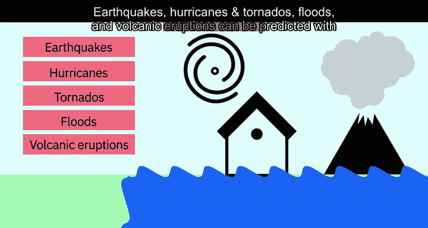

Recent research at the University of Warwick in the UK used social media content such as photos and keywords to track the development of floods。

 hurricanes and other weather events， when added to the information recorded by scientists and weather stations。

 this type of data can be used to improve the predictions for localized weather events。

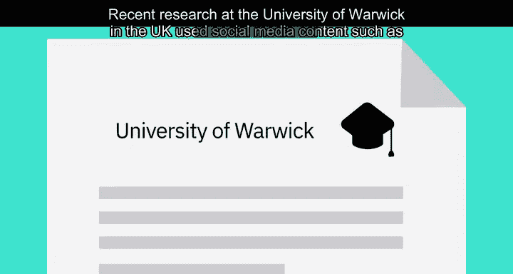

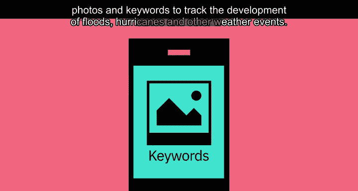

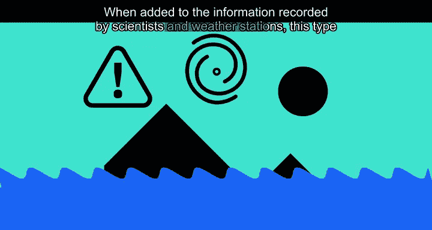

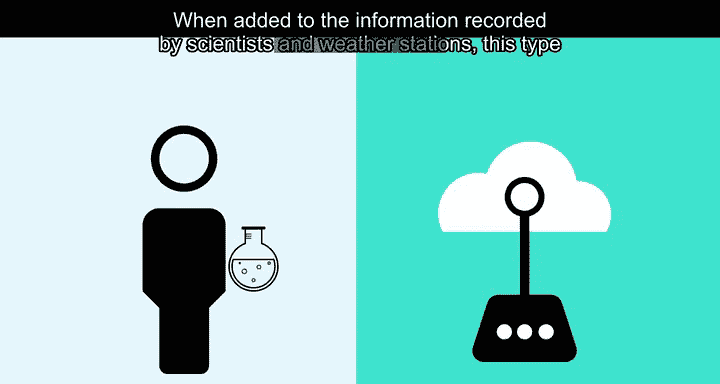

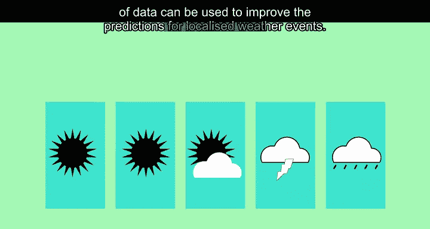

Because the real benefit of this knowledge is so important。

 schools are starting to include this type of data science education in their curriculum。

 for instance， the University of Chicago Graham School offers a master of science course in threat and response management。

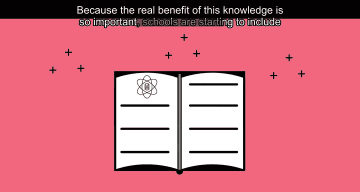

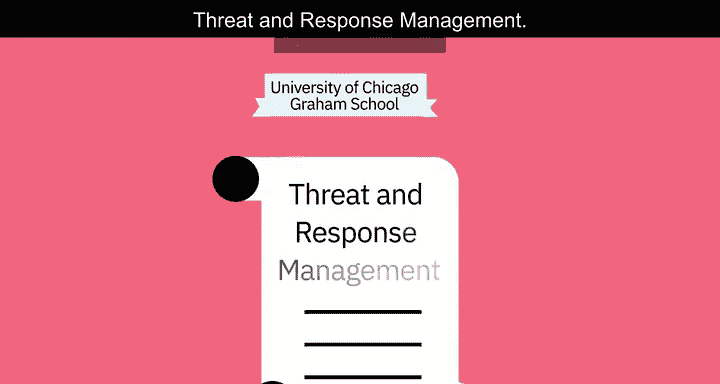

Data science tools enable organizations to analyze vast quantities of data from widely different sources and present that information in a way that allows data scientists to gain new knowledge。

 in some cases， saving hundreds of lives。

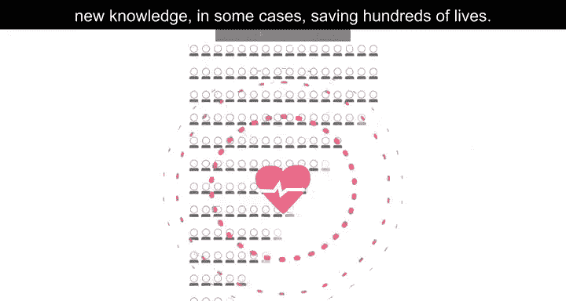