# IBM数据科学专业证书课程1：《数据科学是什么？》what-is-datascience（中英字幕） - P19：18_数据科学应用领域.zh_en - GPT中英字幕课程资源 - BV1wp4y1V7UT

🎼Data science and big data are making an undeniable impact on businesses。

 changing day to day operations， financial analytics， and especially interactions with customers。

 It's clear that businesses can gain enormous value from the insights data science can provide。

 but sometimes it's hard to see exactly how。 So let's look at some examples。

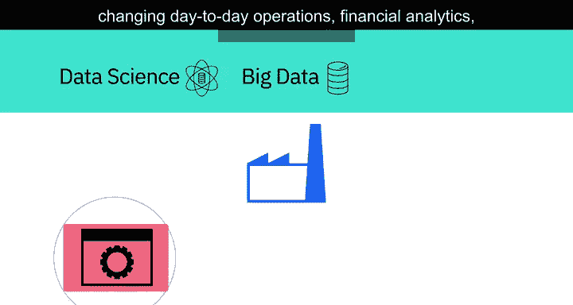

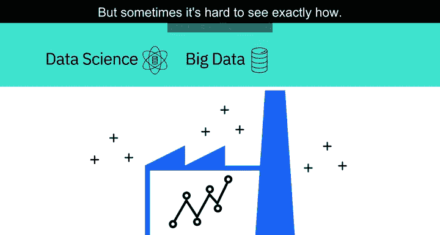

In this era of big data， almost everyone generates masses of data every day。

 often without being aware of it， this digital trace reveals the patterns of our online lives。

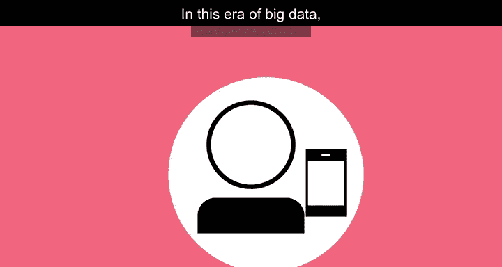

If you have ever searched for or bought a product on a site like Amazon。

 you will notice that it starts making recommendations related to your search。

 This type of system known as a recommendation engine is a common application of data science。

 companies like Amazon Netflix and Spotify use algorithms to make specific recommendations derived from customer preferences and historical behavior。

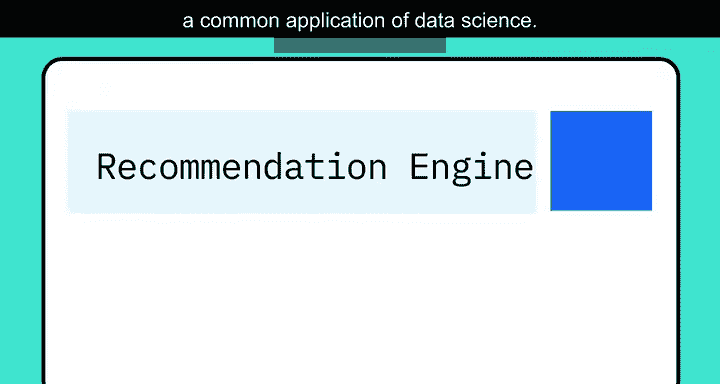

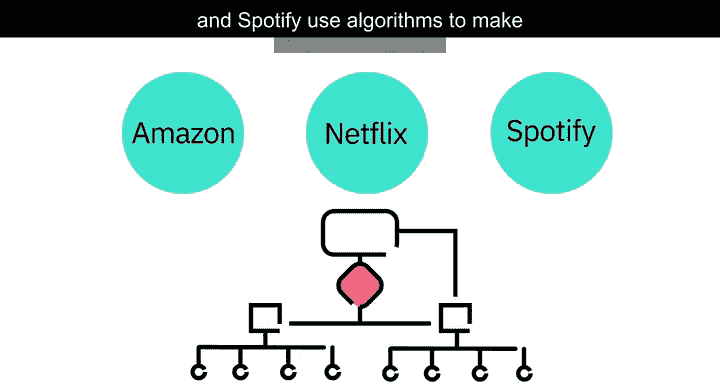

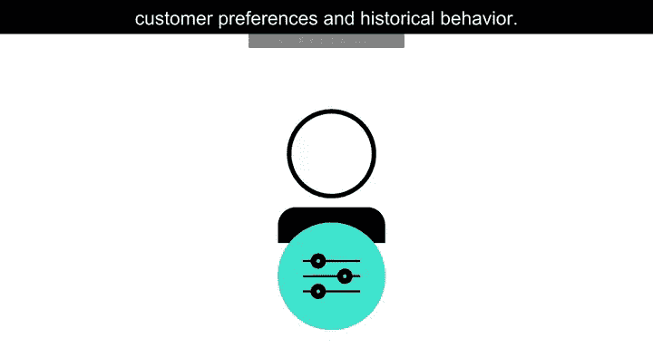

Personal assistants like Siri on Apple devices use data science to devise answers to the infinite number of questions and users may ask。

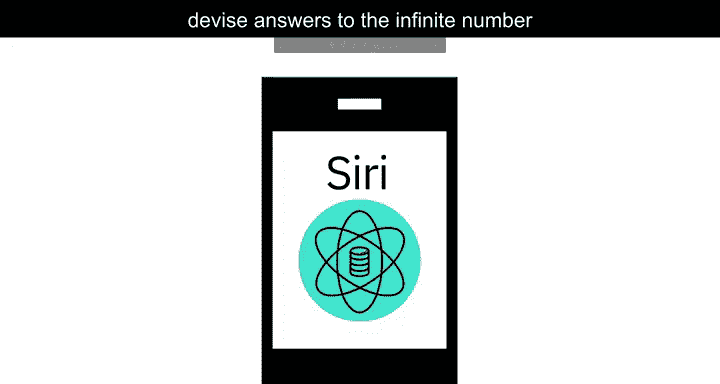

Google watches your every move in the world， your online shopping habits and your social media。

 Then it analyzes that data to create recommendations for restaurants， bars。

 shops and other attractions based on the data collected from your device and your current location。

 wearable devices like Fitbits， Apple watches and Android watches add information about your activity levels。

 sleepleep patterns and heart rate to the data you generate。😊。

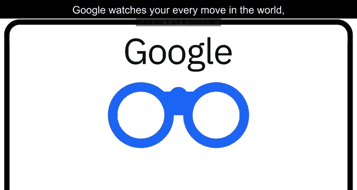

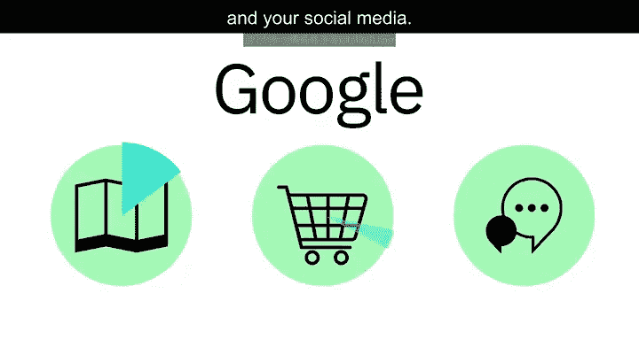

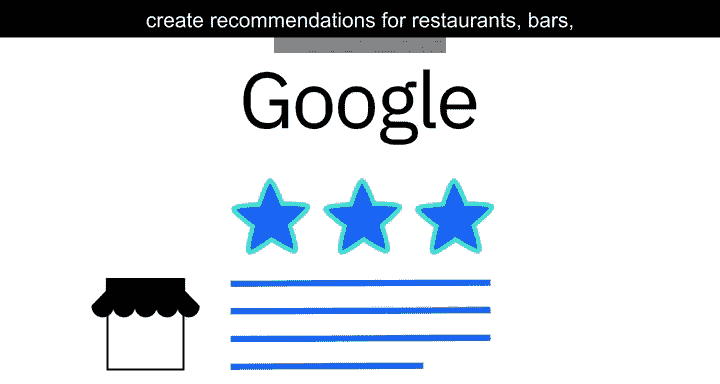

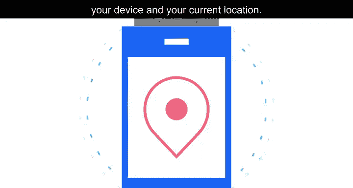

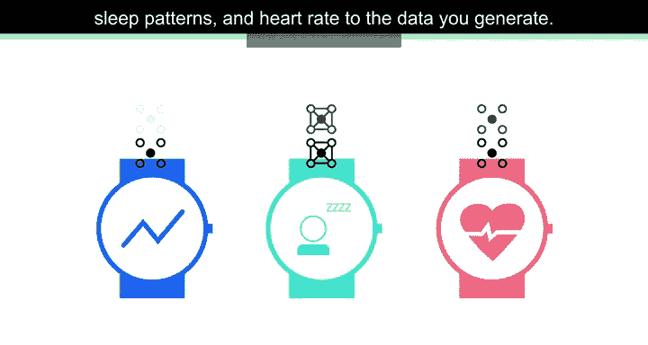

Now that we know how consumers generate data， let's take a look at how data science is impacting business In 2011。

 McKinsey and Company said that data science was going to become the key basis of competition。

 supporting new waves of productivity， growth and innovation。

In 2013， UPS announced that it was using data from customers， drivers。

 and vehicles in a new route guidance system aimed to save time， money， and fuel。

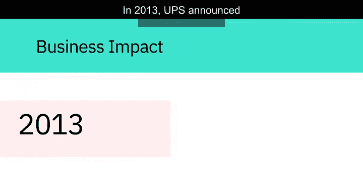

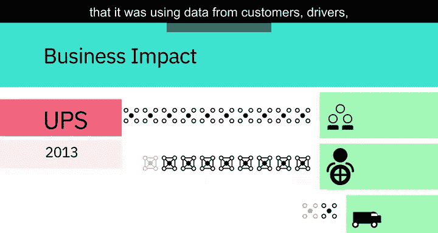

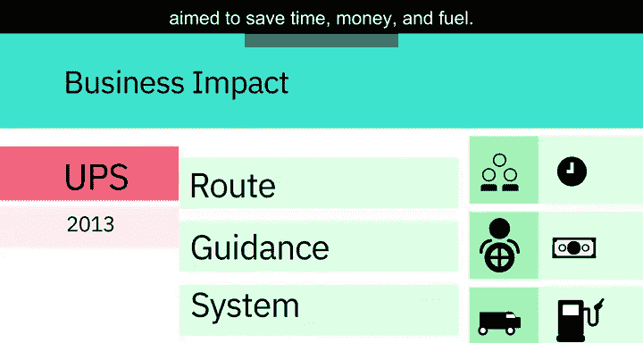

Initiatives like this support the statement that data science will fundamentally change the way businesses compete and operate。

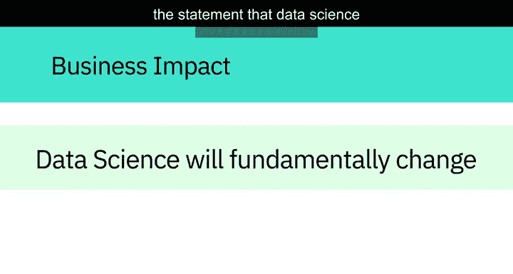

How does a firm gain a competitive advantage， Let's take Netflix as an example。

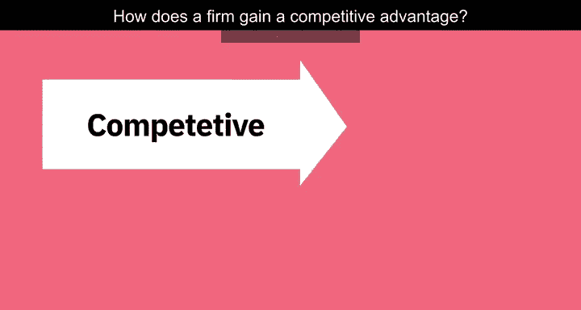

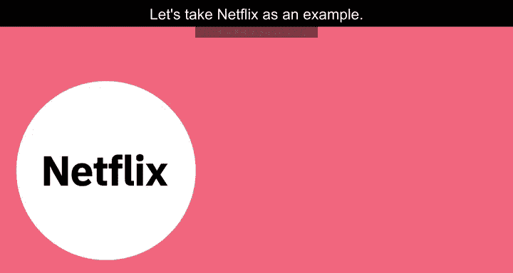

Netflix collects and analyzes massive amounts of data from millions of users。

 including which shows people are watching at what time of day， when people pause。

 rewind and fast forward and which shows directors and actors they search for。

 Netflix can be confident that a show will be a hit before filming even begins by analyzing users preference for certain directors and acting talent and discovering which combinations people enjoy。

😊。

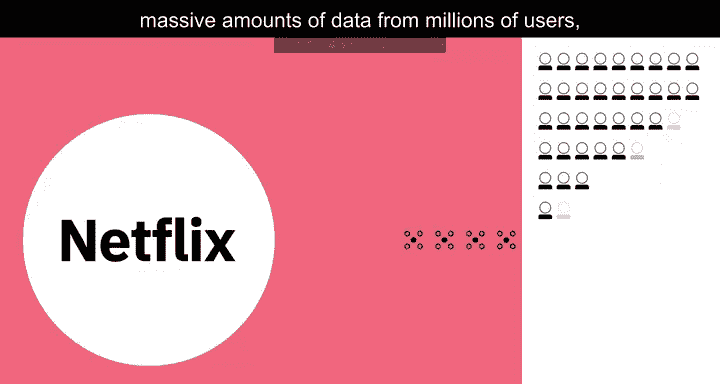

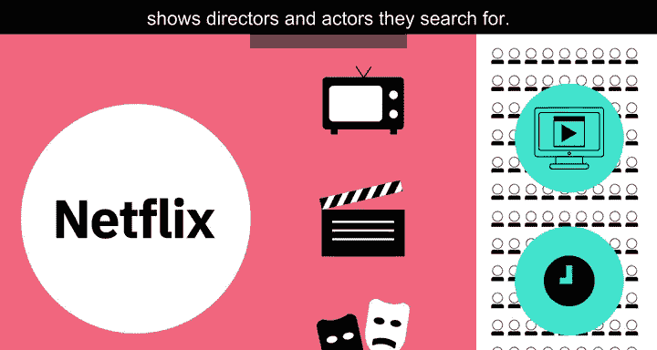

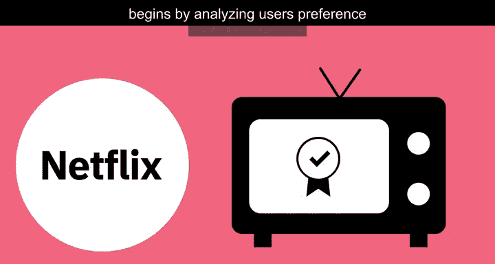

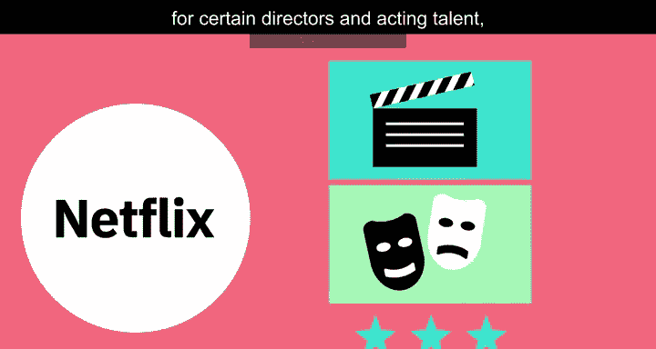

Add this to the success of earlier versions of a show and you have a hit。

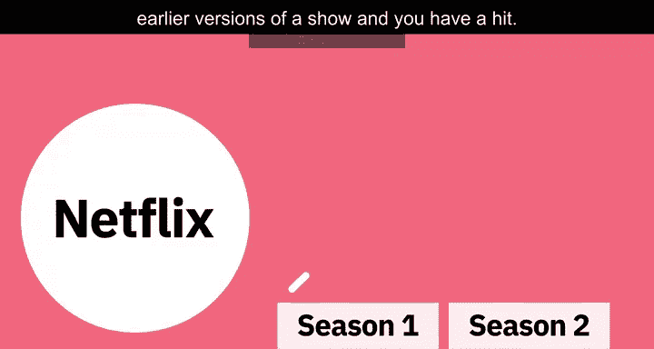

For example， Netflix knew many of its users had streamed the work of David Fincher。

 They also knew that films featuring Robin Wright had always done well and that the British version of House of Cards was very successful。

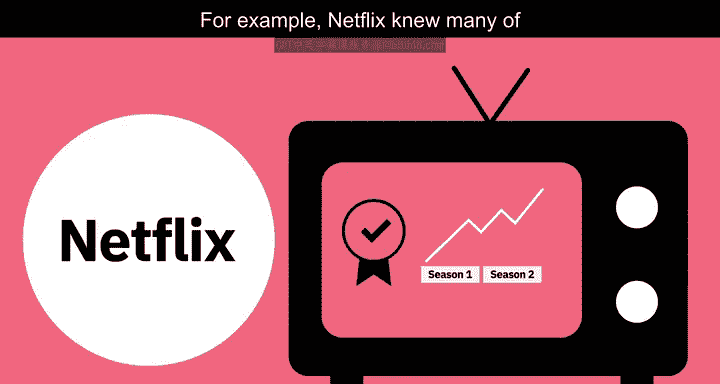

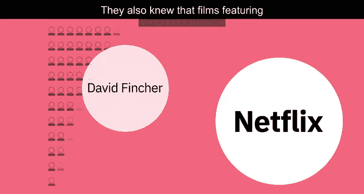

Netflix knew that significant numbers of people who liked Fincher also liked right。

 All this information combined to suggest that buying the series would be a good investment for the company。

 They were right。 It was a huge hit。

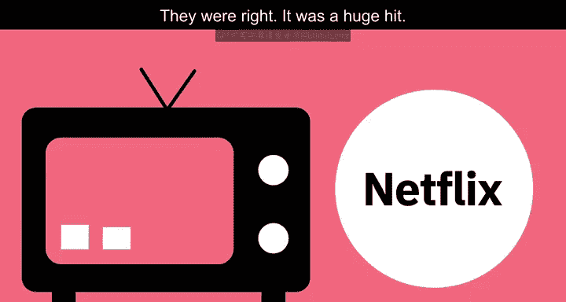

Thanks to data science， Netflix knows what people want before they do。

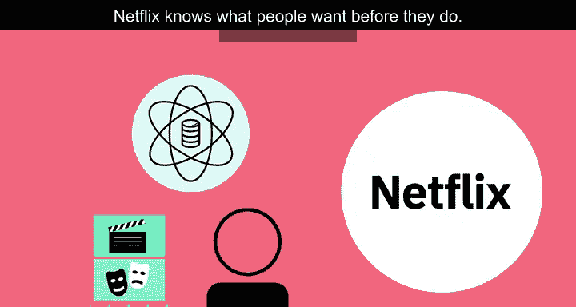