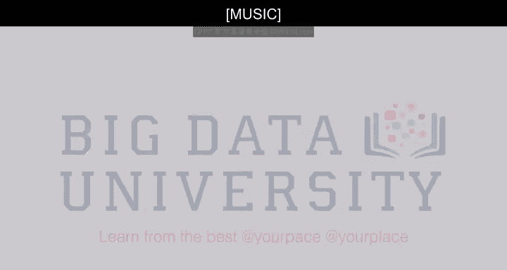

# IBM数据科学专业证书课程1：《数据科学是什么？》what-is-datascience（中英字幕） - P21：20_数据科学人才招聘.zh_en - GPT中英字幕课程资源 - BV1wp4y1V7UT

🎼。

When the companies are hiring people for a data science team。

 may be a data scientist or an analyst or。Achieve data scientist。

 The tendency would be to find the person who who has all the skills that they know the domain specific knowledge。

 they're excellent in analyzing structured and unstructured data and they're great at presenting and they've got the great storytelling skills。

 So if you put all this together you will realize you're looking for a unicorn and your odds of finding a unicorn are pretty rare I think what you need to do is to see given the pool of applicants you have who has the most resonance with with your firm's DNA because you can teach analytic skills。

 Anyone can learn analytic skills if they would dedicate time and effort to it But what really matters is who is passionate about the kind of business that you do Someone could be a great data scientist in in a retail environment but they may not be that excited about working in。

IT related firms or working with gigabytes of web logs。

 but if someone is excited about those web logs or someone is excited about health related data then they would be able to contribute to your productivity much more so and I would say if I'm looking for someone if I have to put together a data science team I would first look for curiosity is that person curious about things。

 not just for data science， but anything like they curious about why this room is painted the certain way why the bookshelves have books and what kind of books they have to have certain degree of curiosity about everything that is in in their vision that they look at the second thing is do they have a sense of humor because you see you have to have a lighthearted about it if someone is too serious about it。

 they probably would take it too seriously and would not be able to look at the lighter elements the third thing I and I think the last thing that I would look for if I have to have a hierarchy。

 the last thing I would look for a technical skills I would go through this。Soal skills curiosity。

 sense of humor， the ability to tell a story， the ability to know that there is a story there and then once all is there then I will say well can you do the technical side of it and if there's some hope or some sign of some technical skills I would take them because I can train them in whatever skills they need but I cannot teach curiosity I cannot teach storytelling I cannot certainly instilled sense of humor in anyone I think there's no hard and fast rule for hiring data scientists I think it's going to be a case by- case thing I would say there has to be some sort of technical components。

 somebody should be able to work with and manipulate the data they should be able to communicate what they find in the data I find quite often nobody really cares about the R squared or the confidence interval so you have to be able to introduce those things and explain something in a compelling way and they also have to find somebody who is relatable because data science it being typically new means。

the person in that role has to make relationships and they have to work across different departments if these data scientists has a good mathematics and statistics background。

 they have to consider like problem solving abilities and analysis data science needs to be good and analysis problems The person they are hiring。

 they should love to play with data and then they know how to play with the data visualization。

 they have analytical thinking when a company is hiring anyone to work on a data science team。

 they need to think about what role that person is going to take before a company begins they need to understand what they want out of their data science team and then they need a hire to begin it as they grow a data science team。

 they need to understand whether they need engineers， architects。

 designers to work on visualization or whether they just need more people who can。

Toly large matrices from a skills point， if you， let's focus on the technical skills and in that case。

First thing would be what kind of a technical platform would you like to adopt let's say you want to work in a structured data environment and let's say you want to work in market research then the type of skills you need are slightly different than someone who would like to work in big data environments if you want to work in the traditional market research data structured data environment your skills should be some statistical knowledge some knowledge of basic statistical algorithms maybe some machine learning algorithms these are the tools that you would like to develop if you want to work in big data then there's the other aspect of it and that is to be able to store data so you start with the expertise in storing large amounts of data and then you look into platforms that allow you to do that the next step would be to be able to manipulate large amounts of data and the final step would be to apply algorithms to those large sets of data So it's a three step process but most likely it starts most importantly it starts with。

where you would like to be in what field and and what domain so in terms of platforms。

 let's say you want to be in a traditional predictive analytics environment and you're not working with big data than R or data or Python would be your tools if you're working mostly with unstructured data then Python is more suitable than R if you're working with big data then Hadoop and spark are the environments that you will be working with so it all depends upon where you would like to be and what kind of work excites you and then you pick your tools in addition to technical skills the second aspect of the data science is to have the ability to communicate the communication skills or presentation skills I call them storytelling skills that is that you have your analysis done now can you tell a great story from it if you have a very large table can you synthesizes and make it more appealing that when it goes on the screen or is it part of a document that it just speaks。

 it sings。Findings and the reader just gets it right there。

 So the ability to present your findings either verbally or in a presentation or in a document。

 so that communication and presentation skills are equally important as the technical skills are when you have a great insight and when you you're presenting your results imagine you're driving on a mountain and then there's a sharp turn and you can't see what's beyond the turn and then you make that turn and then suddenly you see a tremendous valley in front of you and and this great sense of awe that I didn't know that right so when you present your findings and you have this great finding and you communicate it well。

 this is what people feel because they were not expecting it they were not aware of it and then this great sense of happiness that now I know and I didn't know this now I know and then it empowers them it gives them ideas what they can do with this knowledge this new insight it's a great。

😊，Sense of joy and you are able as a data scientist。

 you're able to share it with your clients because you enabled it。

