# IBM数据科学专业证书课程1：《数据科学是什么？》what-is-datascience（中英字幕） - P22：21_数据科学职业发展.zh_en - GPT中英字幕课程资源 - BV1wp4y1V7UT

The emergence of Internet of things and advances in distributed computing have brought vast amounts of data and the technological capability to analyze it。

 Now that we can extract useful insights and new knowledge。

 we need to know how to shape that data to focus on what to do with it and what it can do for us。

 enter data science。 companies like LinkedIn， Glassdo。

 Indeed and dice track employment trends which show a career and data science moving up the list of most promising jobs to become number one since 2016。

 It remains one of the top three career choices for 2020。

 Dice noted that job postings are from companies in a wide variety of industries， not just tech。

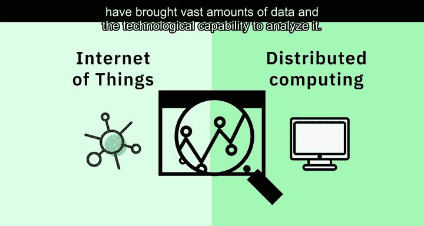

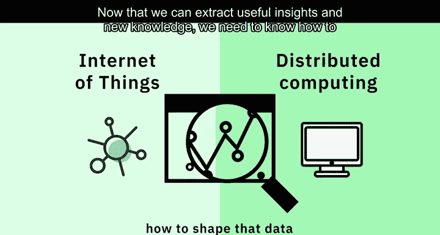

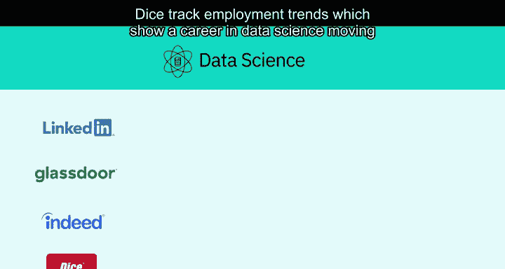

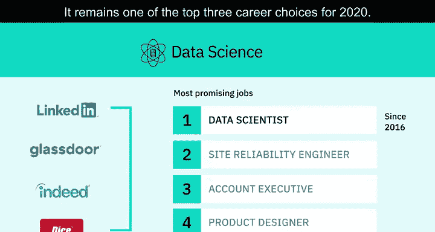

Global Intry analysts Incorporated predicts that the data science platform market will grow by $314。

8 billion by 2025， driven by a compounded growth of 38。2%。

 McKinsey Global Institute warned of huge talent shortages for data and Ana by 2018。

 For a research analyst Brandon Purcell said in January 2019。

 the demand for data scientists will only grow as organizations increasingly rely on data driven insights。

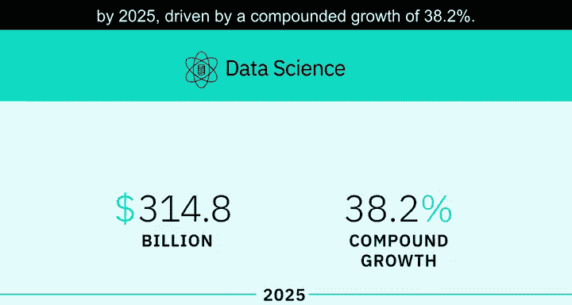

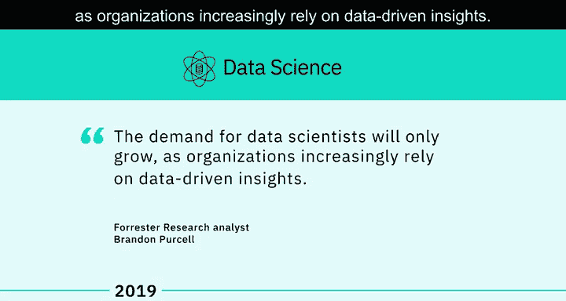

We're now well into that period， and recruiters are finding it difficult to fill the growing need for talented data scientists。

 What motivates someone going into a data science career For one thing。

 data science applies to almost any discipline。 So if you have the aptitude and desire to work with data。

 enjoy coding， have no problem learning math and statistics， and you are a good story telleller。

 then you can certainly enter a data science field in Excel。 For most people。

 this means acquiring additional tools and skills， and continuously learning about new tools and techniques in the field。

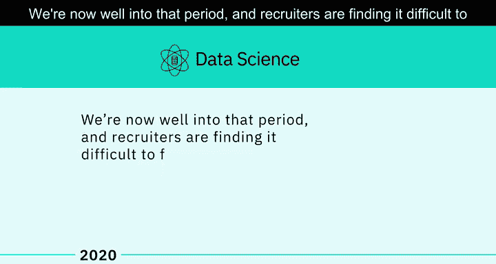

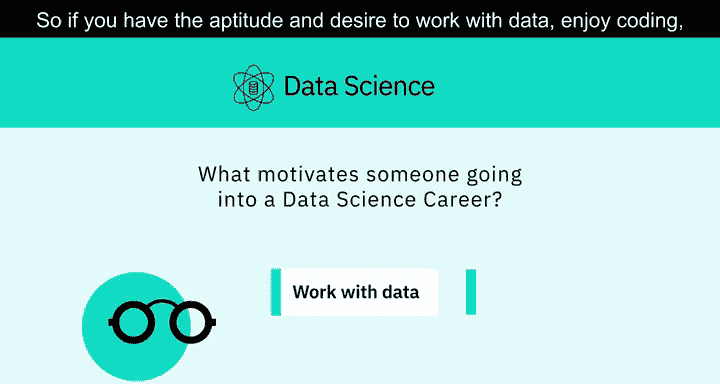

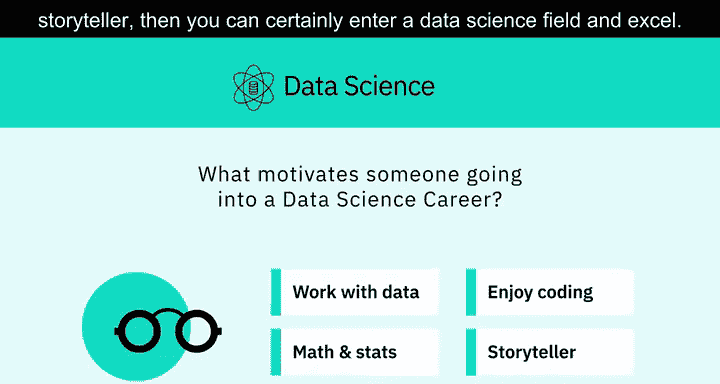

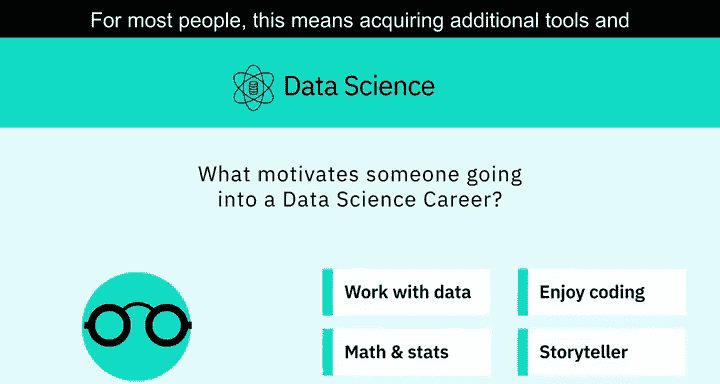

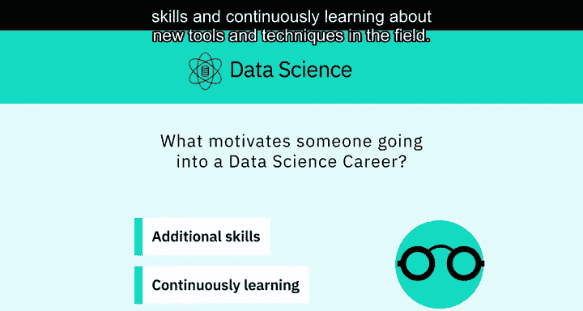

The Women in Data Science Initiative， spearheaded by the Stanford Institute for Computational and Mathematical Computing。

 have committed to inspire and educate data scientists worldwide。

Regardless of gender and to support women in the field。

 When you are seeking a career in data science。 you need to make sure your skill set matches the role you are targeting。

 You can tailor your skill set to the specific area you want to enter。

 adding missing skills via one of the many excellent online training resources。

 Then you will be prepared for a fascinating and rewarding career。

 So now it is time to move into this field。 when there are such diverse choices available and education resources that make it a reality。

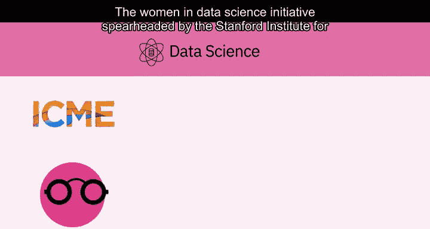

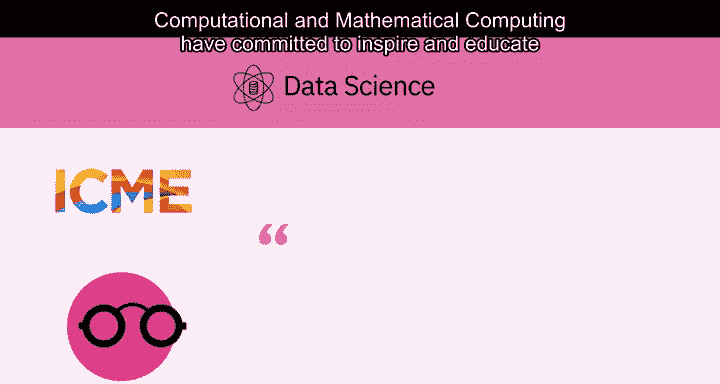

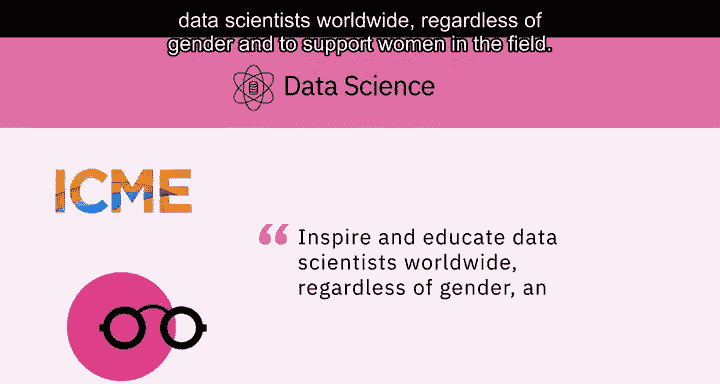

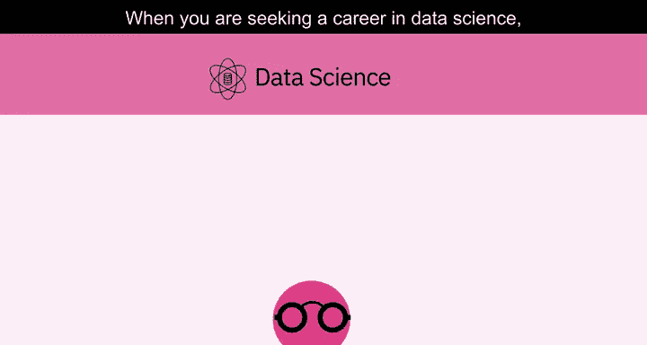

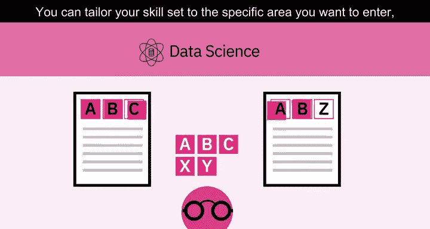

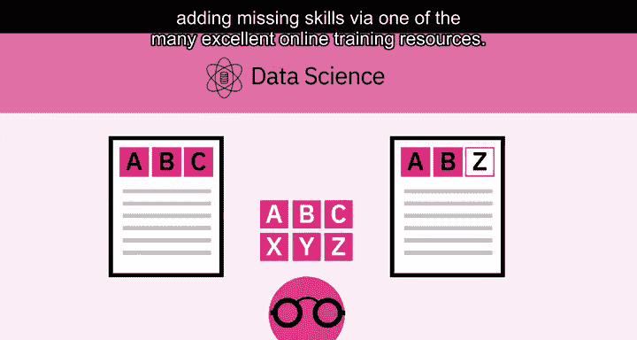

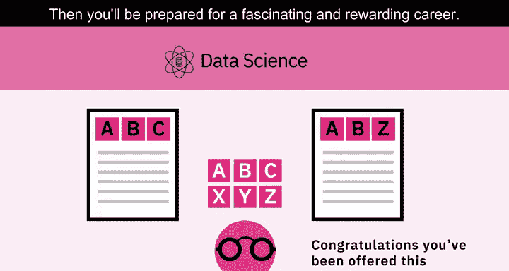

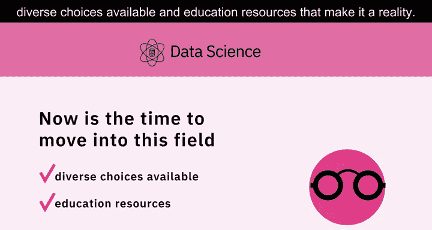