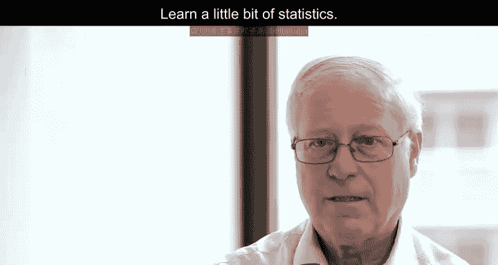
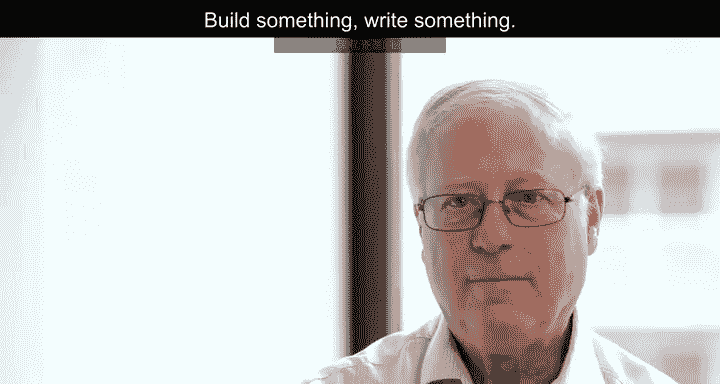
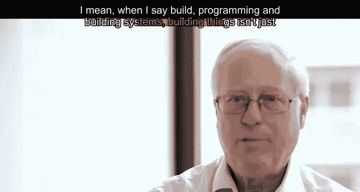
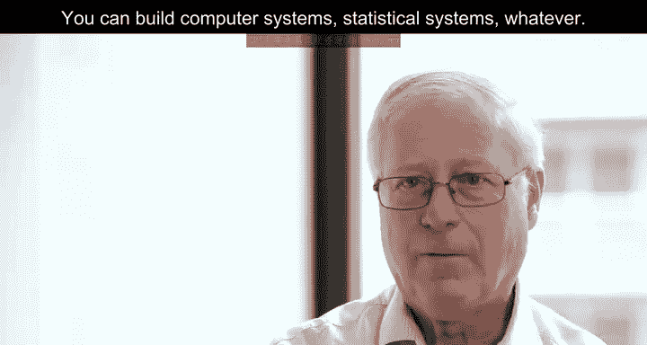
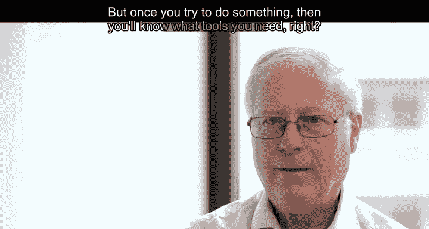
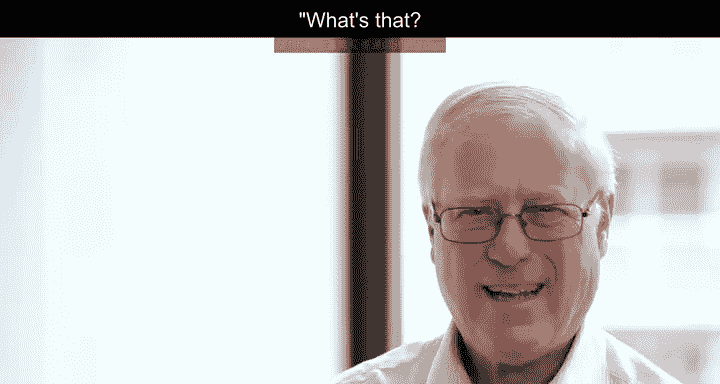
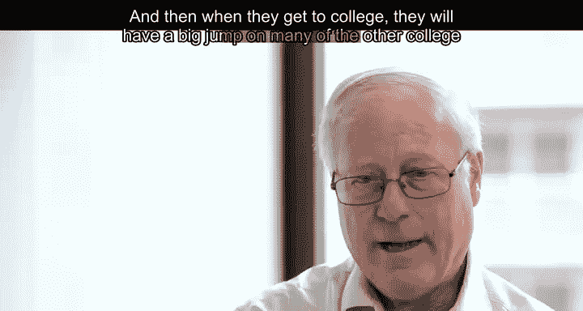
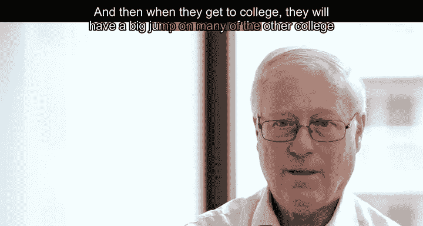

# IBM数据科学专业证书课程1：《数据科学是什么？》what-is-datascience（中英字幕） - P23：22_高中生与数据科学职业.zh_en - GPT中英字幕课程资源 - BV1wp4y1V7UT

Learn how to program。Learn some math。诶。Take a of course， in probability。

Lears a little bit of statistics。

And then play。Build something。

Write something， I mean when I say build。Programming and by build building systems。

 building things isn't just physical， right， You can build。

Computer systems， statistical systems， whatever。 But once you try to do something。

And then then you'll know what tools you need and you'll say， oh， oh my God。

 what there's this expression there。 what what does an inner product mean and what's that， How do I。

 Oh， okay， I can learn that。

And then when they get to college， they will have a big jump。

On many of the other college students。

And so when they get out of college。They'll have an even beer jump and they make a lot of money。

And they'll be happy too。This stuff is fun。

It's fun。If you're in high school and you're considering data science。

 I would say get familiar with databases， start learning SQL， start thinking about。

 you know computer science if that's interesting， if you have a computer science course in your school know take it and that's a good part of being a data scientist beyond that there're probably just ways to foster your creativity your curiosity if you like detective games that's kind of cool right if you like if you like know treasure hunts or whatever right if you're into that stuff。

 I think you' and you get an opportunity to do that stuff that will help you as a data scientist because it's a really a good way to kind of make sure that you can be curious as you go about your daily life。

Encourage the curiosity， encourage the experimentation。

 it's kind of like science fairs right science fairs are great and they encourage that experimentation that learning from you know asking a question and answering it through a scientific method。

 but doing that with，😊，you know， data sets rather than than you know vinegar volcanoes right it's kind of the same thing but learning from data and if we're going through an election season right now。

 there's a lot of stuff in the news about polls and survey results and that's a great way to start a conversation to talk about how do we how did the people who ran the polls。

 how do they know you know how can they predict what's going to happen in the election so' that's another you know kind of cool way to start a conversation about data science。

😊，I would say encourage the person who is interested in data science because to pursue it because it's a great career and it's something that's definitely going to be in need in the future。

 it's one of those you know highly sought after kind of knowledge。You know。

 professions that are really important to。businesses around the world and so being a data scientist and being able to help companies as they grow and learn how to do things more efficiently or how to do things smarter。

 there'll always be a need for people like that and data scientists are those people。

I would say that I understand what you're talking about because I was never a great mathematics student as well。

 and I think there's actually a bunch of data scientists who are really successful and popular who are in the same boat。

 you know， there's kind of arithmetic and math in school is not necessarily everybody's best subject。

But when you combine it with， you know， these aren't just， you know， hypothetical numbers。

 these aren't just。You know， problem statements that you have no connection to when when you when you have a connection to the problem。

 it suddenly becomes much easier to use math to help understand it I've found， and so you know。

 knowing the people who will benefit from the math that you do， I think is really cool。

