# IBM数据科学专业证书课程1：《数据科学是什么？》what-is-datascience（中英字幕） - P2：1_数据科学基础原理.zh_en - GPT中英字幕课程资源 - BV1wp4y1V7UT

Everyone you ask will give you a slightly different description of what data science is。

But most people agree that it has a significant data analysis component。

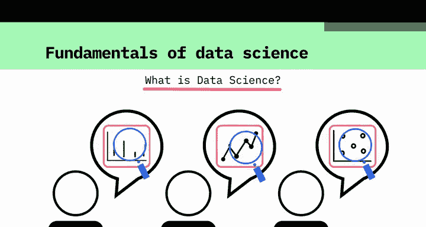

Data analysis isn't new。What is new is the vast quantity of data available from massively varied sources。

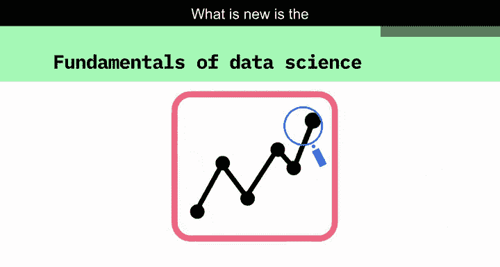

From log files， email， social media， sales data， patient information files， sports performance data。

 sensor data， security cameras， and many more besides。

At the same time that there is more data available than ever。

 we have the computing power needed to make a useful analysis and reveal new knowledge。

Data science can help organizations understand their environments， analyze existing issues。

 and reveal previously hidden opportunities。

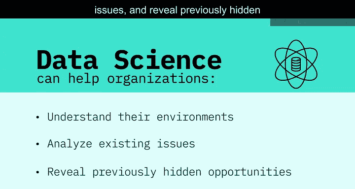

Data scientists can use data analysis to add to the knowledge of the organization by investigating data。

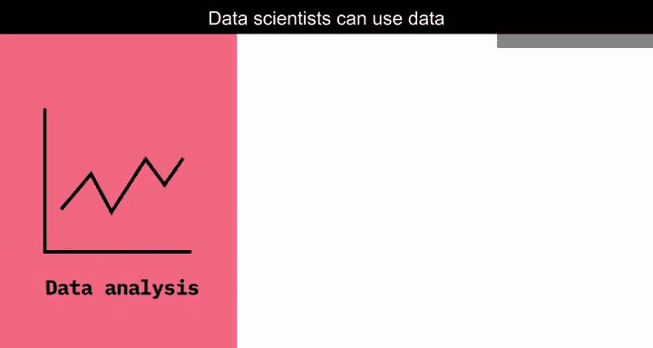

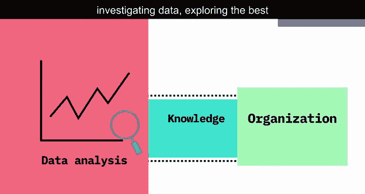

Exploring the best way to use it to provide value to the business So what is the process of data science。

 Many organizations will use data science to focus on a specific problem。

 and so it's essential to clarify the question that the organization once answered。

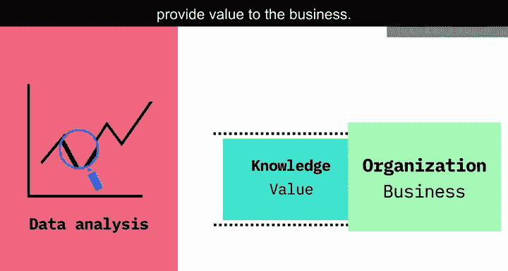

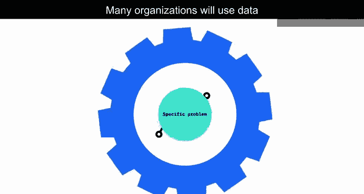

This first and most crucial step defines how the data science project progresses。

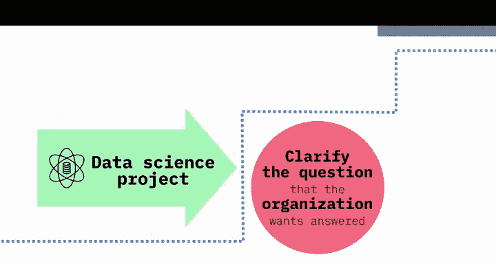

Good data scientists are curious people who ask questions to clarify the business need。

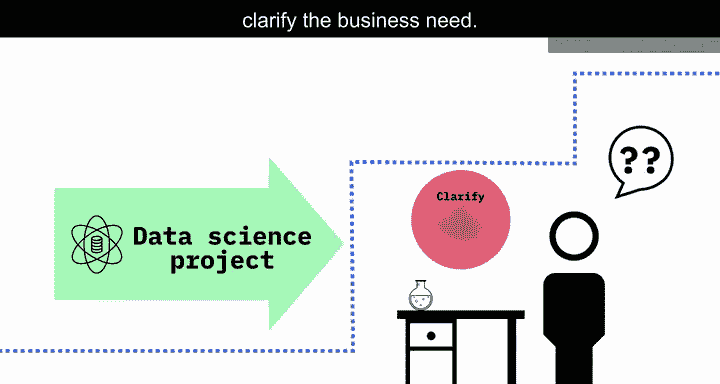

The next questions are， what data do we need to solve the problem？

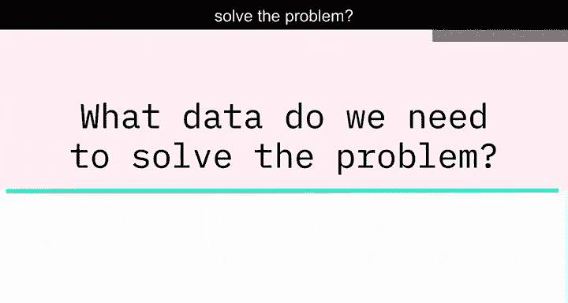

And where will that data come from？Data scientists can analyze structured and unstructured data from many sources。

 and depending on the nature of the problem， they can choose to analyze the data in different ways。

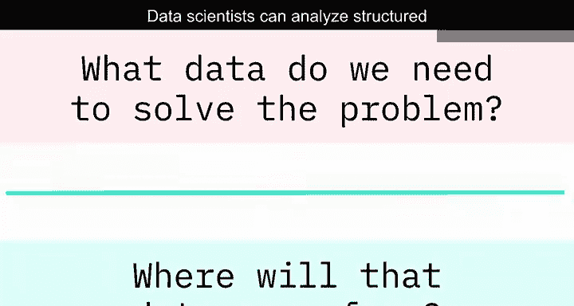

Using multiple models to explore the data reveals patterns， archetypes， and outliers。

 sometimes this will confirm what the organization suspects。

 but sometimes it will be completely new knowledge leading the organization to a new approach。

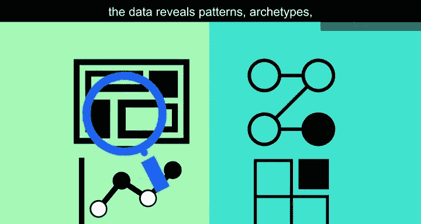

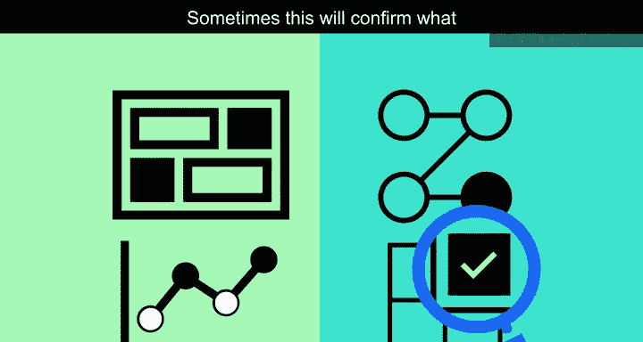

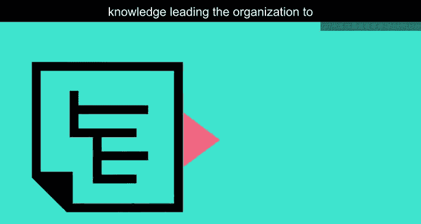

When the data has revealed its insights， the role of the data scientist becomes that of a storyteller。

 communicating the results to the project stakeholders。

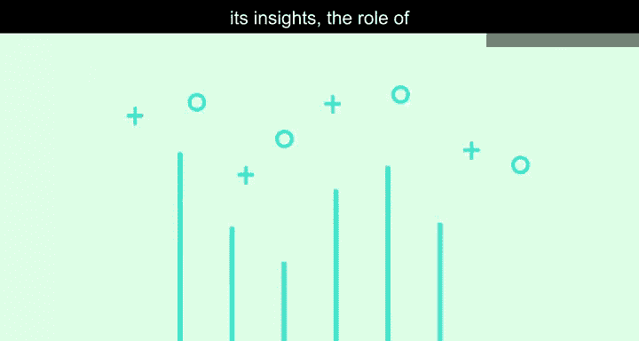

Data scientists can use powerful data visualization tools to help the stakeholders understand the nature of the results and the recommended action to take。

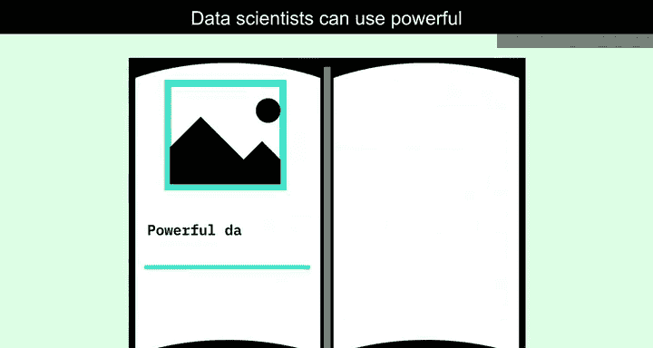

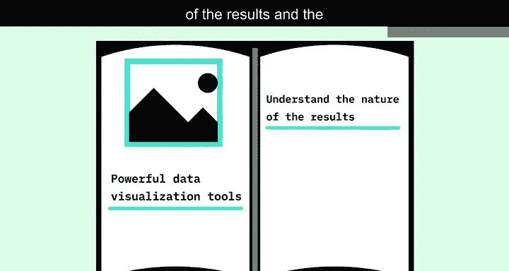

Data science is changing the way we work， it's changing the way we use data and is changing our approach to the world。

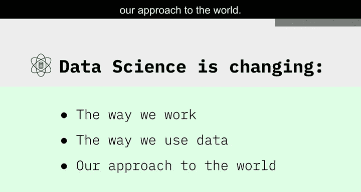