# IBM数据科学专业证书课程1：《数据科学是什么？》what-is-datascience（中英字幕） - P6：5_传统问题与数据科学解决方案.zh_en - GPT中英字幕课程资源 - BV1wp4y1V7UT

Organizations can leverage the almost unlimited amount of data now available to them in a growing number of ways。

 However， all organizations ultimately use data science for the same reason to discover optimum solutions to existing problems Let's take a look at three examples of data science providing innovative solutions for old problems In transport。

 Uber collects realtime user data to discover how many drivers are available if more are needed。

 and if they should allow a surge charge to attract more drivers Uber uses data to put the right number of drivers in the right place at the right time for a cost the rider is willing to pay in a different transport related data science effort the Toronto Transport Commission has made great strides in solving an old problem with traffic flows restructuring those flows in and around the city using data science tools and analysis。

 they have gathered data to better understand streetcar operations and identify areas。

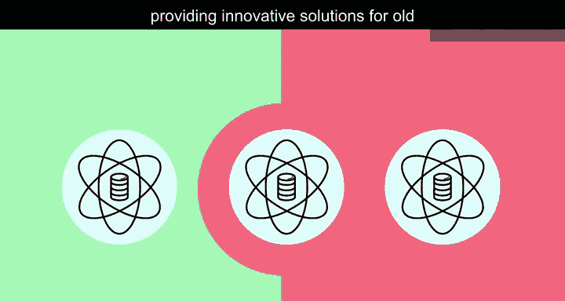

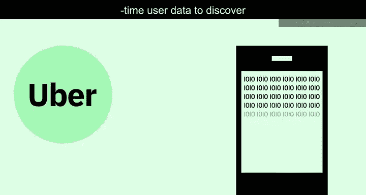

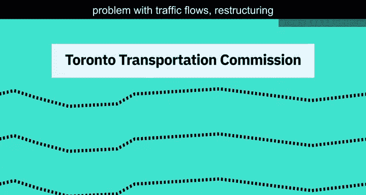

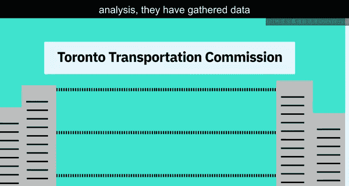

For interventions， analyzed customer complaints data used probe data to better understand traffic performance on main routes and created a team to better capitalize on big data for both planning operations and evaluation by focusing on peak hour clearances and identifying the most congested routes。

 monthly hours lost for commuters due to traffic congestion， dropped from 4。

75 hours in 2010 to  three hours in mid-2014。

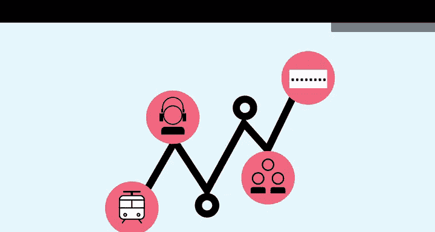

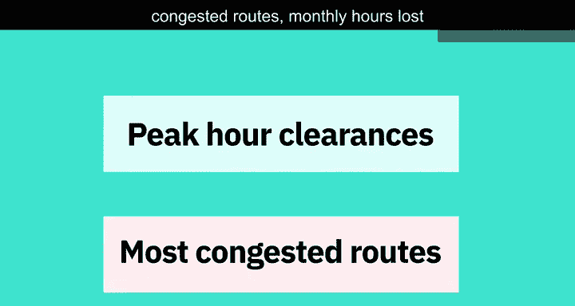

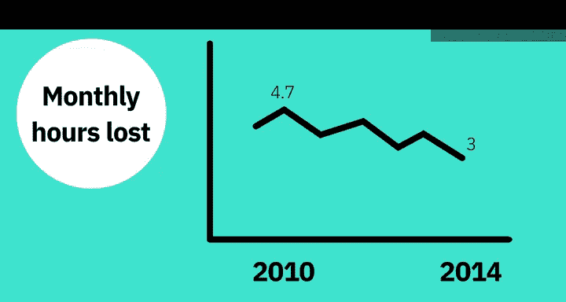

In facing issues in our environment， data science can also play a proactive role。

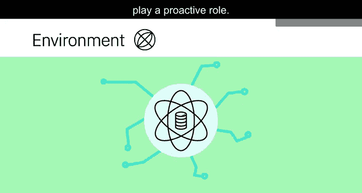

Freshwater lakes supply a variety of human and ecological needs。

 such as providing drinking water and producing food。

 but lakes across the world are threatened by increasing incidences of harmful cyanobacterial blooms。

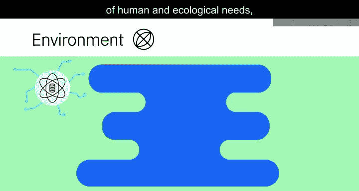

There are many projects and studies to solve this long existing dilemma in the US。

 a team of scientists from research centers stretching from Maine to South Carolina is developing and deploying hightech tools to explore cyanobacteria in lakes across the East Coast the team is using robotic boats。

 buoys and camera equippedquipped drones to measure physical chemical and biological data in lakes where cyanobacteria are detected。

 collecting large volumes of data related to the lakes and the development of the harmful blooms。

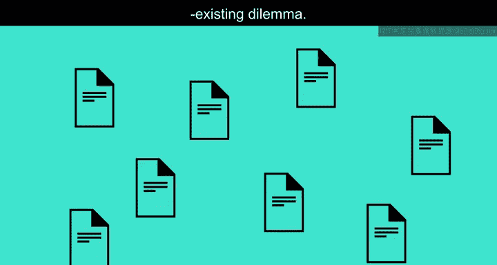

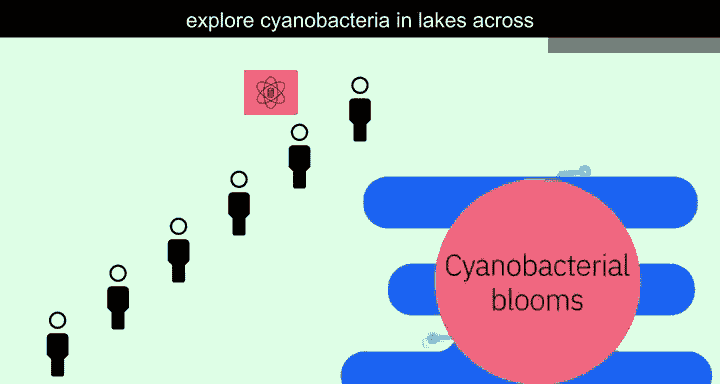

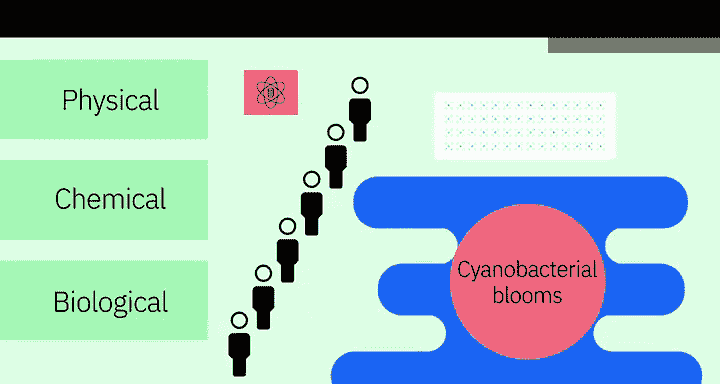

The project is also building new algorithmic models to assess the findings the information collected will lead to better predictions of when and where cyanobacterial blooms take place。

 enabling proactive approaches to protect public health in recreational lakes and in those that supply drinking water。

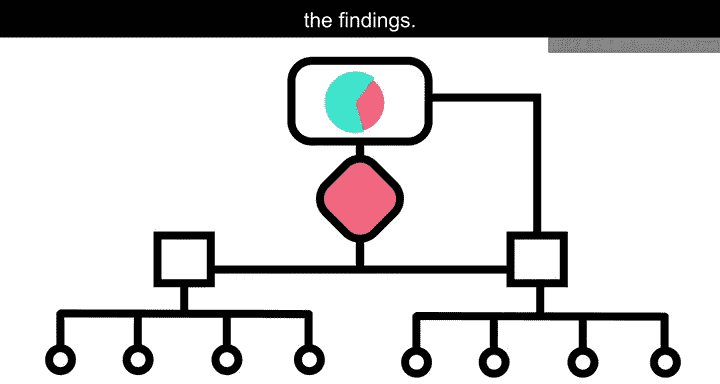

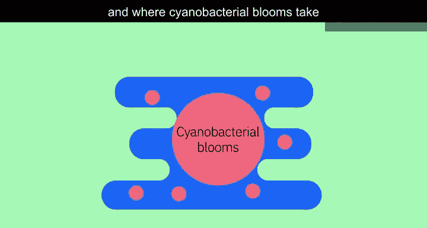

Such interdisciplinary training prepares the next generation of scientists to address societal issues with the proper modernized data science tools。

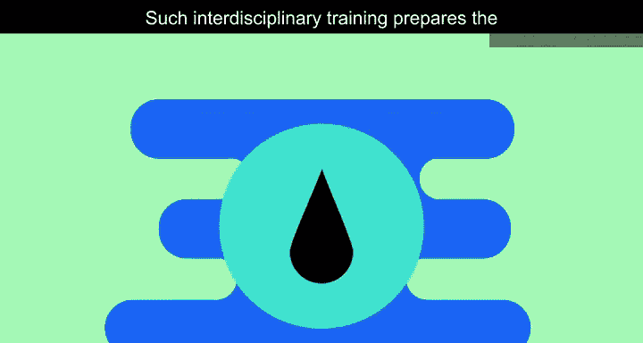

It takes gathering a lot of data， cleaning and preparing it。

 and then analyzing it to gain the insight needed to develop better solutions for today's enterprises。

How do you get a better solution that is efficient。

 You must identify the problem and establish a clear understanding of it。 Ga the data for analysis。

 identify the right tools to use and develop a data strategy。

Case studies are also helpful in customizing a potential solution once these conditions exist and available data is extracted。

 you can develop a machine learning model， it will take time for an organization to refine best practices for data strategy using data science。

 but the benefits are worth it。

