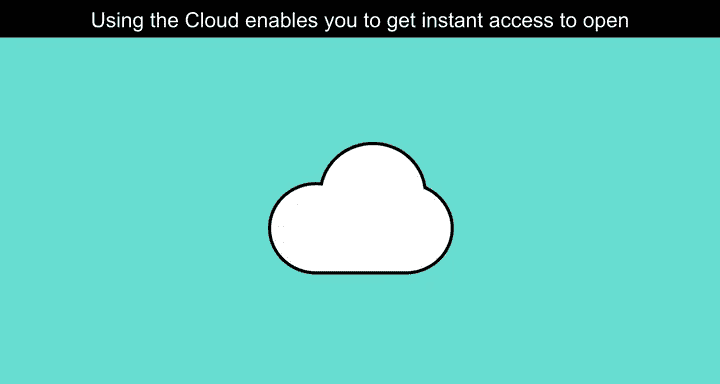
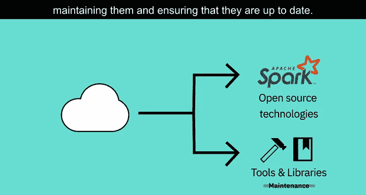
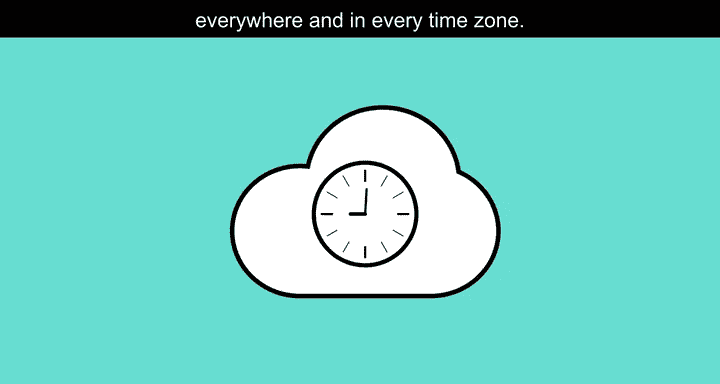
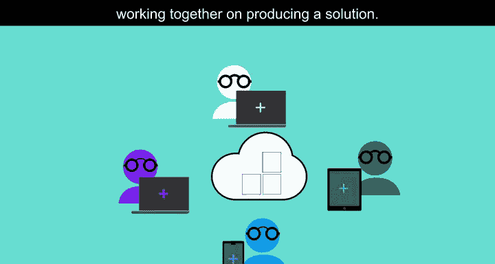
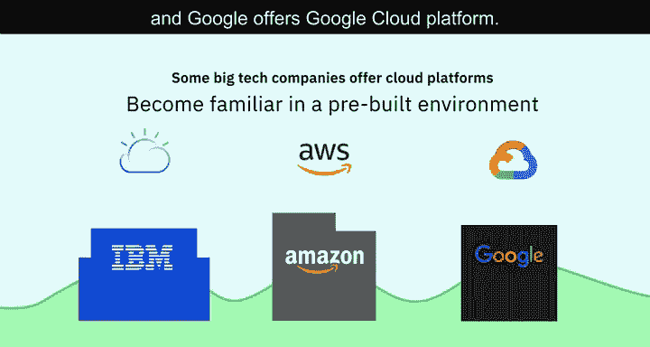
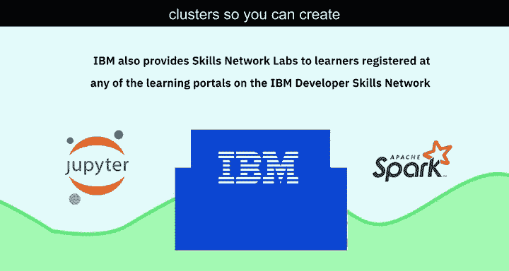
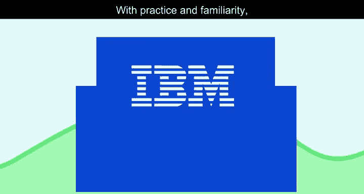
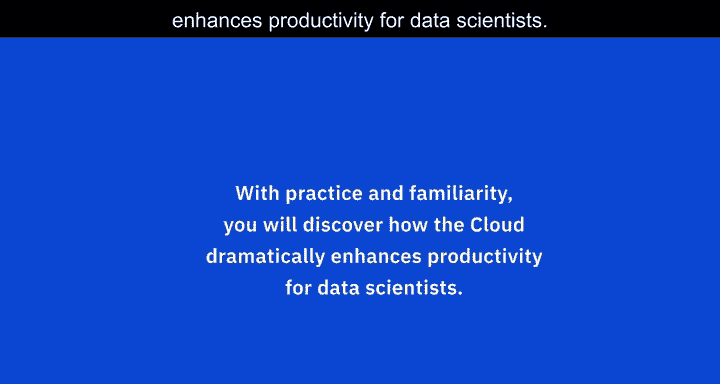

# IBM数据科学专业证书课程1：《数据科学是什么？》what-is-datascience（中英字幕） - P8：7_数据科学中的云计算.zh_en - GPT中英字幕课程资源 - BV1wp4y1V7UT

Cloud its a godsend for data scientists， primarily because you're able to take the or you take your data。

 take your information and put it in the cloud， put it in the central storage system it allows you to bypass the physical limitations of the computers and the systems you're using and it allows you to deploy the analytics and storage capacities of advanced machines that do not necessarily have to be your machine or your company's machine cloud allows you not just to store large amounts of data on servers somewhere in California or in Nevada。

 and it also allows you to deploy very advanced computing algorithms and the ability to do high performance computing。

 using machines that are not yours。 so think of it as。You have some information。 you can't store it。

 so you send it to storage space。 Let's call it cloud。 and the algorithms that you need to use。

 you don't have them with you。 but then in on the cloud， you have those those algorithms available。

 So what you do is you deploy those algorithms on very large data sets and you're able to do it even though your own systems。

 your own machines， your own computing environment were not allowing you to do so So cloud is beautiful and the other thing cloud is beautiful for is that it allows multiple entities to work with same data at the same time。

 So you can be working with the same data that your colleagues in say Germany and another team in India and another team in in Ghana。

 they are collectively working and they are able to do so because the information and the algorithms and the tools and the answers and the results。

 whatever they need it is available at a central place which we call cloud。 So cloud is beautiful。

Using the cloud enables you to get instant access to open source technologies like Apache Spark without the need to install and configure them locally。

 usings the cloud also gives you access to the most up to date tools and libraries without the worry of maintaining them and ensuring that they are up to date。

 The cloud is accessible from everywhere， and in every time zone。

 you can use cloudbased technologies from your laptop， from your tablet and even from your phone。

 enabling collaboration more easily than ever before。

 Multi collaborators or teams can access the data simultaneously working together on producing a solution。

Some big tech companies offer cloud platforms， allowing you to become familiar with cloudbased technologies in a pre-built environment IBM offers the IBM Cloud。

 Amazon offers Amazon Web Services or AWS and Google offers Google Cloud platformform IBM also provides Skills Network Labs or SN Labs to learners register to any of the learning portals on the IBMDevelop skills network。

 where you have access to tools like Jupiter notebooks and Spark clusters so you can create your own data science Project and develop solutions。

With practice and familiarity， you will discover how the cloud dramatically enhances productivity for data scientists。

