# IBM数据科学专业证书课程2：《数据科学工具》open-source-tools-for-data-science（中英字幕） - P10：9_商业数据科学工具.zh_en - GPT中英字幕课程资源 - BV1np4y1V7Sn

We previously covered open source tools for data science。

 Now let's look at the commercial options you'll find in many enterprise projects。

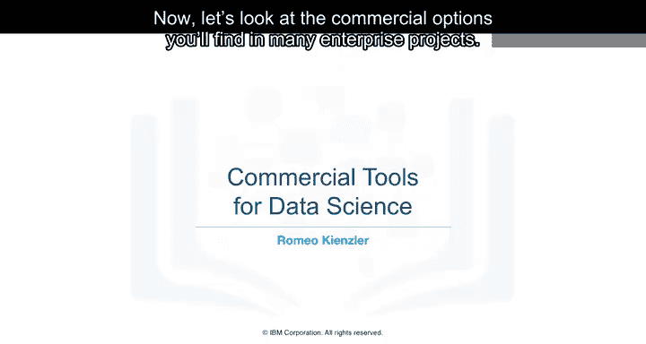

Let's revisit our overview of different tool categories In data management。

 most of an enterprise's relevant data is stored in an Oracle database， Microsoft SQL server。

 or IBM DB2。

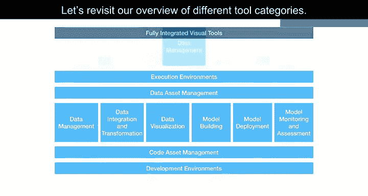

Although open source databases are gaining popularity。

 those three data management products are still considered the industry standard。

 They won't disappear in the near future。 It's not just about functionality。

 Data is at the heart of every organization， and the availability of commercial supports plays a major role。

Commercial supports are delivered directly from software vendors。

 influential partners and support networks When we focus on commercial data integration tools。

 we're talking about extract transform and load or ETL tools。

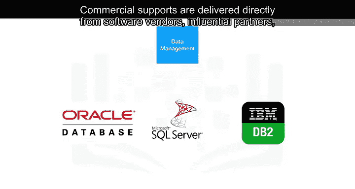

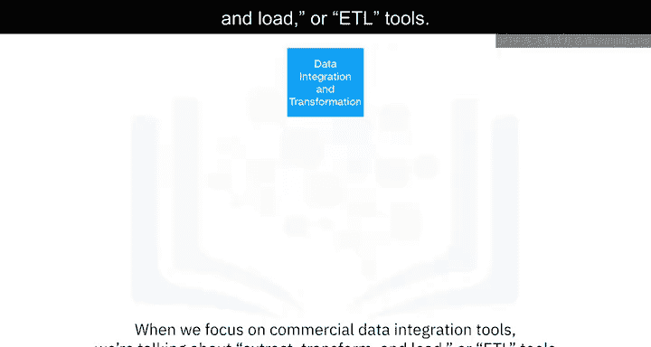

According to Gartner Magic Quadrant， Informaticica Power Center and IBM Infosphere Data St are the leaders followed by products from SAP。

 Oracle， SAS， T and Microsoft。 These tools support design and deployment of ETL data processing pipelines through a graphical interface。

 They also provide connectors to most of the commercial and open source target information systems。

 Finally， Watson Studio desktop includes a component called data refinery。

 which enables the defining and execution of data integration processes in a spreadsheet style。

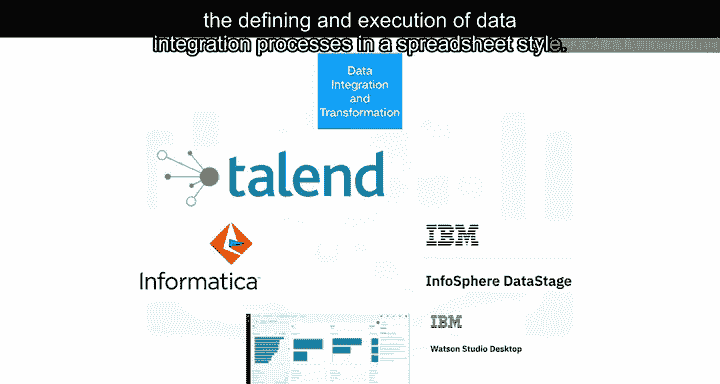

In the commercial environment， data visualizations are utilizing business intelligence or B tools。

 Their main focus is to create visually attractive and easy to understand reports and live dashboards。

 The most prominent commercial examples are tableableau， Microsoft power B， an IBM Cgnos analytics。

 Another type of visualization targets data scientists rather than regular users。

 A sample problem might be how can different columns in a table relate to each other。

 This type of functionality is contained in Watson Studio desktop。

 If you want to build a machine learning model using a commercial tool you should consider using a data mining product。

 The most prominent of these types of products are SPSS modeler and SS Enterprise Min。😊。

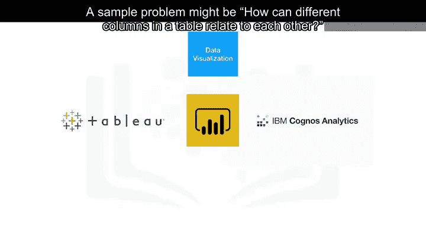

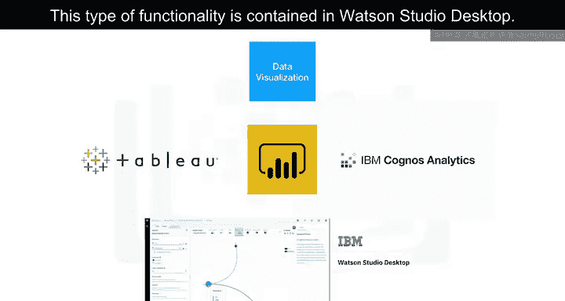

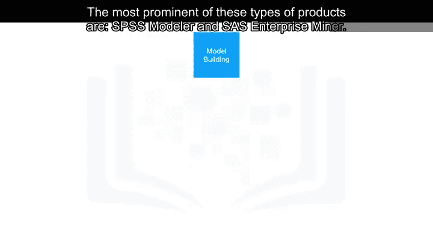

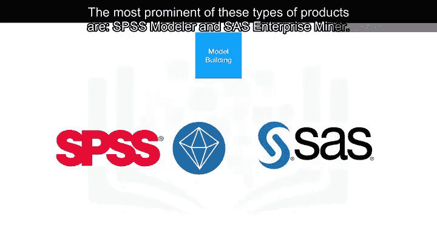

In addition， a version of SPPSS modeller is also available in Watson Studio Desktop based on the cloud version of the tool we'll talk more about cloud based tools in the next video。

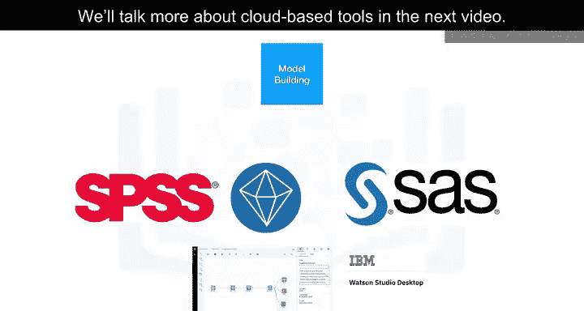

In commercial software， model deployment is tightly integrated in the model building process。

 This diagram shows an example of the SpPSs collaboration and deployment services。

 which are used to deploy any type of asset created by the SPSS software tools suite。

Other vendors use the same type of process。Commercial software can also export models in an open format。

 for example， SpPSS modeler supports the exporting of models as predictive model markup language or PMML。

 which can be read by many other commercial and open software packages。

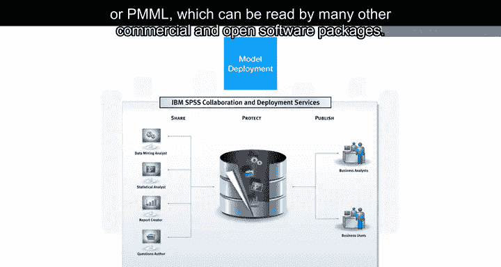

Model monitoring is a new discipline， and there are currently no relevant commercial tools available。

 As a result， open source is the first choice。 The same is true for code asset management。

 Open source with Git and GitHub is the effective standard。Data asset management。

 also called data governance or data lineage is a crucial part of enterprise grade data science。

 data must be versioned and annotated using metadata。 vendors。

 including Inatica En data governance and IBM provide tools for these specific tasks。

 The IBM Infophere information governance catalog， covers functions like data dictionary。

 which facilitates discovery of data assets。 Each data asset is assigned to a data steward。

 The data owner。 The data owner is responsible for that data asset and can be contacted。

 data lineage is also covered。 This enables a user to track back through the transformation steps followed in creating the data assets。

 The data lineage also includes a reference to the actual source data rules and policies can be added to reflect complex regulatory and business requirements for data。

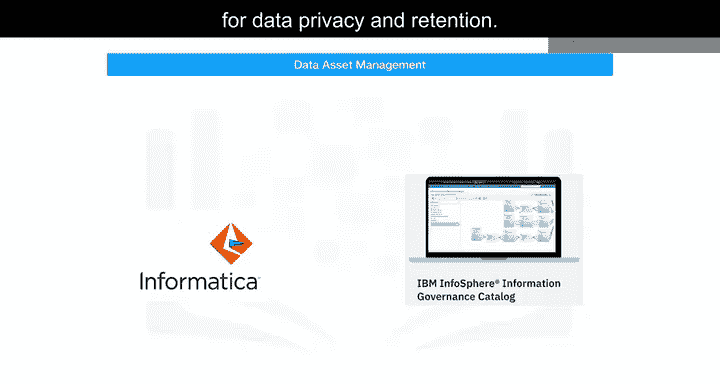

privacy and retention Watson Studio is a fully integrated development environment for data scientists。

 It's usually consumed through the cloud and will'll cover more about it in a later lesson。

There is also a desktop version available。 Watson Studio Destop combines Jupiter notebooks with graphical tools to maximize data scientist's performance。

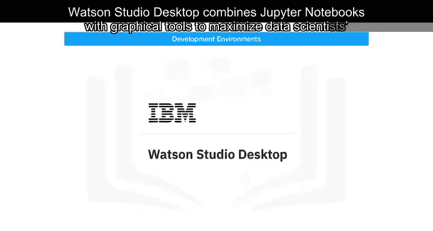

Watson Studio， together with Watson Open scale， is a fully integrated tool covering the full data science lifecycle and all the tasks we've discussed previously。

 we'll talk more about both in the next lesson， but just keep in mind that they can be deployed in a local data center on top of Kubernetes or Red Hat Openshift。

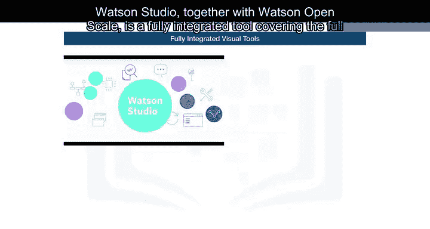

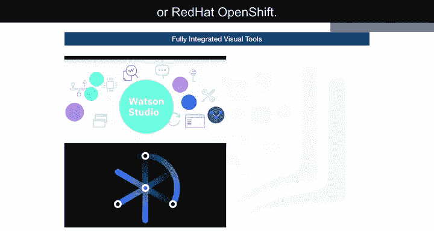

Another example of a fully integrated commercial tool is H2O driverless AI。

 which covers the complete data science lifecycle。

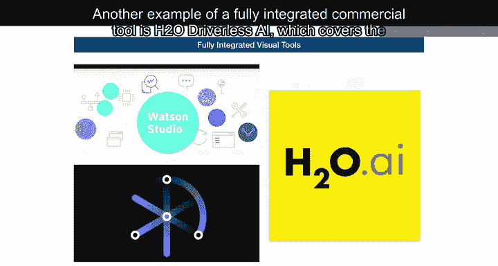

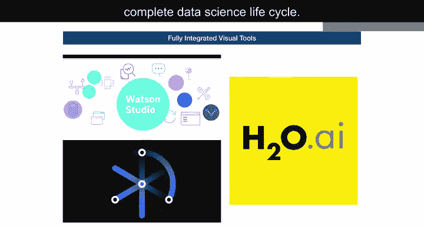

In this lesson you've learned how most common data science tasks are supported by commercial tools In the next video we'll discover data science tools that are available exclusively on the cloud。

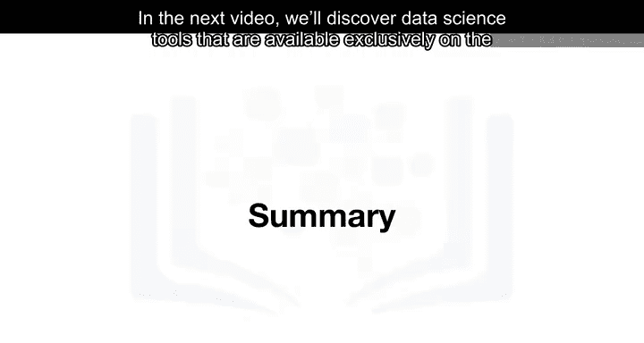