# IBM数据科学专业证书课程2：《数据科学工具》open-source-tools-for-data-science（中英字幕） - P11：10_云端数据科学工具.zh_en - GPT中英字幕课程资源 - BV1np4y1V7Sn

Since we've previously covered open source tools for data science。

 let's look at the commercial options you'll find in many enterprise projects。

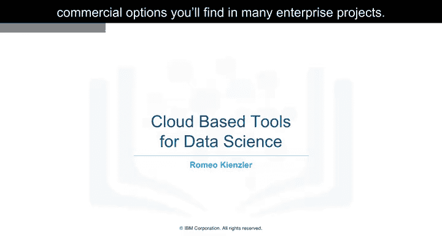

Take another look at the overview of different tool categories。

 Since cloud products are newer species， they follow the trend of having multiple tasks integrated into a single tool。

 This especially holds true for the tasks marked green in the diagram。

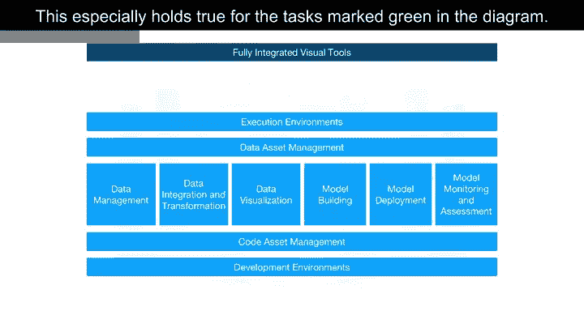

Let's start with the fully integrated visual tools category。

Since these tools introduce a component where large scale execution of data science workflows happens in compute clusters。

 we've changed the title here and added the wordplform。

These clusters are composed of multiple server machines transparently for the user in the background。

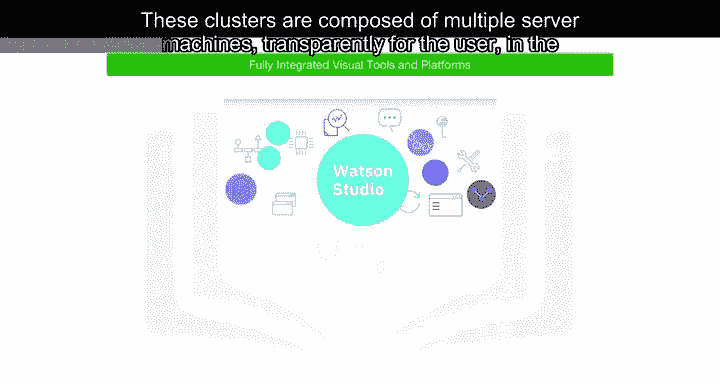

Watson Studio， together with Watson Open Sc， covers the complete development life cycle for all data science。

 machine learning， and AI tasks。

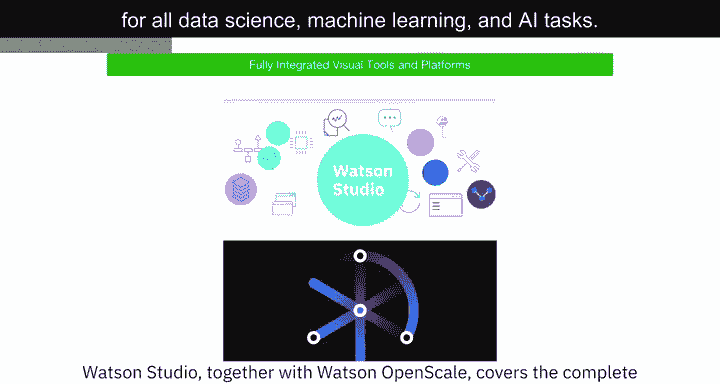

Another example is Microsoft Azure Machine learning。

 This is also a fully cloud hosted offering supporting the complete development lifecycle of all data science。

 machine learning and AI tasks。

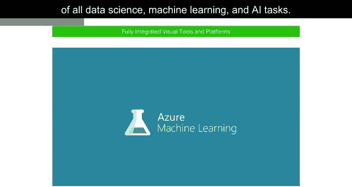

And finally， another example is H20 driverless AI， which we've already introduced in the last video。

 although it is a product that you download and installed。

 one clicked deployment is available for the Common cloud service providers since operations and maintenance are not done by the cloud provider。

 as is the case with Watson Studio， Openscale and Azure Mach learning。

 this delivery model should not be confused with platform or software as a service， PAA or SAAS。

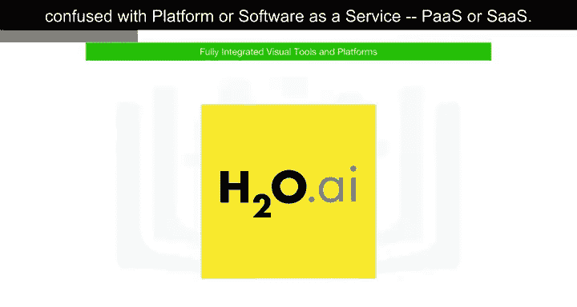

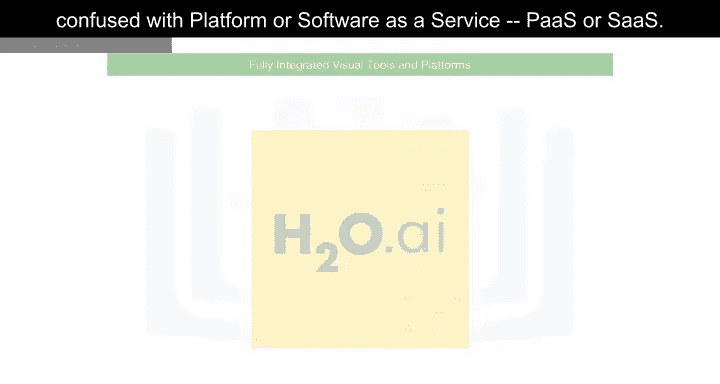

In data management， with some exceptions， there are SA AA versions of existing open source and commercial tools。

 Remember， SA AA stands for software as a service。 It means that the cloud provider operates the tool for you in the cloud。

As an example， the cloud provider operates the product by backing up your data and configuration and installing updates。

 As mentioned， there is proprietary tooling， which is only available as a cloud product。

 Sometimes it's only available from a single cloud provider。😊。

One example of such a service is Amazon Web Services Dynamo DB。

 a no SQL database that allows storage and retrieval of data in a key value or a document store format。

The most prominent document data structure is Jason。Another flavor of such a service is cloudant。

 which is a database as a service offering， but under the hood。

 it is based on the open source Apache Couch Db。 It has an advantage。

 although complex operational tasks like updating backup。

 restore and scaling are done by the cloud provider under the hood。

 this offering is compatible with Co Db。 Therefore。

 the application can be migrated to another couch Db server without changing the application。

 and IBM offers Db2 as a service as well。😊，This is an example of a commercial database made available as a software as a service offering in the cloud。

 taking operational tasks away from the user。

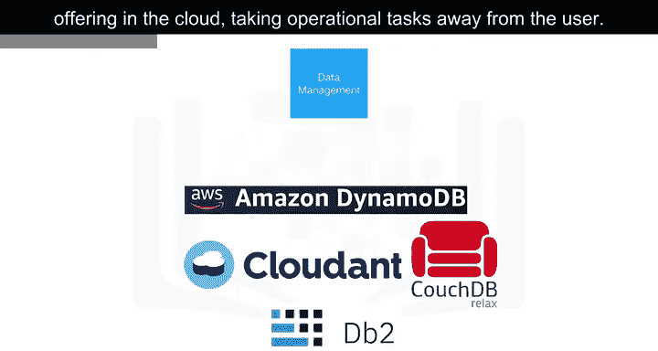

When it comes to commercial data integration tools。

 we talk not only about extract transform and load or ETL tools。

 but also about extract load and transform or ELT tools。

This means the transformation steps are not done by a data integration team。

 but are pushed towards the domain of the data scientist or data engineer。

Two widely used commercial data integration tools are Informatica。

 Cloud Data integration and IBM's data Refry。Data refinery enables transformation of large amounts of raw data into consumable quality information in a spreadsheet like user interface。

Data refinery is part of IBM Watson Studio。 The market for cloud data visualization tools is huge。

 and every major cloud vendor has one。 An example of a smaller company's cloud based data visualization tool is datame。

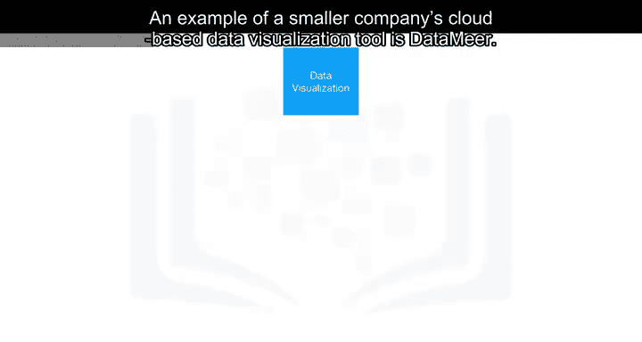

IBM offers its famous cgnos business In suiteite as a cloud solution as well。

IBM Data Refinery also offers data exploration and visualization functionality in Watson Studio Again。

 these are just some examples of a rapidly changing and growing commercial ecosystem among a huge number of established and emerging vendors。

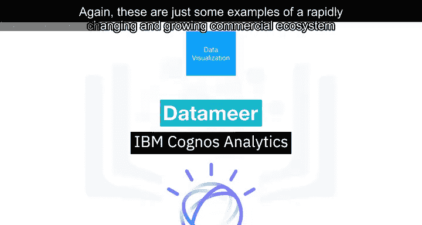

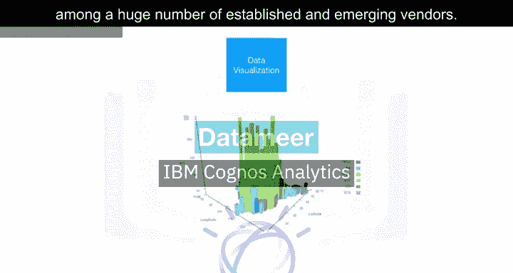

In Watson's studio， an abundance of different visualizations can be used to better understand data。

 For example， this 3D bar chart enables you to visualize a target value on the vertical dimension。

 which is dependent on two other values on the horizontal dimensions。

 Coling enables you to visualize a third dimension。

Hierarchical change bundling enables you to visualize correlationizations and affiliations between entities。

 If sufficient， a classic bar chart can do the job as well。

 whereas a 2D scatter plot with a heat map shows two dependent data fields。

 one on the Y axis and one as color intensity。

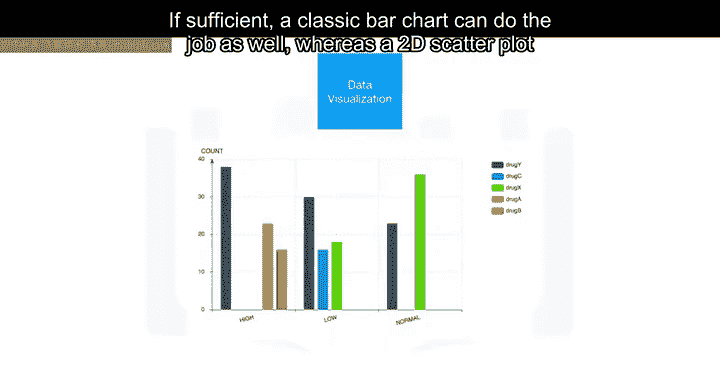

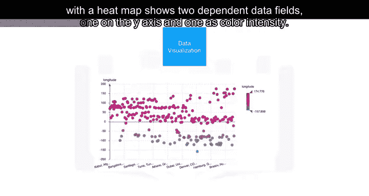

A tree map shows distribution of subsets within a set。 The famous pie chart does the same。

 but in a non hierarchical manner。 And finally， a word cloud pops out significant terms in a document corpus。

 Model building can be done using a service such as Watson machine learning。

 Watson machine learning can train and build models using various open source libraries。

 Google has a similar service on their cloud called AI platform training。

 Nely every cloud provider has a solution for this task。😊。

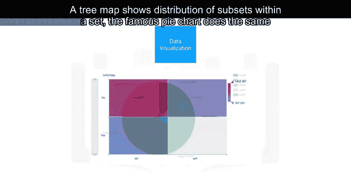

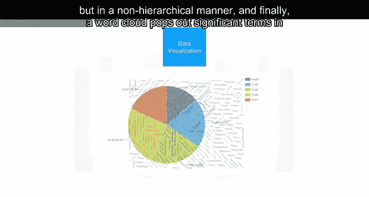

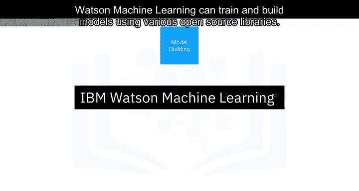

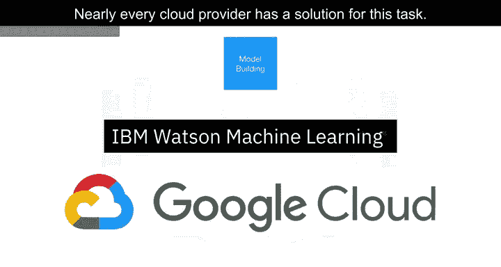

Model deployment in commercial software is usually tightly integrated to the model building process。

 Here is an example of the Ss collaboration and deployment services。

 which can be used to deploy any type of asset created by the SPSS software tools suite。

 The same holds for other vendors。 In addition， commercial software can export models in an open format。

 As an example， SS modeler supports exporting models as predictive model markup language or PMml。

 which can be read by numerous other commercial and open software packages。😊。

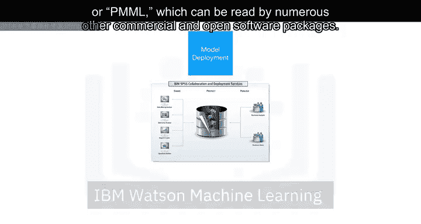

Wattson machine learning can also be used to deploy a model and make it available to consumers using a RE interface。

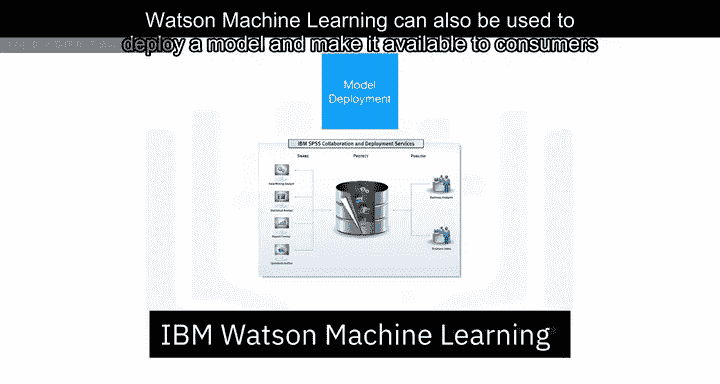

Amazon Sagemaker model Monitor is an example of a cloud tool that continuously monitors deployed machine learning and deep learning models。

 Again， every major cloud provider has a similar tooling。

 This is also the case for Watson Open scale。 Open scale and Watson Studio unify the landscape。

 Everything marked in green can be done using Watson Studio and Watson Open scale。

 Open scale will be covered in a later video。😊。

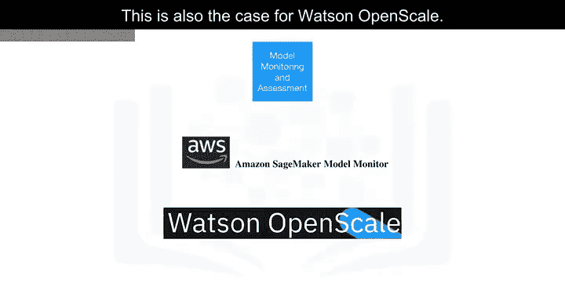

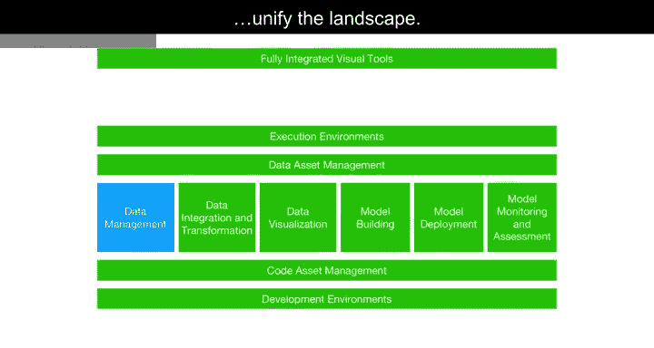

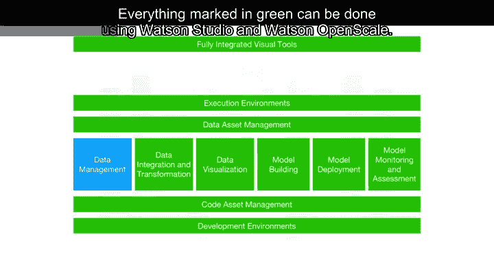

You've learned how the most common tasks in data science are supported by commercial cloud tools integrationration provides us the ability to use the same tools for multiple tasks In the next videos。

 we'll look at packages， APIs， data sets and models for data science。

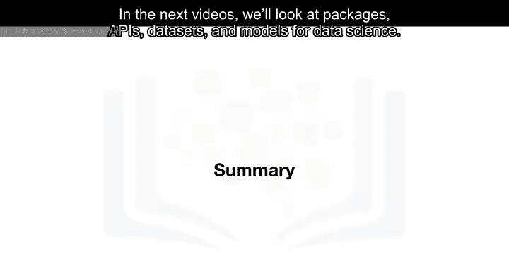