# IBM数据科学专业证书课程2：《数据科学工具》open-source-tools-for-data-science（中英字幕） - P13：12_应用程序接口（API）.zh_en - GPT中英字幕课程资源 - BV1np4y1V7Sn

In this video， we will discuss application programming interfaces or APIs， specifically。

 we will discuss what an API is， API libraries， RE APIs， including request and response。

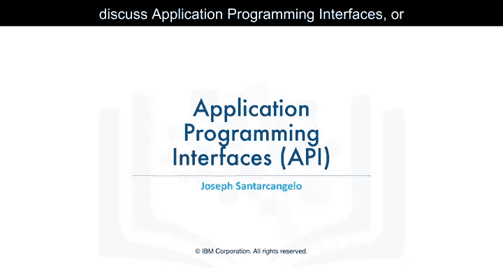

An API lets two pieces of software talk to each other。 For example， you have your program。

 you have some data。 you have other software components。

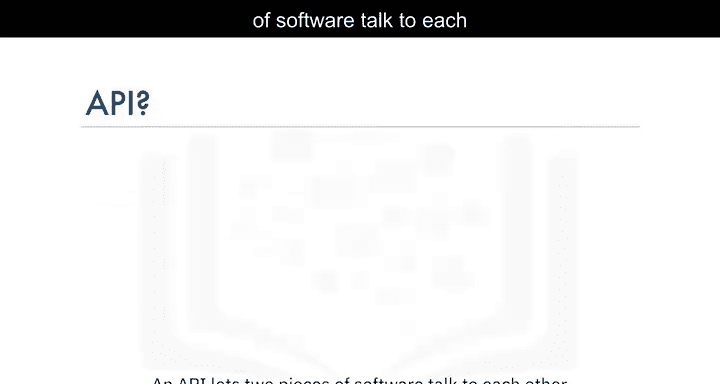

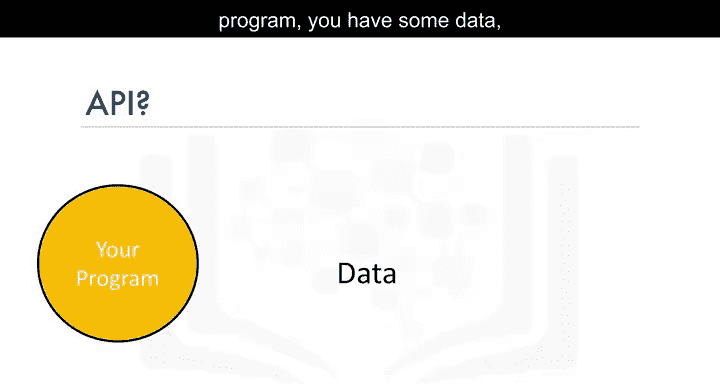

You use the API to communicate with the other software components。

You don't have to know how the API works。 You just need to know its inputs and outputs。 Remember。

 the API only refers to the interface or the part of the library that you see。

 The library refers to the whole thing。

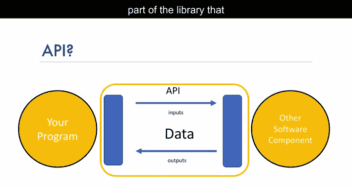

Consider the panndas library。 Pandas is actually a set of software components。

 many of which are not even written in Python。 You have some data。

 You have a set of software components。 We use the pandas API to process the data by communicating with the other software components。

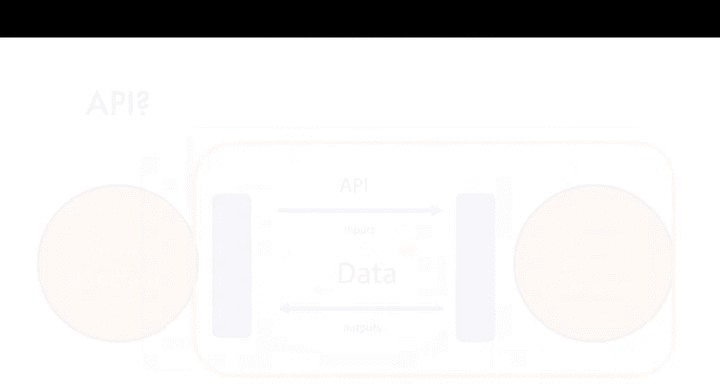

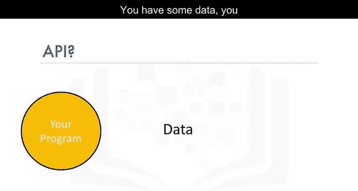

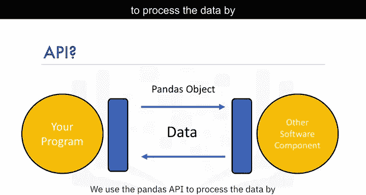

There can be a single software component at the back end。

 but there can be a separate API for different languages。 Consider Tensorflow written in C++。

There are separate APIs in Python， Javascript， C plus plus Java and go。

 The API is simply the interface。 There are also multiple volunteer developed APIs for Tensorflowlow。

 For example， Julia， Matlab， R， Scala and many more。

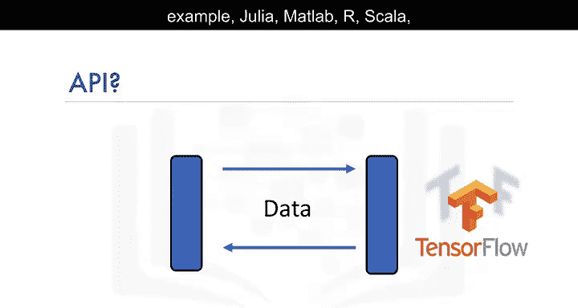

Rest APIs are another popular type of API。 They enable you to communicate using the Internet。

 taking advantage of storage， greater data access， artificial intelligence algorithms and many other resources。

 The R stands for representational。 The S stands for state。 The T stands for transfer。

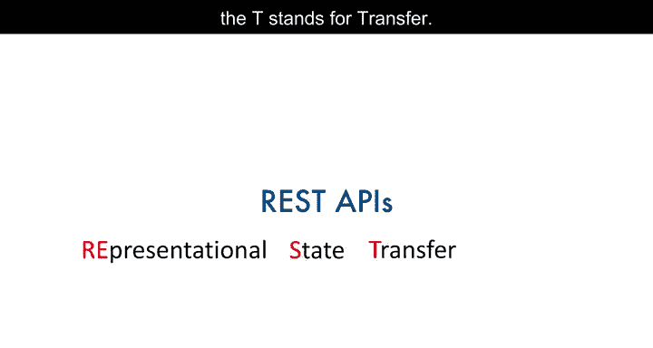

In RE APIs， your program is called the clientient。 The API communicates with a web service that you call through the internet。

 a set of rules， governs communication， input or request and output or response。

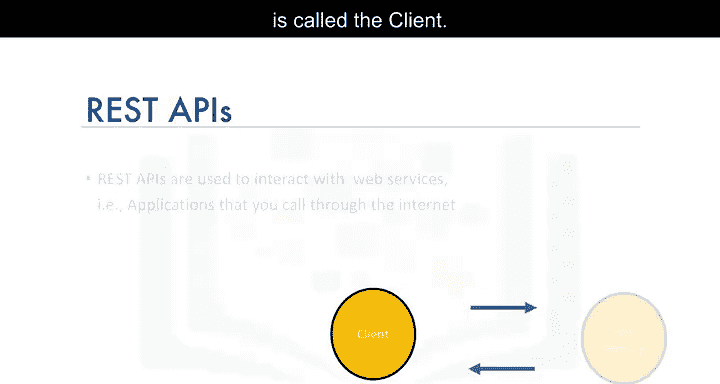

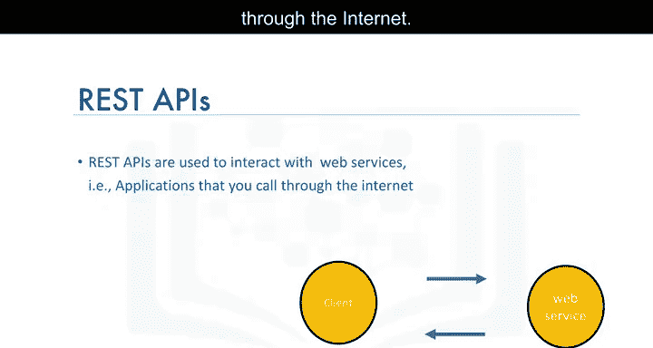

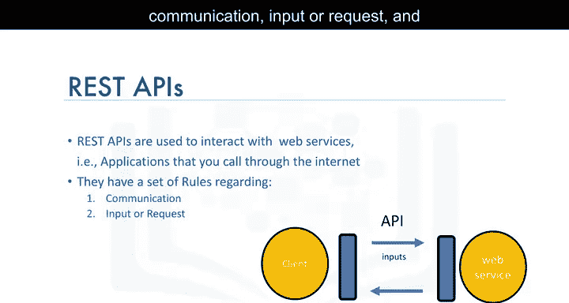

Here are some common API related terms。 You or your code can be thought of as a client。

 The web service is referred to as a resource。 The client finds the service through an end point。

 The client sends the request to the resource and the response to the client。

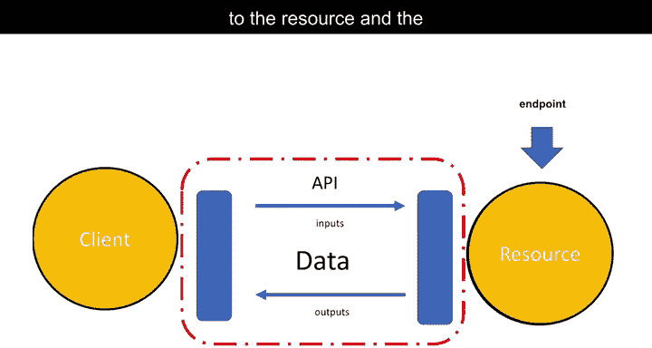

H T TP methods are a way of transmitting data over the Internet。

 We tell the rest As what to do by sending a request。

 The request is usually communicated through an H T TP message。

 The H T TP message usually contains a J file， which contains instructions for the operation that we would like the service to perform。

This operation is transmitted to the web service over the internet。

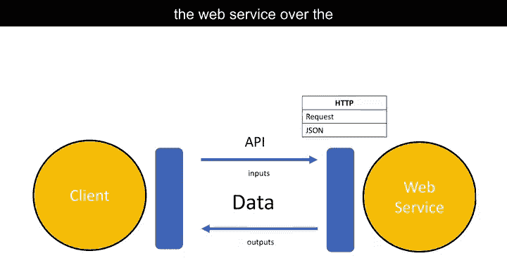

The service performs the operation。 Similarlyly， the Web service returns a response through an HtTP message where the information is usually returned using a J file。

 This information is transmitted back to the client。

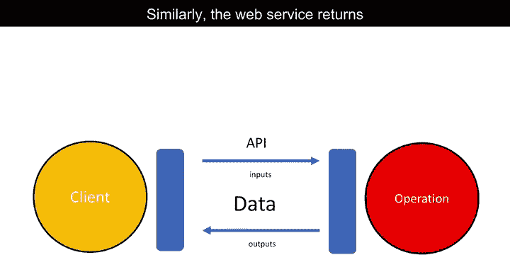

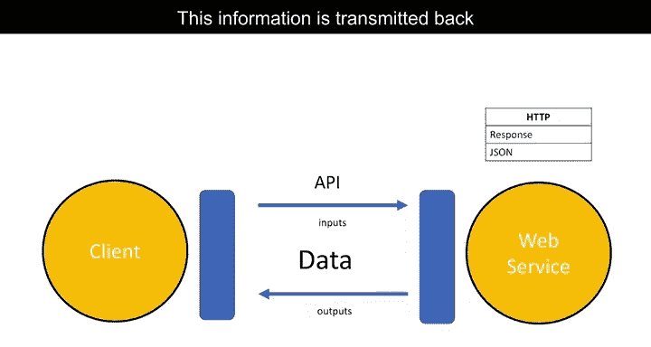

The Watson Speech to Text API is an example of a RE API。This API converts speech to text。

In the API call， you send a copy of the audio file to the API。 This process is called a post request。

 The API then sends the text transcription of what the individual is saying。

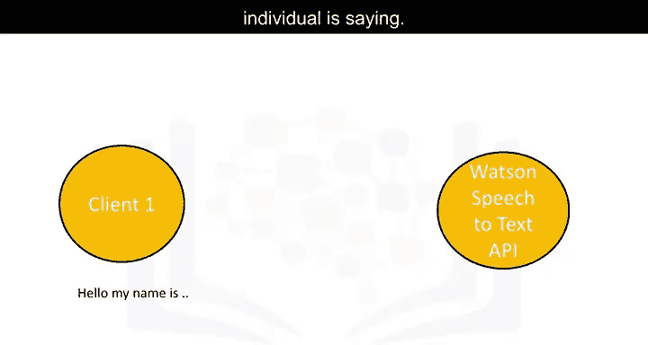

The API is making a get request。The Watson Language Translator API provides another example。

 You send the text you would like to translate into the API。

 The API translates the text and sends the translation back to you。 In this case。

 we translate English to Spanish。

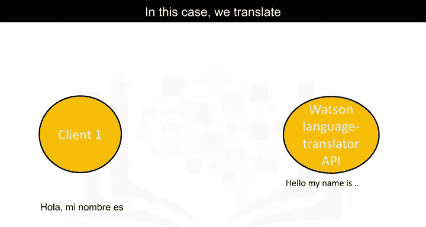

In this video， we've discussed what an API is， API libraries， rest APIs。

 including request and response。 Thank you for watching this video。

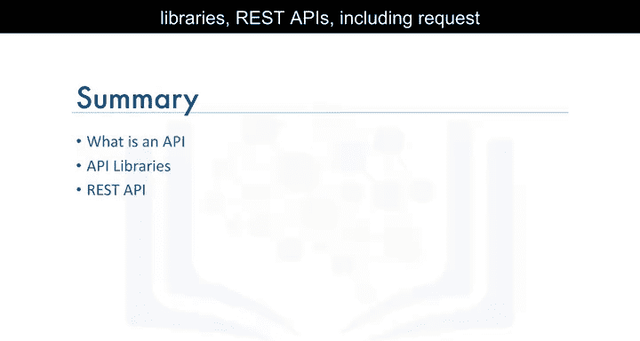