# IBM数据科学专业证书课程2：《数据科学工具》open-source-tools-for-data-science（中英字幕） - P15：14_企业数据共享-数据资产交换.zh_en - GPT中英字幕课程资源 - BV1np4y1V7Sn

Despite the growth of open datas that are available to the public。

 it can still be difficult to discover datasets that are both high quality and have clearly defined license and usage terms to help solve this challenge IBM created the data asset exchange or DAX。

 which will introduce in this video DAX provides a trusted source for finding open datas that are ready to use in enterprise applications。

 these datas cover a wide variety of domains including images， video。

 text and audio because DAX provides a high level of curation for data quality as well as licensing and usage terms DAX datas are typically easier to adopt whether in research or commercial projects。

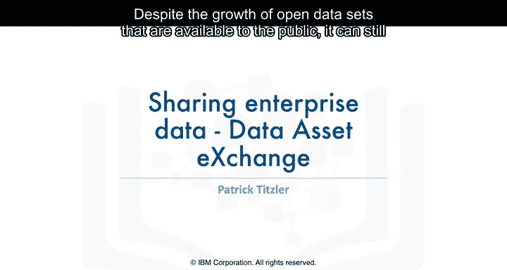

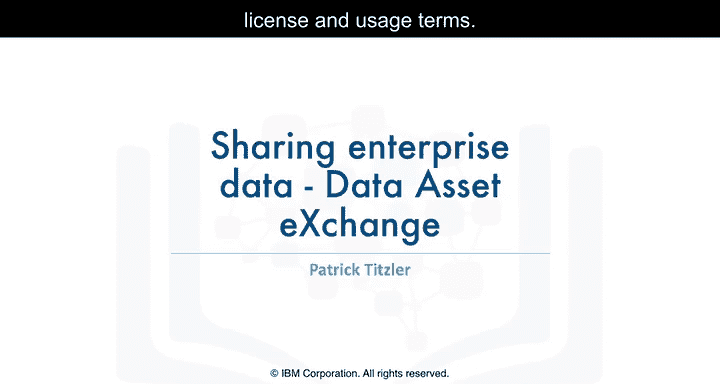

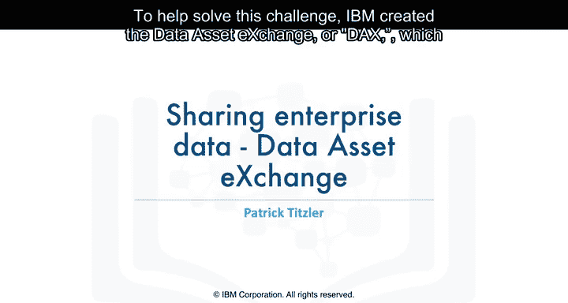

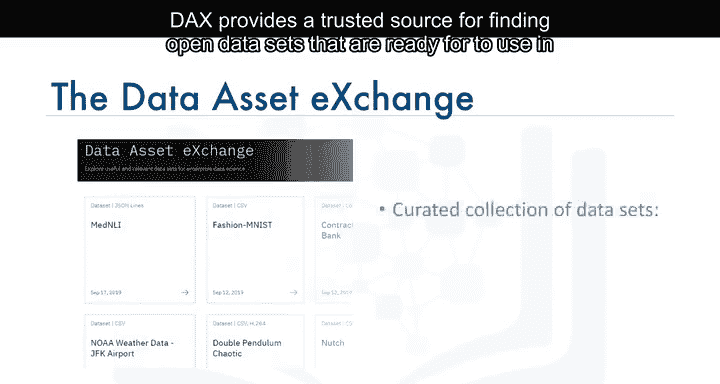

Wherever possible， DAACX aims to make data sets available under one of the variants of the community data License agreementement in order to foster data sharing and collaboration。

DAX also provides a single place to access unique data sets。

 in particular from IBM research projects。

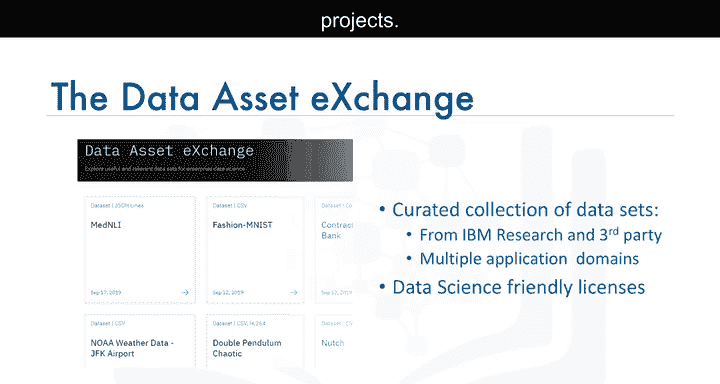

To make it easier for developers to get started with using the data sets。

 DAX also provides tutorials in the form of notebooks that walk through the basics of data cleaning。

 preproces， and exploratory analysis。For some data sets。

 there are also notebooks illustrating how to perform more complex analysis such as creating charts。

 statistical analysis， time series analysis， training machine learning models。

 and integrating deep learning using the model asset exchange。

 a project closely related to DAS and also available on the IBM developer website， in this way。

 DAX helps developers to create end to end analytic and machine learning workflows。

 and to consume open data and models with confidence under clearly defined license terms。

Let's say you found a dataset that might be of interest to you on the dataset page。

 you can download the compressed dataset set archive from Cloud Stor。

 explore the dataset using Jupiter notebooks， review the dataset metadata such as format。

 licensing terms and size， and preview some parts of the dataset。

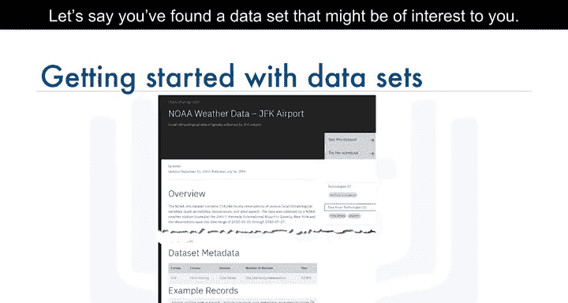

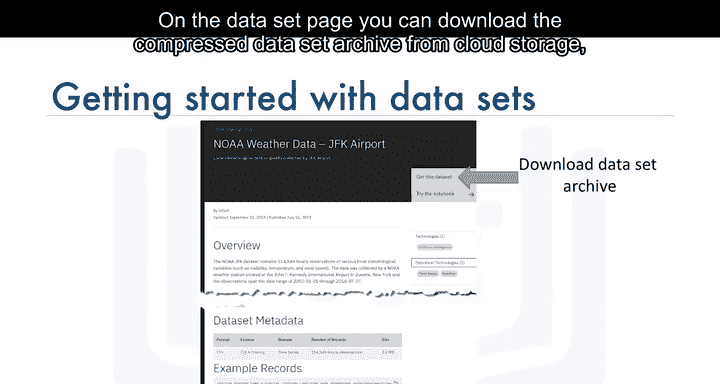

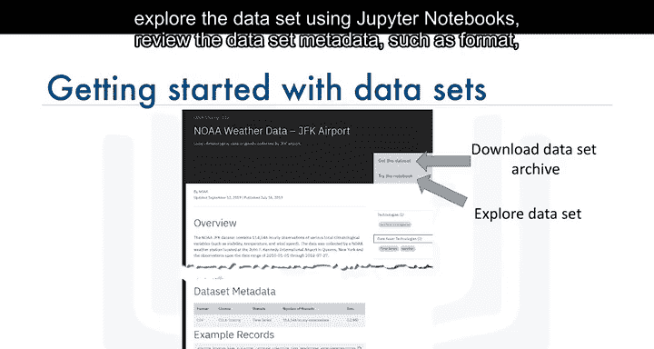

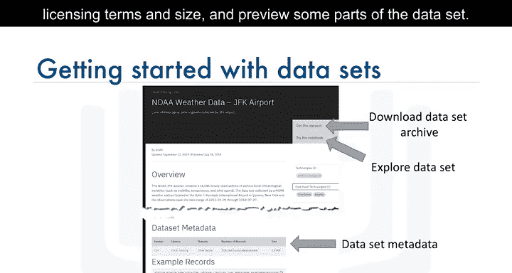

Most data sets on Ds are complemented by one or more Jupiter notebooks that you can use to perform data cleaning。

 preprocessing and exploratory analysis these notebooks run as is in Watson Studio。

 IBM's data science platform， Jupiter Notes and Watson Studio are covered later in this course。

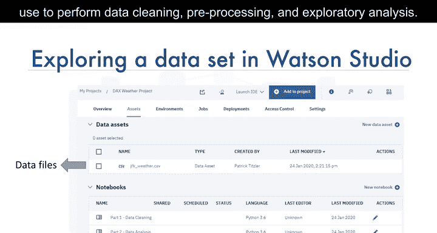

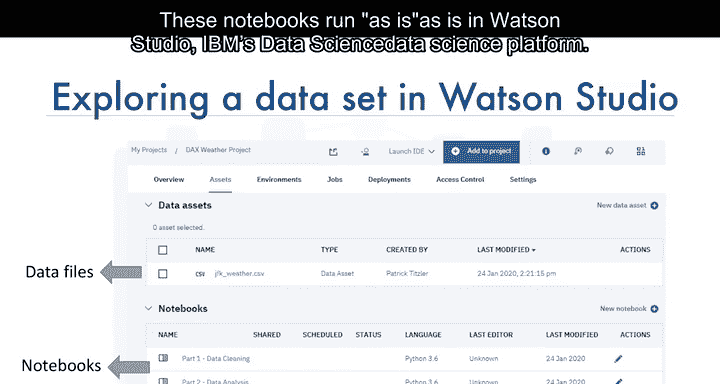

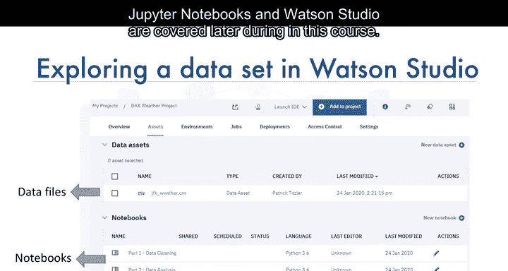

In this video， you've learned about IBM's open data repository。

 the data Aset Exchange in the hands on lab， you'll have a chance to explore the repository。

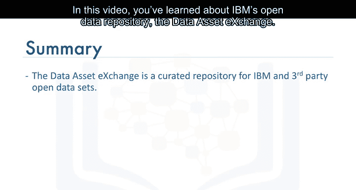