# IBM数据科学专业证书课程2：《数据科学工具》open-source-tools-for-data-science（中英字幕） - P18：17_Jupyter Notebook入门.zh_en - GPT中英字幕课程资源 - BV1np4y1V7Sn

Welcome to Introuction to Jupiter Notes this tutorial walks you through what Jupiter is and some basic syntax The following videos will contain tutorials and hands on practice。

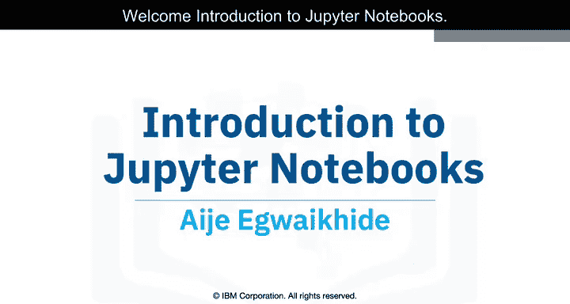

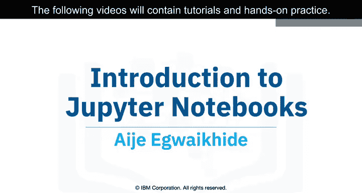

A Jupiter notebook is a browserbased application that allows you to create and share documents that contain code equations。

 visualizations， narrative text links and so much more。

 it can be likened to a scientist's lab notebook where a scientist records all steps to perform their experiments and records the results so that it can be reproduced in the future。

 Similarlyly， a Jupiter notebook allows a data scientist to record their data experiments。

 their results and allows for the same experiment to be used and repeated by anyone。

 A Jupyter notebook file allows data scientist to combine descriptive text。

 code blocks and code output in a single file。 When you run the code it generates the outputs。

 including plots and tables within the notebook file。

 and you can then export the notebook to a Pf or HTML file that can be then shared with anyone。

 Jupiter notebooks originated as I Python originally developed for the Python programming language as。

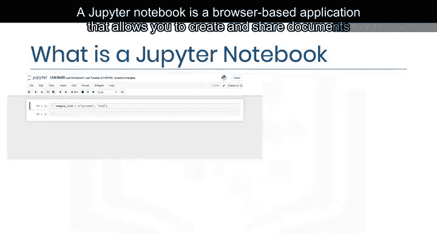

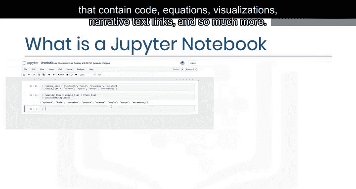

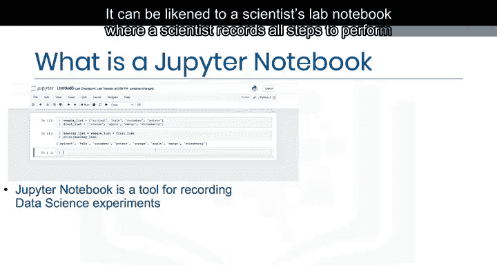

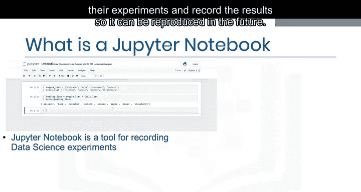

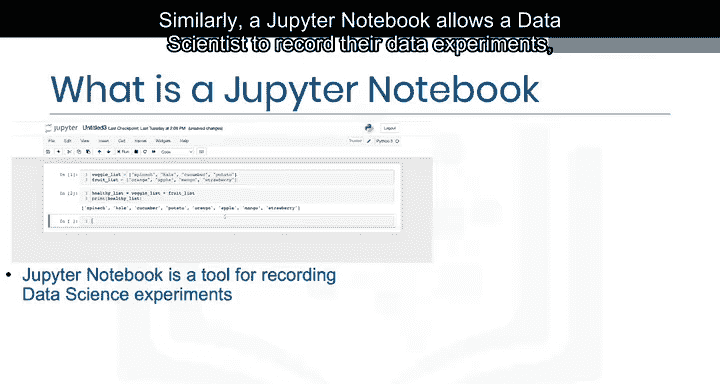

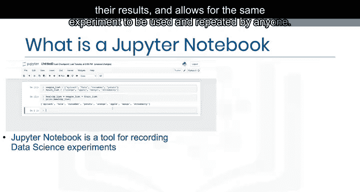

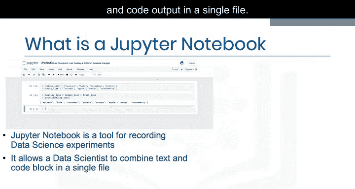

Came to support additional languages。 It was renamed Jupiter， which stands for Julia Python R。

 but nowadays， the notebook supports many other languages as well。

Jupiter labb is a browserbased application that allows you to access multiple Jupiter notebook files as well as other code and data files。

 Jupiter Lab extends the functionalities of Jupyter notebooks by enabling you to work with multiple notebooks。

 text editors， terminals and custom components in a flexible， integrated and extensible manner。

 Jupiter Lab allows for interactive control of the notebook sales and output。

 Realtime editing markdowns， Cv， etc cetera。 It is compatible with several file formats like Cv。

 Jason， Pdf， Vega and more。 and it is open source。 Jupiter notebooks can be used with a cloudbased service like IBM and Google coabb。

 They do not require you to install anything on your local machine。

 They give you access to the Jupiter notebook environment。

 They do allow you to import and export notebooks using the standard i Python notebook file format。

 and they support the Python language and other languages。

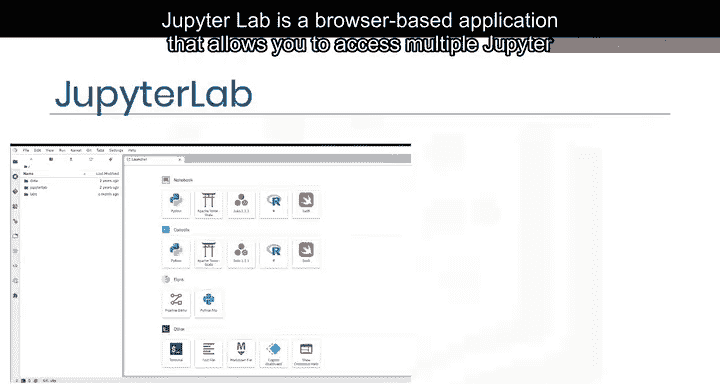

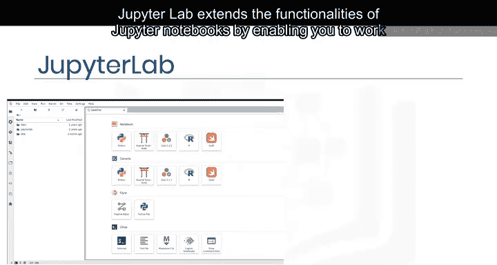

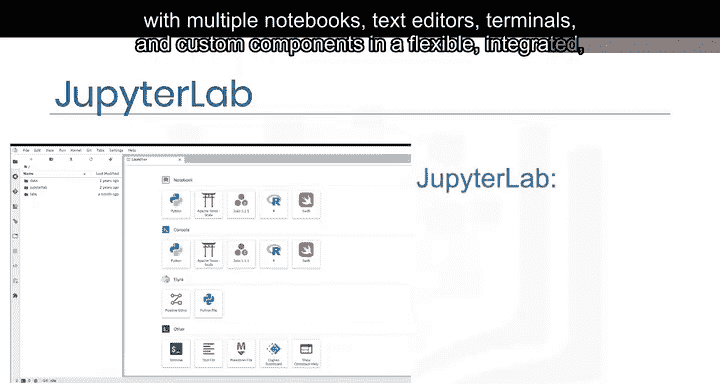

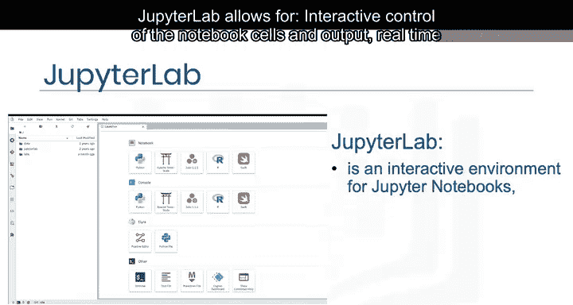

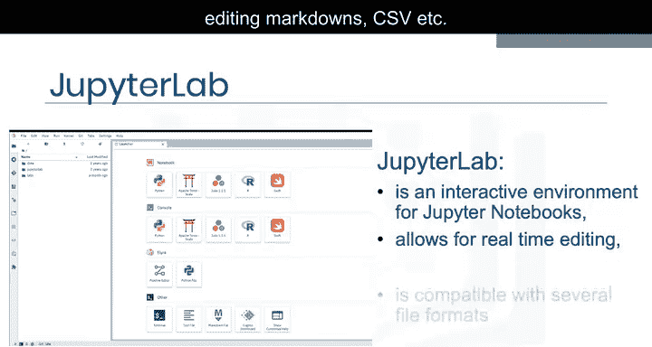

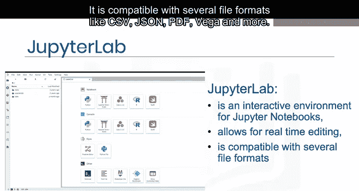

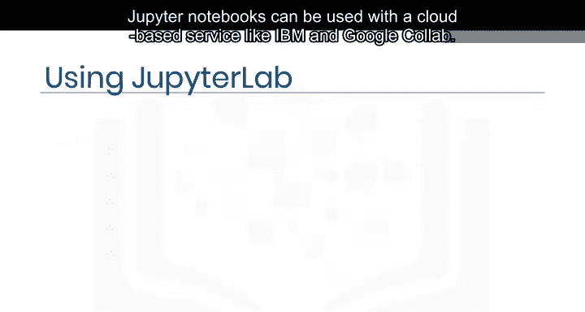

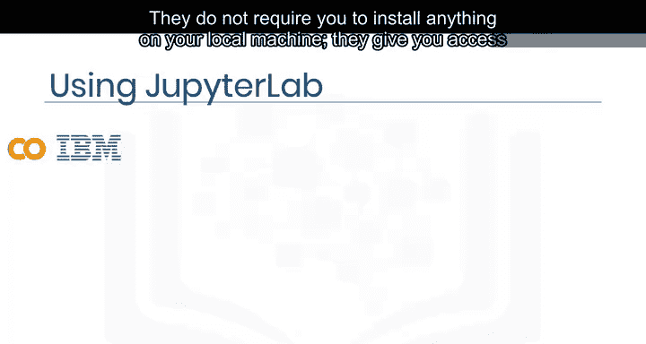

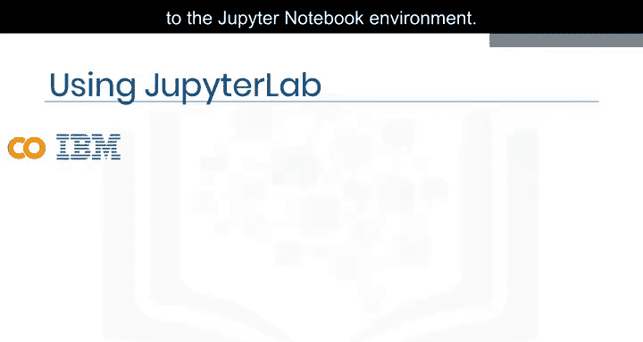

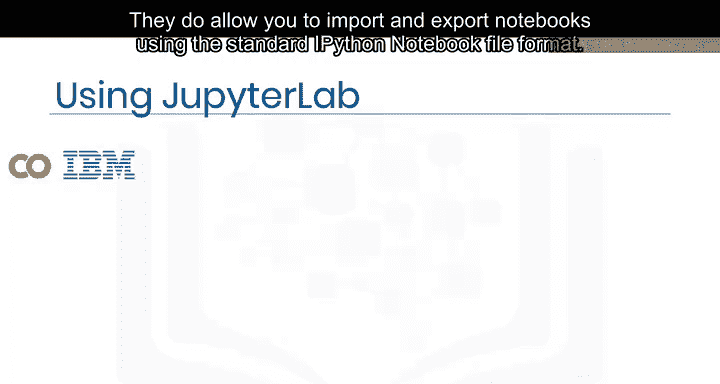

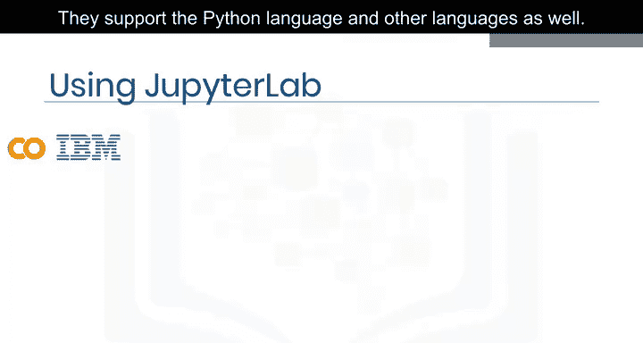

As well。Jupiter notebooks can be installed via the command line using the Pip installs function。

 Jupiter notebooks can also be downloaded locally to your laptop through the Ananaconda platform from Anaconda do co Anaconda is one of the popular distributions which includes Jupiter and Jupiter lab for the purposes of learning in this course。

 you have access to a hosted version of Jupiter labs in skills network labs so you do not have to download and install anything on your own device in order to complete the handson labs。

 You will see a screen like this that launches the Jupiter lab in the virtual environment。

 Simply click on open tool。

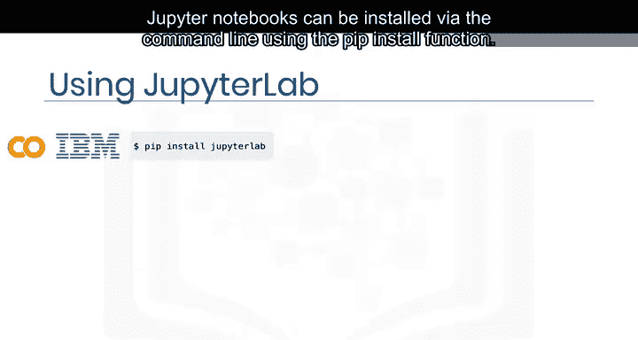

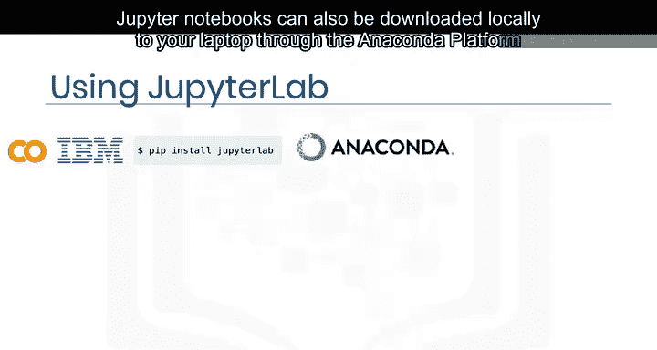

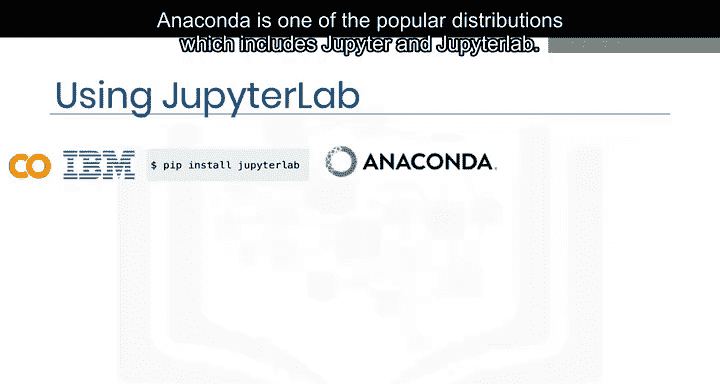

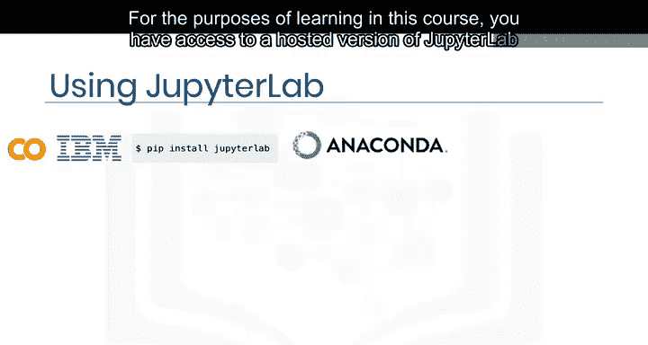

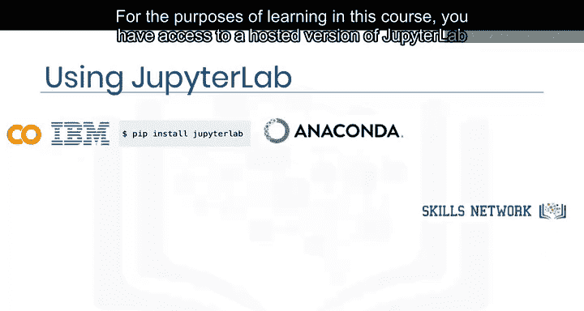

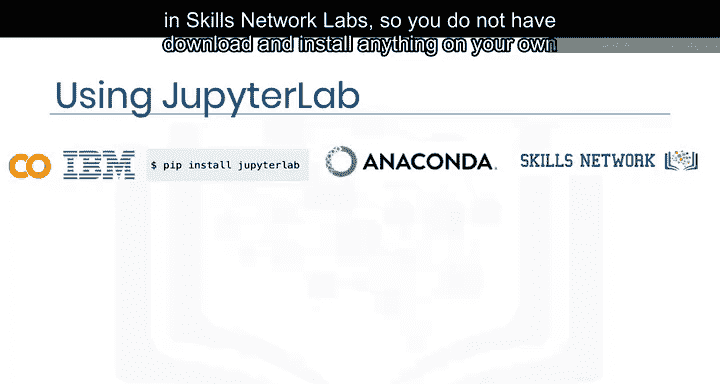

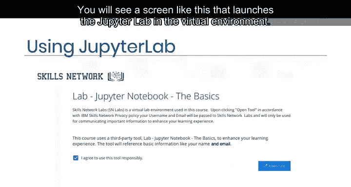

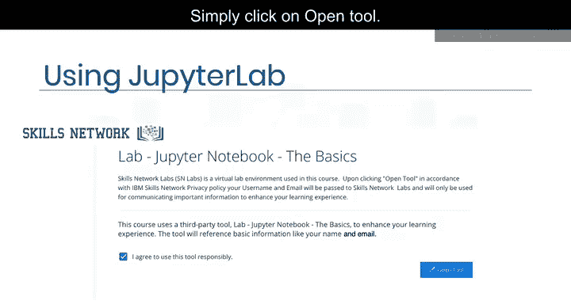

You should now be familiar with how Jupiter notebooks are used in data science for recording experiments and projects。

 how Jupiter Lab is compatible with many files and many data science languages。

 and different ways to install and use Jupiter notebooks。

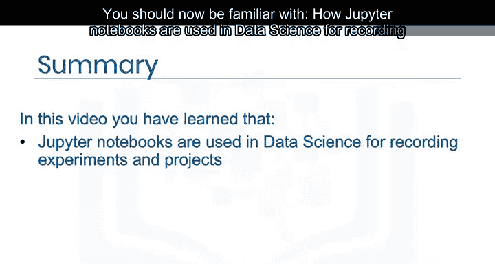