# IBM数据科学专业证书课程2：《数据科学工具》open-source-tools-for-data-science（中英字幕） - P19：18_Jupyter基础操作.zh_en - GPT中英字幕课程资源 - BV1np4y1V7Sn

In this video， we will go through the basics of getting started with Jupiter。

In the lab session of this module， we can launch a notebook using the skills network virtual environment。

 simply click on open tool， and the environment will open Jupiter lab。

 The lab will open a notebook like this one。 When we start the notebook。

 we can change the name by clicking on file， then renaming the notebook to the preferred name。

 We can now start working with our new project。 Let us print hello world to show that the environment is working properly to get an output from a code cell。

 You must run the cell to run the cell， place your cursor in the cell and click on run on the top of your screen。

 Then click run selected cells to run the current highlighted cells to use a shortcut press shift plus enter。

 You can also run all the cells in the notebook by clicking on run all cells to add code to a new cell。

 click on the plus symbol。😊。

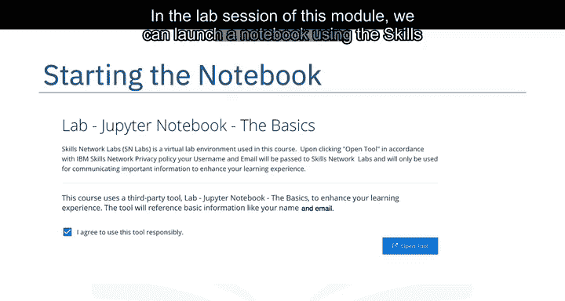

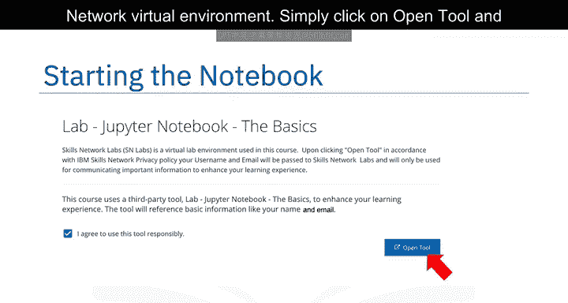

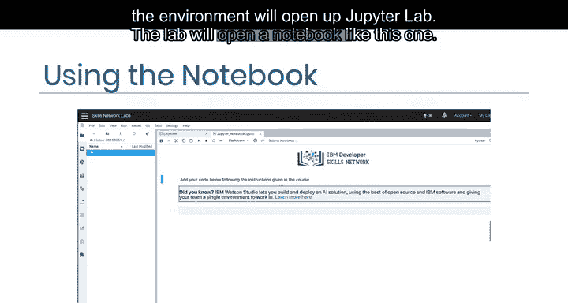

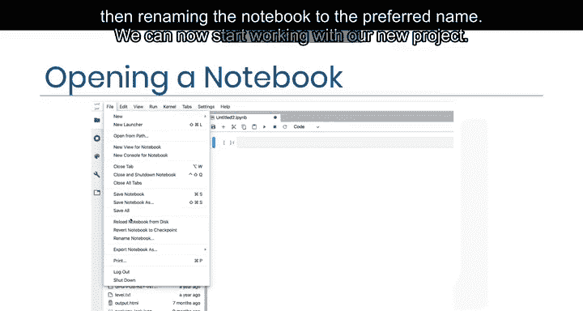

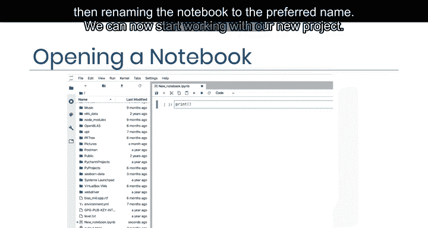

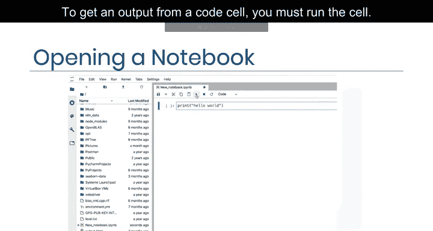

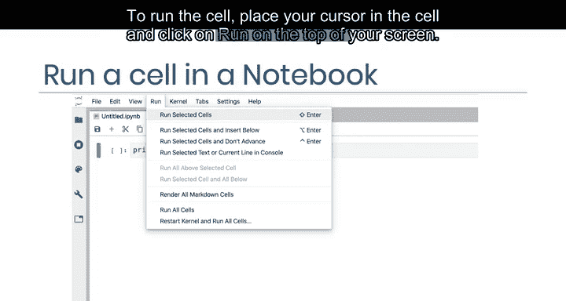

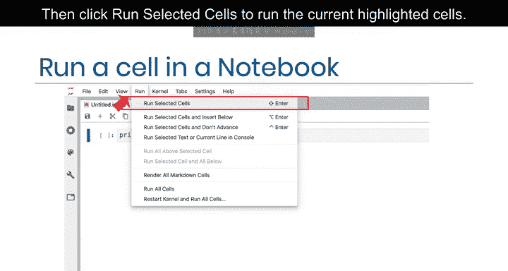

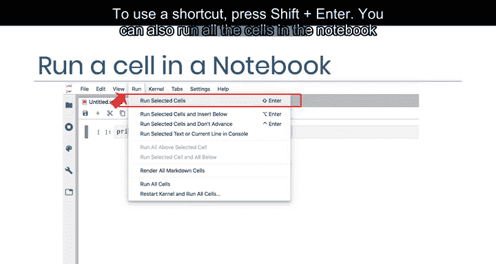

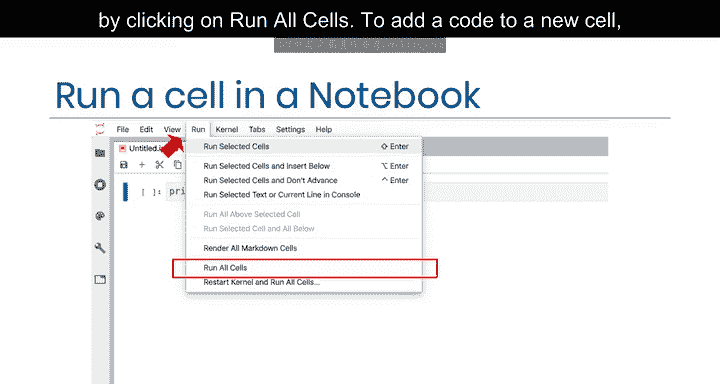

You can work with multiple files。 you can do that by clicking the plus button above the folders in your local machine。

 then choose the file you want to open。 We will open another notebook。

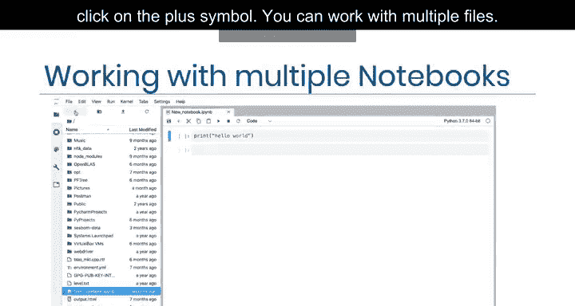

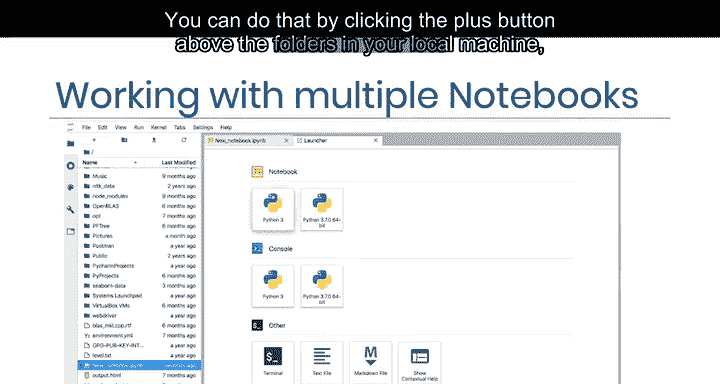

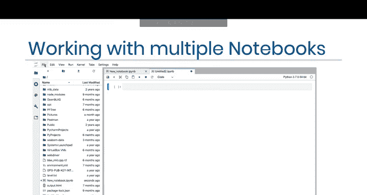

You can also use the file option to open a new launcher or open a new notebook。

 When we open the new file， we can move them around based on our preference when working with multiple notebooks for the same problem。

 I like to put them side by side so I can see both notebooks at the same time。 Now。

 we will assign the variable  one to the number one and the variable 2 to the number 2。

 and we will find the results of adding one and 2。

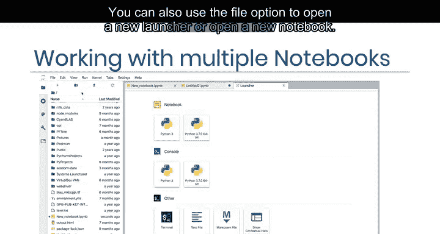

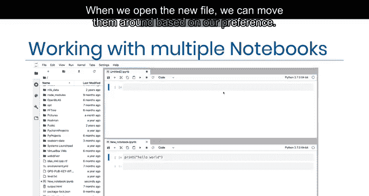

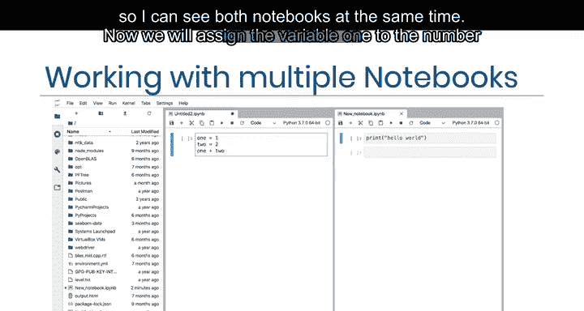

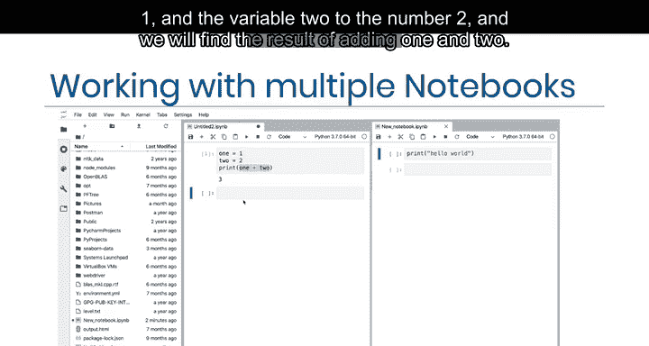

To delete a cell， highlight the cell and click on edit and choose delete cells to use a shortcut。

 press D twice on the highlighted cell。 If you decide to move your cells around for better flow within the notebook。

 you can either move the cell up or move the cell down， depending on your preference。😊。

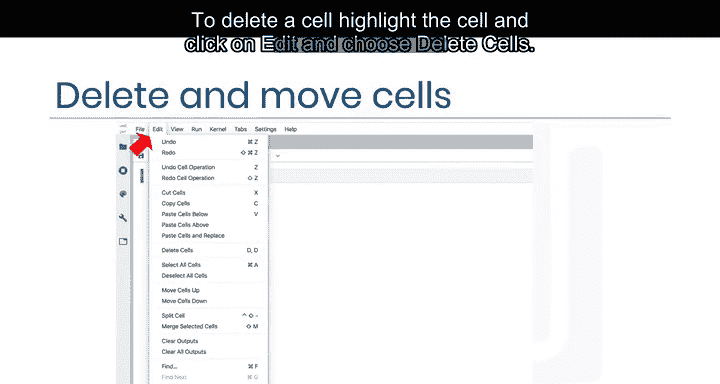

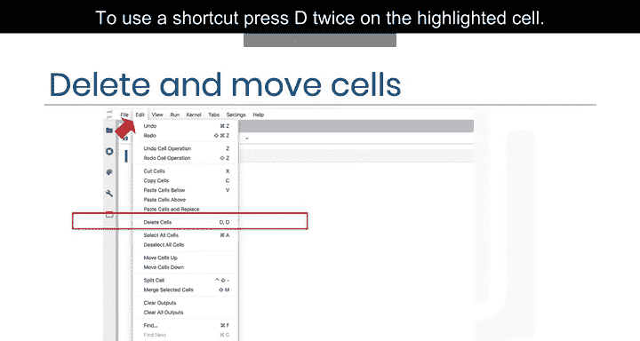

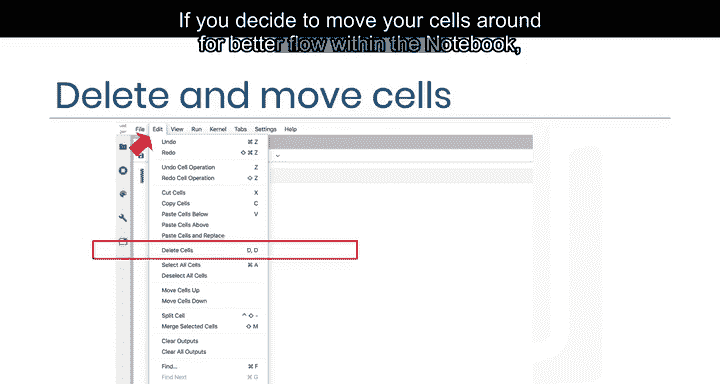

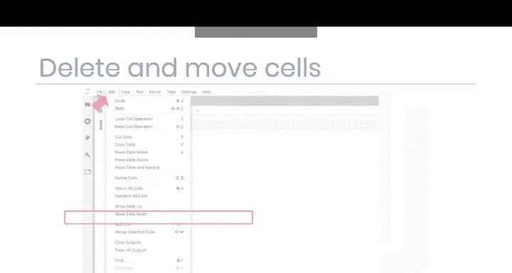

As data scientists， communicating our results is a big and important part of our jobs。

 Jupiter supports presenting results directly from the notebooks。

 you can create markdown to add titles and text description to help with the flow of the presentation to do that。

 click on the dropdown bar by code and select markdown。

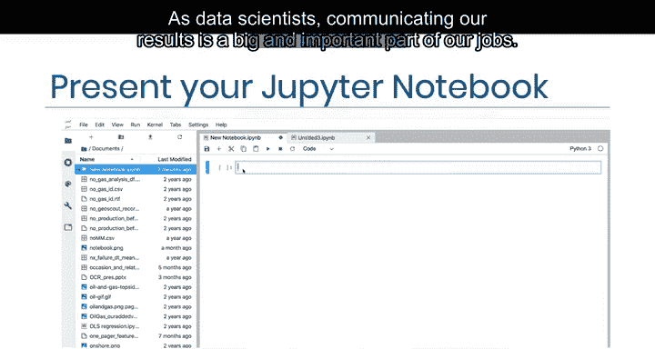

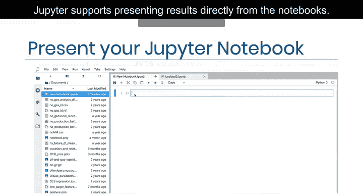

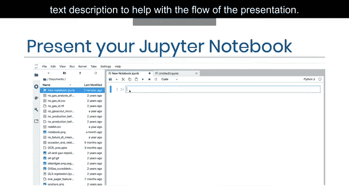

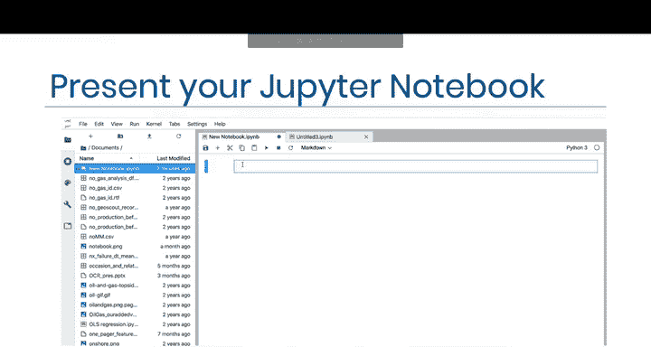

We will create line plots and convert each cell and output into a slide or a subslide depending on preference。

 and we will have a presentation。

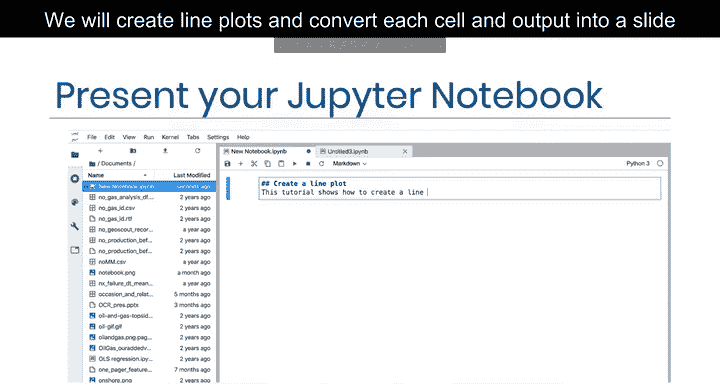

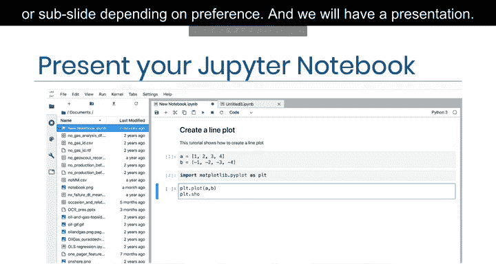

The slide's functionality in Jupiter allows us to effectively deliver code， visualization。

 text and outputs of executed code， as this is very important for presenting data science projects。

 When you are done with your notebook or notebooks。 you can shut them down。

 This helps free up the memory that the notebook is using to do this。

 click on the stop icon on the sidebar。 It is normally the second icon。

 you can either terminate all sessions at once or you can terminate or shut them down individually。

 After you shut down the notebook session， you will see no kernel at the top right of the notebook confirming it is no longer active。

 and you can now close the tabs。😊。

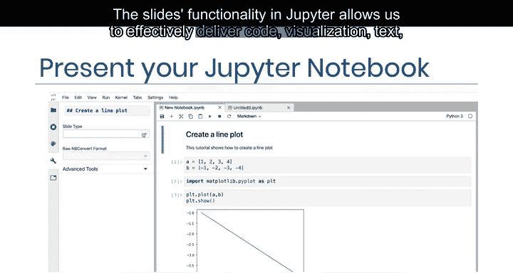

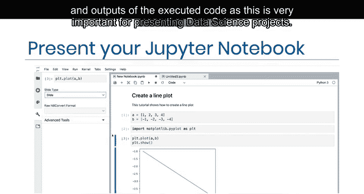

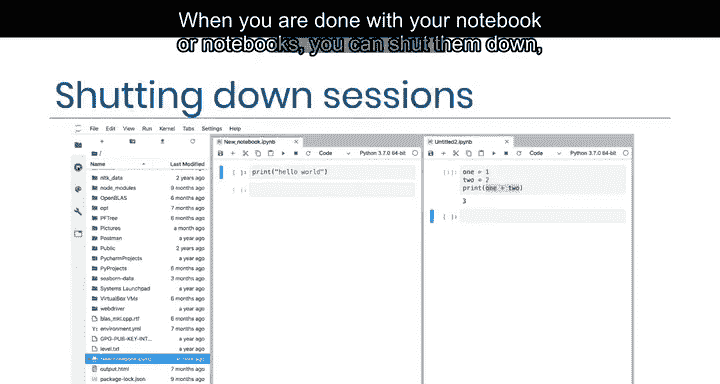

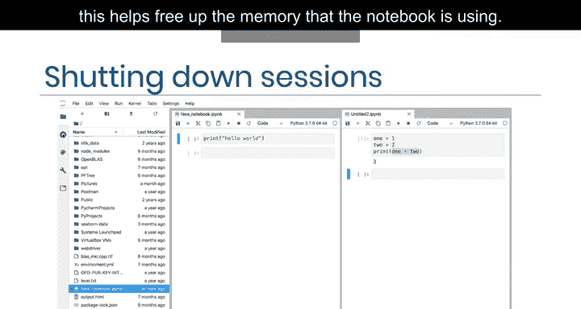

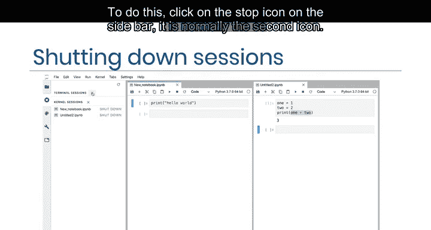

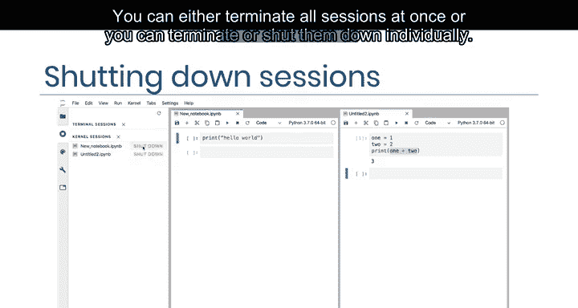

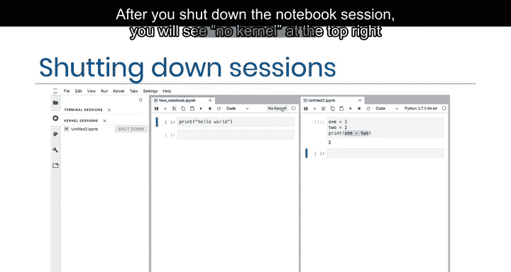

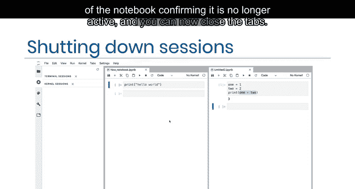

You should now be familiar with run， delete and insert a code cell。

 How to run multiple notebooks at the same time， Jupiter's capabilities for presenting a notebook using a combination of markdown and code cells and how to shut down your sessions after you are done。

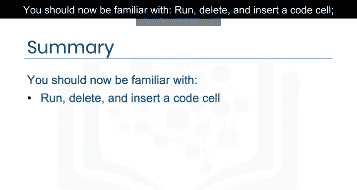

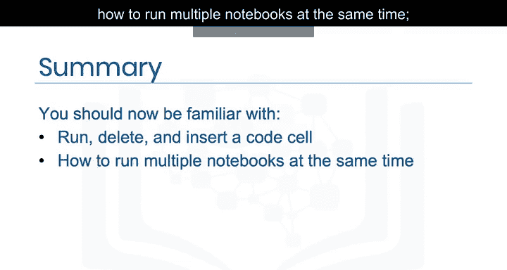