# IBM数据科学专业证书课程2：《数据科学工具》open-source-tools-for-data-science（中英字幕） - P1：0_课程介绍.zh_en - GPT中英字幕课程资源 - BV1np4y1V7Sn

Welcome to the course。 You've begun one of the most complete overviews on data science tooling that you'll currently find on the internet。

 This doesn't mean that we cover each and every tool。

 but later in the course we' introduce a comprehensive list of tasks a data scientist needs to perform and give you the top two or three open source and commercial tools available to complete them We also explain how the tools overlap in functionality what their pros and cons are and how these tools can address the whole data science pipeline Let's start with data data is obviously central to data scientists In this course will show you how to manage。

 extract， transform， analyze and visualize data。

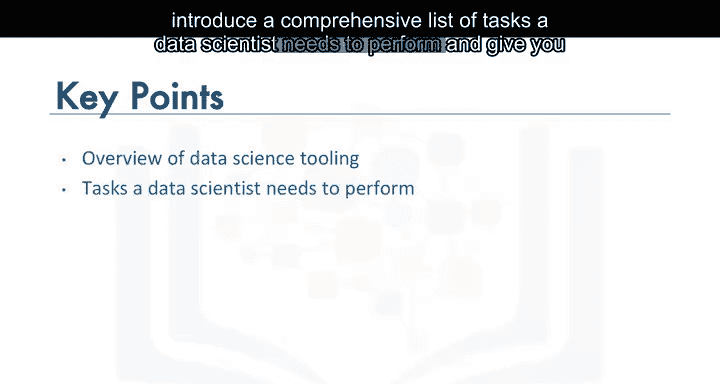

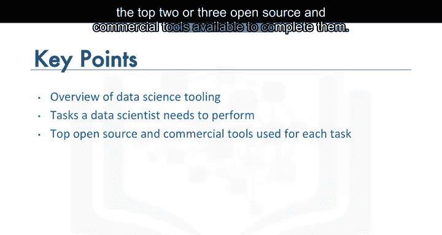

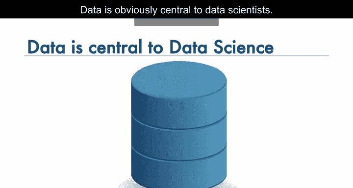

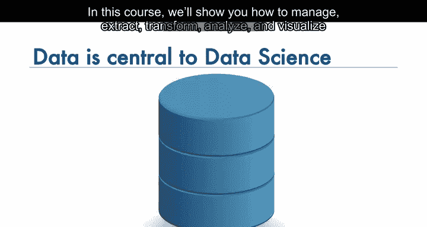

Now you might be able to survive data science without programming skills if you use the right set of tools。

 however， we highly recommend getting familiar with programming and the related programming frameworks for data science to help you along will introduce you to the most commonly used programming languages and frameworks available for data science。

That said， there is a lot of automation available in the latest tooling that a data scientist can use in this course we'll explain how to make use of those tools to save time and uncover inspiration。

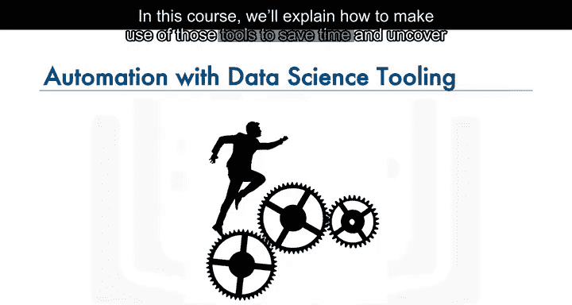

Visual programming is available in many tools In this course you'll learn how visual programming can be used to speed up development time and to help non-programrs enter the field of data science。

 open source software is leading the field of data science。

 but its total costs of ownership or TCO can be higher at times due to configuration。

 customization and maintenance costs， As a result， commercial software also has its place。

 especially since the new generation of commercial data science software leverages open source software and open standards。

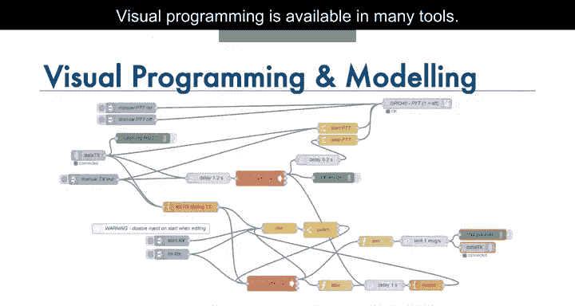

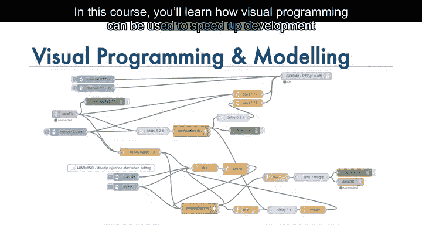

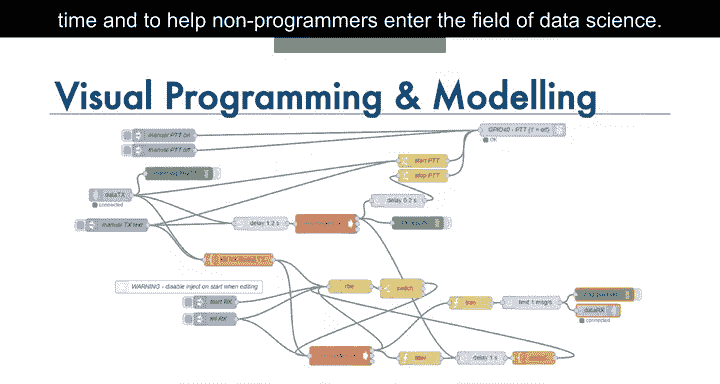

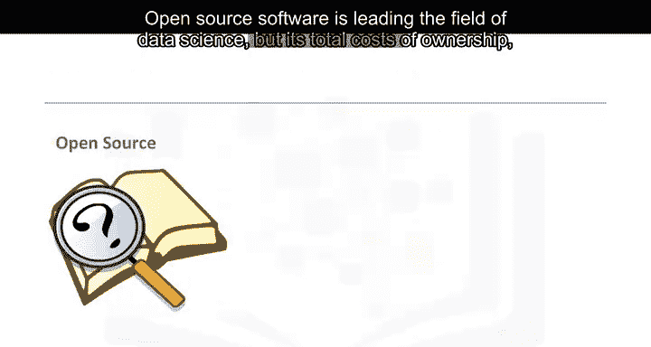

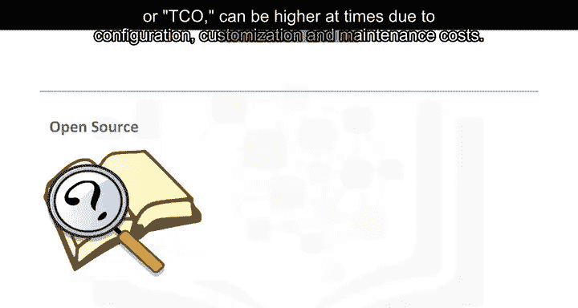

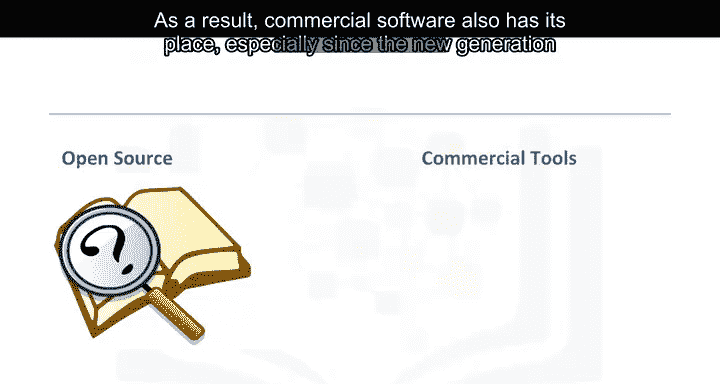

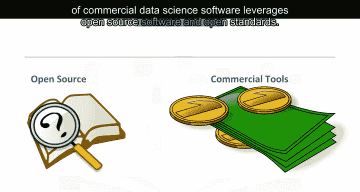

This makes it easy to migrate between tools and can reduce overall TCO in this course。

 we'll introduce you to both open source and commercial software and point out their strengths and weaknesses for data science will also show you ways that you can take advantage of their respective strengths。

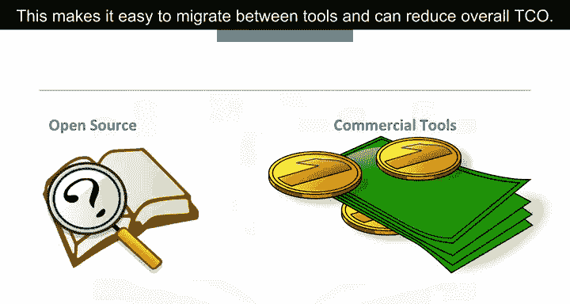

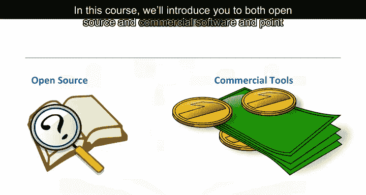

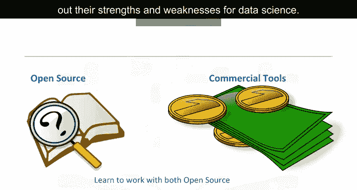

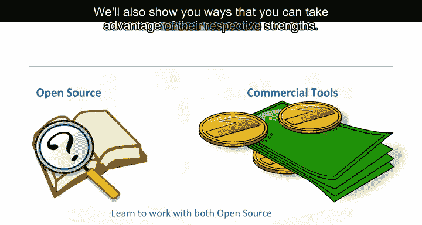

Finally， we'll show you how cloud computing can be used to further speed up and facilitate data scientists' work we'll introduce you to the most commonly used and newly emerging cloud tools for data science in addition to lectures this course has numerous labs to make you more familiar with the material and get hands-on experience。

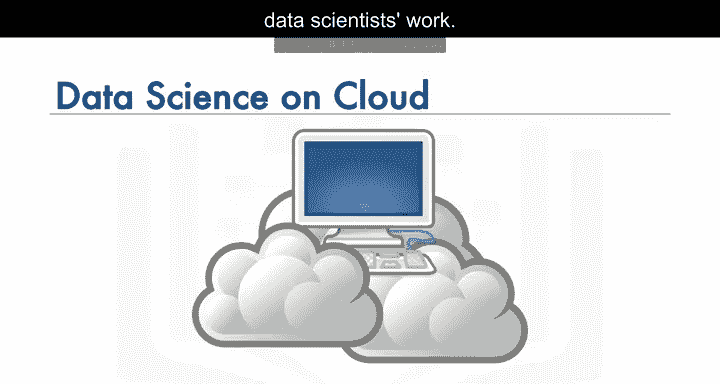

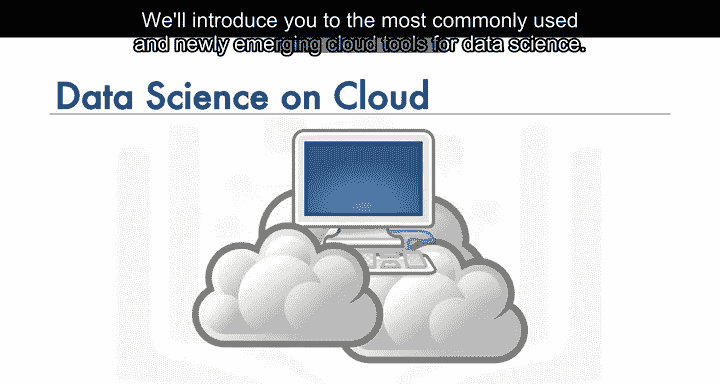

There are also multiple quizzes to test your learning。There's nothing left but to begin。

 We're very happy to have you with us as you start your data science journey。

 If you have any trouble with any of the course material。

 please don't hesitate to contact us in the discussion forum。 Let's get started。😊。

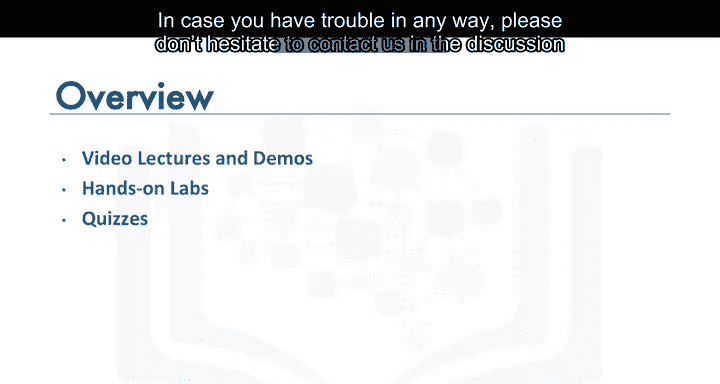

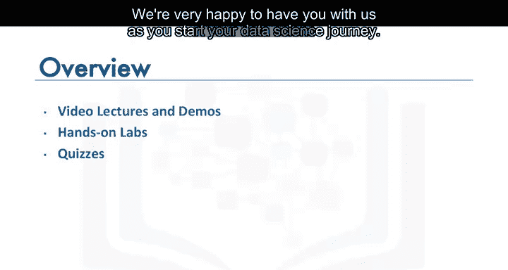

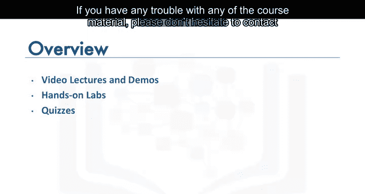