# IBM数据科学专业证书课程2：《数据科学工具》open-source-tools-for-data-science（中英字幕） - P20：19_Jupyter内核系统.zh_en - GPT中英字幕课程资源 - BV1np4y1V7Sn

In this video， you will learn about kernels in the Jupiter environment。

 A notebook kernel is a computational engine that executes the code contained in a notebook file。

 Jupiter kernels， for many other languages exist。 and we will explore some of the ones that are relevant in data science。

 When you open a notebook document， the associated kernel is automatically launched。

 when the notebook is executed， the kernel performs the computation and produces the results。

 depending on the environment you are using， you may need to install other notebook languages in your Jupiter environment。

 in the skills network lab environment。 a few of the languages have been preinstalled for you。

 The first one is the Python kernel。 When you launch a notebook。

 pick the language you are interested in for your data science project。

 The Python kernel allows you to run Python cells。 You can run the Python script to produce results。

😊。

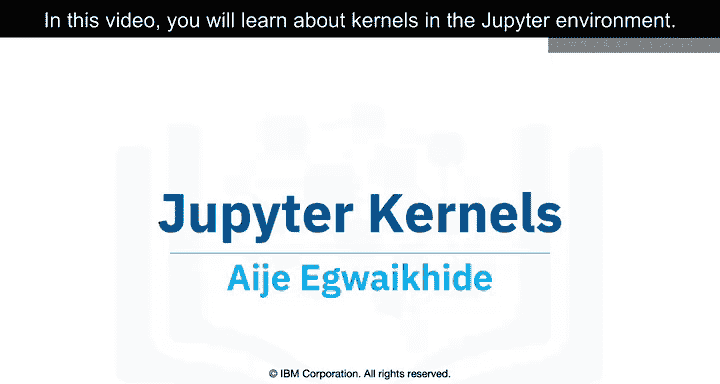

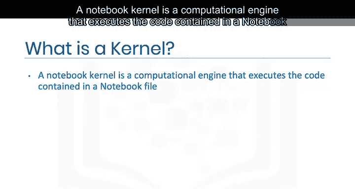

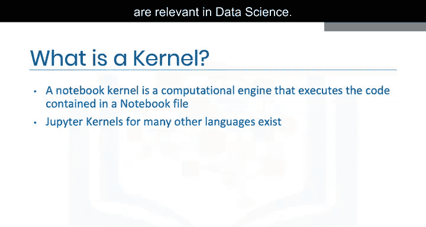

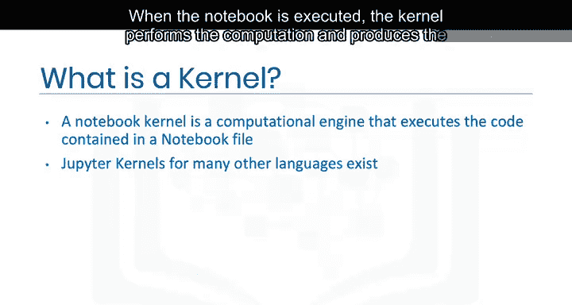

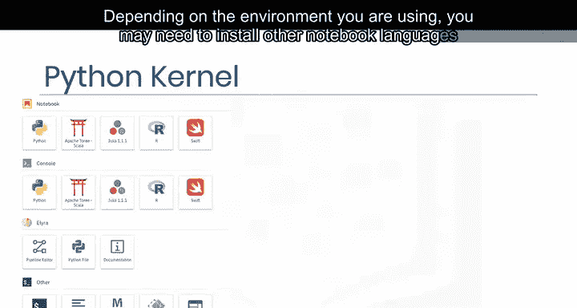

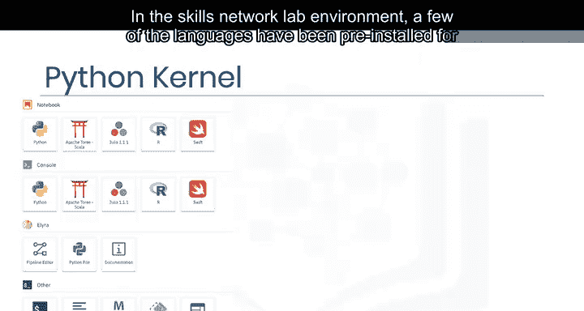

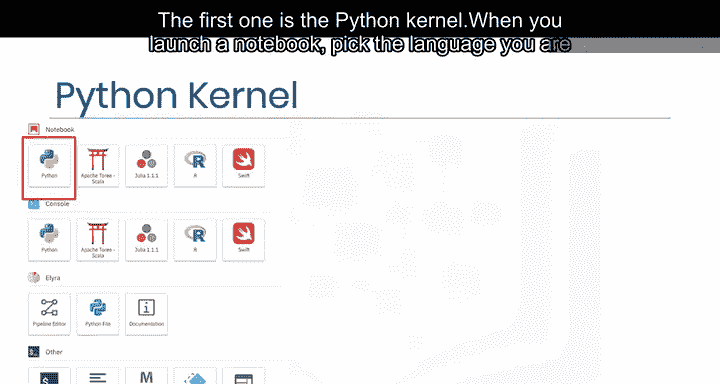

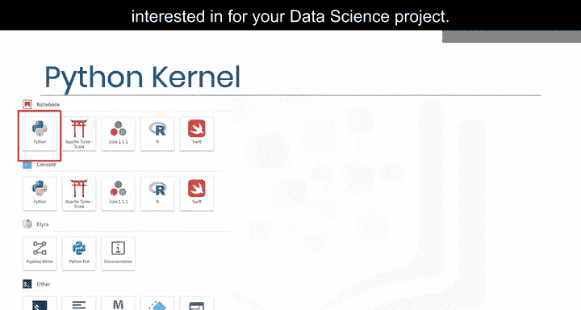

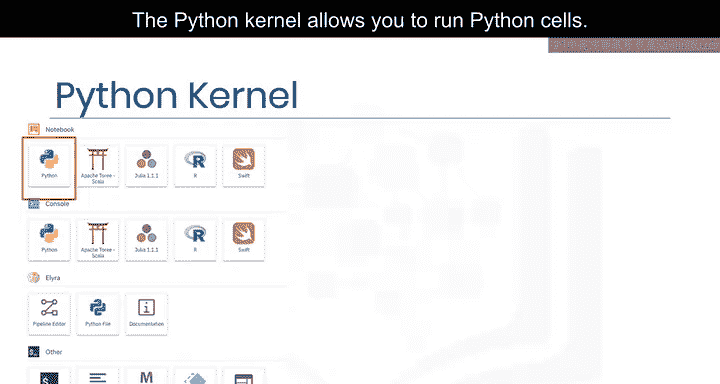

On the top right corner， it tells you what kind of kernel it is。 In this case， it is a Python kernel。

 You can also run other kernels， either by choosing the preferred kernel on the launch page or by clicking the top right to switch the kernel to the preferred kernel and picking the kernel from the drop down menu。

 If you are running it on your local machine， you may need to manually install the languages through your command line interface。

 The skills network virtual Jupiter environment has Apache， Julia R and Swift。

 depending on your preference and type of project， you can use any of the languages that the Jupiter notebook supports to execute your code。

😊。

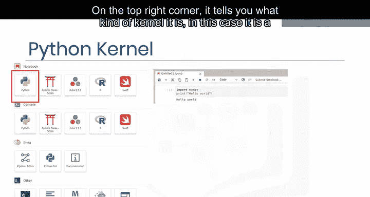

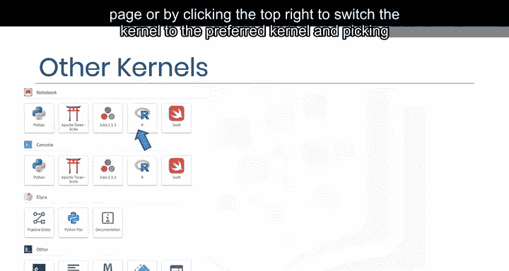

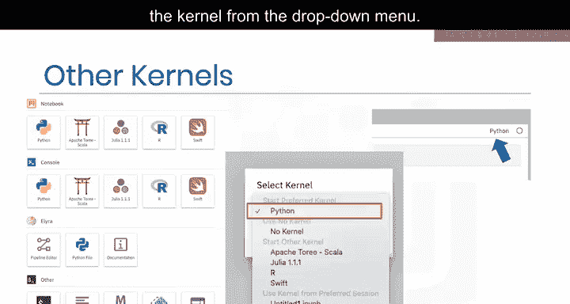

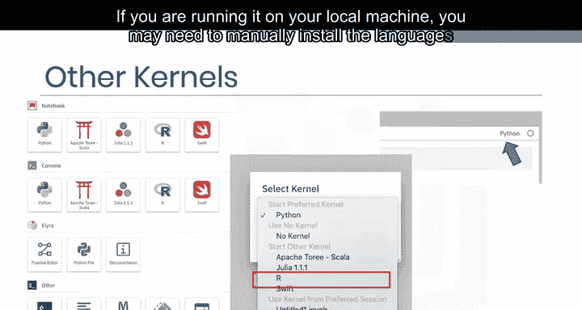

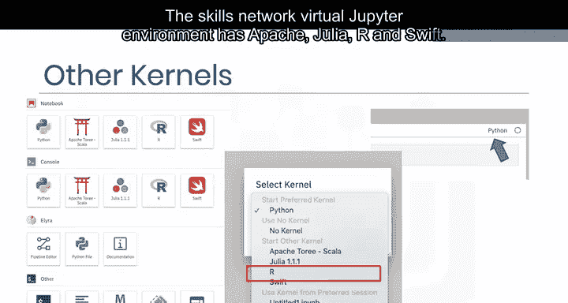

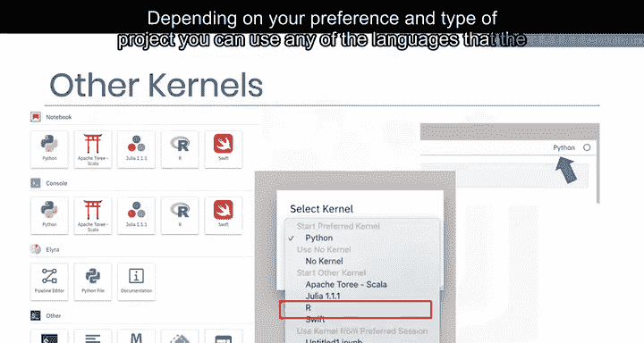

You should now be familiar with what a kernel is， how the Jupiter notebook supports different languages。

 and how to switch to a different kernel。

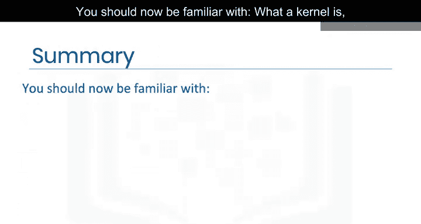

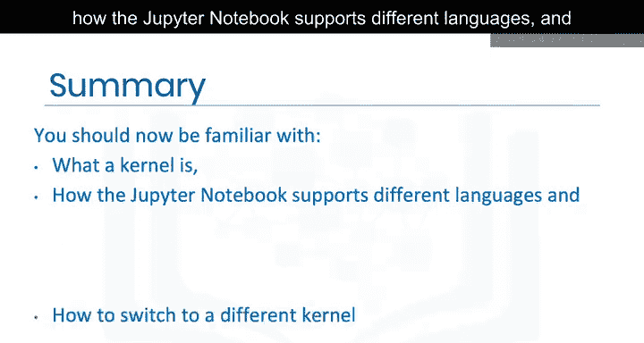