# IBM数据科学专业证书课程2：《数据科学工具》open-source-tools-for-data-science（中英字幕） - P21：20_Jupyter架构解析.zh_en - GPT中英字幕课程资源 - BV1np4y1V7Sn

In this video， you will learn about the basic architectural design of the Jupiter ecosystem。

 Jupiter implements a two process model with a kernel and a client。

 The client is the interface offering the user the ability to send code to a kernel。

 The kernel executes the code and returns the result to the client for display。

 The client is the browser when using a Jupyter notebook。

 Jupiter notebooks represent your code metadata contents and outputs。 When saved。

 it uses a dotip and B extension and a structure。 When you， the user saves it。

 It is sent from your browser to the notebook server。

 which saves the notebook file on a disk as a file with a dot I N B extension。

 The notebook server is responsible for saving and loading the notebooks。

 The kernel gets sent the cells of code when the user runs them。

 Jupiter also has an architecture of how it converts files to other。

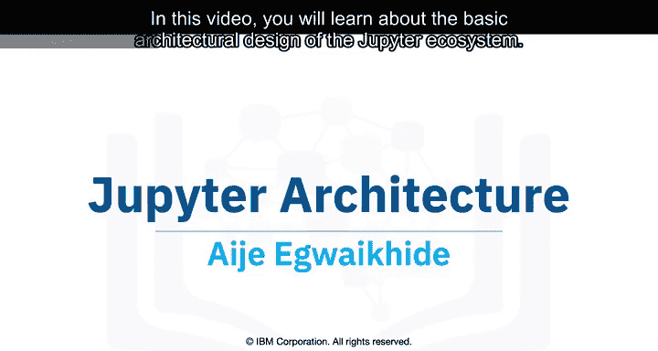

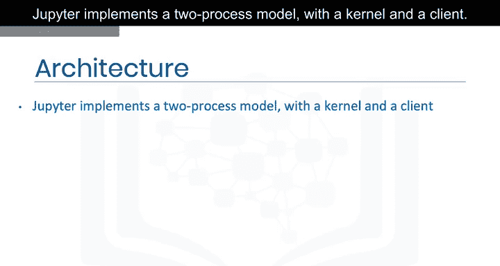

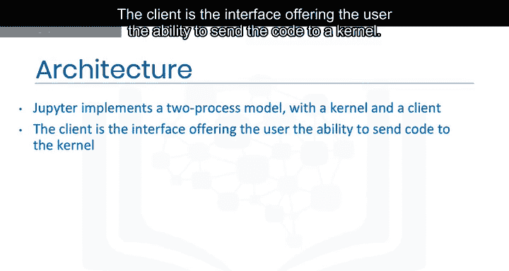

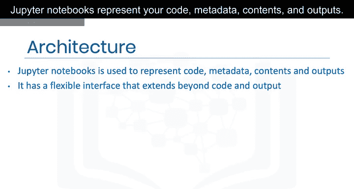

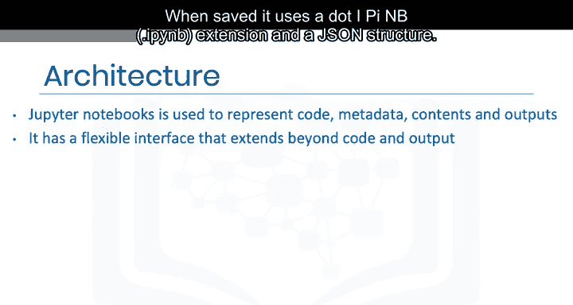

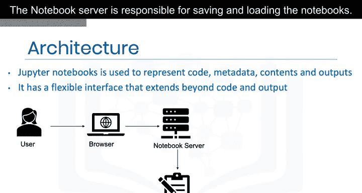

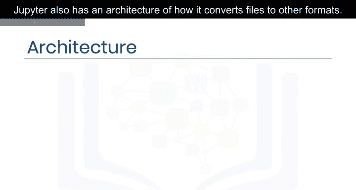

It uses a tool called NB convert For example， if we want to convert a notebook file into an H file。

 it will go through the following。 The notebook is modified by a preprocessor and exporter converts the notebook to the new file format and a post processoror will work on the file produced by exporting it After conversion when you give the URL of the H file。

 it first fetches the notebook converts it to H and displays the file to you in an H file You should now be familiar with the twopro model implementation of Jupiter how notebook servers communicate with kernels and clients and the architectural design of how notebook files are converted to other files。

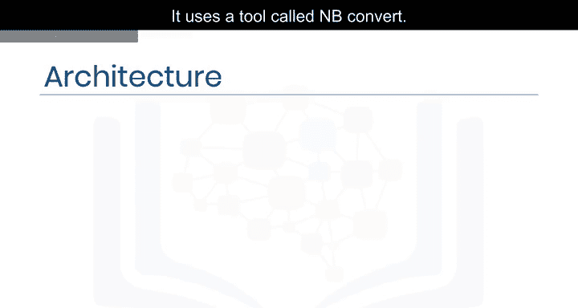

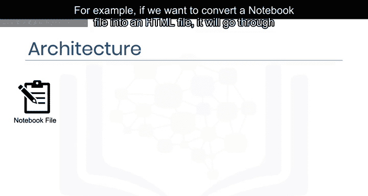

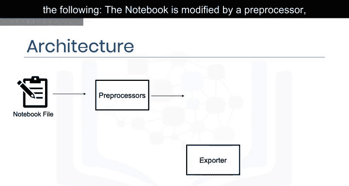

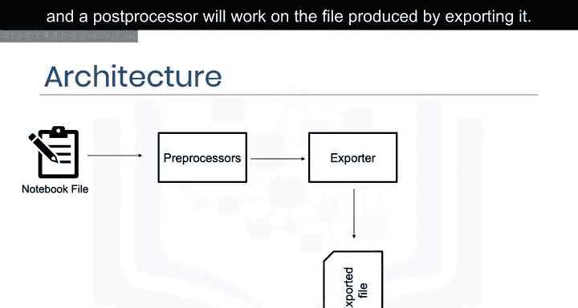

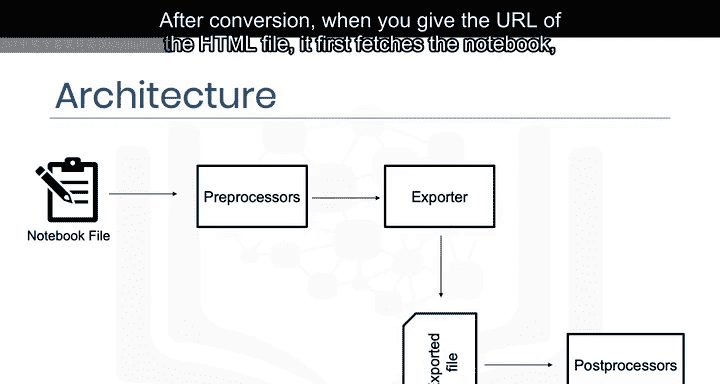

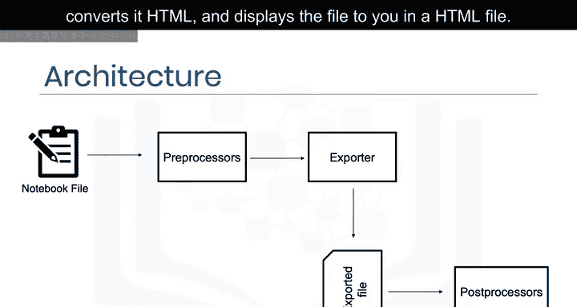

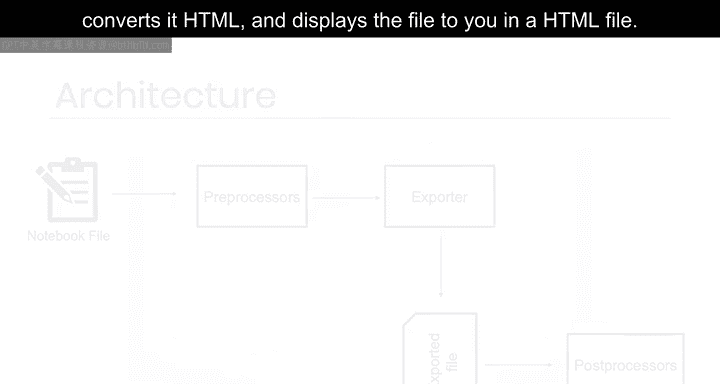

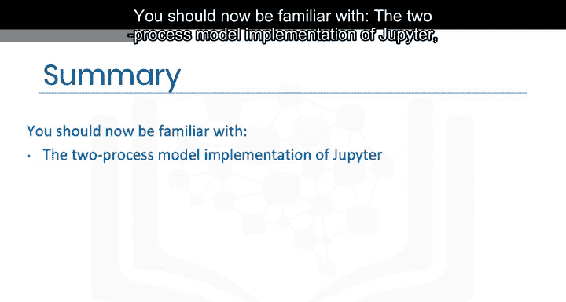