# IBM数据科学专业证书课程2：《数据科学工具》open-source-tools-for-data-science（中英字幕） - P22：21_R与RStudio导论.zh_en - GPT中英字幕课程资源 - BV1np4y1V7Sn

Welcome to a gentle introduction to R and R Studio This tutorial introduces you to the R programming language and its environment the videos following will contain tutorials and handson practice R is a statistical programming language It is a powerful tool for data processing and manipulation。

 statistical inference， data analysis and machine learning algorithms。

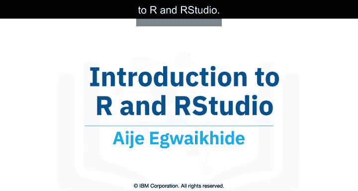

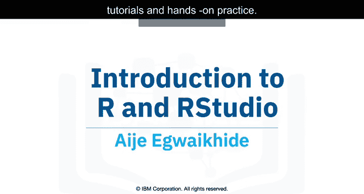

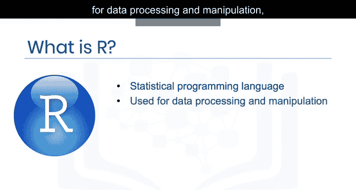

Based on 2017 stack overflow visits， they found that R is most used by academics。

 healthcare and the government。 R has many functions which support importing data from different sources For example。

 Fl files databases， the web and statistical software like SPSS and data。

 R is a preferred language for some data scientists because it is easy to use the functions within R。

 It is also known for producing great visualizations and readily available packages to handle data analysis without the need to install any libraries。

 To use R。 we need an environment to help run the codes。

 One of the most popular environments for developing and running R language source code and programs is R studio。

 R studio is an integrated development environment that helps improve and increase productivity with the R language。

 RSt includes a syntax highlighting editor that supports direct code。

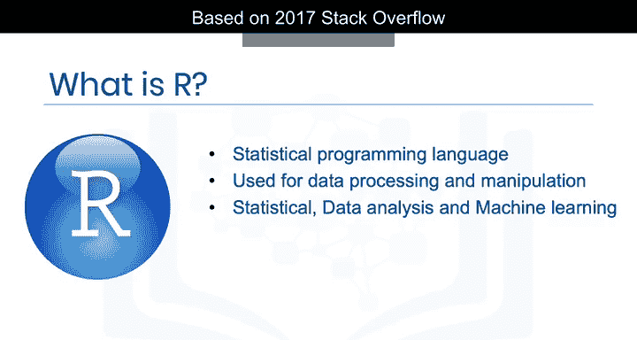

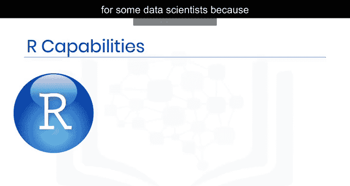

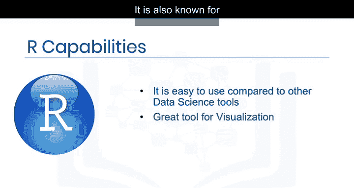

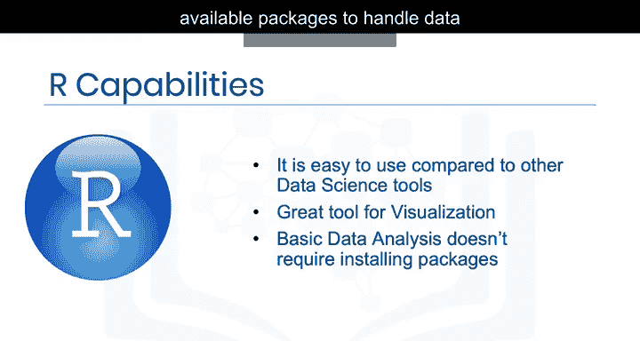

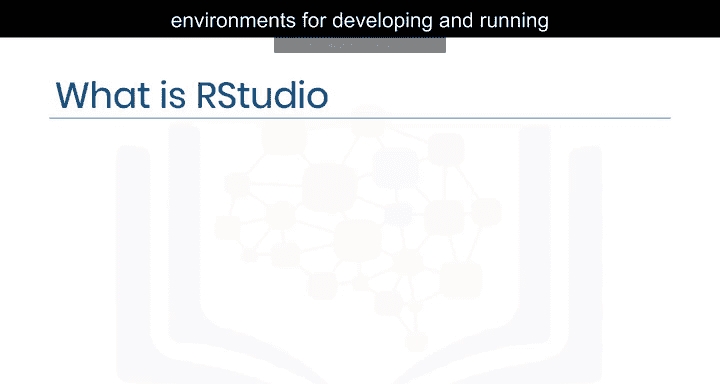

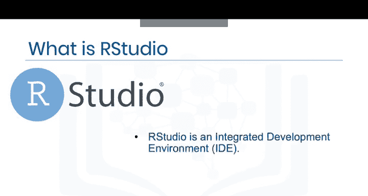

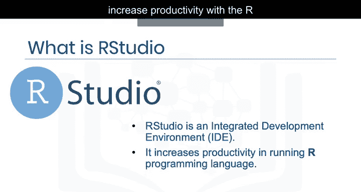

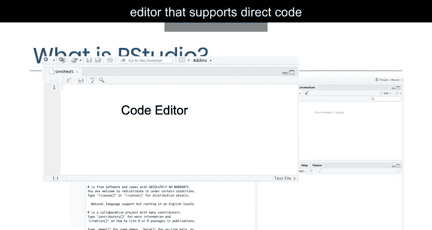

And where you keep a record of your work， a console for typing R commands。

 a workspace and history tab that shows the list of R objects you created during your R session and shows the history of all previous commands and a plots files packages and help tab for showing files in your working directory history of plots you have created and allow for exporting plots to P or image files。

 external R packages available on your local computer and help on our resources。

 RSt support packages and many more If R is your tool of choice for data science here are some popular libraries in the data science community D plier for manipulating data Strer for manipulating strings G plot for visualizing data and carrot for machine learning to get you up and learning quickly。

 we have provided you with an RSt virtual environment as part of the skills network labs。

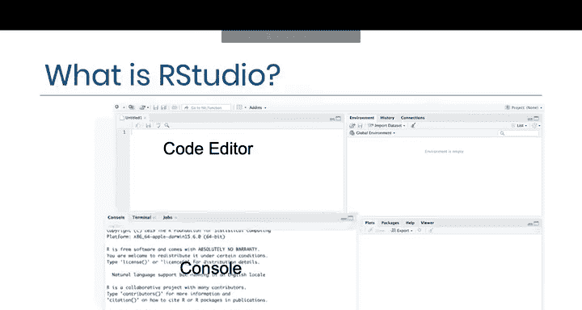

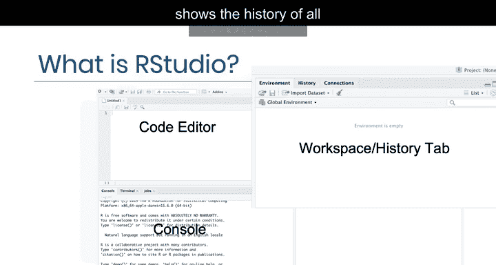

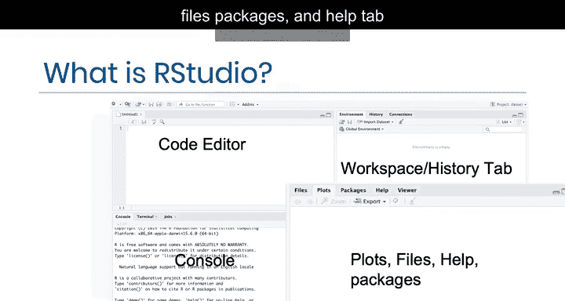

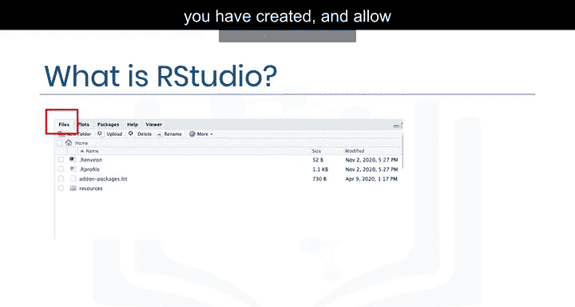

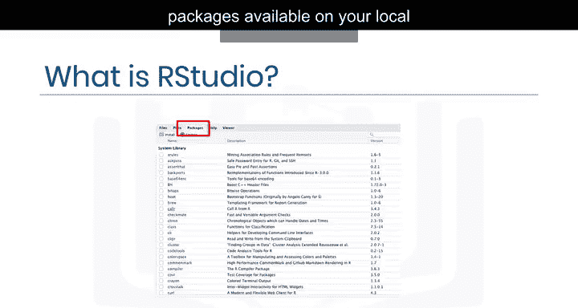

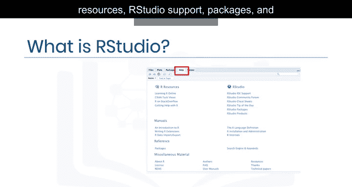

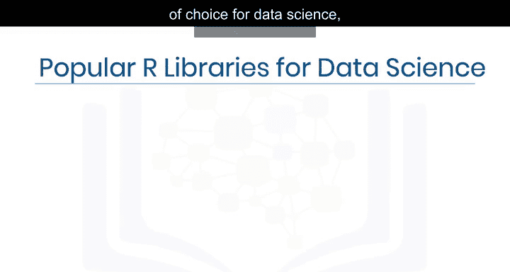

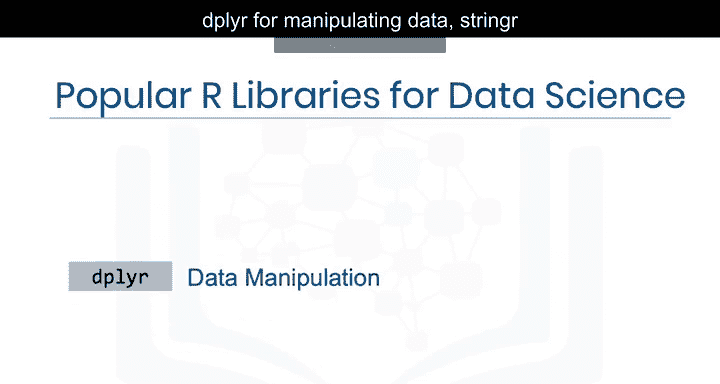

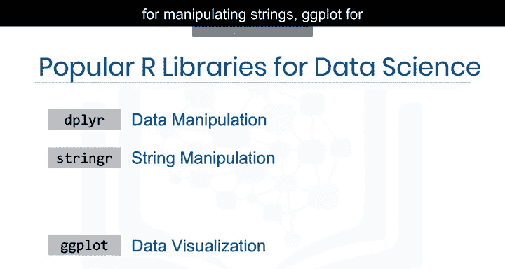

This virtual lab environment is designed to assist you to easily practice what you learn in the course and skip the need to create an account or download or install anything。

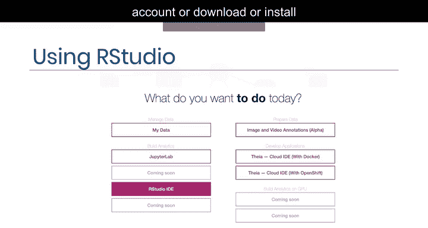

You should now be familiar with the capabilities of R and its uses in data science。

 the R Studio interface for running R codes and popular R packages for data science。

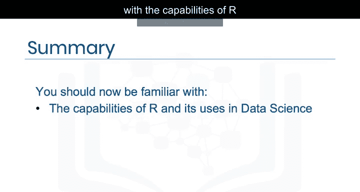

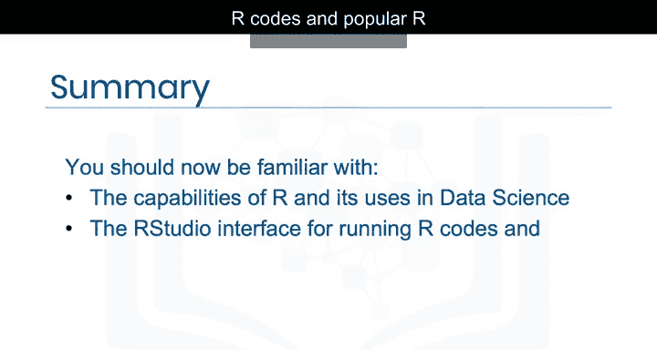

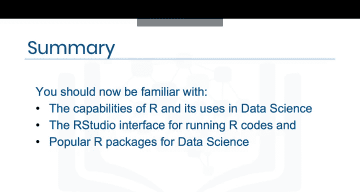