# IBM数据科学专业证书课程2：《数据科学工具》open-source-tools-for-data-science（中英字幕） - P23：22_RStudio可视化功能.zh_en - GPT中英字幕课程资源 - BV1np4y1V7Sn

With the increasing amount of data， one of our many jobs as data scientists is to produce insights using visualizations。

 R is a great tool for data visualization and has different packages。

 Some of the popular and top data visualization tools include G plot。

 which is used for data visualizations such as histograms bar charts scatter plots， etc ce。

 It allows adding layers and components on a single visualization。

 Ply is an R package which can be used to create web-based data visualizations that can be displayed or saved as individual HTML files。

 latticetuce is a data visualization tool that is used to implement complex multivariable data sets。

 latticeuce is a highlevel data visualization library。

 It can handle many of the typical graphics without needing many customizations and leaflet is very useful in creating interactive plots。

😊。

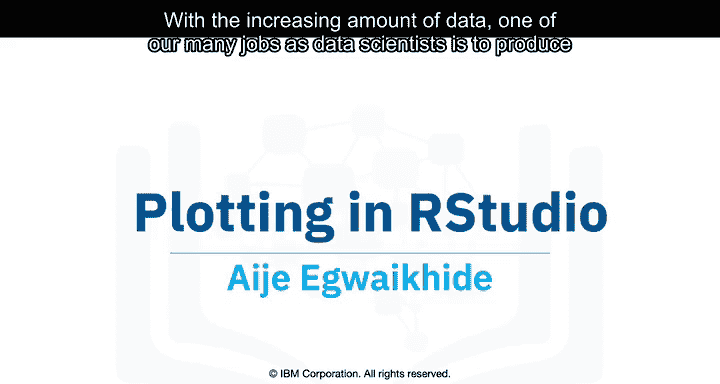

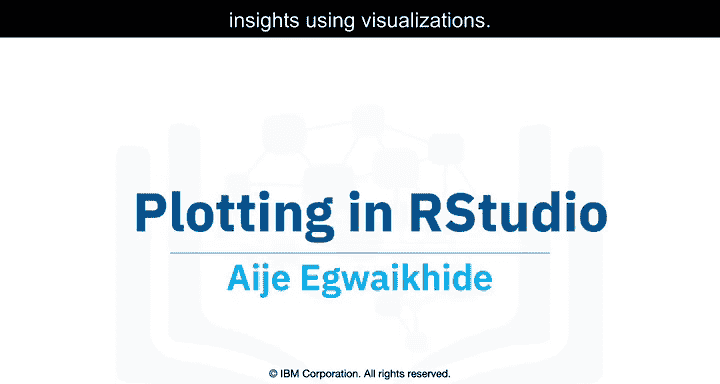

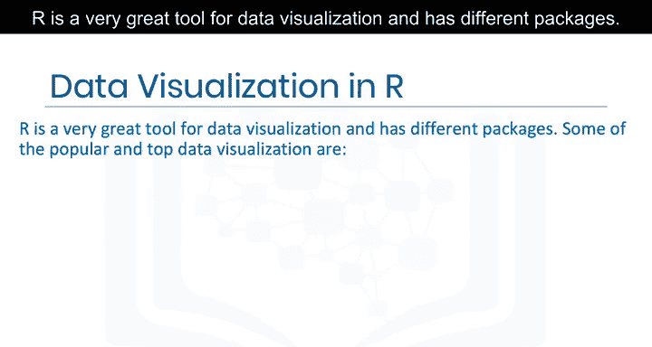

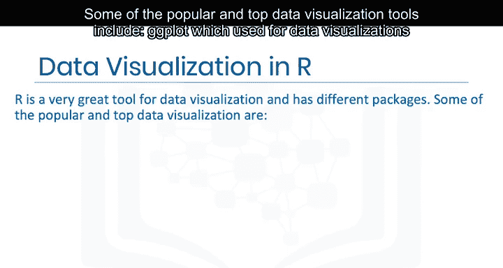

Depending on your need and data science project， most of these libraries and packages can come in handy to install these packages in your R environment。

 Use the installed dot packages and the package name command。

 R also has its own inbuilt functions to create plots and visualizations。

 It is mostly used using the plot function。 For example。

 the function above is the simplest form of the plot function。

 and it returns a scatter plot of the values versus the index as shown here。

 You can also add lines to the function and add a title to make it easier to read and understand。

 here we add a line to the plot and to add a title。 We specify the title function。

 and we can see we have added a line and a title。 We can create more beautiful visualizations using the G plot libraries。

 G plot is a data visualization package for R。 It can handle complex requests。

 allowing for you to add layers into plot。

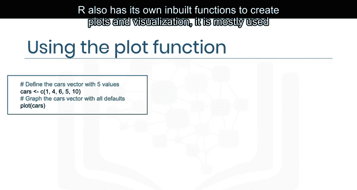

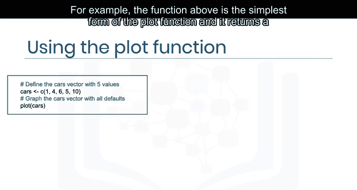

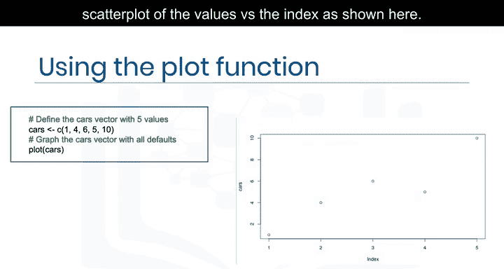

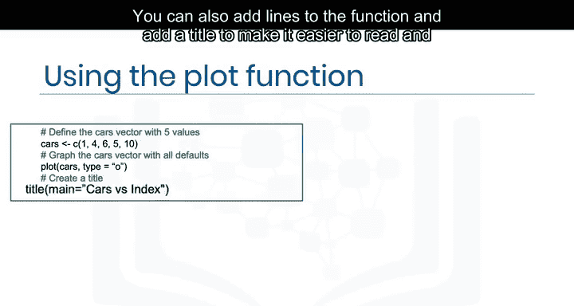

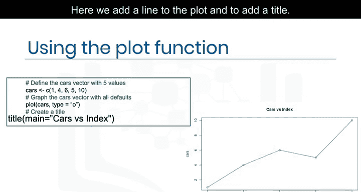

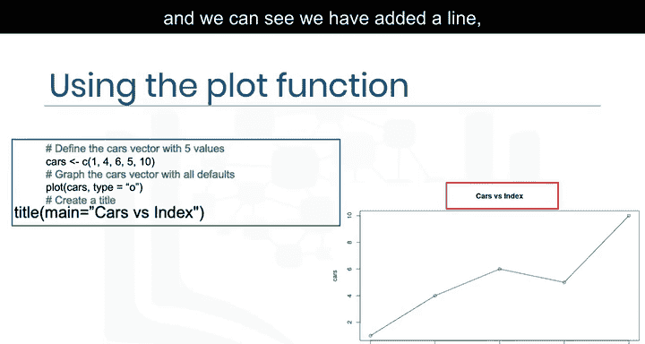

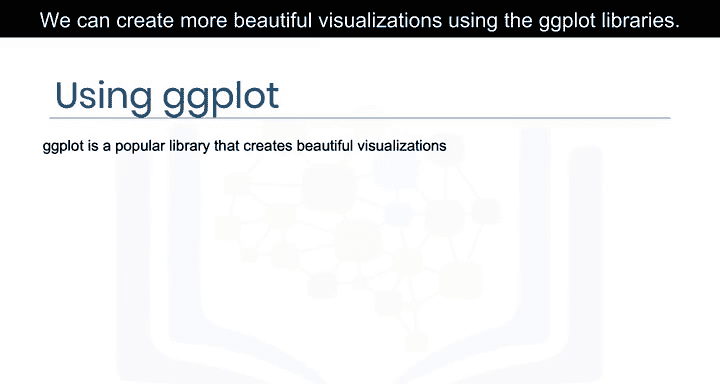

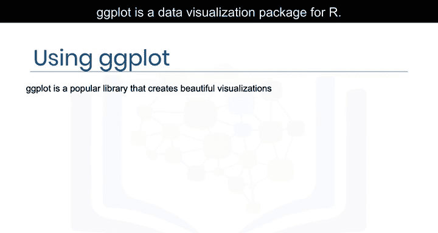

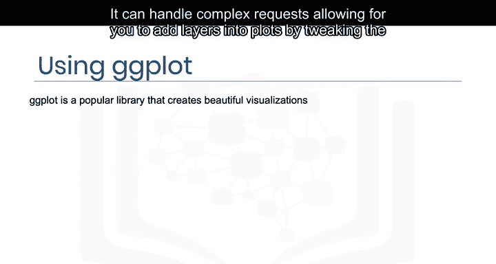

By tweaking the functions and arguments to create a scatter plot。

 we will use the inbuilt dataset empty cars We will first read G plot library into memory by using the library function and then call G plot on the data frame empty cars specify the X axis is miles per gallon and y axis is weight and then add the geoome point function to specify to G plot that we want a scatter plot otherwise it will return an empty plot it will produce a more beautiful and easier to read plot like this。

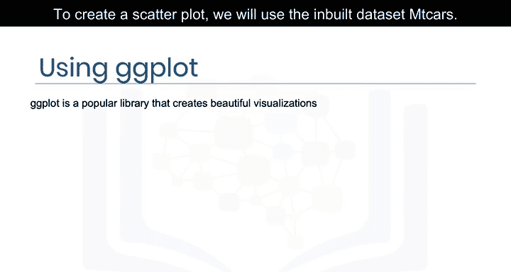

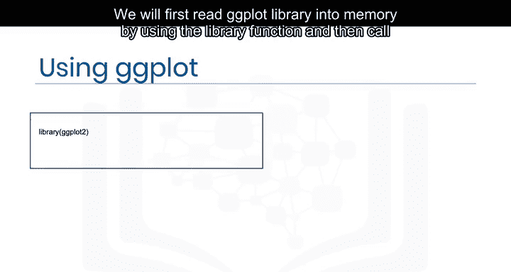

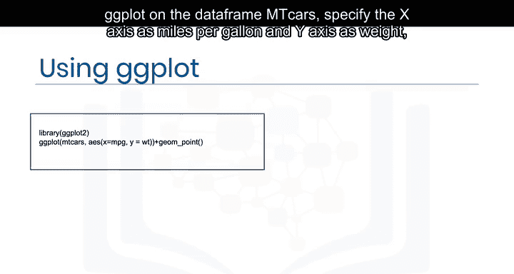

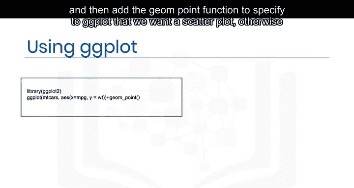

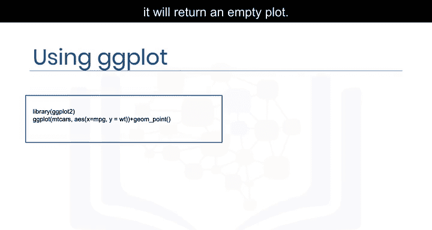

You can also add titles and tweak the access name by using the G G title argument to add a title。

 add the labs argument to change the names of the access by specifying the new names we want to see。

 We will see an easier to read and understand graph。

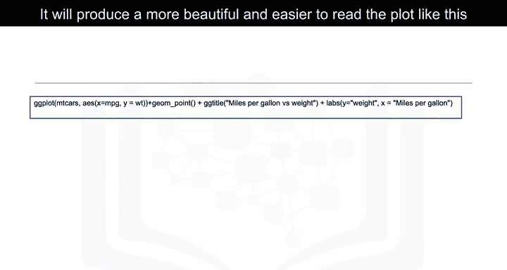

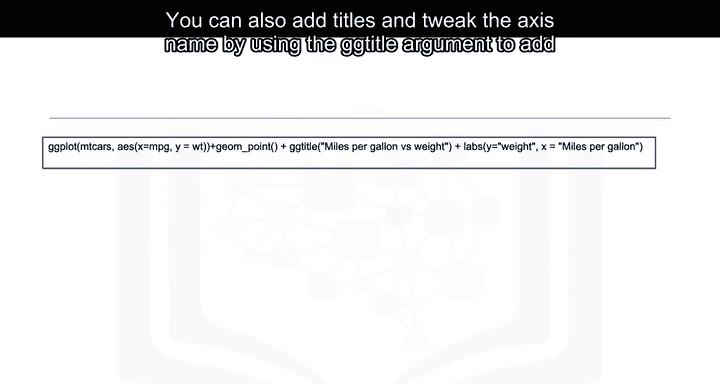

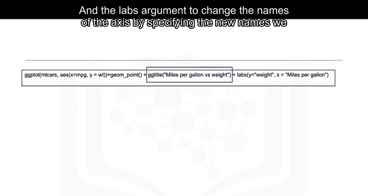

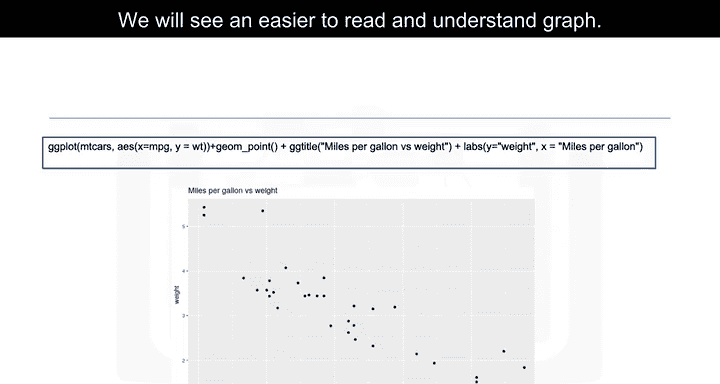

In our lab， we will be recreating the above graphics with Ggi plot and the extension library called Ggaley。

 Ggaley extends Ggiplot2 by adding several functions to reduce the complexity of combining geometric objects with transformed data。

 Please type and execute the following command in the console window to install both packages。

 You will not need any coding experience as the code and commands will be given to you。

You are now familiar with popular data visualization packages in R。

 plotting with base R plot function， plotting with GG plot。

 and adding a title and changing the access name using the GG title and Las function。

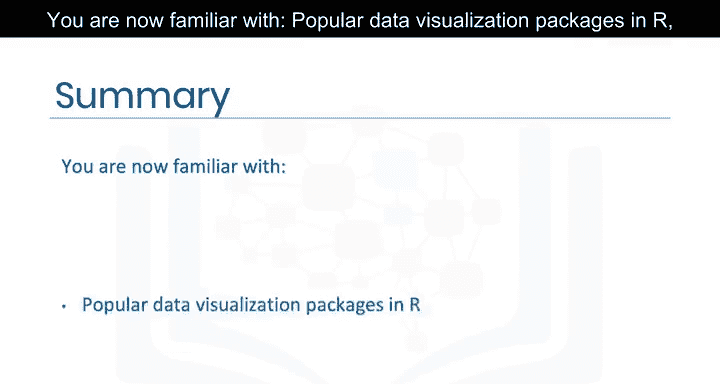

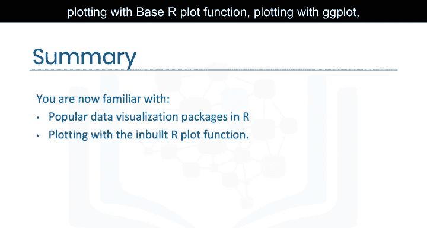

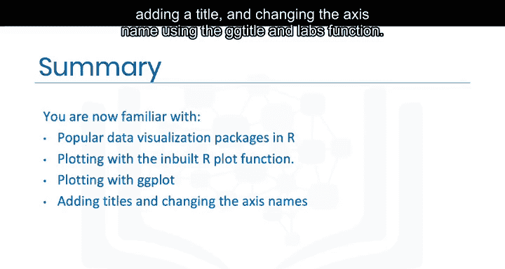