# IBM数据科学专业证书课程2：《数据科学工具》open-source-tools-for-data-science（中英字幕） - P24：23_Git与GitHub概述.zh_en - GPT中英字幕课程资源 - BV1np4y1V7Sn

In this video you will get an overview of Git and GitHub。

 which are popular environments among developers and data scientists for performing version control of source code files and projects and collaborating with others。

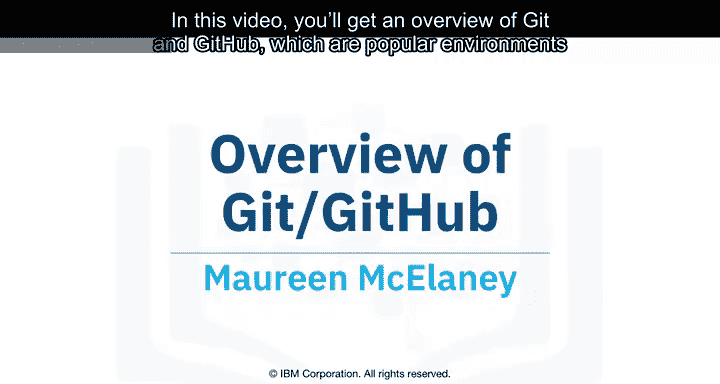

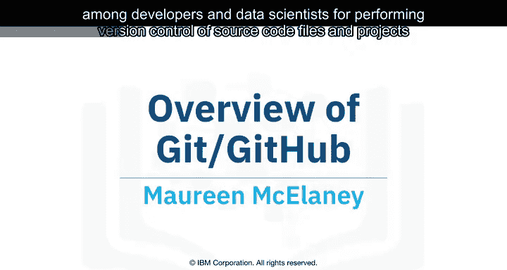

You can't talk about Git and Gitthub without a basic understanding of what version control is。

 A version control system allows you to keep track of changes to your documents。

 This makes it easy for you to recover older versions of your document if you make a mistake。

 and it makes collaboration with others much easier。

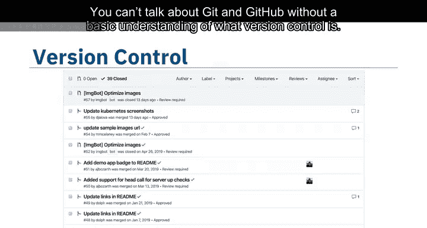

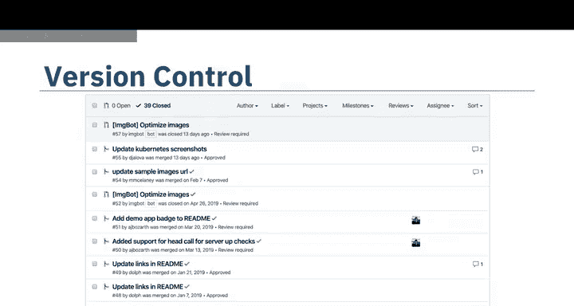

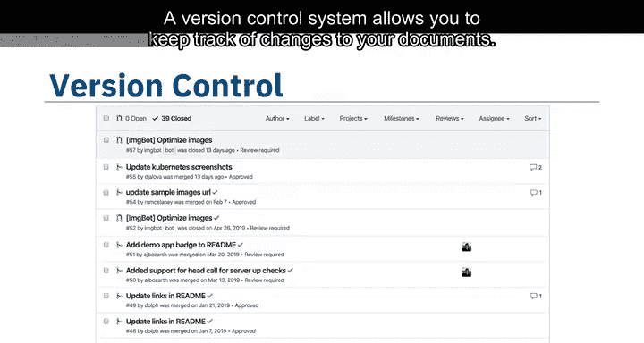

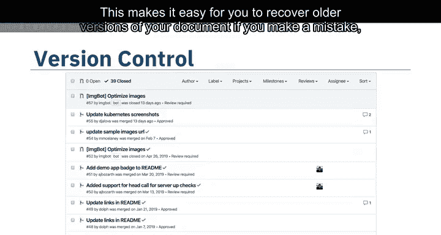

Here is an example to illustrate how version control works。

 Let's say you've got a shopping list and you want your roommates to confirm the things you need and add additional items without version control。

 You've got a big mess to clean up before you can go shopping。

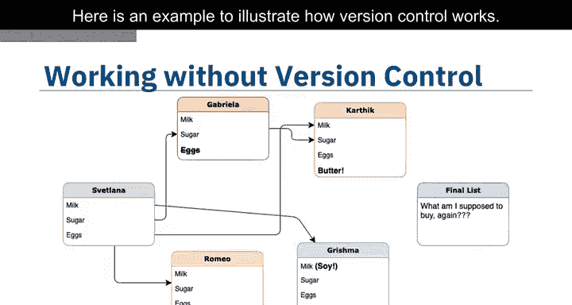

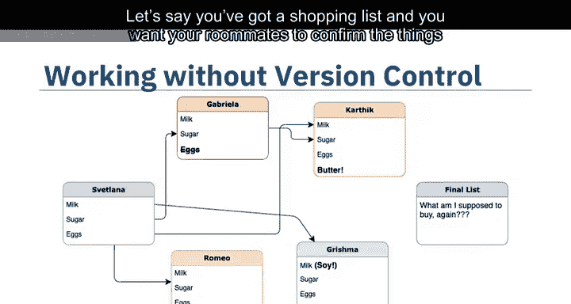

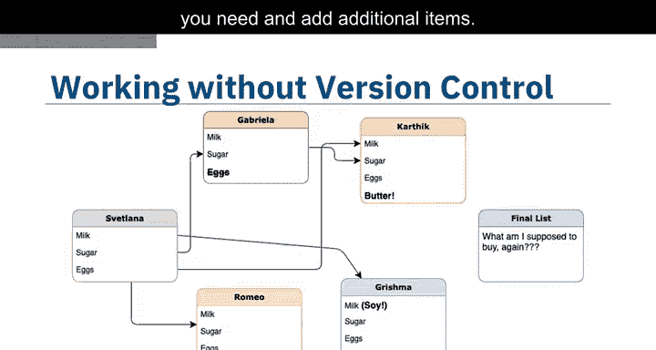

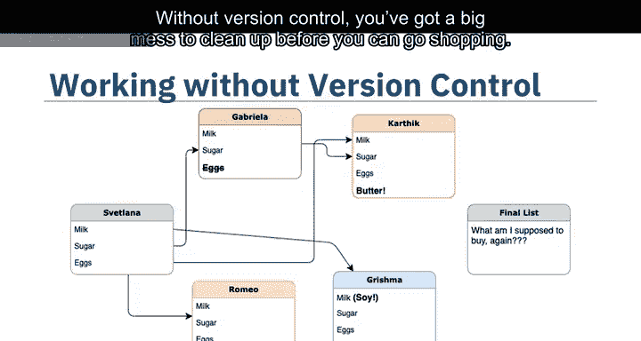

With version control， you know exactly what you need after everyone has contributed their ideas。

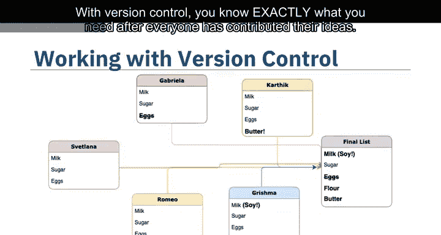

Gitt is free and open source software distributed under the new general public license。

 Git is a distributed version control system， which means that users anywhere in the world can have a copy of your project on their own computer When they've made changes。

 they can sync their version to a remote server to share it with you。

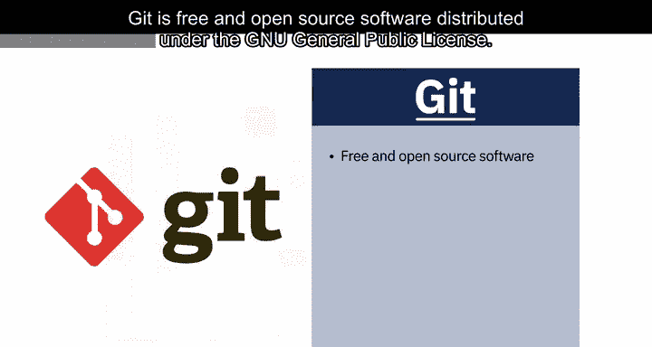

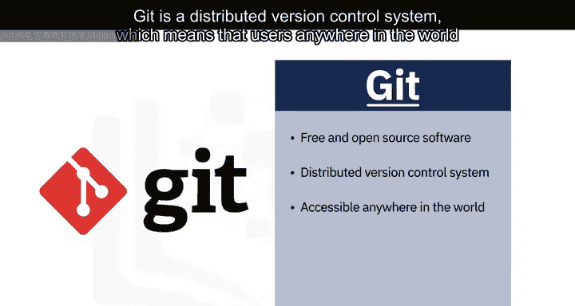

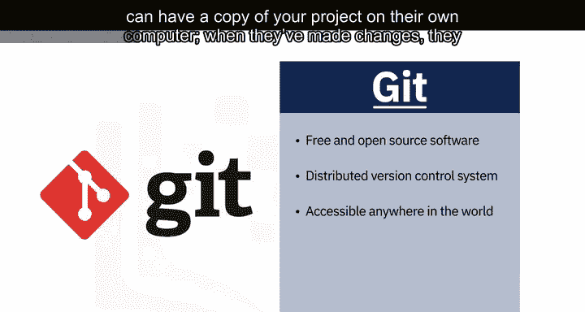

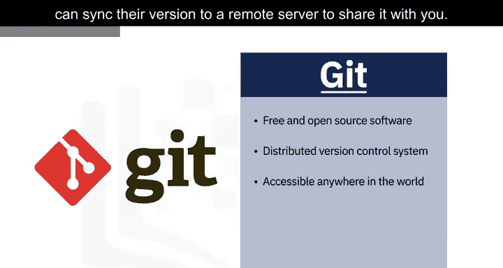

Gt isn't the only version control system out there。

 but the distributed aspect is one of the main reasons it's become one of the most common version control systems available。

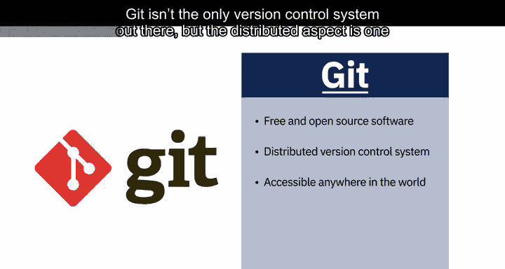

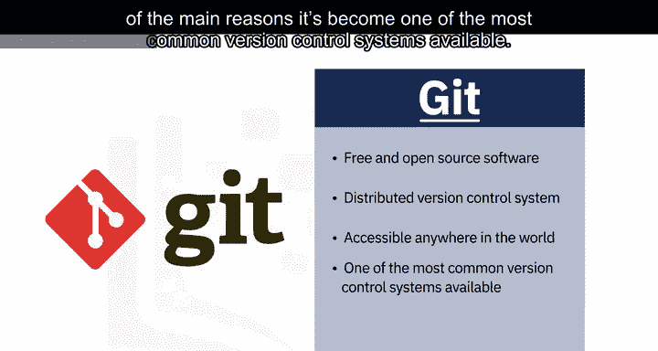

Version control systems are widely used for things involving code。

 but you can also version control images， documents， and any number of file types。

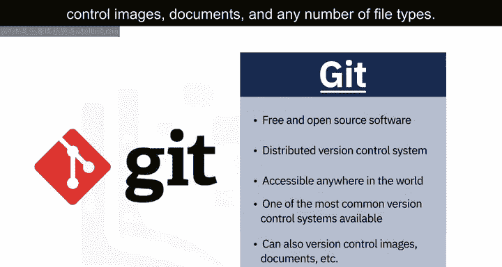

You can use Git without a web interface by using your command line interface。

 but GitHub is one of the most popular web hosted services for Git repositories。

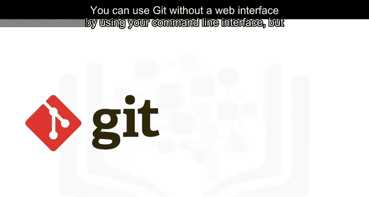

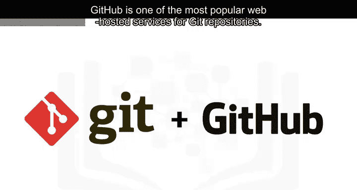

Others include Gitlab， Bi bucket， and Beanstock。

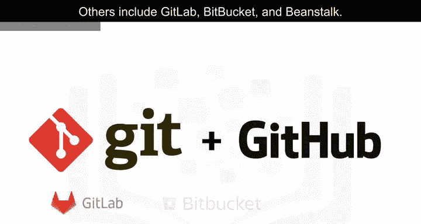

There are a few basic terms that you will need to know before you can get started。

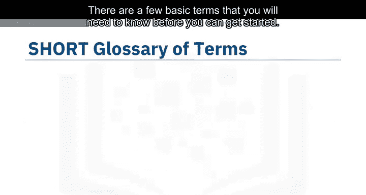

The SSH protocol is a method for secure remote login from one computer to another。

 A repository contains your project folders that are set up for version control。

 A fork is a copy of a repository。 A pull request is the way you request that someone reviews and approves your changes before they become final。

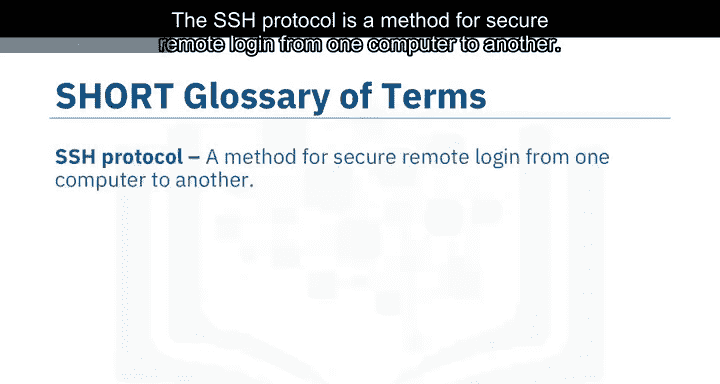

A working directory contains the files and subdirecties on your computer that are associated with a Git repository。

There are a few basic git commands that you will always use when starting out with a new repository。

 you only need create once either locally and then push a Gitthub or by cloning an existing repository by using the command Git in it。

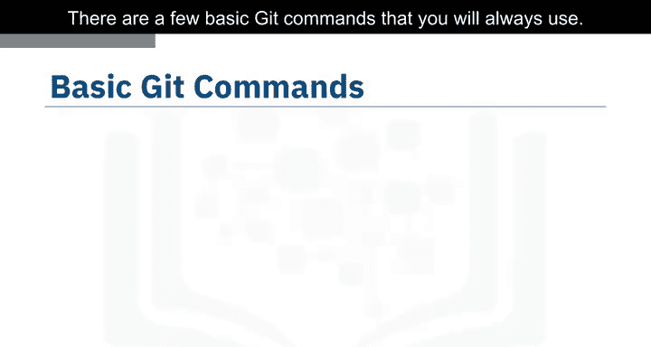

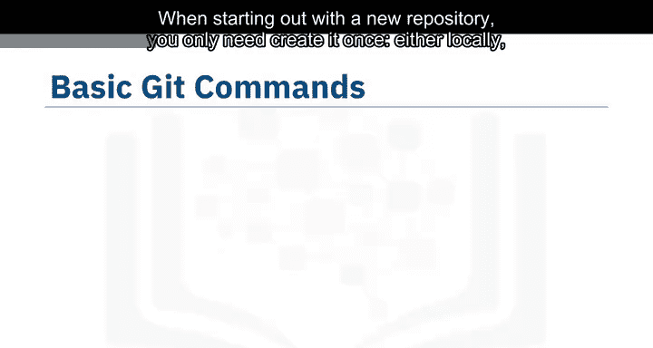

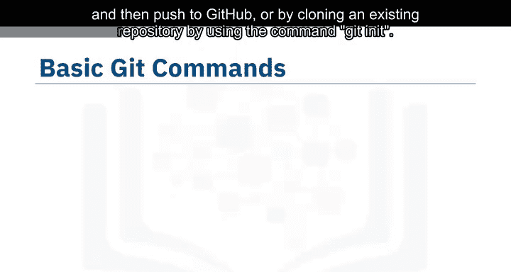

Gett add moves changes from the working directory to the staging area。

 Git status allows you to see the state of your working directory and the staged snapshot of your changes。

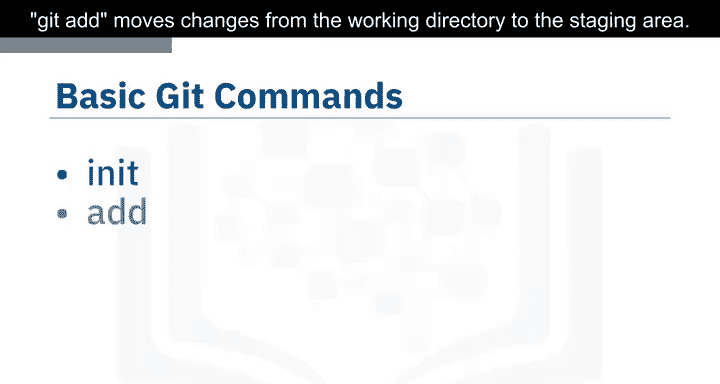

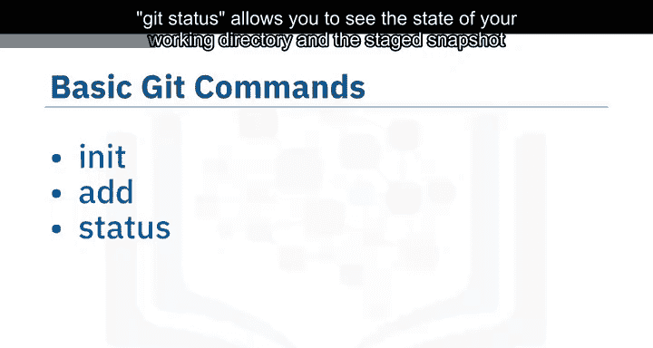

Get commitmit takes your stage snapshot of changes and commits them to the project。

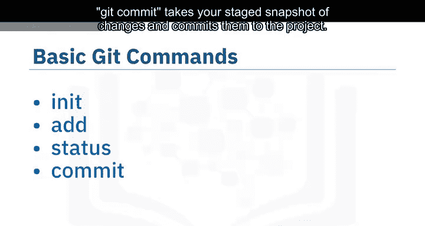

Get Reset undoes changes that you've made to the files in your working directory。

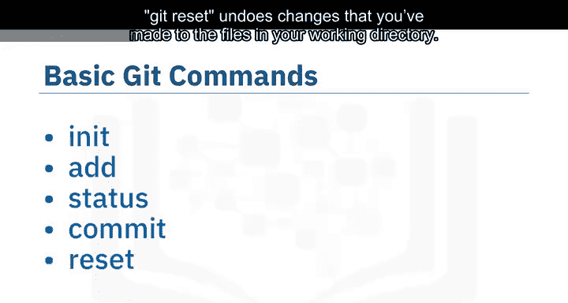

GitLo enables you to browse previous changes to a project。

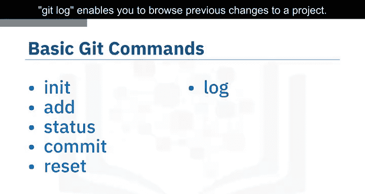

Git branch lets you create an isolated environment within your repository to make changes。

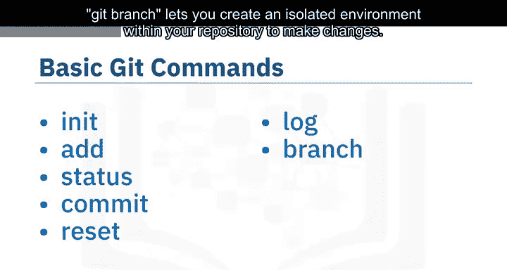

Get check out。 lets you see and change existing branches。 Get merge。

 Lets you put everything back together again。

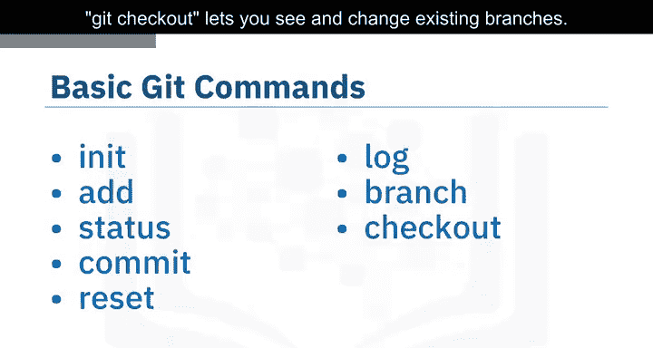

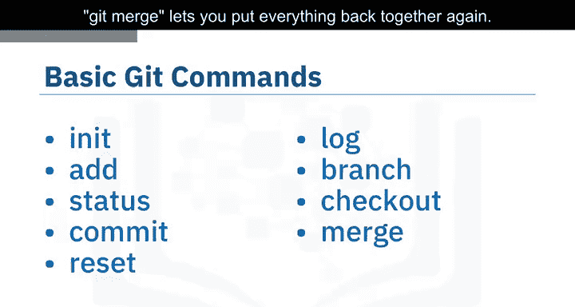

To learn how to use Git effectively and begin collaborating with data scientists around the world。

 you will need to learn the essential commands。Luckily for us。

 GitHub has amazing resources available to help you get started。Go to try。github。

o to download the cheat sheets and run through the tutorials。In the following modules。

 we'll give you a crash course on setting up your local environment and getting started on a project。

