# IBM数据科学专业证书课程2：《数据科学工具》open-source-tools-for-data-science（中英字幕） - P25：24_GitHub入门指南.zh_en - GPT中英字幕课程资源 - BV1np4y1V7Sn

In the previous video， you learned about Git and GitHub Before you continue with this video。

 register for a GitHub account and log in。

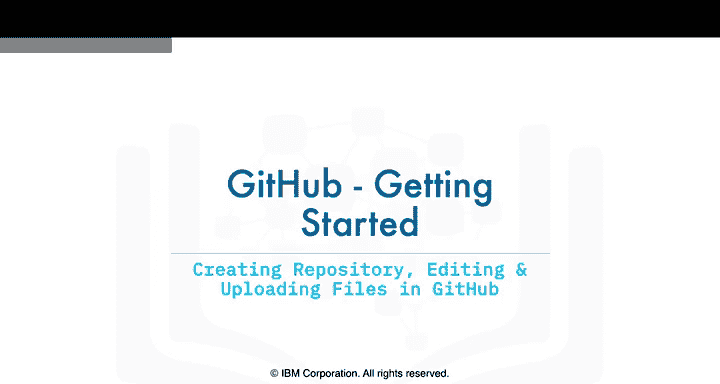

Let us start by creating a new repository。Click plus， then click New Repoitory。

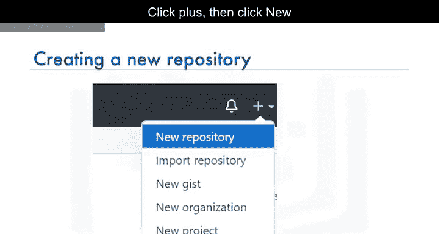

To create a new repository， you need to provide these details。 Give your new repository a name。

 optionally， add a description of your repository。 Choose the repository visibility。

 whether you want it to be public or private， and choose the option to initialize this repository with Readme file。

 then click createate repository。

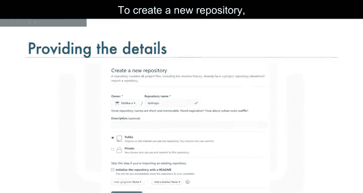

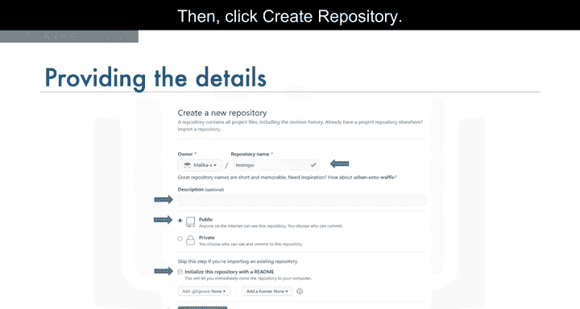

You will now be redirected to the repository you have created。

 The root folder of your repository is listed by default， and it has just one file， readme doMd。

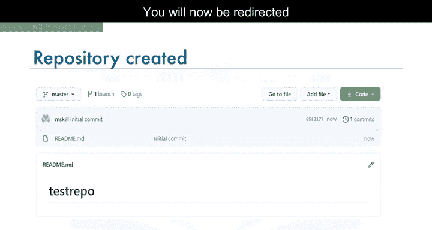

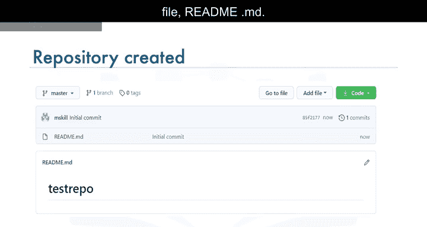

Now it's time to edit the Readme， you can do this in your browser。

 just click the pencil to open the online editor and you can change the text of the Readme。

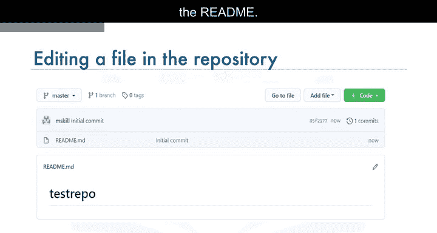

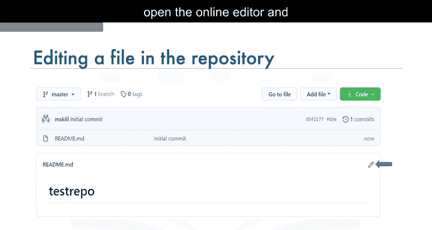

To save your changes to the repository， you must commit them after you have made your changes。

 scroll down to the commit changes section。 add a commit message and optionally add a description。

 Then click commitit changes。

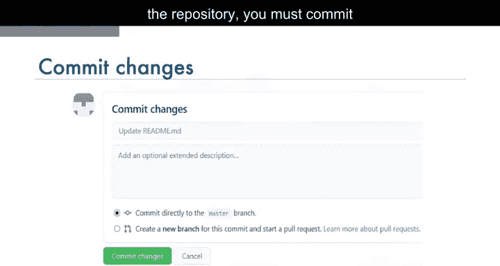

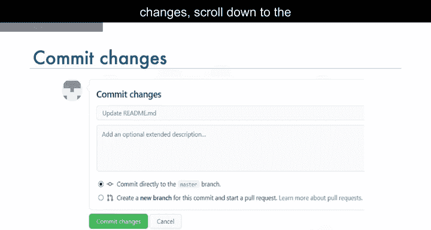

Commit changes is used to save your changes to the repository。

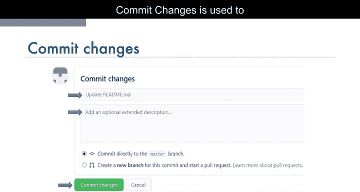

Go back to the home screen by clicking the repository name link。

 note that the Read Me file is updated and verify your changes。

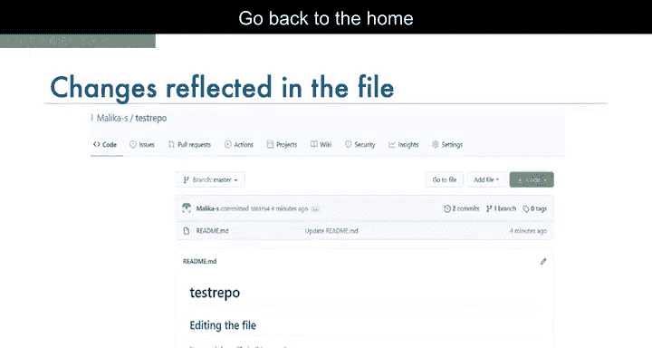

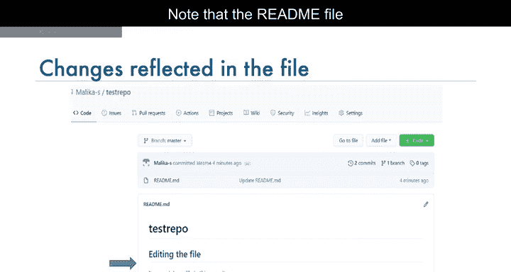

Let's learn how to create a new file using the builtt in web editor provided by GitHub。

 which runs in the browser。Click add fileile， then click createate new file to create the new file。

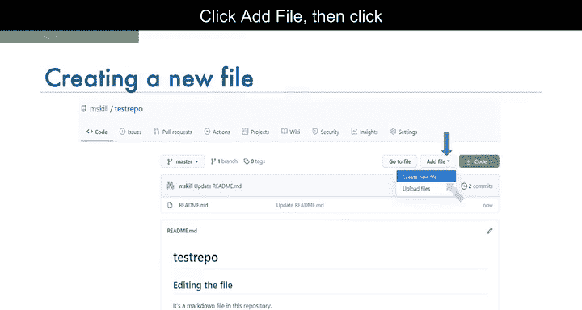

To create a Python file called first Python dot Pi。 first provide the file name。 Next。

 add a comment that describes your code， then add the code。

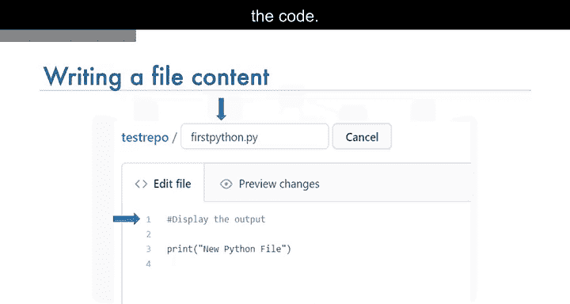

Once finished， commit the change to the repository。

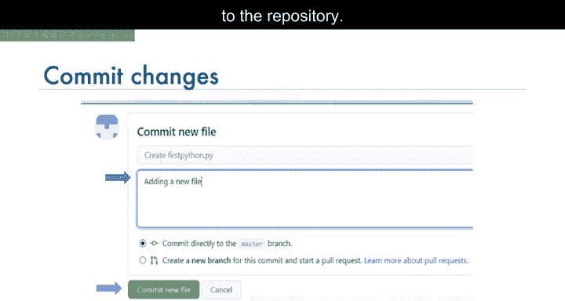

You can see that your file is now added to the repository and the repository listing shows when the file was added or changed。

When you need to change the file， you can edit it again， click the file name。

 then click the pencil icon， make your edits， and commit the changes。

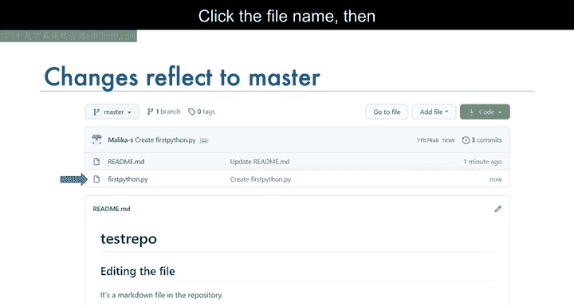

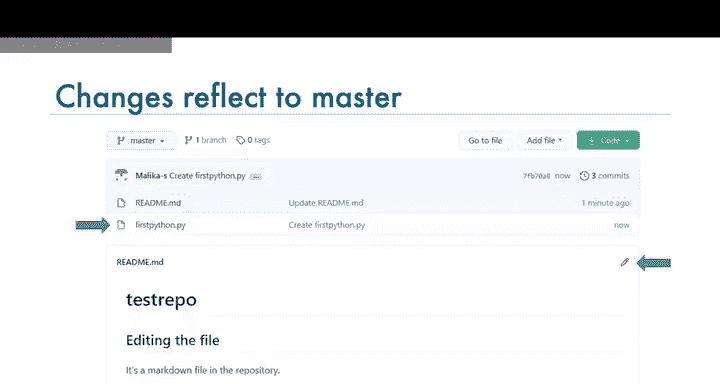

You can also upload a file from your local system into the repository from the home screen of the repository。

 click add fileile and choose the upload files option。

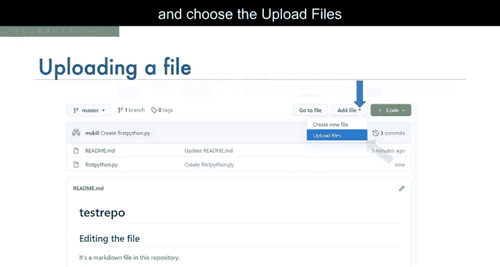

Click Choose your files and select the files you want to upload from your local system。

The file upload process may take a short time， depending on what you are uploading。

 Once the file finishes uploading， click commitmit Change。

 The repository now reflects the files that were uploaded。

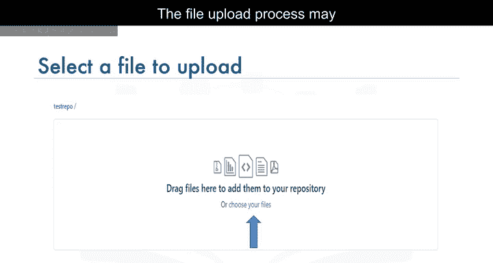

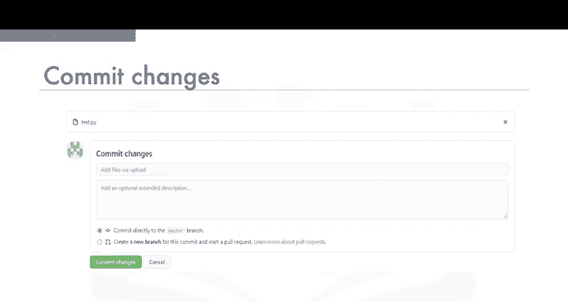

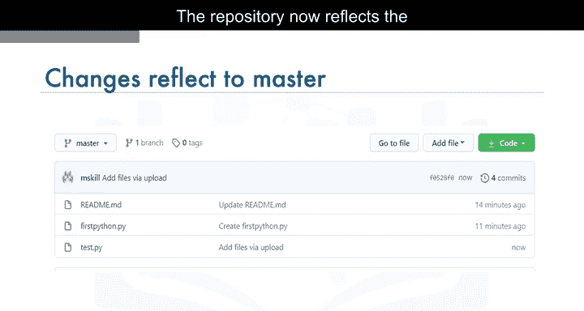

In this video， you learned how to create a repository， edit files。

 and commit changes using the web interface。

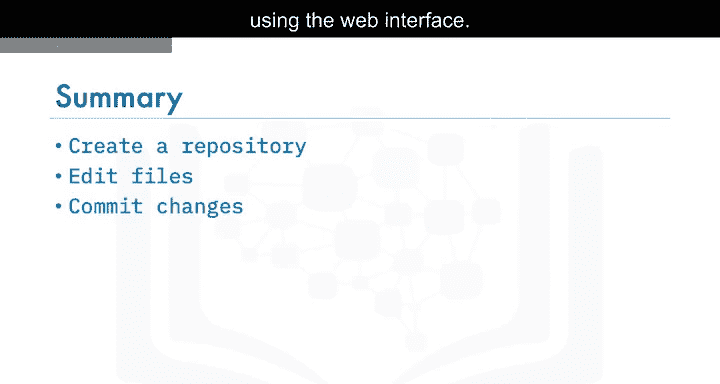