# IBM数据科学专业证书课程2：《数据科学工具》open-source-tools-for-data-science（中英字幕） - P27：26_命令行操作Git与GitHub（选修）.zh_en - GPT中英字幕课程资源 - BV1np4y1V7Sn

So welcome to a little introduction to Git and Gitthub。 It's very basic。

 So if you have absolutely no clue， then this is for you。 Otherwise it's maybe boring。😊。

I'm just telling you how I'm using it。And I am able to survive in most of the cases with that knowledge。

 sometimes I have to read the documentation for the more advanced stuff。

 but let's say 80% of the cases what I will tell you now is sufficient。

 so let's actually start using GitHub。😊，It makes things a bit more easy。 There's also。Competition。

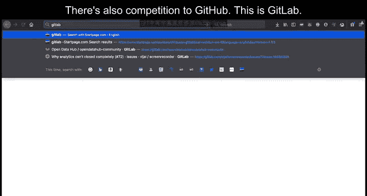

To Gitthub， this is Gitla。 Gitla is particularly interesting because the whole system behind Gitla is open source。

 So this is a hosted version， but you can have the whole system on prem and also purchase support from Gitla。

😊，Those guys are partially in Berlin， so they are pretty cool。Anyway， let's start this GitHub here。

 so what I will do now is create a repository。😊，So a repository is the stuff。

The location where your stuff goes in now。Okay， so let's call it， I don't know。でも。

And you can choose whether we want to create a public or a private repository。

 So that repository is remote。 Okay， let's host it at Github and let's initialize with a readme and also with a let's keep。

😊，You ignore for now， I will show you that later， so we create now repository。😊。

And once this is created， it's very easy to have a copy of this repository locally。

 there are two options， One is cloning it via HtPS or via SH So I'm always using SH SH is makes things a bit more easy The only thing you need to do is you have to add your public。

😊。

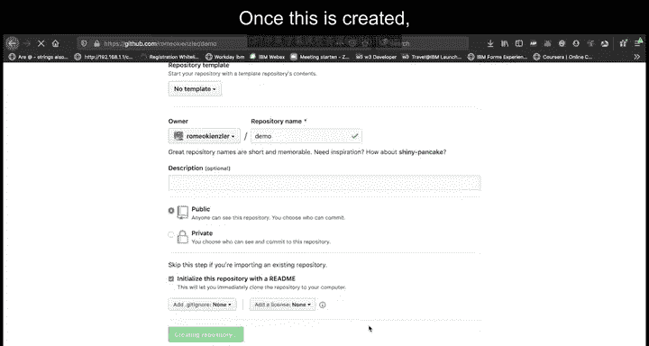

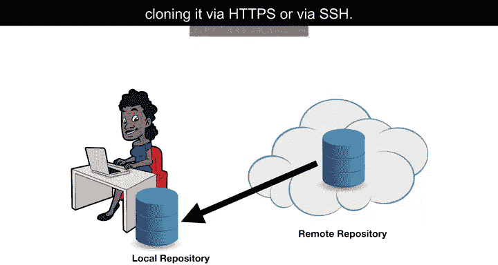

Identity to Giub， I can show you that later。

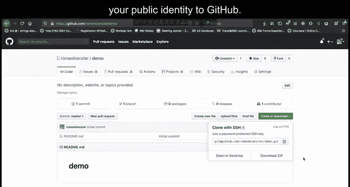

So now the only thing we need to do is。一个。

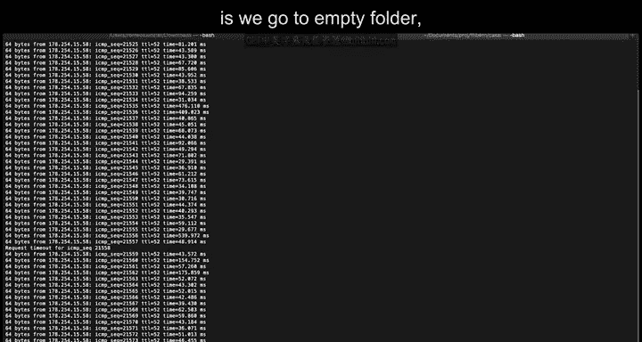

To empty folder。 And then we say。Kit clone and these link of kit clone。And this link。 Okay。

 so what now happens is the contents of this is copied to my machine Here。 I have to specify my。

Passport for my SSH identity so that's something I need to explain you later so if you know go go to demo。

😊，You will see here the Rmi file。And you see here， there is。Contents of the read me file。 Okay。

 now let's add a file so。😊。

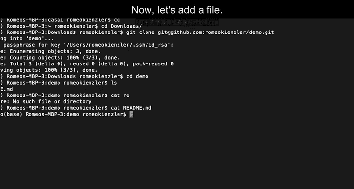

So you see here there's only the read me and do get folder， please never ever touch it okay。

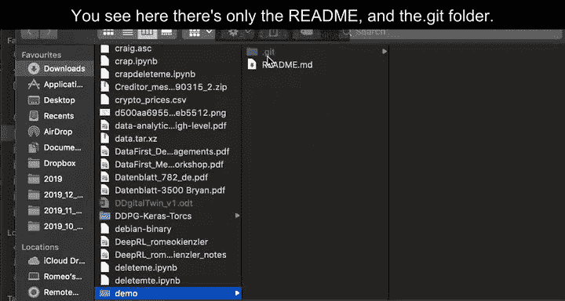

Let's create another file。 Let's say V I test the text。 And hello， this is at。Test。And now。

We add this to the reportport。 So first of all， we say get add test the text。

And now if you say now get status。

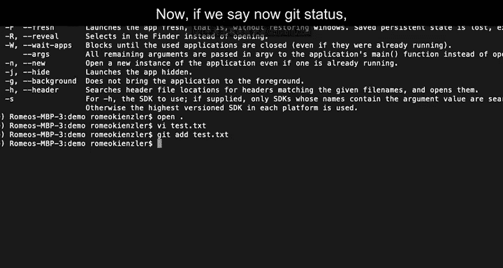

Then we see that this file is now in the so-called staging area okay that's something in between your local folder and your local repository so you have a local folder with the contents you have a local repository and you have a remote repository and you personally you work with your local repository and all the other guys working together with you are working also with their local repositories and do sync all your contents with a remote repository okay so now we want to commit so we say all let's do something else let's say we create a file。

😊。

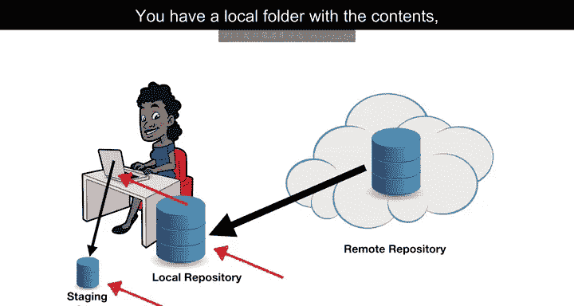

Test2。And。Let will take it at。Test to the text。 Now， interestingly， if we now say get status。

 those are both in the staging area and now if we say get commit。

And we say a message message initial share commit。thatThat is now in our local repository on this machine okay and the idea is why you have the staging area you can control which files go into a commit because the it's say the atomic entity here and get is is the commit so so everything is around builder on the commit so you can here definitely control which files are going into a signal commit and now what you want to do is you want to push the contents of your local repository to the remote repository because if you know go to this here so this。

😊。

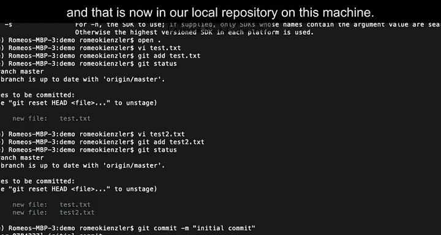

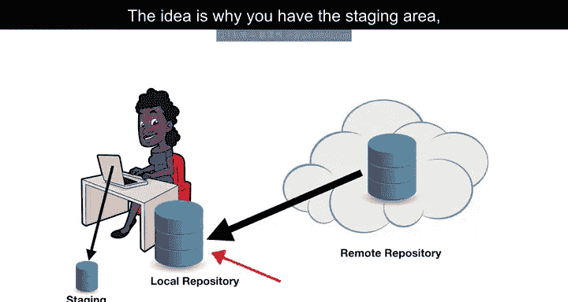

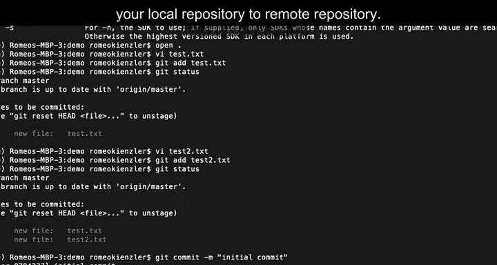

GitHub project to see there there is。

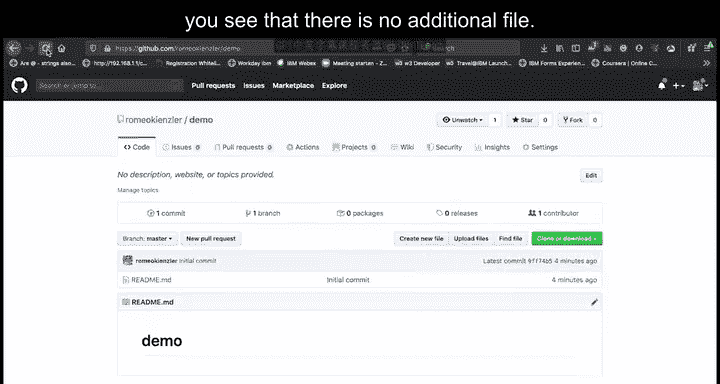

No additional file， okay， so we say now kit push。And。

What now happens is I again have to provide a password。

 I don't have the key manager at the key agent。

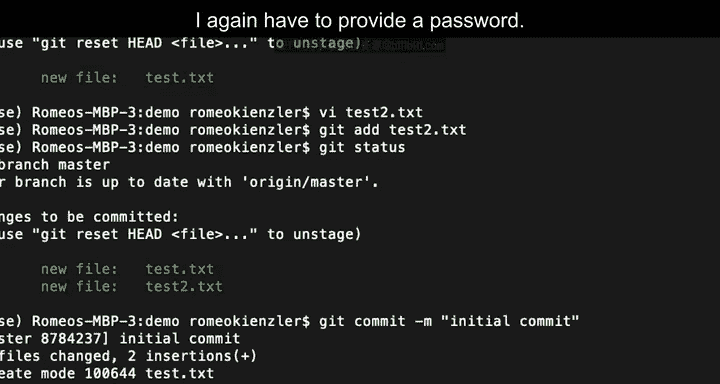

Running， so now you see here we have committed this local change in the local repository to the remote repository。

😊。

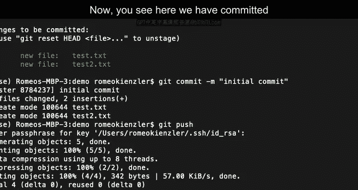

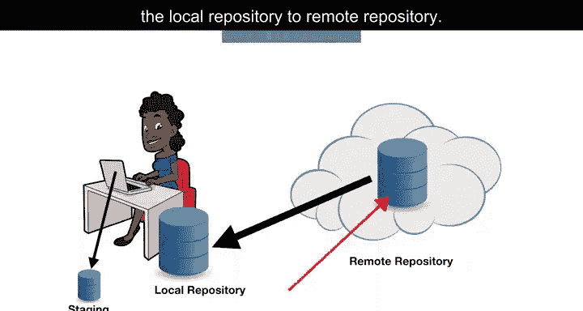

And now you can see that you have these two files here and if you click on that file you see first of all the content and also you see here which commit was responsible for adding this file okay。

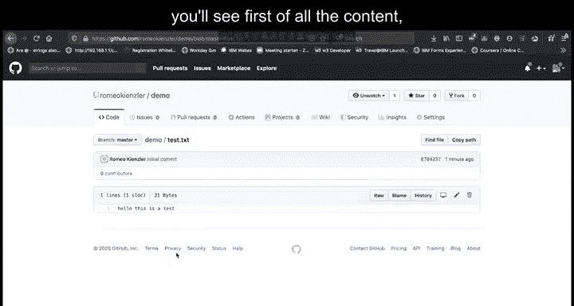

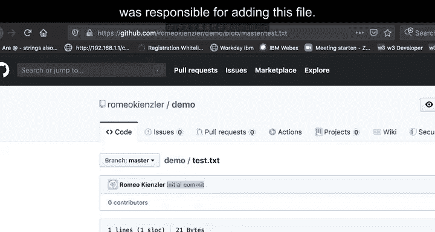

Another interesting thing is if you are starting from scratch。

 you can actually also do the following。 Okay， now let's delete this。😊。

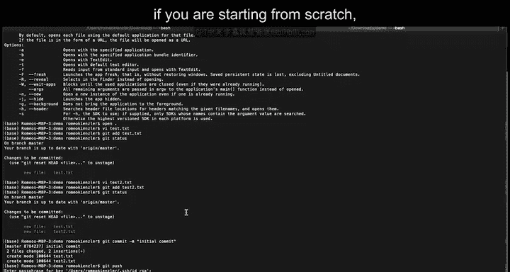

Pro checked。And this is a bit hard just to make sure you don't do that accidentally。

 so to need this repository and you have to say demo here， oh no， I think you have to。

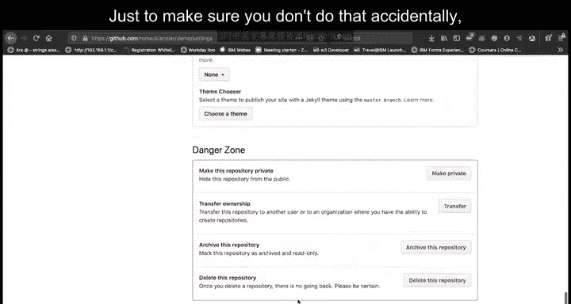

Tpe the hold thing here， so now this project is still needed。

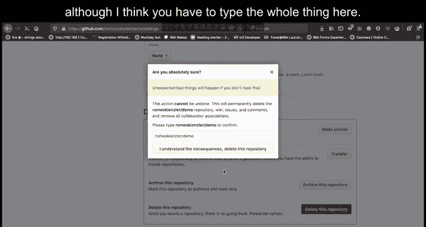

Okay， so now let's do something else， let's create a new repository。

 but now let's enter the repository on my machine， let's call it demo again。😊。

We don't initialize it with readme， we say create repository。😊。

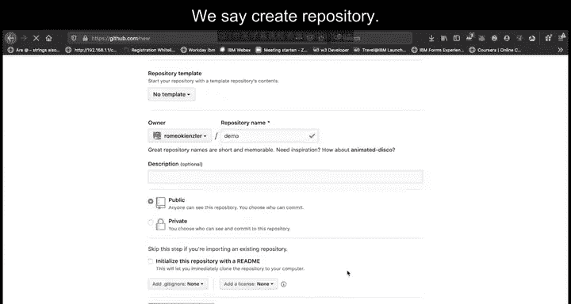

And if you are lucky， Github will show us how to do it， higher here。Okay， let's actually。With our。

 so let's get rid of the demo folder。And let's create it again。

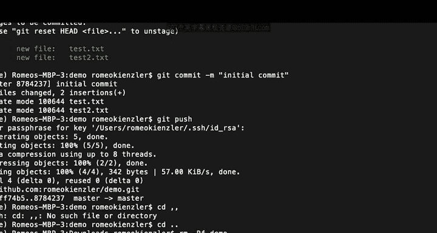

And now do what they tell us。 So we create read me。And let me take it in it。So， now we have it。

Iitialized because now we have the dot gi folder， which you never ever should touch。

 And now we say get at read me， but we can also say gi at dot。 So it's adding。😊。

Everything which was in our folder。 So it's only the readme dot M。

 and then we selected commit as usual。😊，UT or whatever。And now you can't say get push now， okay。

 if we say get push。

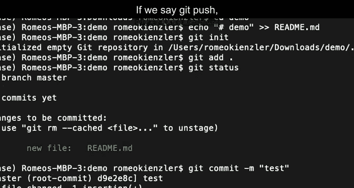

It doesn't know where to push it because actually we haven't told this local folder that it should connect to remote repository that we do with a kit at remote。

😊，My kids wrote remote at origin。

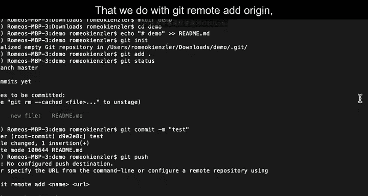

And that's the URL of our project。And then we can say it push U origin master。

And that's basically so we have to。Rereate。Sorry， we entered a passport for my RSA key and if we are lucky and everything worked fine。

 we can now go to the project and we should see the readme file， which is the case。 Okay。

 that's it for now That's the first part in the next video I will show you how to do branches and actually also how to create a pull request。

 Okay， thanks for watching and see you later。😊。

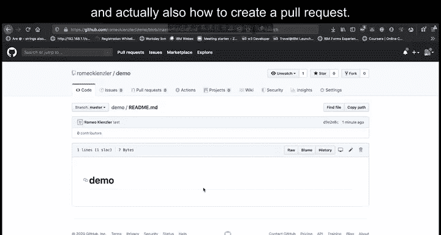