# IBM数据科学专业证书课程2：《数据科学工具》open-source-tools-for-data-science（中英字幕） - P28：27_命令行分支与合并（选修）.zh_en - GPT中英字幕课程资源 - BV1np4y1V7Sn

Yeah。Welcome back to the second part of my little Github for。😊。

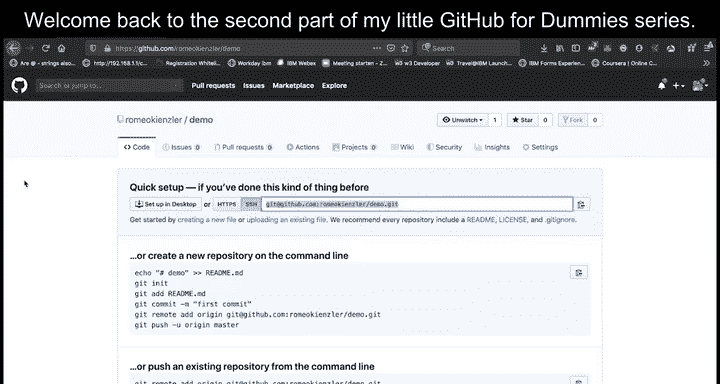

Dummies。Seerries， one thing I forgot in the last video is how to sync if someone else has made a change。

 Okay， so let's consider this repository here。 We have nothing inside。

 So this is actually the remote repository here on Github。 So we will again， create。😊。

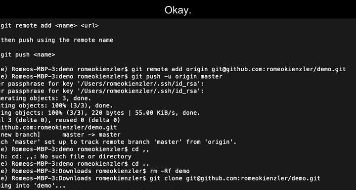

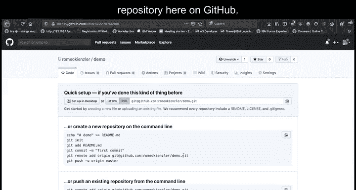

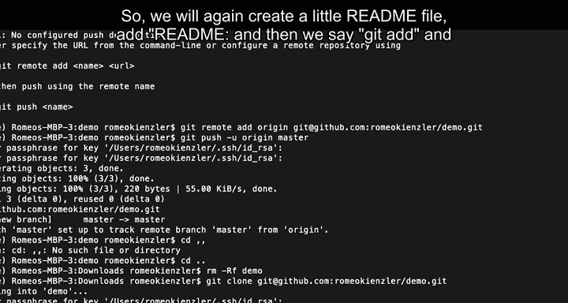

And。A little readme file。 We add read me， and we take it at。

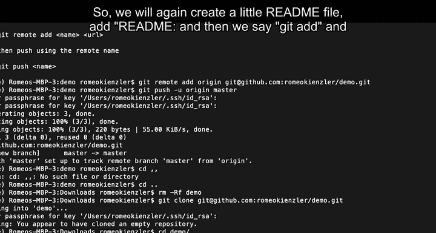

And then we say， good commit。

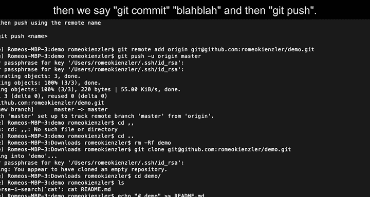

Lala， b blah， and then get push。Okay， so。So then we have the readme file here。

 and now let's create a new file in the remote repository。😊。

That's something which will happen also if someone else pushes something to that repository。

 you will see a new file， a new file。😊，哎。And this is now only in the remote repository and not in my local。

 you see here， there is only the readmi， not the。The new file。 So to obtain this new file。

 you say just get a pull。

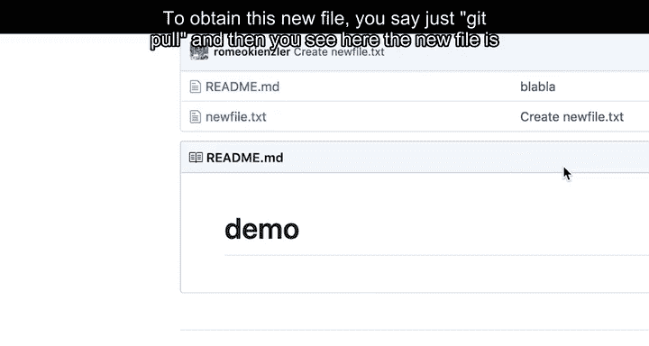

And then you see here。The new fight is also here。 yeah， that's basically。and then interestingly。

 let's say you are for example， working on a huge subpro in that repository and you don't want to interfere with the main work going on so the main work is basically called a branch which is master and you can create your own branch so you can say get。

😊。

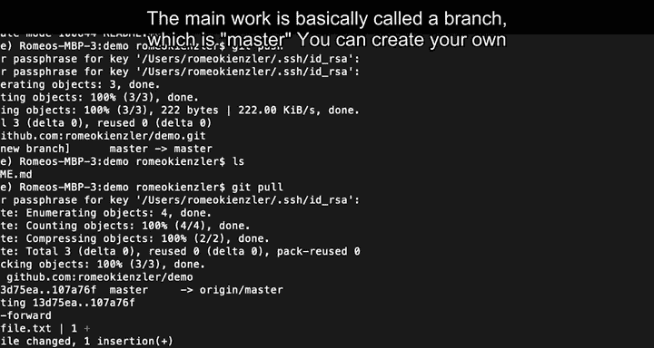

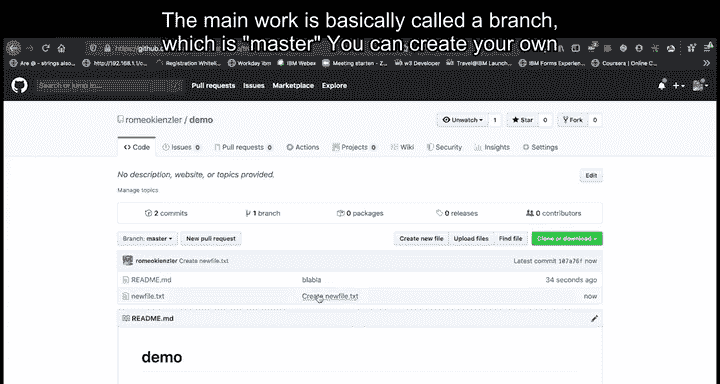

Branch， my branch， for example。

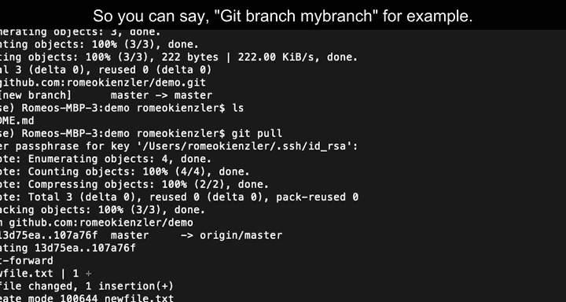

So and then we still， if you say it status。

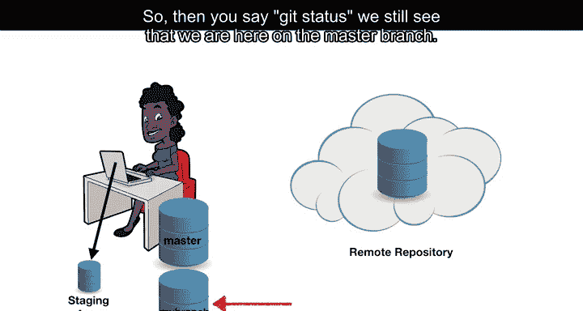

We still see that we are here under master branch now we say kit。😊，Check out my branch。

And now see we are switched to my branch and now we say kit status。

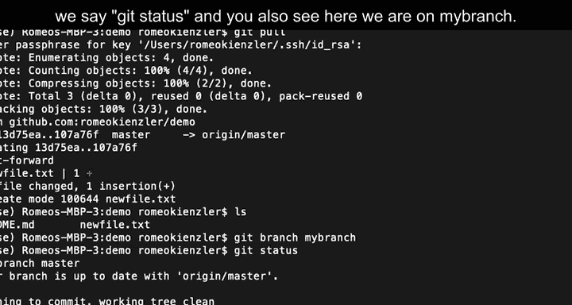

You also see here we are on my branch。 Okay now what what I do is we say here we have those two files and then we say。

😊，Stuff on branch here， and we say。

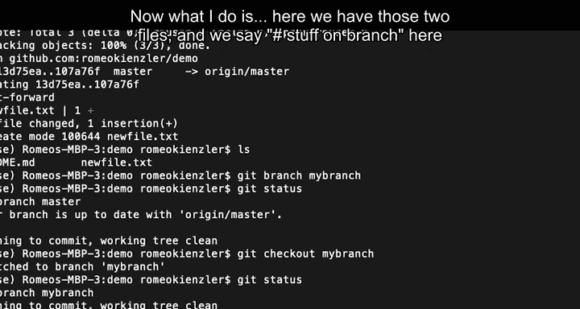

Sttauff on branch or text。 So get add stuff on branch， get commit。🤢。

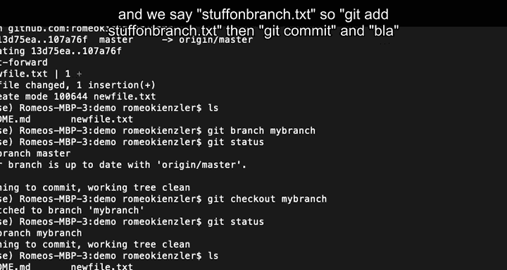

Bh and it push。I， we have to。放首。Create this branch remotely。So and now we push it to a remote branch。

So。

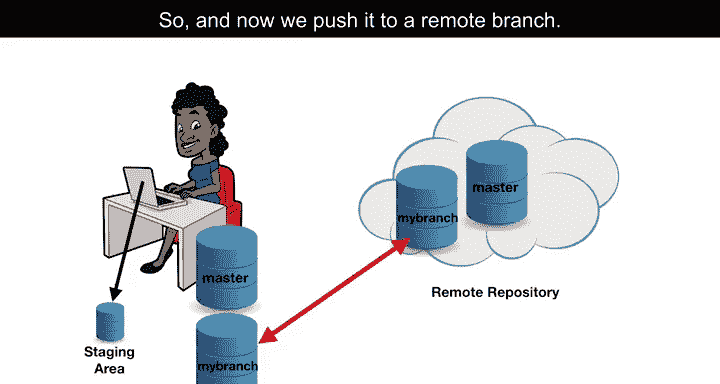

Now we can actually see that my branch has been created here。

 and you see here that file stuff on branch， which is。😊。

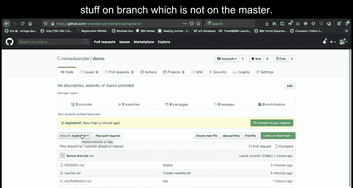

Not on the master okay， so so what we do now here is we switch back to the main branch。

 so let's get check out master and then we say kit merge my branch。😊。

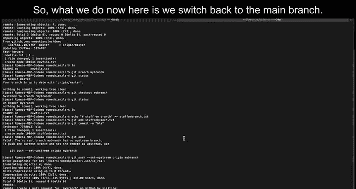

So this has been automatically merged， so you see here we have stuff on branch also in my local folder here。

😊。

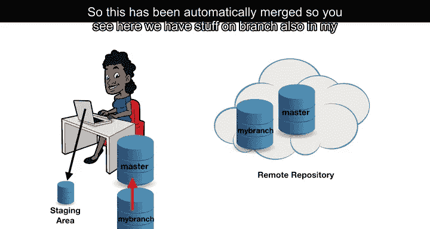

But we see here it's still not in the master。 Okay， that means we say get push。

So and if you now refresh。You see stuff on branch， so what happened here is we have merged from the local branch repository into the local。

😊，Master repository and now we push the contents of the local master repository to the remote master repository and that way we merged the branch back into the master branch。

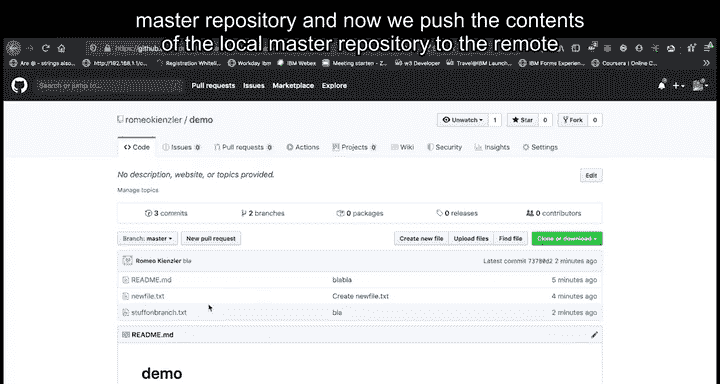

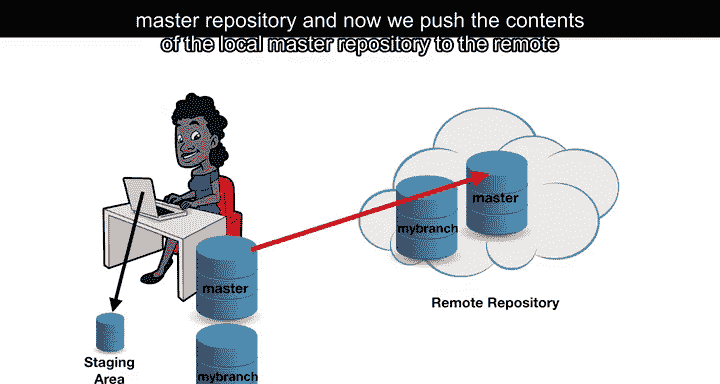

Okay， so thats that's all for now here and in the next video I will show you how to actually create pull requests and contribute to foreign repositories Okay。

 thanks for watching and see you in a second。😊。

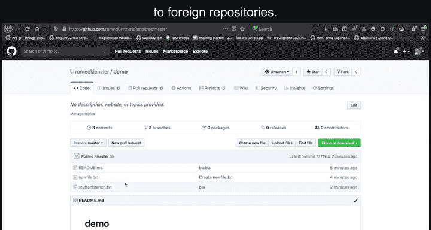