# IBM数据科学专业证书课程2：《数据科学工具》open-source-tools-for-data-science（中英字幕） - P29：28_通过Pull Request参与协作（选修）.zh_en - GPT中英字幕课程资源 - BV1np4y1V7Sn

Okay so this is the last video now on the series kit for dummies so I just want to show you how to fork repository on Gitthub how to commit to the fork repository and how to create a pull request okay so let's consider you want to contribute to the very best and most important Gitthub repository on the planet。

 this is the Cosera repository in the IBM organization which I'm maintaining。😊。

And let's assume you have found an error in one of those software components。

 I mean it's impossible that there is an error but just consider there as an error and you want to fix it So what we can actually do is。

😊。

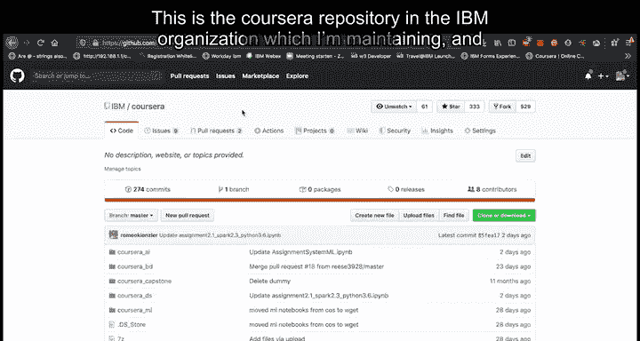

You can either ask me to give you commit rights to that repository。

 but it's better if you just create a fork of this repository。😊。

And then commit to your repository to your fork and create a pull request so let me show you how that works So you see here 529 other folks already fork this repository by the way just give me a star if you like。

😊，I want to have thousand stars soon here you can click on on fork。😊。

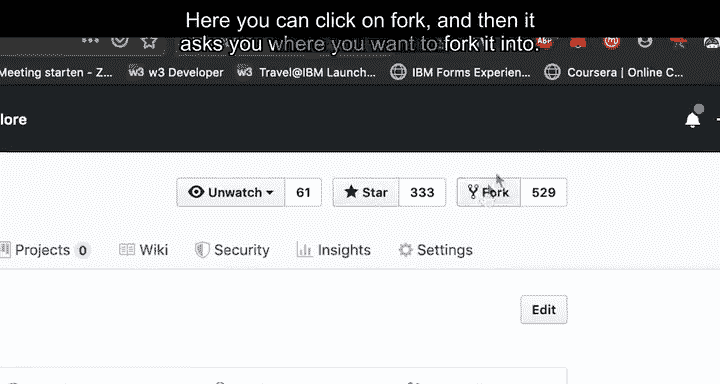

And then it asks you where you want to fork it into。

 so this is in the IBM organization and I'm now forking it into my private。Account。

And that means I will have a Cora repository in my。

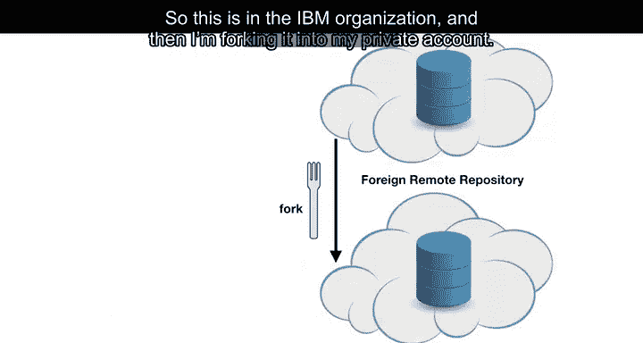

Coun here and you see here even it's showing me forked from IBM Cora。 Okay。

 now I can change something。 I can either make change directly in here。😊。

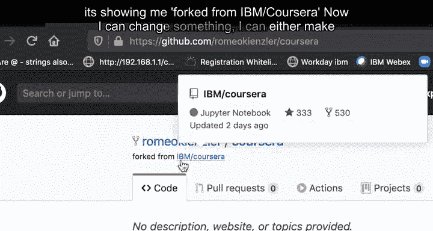

But to make it a bit more complicated。Let's actually make the changes locally。So I clone it。😔，Alway。

Shouldn't forget to show you how to add your RS A public key to the Github。Report。

 but try to Gi up a system， but I'll do it later， so I'm now cloning this Cora repository。

This remote repository into my local repository， and you see here again。

 it's in the Romeo Kinsler account， which is basically a copy。

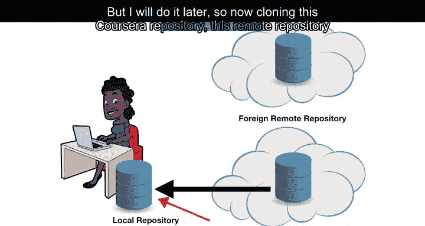

Of the official IBM one。 And I think we have to wait a bit because it's quite huge。I should have。

Maybe set up too little test depositositories， but anyway。That's sweet。For that long。

Yeah while we are waiting， let me show you something else。So。

that's about the SSH keys okay I'm now in the home folder and in your home folder you have the SSH folder and I have already created the key so there's a private key never ever give it to anybody and never ever show it。

😊，诶。The contents to anybody and you create those and you can set a pass phrase for the keys and I will put the commands for creating those into the description of this video and but that's the public key that you can safely give to anybody and share with anybody so I can also do that here so I can show you。

😊。

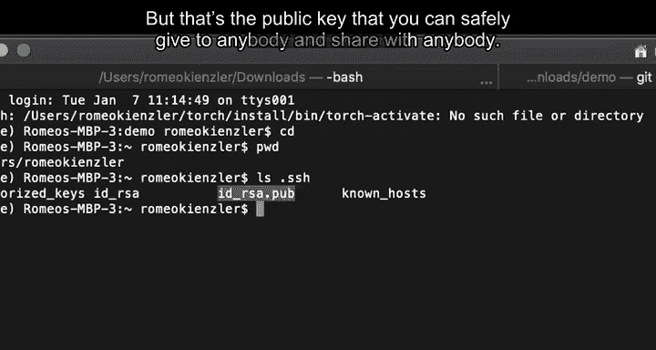

The contents。So see， that's the public key and what I do is。😊，If I go to the Gi page。

 I have to go to I think the account settings。SSH and P GP GP G keys。

 So you see here here you have to add。The key。 So you can say new SSH key。

And you just paste the contents of。The public key and now I'm not doing that because I've already edit it。

 but that's all you need to do in Github And from now on you can use SSH because only you have the corresponding private key to that public key here therefore you can safely authenticate against the Github okay so you also know this and I'm hoping that in the meanwhile this other yeah the cloning is done so go to Cosera and let's have a look into。

😊。

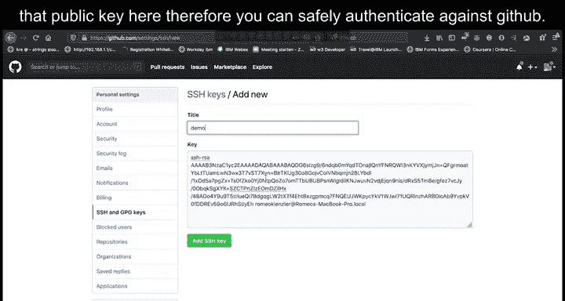

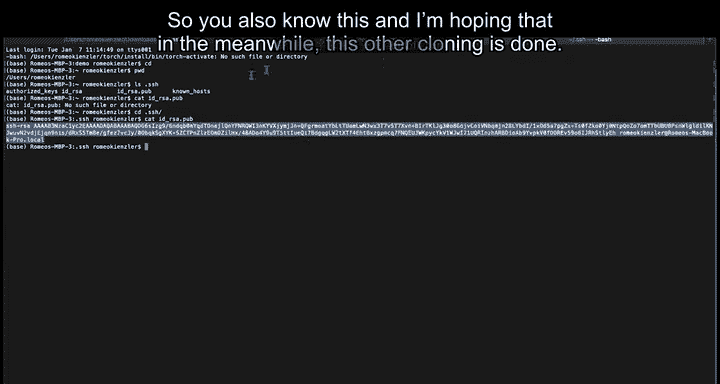

That repository， so we have the readme for example， let's have a look at the readme。

 maybe there is something I can improve on the readme。So。

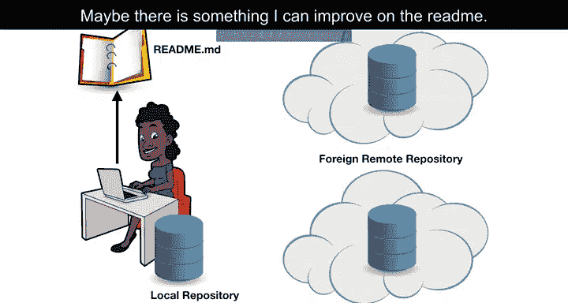

This is the guitar project for the following Cora specialization。

 so let's put Cora into a capital and save。

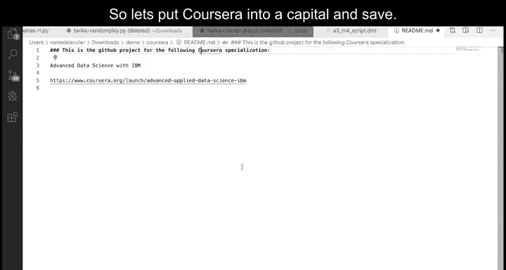

as you remember， I need to say get at。😊，And then if I say get status， the readme file is modified。

 okay， I say okay get commit and I say now message， it's important since this is a re repository。

 I cannot just write a correct message correct little typo。😊，And now， I take it。

Push okay so now the corrected readme is in my local repository and in a remote repository。

 but only in my private account， okay， if I go to this repository here。

 So in my private account then if I click on readme So first of all， you see here 21 seconds ago。

 it has been changed to see here the commit message corrected the the typo and if I click on the readme。

 you see here the C is now capital case。 okay now I want to get this change back into the official repository IBM slash Cosera。

 and you see here there's a contributor So she also committed some stuff via a pull request into the main repository Okay so it it's straightforward you can create a pull request easily here。

😊。

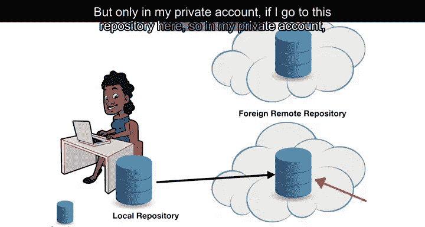

On that button and then the difference between my repository and the official repository is just used and you see here the only difference is here the little typo。

😊。

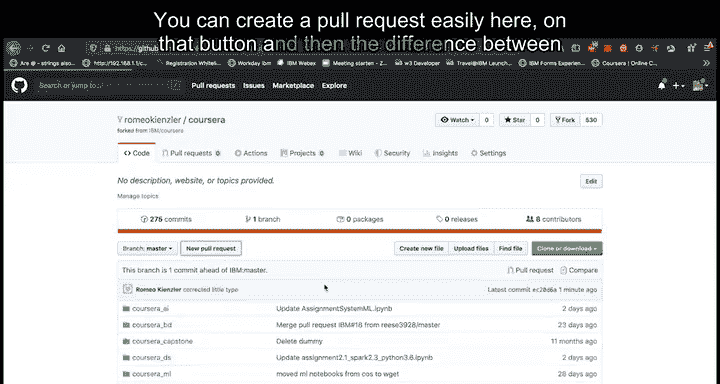

Coorrrrection， I say create pull request。 Okay， So that's something I'm doing as a potential contributor。

 I say create pull request。 Okay， so now。😊，I am myself， as Im administrator of the IBM repository。

 I will get an email and。😊。

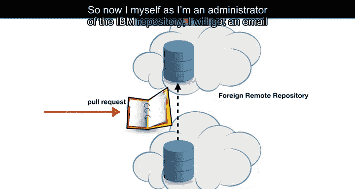

You see here Im already forwarded so let's consider I'm not Romeo I'm somebody else the administrator of the repository and here I see theres a pull request coming in and I will review it so I see okay cool someone fix the little typo in my repository thats something I can definitely accept so I say a mech pull request confirm merch。

😊，And usually what I can say is。Nched。Thanks a lot also， okay。

You have to be polite to your contributors。Now here I'm in the Cosera repository and if you now click on read me。

😊，You see here there's a capital case and that's basically how it works now here you see the commit and the commit message。

😊，And that's basically all So I hope this helped you a bit。

 So with that knowledge you will survive around 80% of your Gi and Github problems in work if you have specific questions feel free to ask me in the discussion forum or in the comments below the video and thanks for watching and have a nice stay by Thank you very much。

😊。

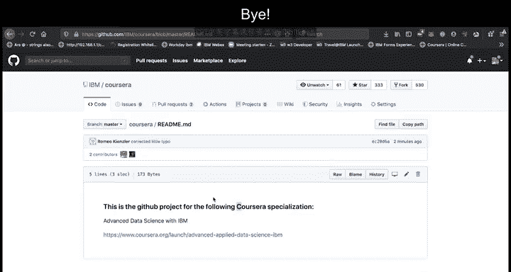