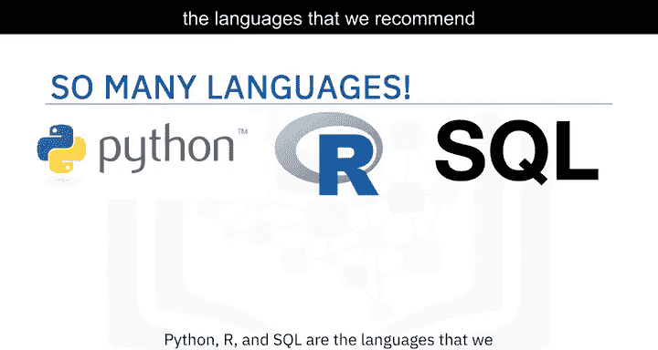
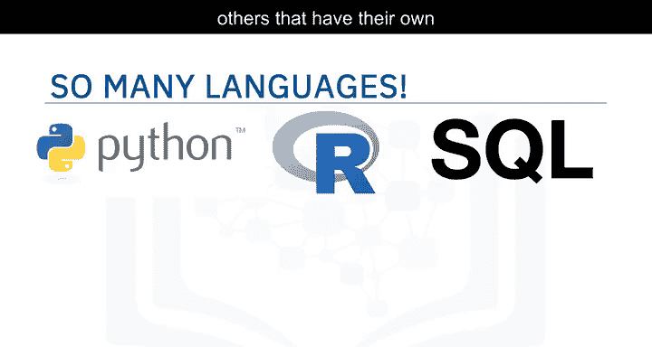
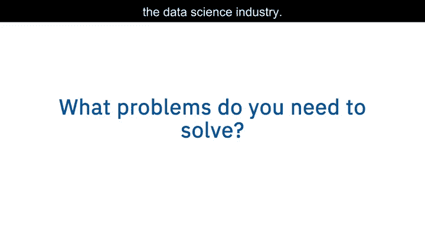
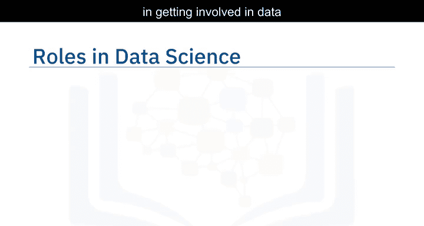
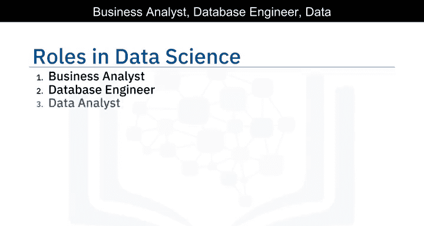
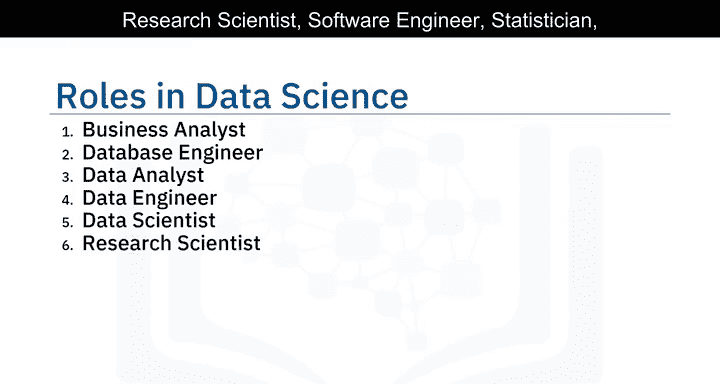
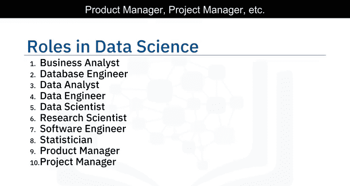
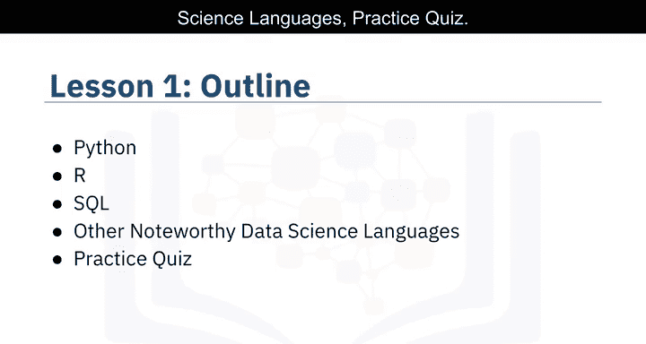

# IBM数据科学专业证书课程2：《数据科学工具》open-source-tools-for-data-science（中英字幕） - P2：1_数据科学语言体系.zh_en - GPT中英字幕课程资源 - BV1np4y1V7Sn

The languages of data science for anyone just getting started on their data science journey。

 the range of technical options can be overwhelming。

 There is a dizzying amount of choices when it comes to programming languages。

 Each has its own strengths and weaknesses， and there is no one right answer to the question of which one you should learn first。

 The answer to that question depends largely on your needs。

 The problems you are trying to solve and who you are solving them for Python R and SQl are the languages that we recommend you consider first and foremost。

 but there are so many others that have their own strengths and features。 Scala， Java。

 C plus plus and Julia are some of the most popular。 Javascript， P P。

 Go Ruby and visual basic all have their own unique use cases as well。

The language you choose to learn will depend on the things you need to accomplish and the problems you need to solve。

 It will also depend on what company you work for， what role you have and the age of your existing application。

 will explore the answers to this question as we dive into the popular languages in the data science industry。

 There are many roles available for people who are interested in getting involved in data science。

 business analyst， Data engineer， Data analyst， data engineer， data scientist， research scientist。

 software engineer， statistician， product manager， project manager， etc ce。

 Let's dive into what we will learn in lesson1。 We will put most of our focus on the top three data science languages。

 Python R and SQl， which each have their own lessons。

 Then we will go on to highlight other noteworthy languages and what makes them special。

 Then we'll finish with a。

z to test Here's what we'll cover Python， R， SQL， other noteworthy data science languages practicequiz。

